<h1>OS2-0 : Applications</h1>

<a href="../README.md">&larr; Retour au README</a>

<h3>Loisirs : Astromancie (APPS/ASTROMAN.PAS) et Onirologie (APPS/REVES.PAS)</h3>

Le dossier <b>Loisirs</b> du bureau contient deux applications portées du dépôt <b>Mystix</b> (Turbo Pascal 7 et Free Pascal, BGI en 640 x 480 x 16 couleurs) vers Presentation Manager : <b>Astromancie</b>, logiciel interactif d'interprétation de l'astrologie (clone graphique du logiciel URRIS de 1985), et <b>Onirologie</b>, interprète de rêves. Comme les autres applications, leurs sources sont dans le dossier <b>APPS</b> du dépôt, chacune en un seul fichier (moteur, textes d'interprétation, dictionnaire et interface). Le moteur d'origine est conservé tel quel ; ce qui change pour OS/2 :

<table>
	<tr><th>Élément</th><th>OS/2-0</th></tr>
	<tr><td>Fenêtre</td><td>Fenêtre de Presentation Manager : barre de titre (nom de la personne, titre du rêve), menu système, barre de menus d'OS/2 construite à partir des tables de menus d'origine dans la langue choisie (F10, Alt + lettre, souris ; raccourcis F1 à F9 et Alt+X affichés). La fenêtre tient dans un écran de 640 x 480 (32 lignes de texte par page au lieu de 34).</td></tr>
	<tr><td>Pages</td><td>Pages de texte, éditeur du récit et graphiques sur fond blanc, avec les couleurs d'origine assombries pour rester lisibles ; barre d'information et barre d'état grises ; barre de défilement d'OS/2 (flèches et pages à la souris). La carte du ciel et les pages d'accueil gardent leur ciel étoilé.</td></tr>
	<tr><td>Dialogues</td><td>Boîtes de dialogue, boutons, zones de saisie et listes dans le style d'OS/2 ; les messages et les questions (Oui/Non) passent par <code>WinMessageBox</code>.</td></tr>
	<tr><td>Menus</td><td>Astromancie : les choix qui demandent un thème sont grisés tant qu'aucun horoscope n'est ouvert. Onirologie : Surligner est un choix coché.</td></tr>
</table>

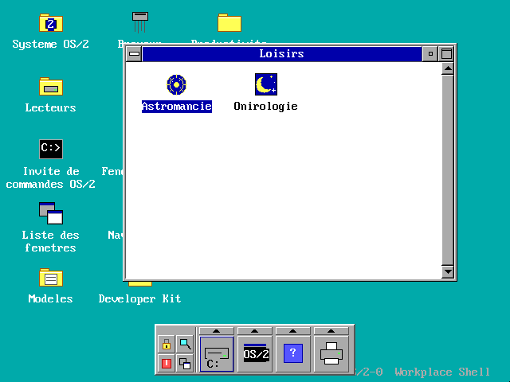

<b>Astromancie</b> (ASTROMAN.EXE) : nouvel horoscope (nom, date et heure de naissance, pays, état, ville : les coordonnées et le décalage horaire sont retrouvés dans l'atlas intégré), calepin des personnes (ASTROMAN.CAL), thème natal (planètes, signes, maisons, mots-clés, planète dominante, ascendant), maisons, carte du ciel (roue du zodiaque, aspects, planètes du jour sur l'anneau extérieur), détail d'une planète ou d'une maison, thème du jour, prévisions, tarot astrologique, comparaison de deux thèmes, exportation de la page (ASTROMAN.TXT), guide ; cinq langues (variable <code>LANGUAGE</code> : FR, EN, DE, ES, IT).

<table>
	<tr>
		<td align="center">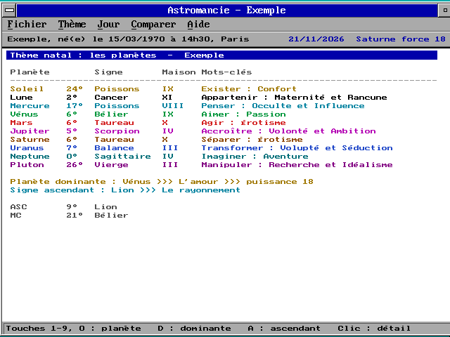 <i>Thème natal (15/03/1970, 14 h 30, Paris)</i></td>
		<td align="center">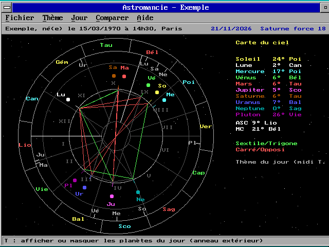 <i>Carte du ciel (F7)</i></td>
	</tr>
</table>

<b>Onirologie</b> (REVES.EXE) : éditeur du récit (accents par Tab, mots-clés surlignés : symboles, émotions positives et négatives), propriétés du rêve (titre, date, rêveur, humeur au réveil, langue du récit, rêve récurrent ou lucide), analyse par un dictionnaire intégré de 442 symboles et 17 831 mots-clés en cinq langues (détection de la langue), sens du rêve, rapport complet, symboles, tonalité et émotions (camembert, jauge, évolution au fil du récit), thèmes et domaines de vie, classification, archétypes, dictionnaire (parcourir, chercher, par catégorie), journal des rêves (REVES.JNL) et ses statistiques, importation et exportation de textes. <code>REVES récit.txt</code> ouvre un récit dans l'éditeur ; le CD-ROM contient l'exemple <b>REVE.TXT</b>.

<table>
	<tr>
		<td align="center">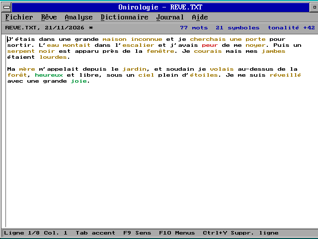 <i>Le récit, mots-clés surlignés</i></td>
		<td align="center">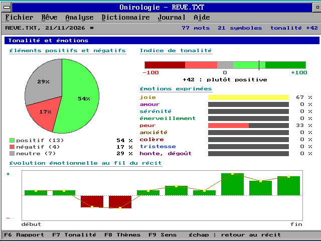 <i>Tonalité et émotions (F7)</i></td>
	</tr>
</table>

La couche d'OS/2 de chaque programme dessine dans une image en mémoire de 640 x 480 (les routines de l'unité Graph utilisées sont réécrites : traits, rectangles, cercles, arcs, secteurs, texte agrandi), montrée dans la fenêtre par <code>GpiDrawBits</code> ; la file de messages de PM alimente la boucle d'origine (touches, clics, choix des menus). Dans OS2PC, chaque élément d'un tableau de <code>String[n]</code> occupe 256 octets : les 17 831 mots-clés et les 3 872 lignes de texte d'Onirologie sont regroupés dans des chaînes de 200 caractères, indexées au démarrage (REVES.EXE passe de 6,7 Mo à 1,7 Mo, sous la limite de 4 Mo de l'image d'un programme). Le portage a été vérifié par les modes texte d'origine : <code>ASTROMAN /TEST</code> (deux thèmes : Paris 1970 et Montréal 1985) et <code>REVES /TEST</code> et <code>/RAPPORT</code> donnent exactement les mêmes lignes que les programmes d'origine compilés par Free Pascal sous Linux. Ce travail a corrigé trois défauts d'OS2PC, valables pour tous les programmes : une fonction qui rend un <code>Single</code> effaçait 8 octets au lieu de 4 en commençant (l'EBP sauvé de l'appelant était remis à zéro) ; un paramètre <code>Integer</code>, <code>Word</code> ou <code>Byte</code> passé par valeur et modifié dans la procédure (<code>A := A + 360</code>) n'était réécrit que sur 2 octets mais relu sur 4 ; <code>Read(F, S)</code> sur un fichier texte lisait toute la ligne au lieu de s'arrêter avant la fin de ligne, comme Turbo Pascal.

<h3>Science : Astronomie, Simulateur de planète, Anatomie 3D, Table des éléments et Dessin de chimie (APPS)</h3>

Le dossier <b>Science</b> du bureau contient cinq applications graphiques portées vers Presentation Manager, chacune en un seul fichier source du dossier <b>APPS</b> du dépôt :

<table>
	<tr><th>Application</th><th>Source</th><th>Dépôt d'origine</th><th>Contenu</th></tr>
	<tr><td>Astronomie</td><td><code>APPS/ASTRO.PAS</code> (ASTRO.EXE)</td><td>Axtro</td><td>Calendriers (jour julien, rang du jour, Pâques et fêtes mobiles, calendriers grégorien, julien, hébreu, maya…), coordonnées (équatoriales, écliptiques, galactiques, horizontales, géographiques), observation (équation du temps, réfraction, cadran solaire), éphémérides (planètes, étoiles doubles, comètes), phénomènes (phases de la Lune, lever, coucher et passage au méridien, satellites de Jupiter, Mars, Saturne, Uranus, Neptune et Pluton, réduction des observations physiques) ; vues graphiques : calendrier lunaire, système solaire, comètes, Voie lactée, catalogue de 92 planètes et exoplanètes, 88 constellations, 1000 étoiles.</td></tr>
	<tr><td>Simulateur de planète</td><td><code>APPS/SIMUPLAN.PAS</code> (SIMUPLAN.EXE)</td><td>Axtro</td><td>Simulation animée du système solaire : démarrer, pause, recommencer, vitesse ; orbites, noms des astres, ceinture d'astéroïdes, étoiles du fond ; système intérieur ou complet, zoom ; fiche des astres de la simulation.</td></tr>
	<tr><td>Anatomie 3D du système circulatoire</td><td><code>APPS/CS3DA.PAS</code> (CS3DA.EXE, avec <code>HUMAN.C3D</code> et <code>PHYSIO.CFG</code>)</td><td>BIOLOGIE-0</td><td>Modèle 3D du corps humain (artères, veines, capillaires, cœur), animation de la circulation, physiologie (fréquence cardiaque, pression, débit…), électrocardiogramme et courbe de pression.</td></tr>
	<tr><td>Table des éléments</td><td><code>APPS/ELEMENTS.PAS</code> (ELEMENTS.EXE)</td><td>QCHIMIE</td><td>Tableau périodique des 118 éléments (F5) ou liste des éléments (F6), fiche de chaque élément (numéro, symbole, masse, groupe, période, catégorie, état), recherche par nom, symbole ou numéro (F3), couleurs des catégories.</td></tr>
	<tr><td>Dessin de chimie</td><td><code>APPS/CHEMDRAW.PAS</code> (CHEMDRAW.EXE)</td><td>QCHIMIE</td><td>Éditeur de structures chimiques (atomes, liaisons, cycles, flèches, texte), importation et exportation SMILES, MOL, InChI, SVG, BMP, analyse (formule brute, masse, RMN, spectre de masse).</td></tr>
</table>

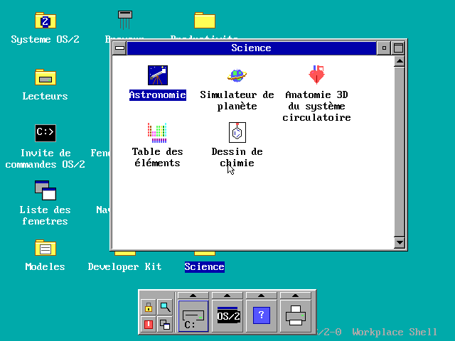

<b>Astronomie</b> utilise au maximum les composants d'OS/2 au lieu de dessiner elle-même ses contrôles, ce qui la rend plus fluide que la version DOS :

<table>
	<tr><th>Élément</th><th>OS/2-0</th></tr>
	<tr><td>Menus</td><td>Barre de menus de PM (Alt + lettre, F10, souris), construite à partir des tables de menus d'origine (le menu Phénomènes, limité à 18 choix dans la version DOS, perdait ses quatre derniers : Réduction Neptune, Réduction Pluton, Constellations et Étoiles ; il en a maintenant 22).</td></tr>
	<tr><td>Saisies</td><td>Boîte de dialogue modale de PM : champ de saisie (<code>WC_ENTRYFIELD</code>, texte proposé sélectionné), boutons <b>OK</b> et <b>Annuler</b> (<code>WC_BUTTON</code>), Entrée et Échap ; la fenêtre principale est désactivée pendant la saisie.</td></tr>
	<tr><td>Messages et questions</td><td><code>WinMessageBox</code> (information, Oui/Non).</td></tr>
	<tr><td>Résultats</td><td>Fenêtre de PM « Résultats » : texte dans la police du système, barres de défilement de PM verticale et horizontale (<code>WC_SCROLLBAR</code>), flèches, Pg préc., Pg suiv., Début, Fin, boutons <b>Enregistrer...</b> (fichier texte) et <b>Fermer</b>.</td></tr>
	<tr><td>Vues graphiques</td><td>Calendrier lunaire, système solaire, comètes, Voie lactée, planètes, constellations et étoiles s'ouvrent chacune dans sa propre fenêtre de PM (barre de titre, menu système) avec de vrais boutons de PM (Mois précédent, &lt; Heure, Jour &gt;&gt;, Fermer…) et, pour les catalogues, une liste de PM avec sa barre de défilement (jusqu'à 1000 étoiles) ; seuls les dessins scientifiques (orbites, figures des constellations, couleur des étoiles) restent dessinés.</td></tr>
	<tr><td>Barre d'outils</td><td>Icônes des sept vues sous la barre de menus (souris).</td></tr>
</table>

<table>
	<tr>
		<td align="center">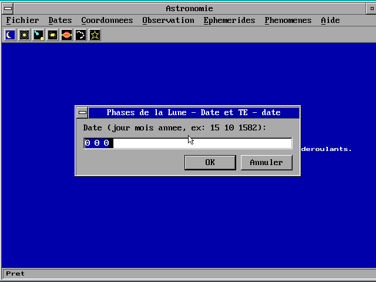 <i>Saisie (Phases de la Lune)</i></td>
		<td align="center">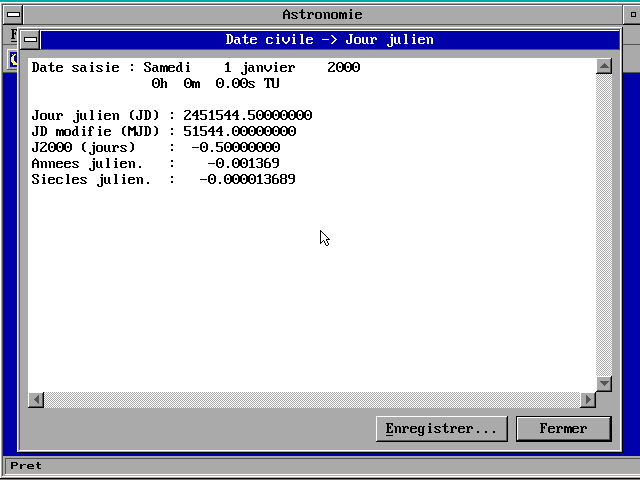 <i>Fenêtre des résultats (date → jour julien)</i></td>
	</tr>
	<tr>
		<td align="center">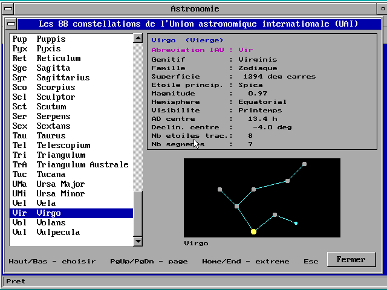 <i>Les 88 constellations (liste de PM)</i></td>
		<td align="center">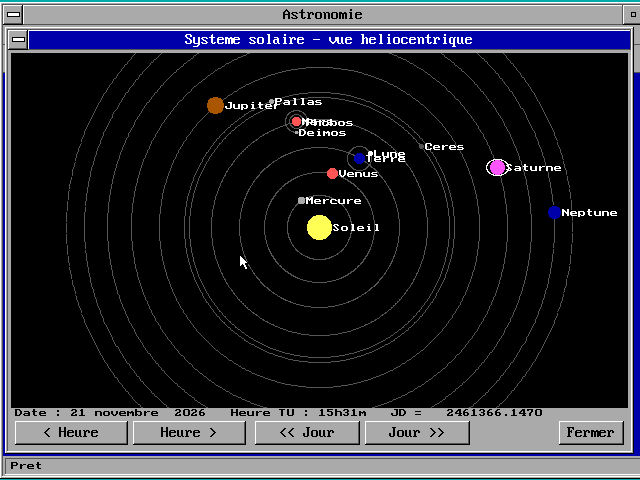 <i>Système solaire (boutons de PM)</i></td>
	</tr>
	<tr>
		<td align="center">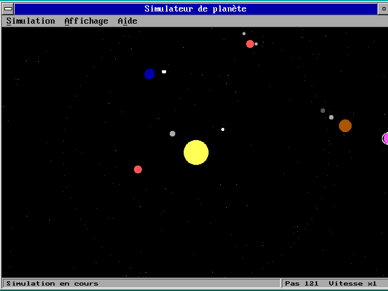 <i>Simulateur de planète</i></td>
		<td align="center">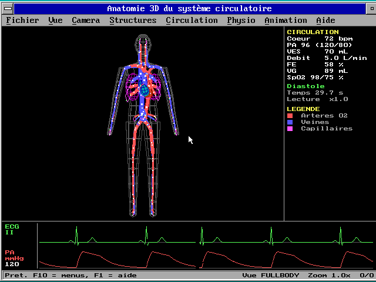 <i>Anatomie 3D du système circulatoire</i></td>
	</tr>
	<tr>
		<td align="center">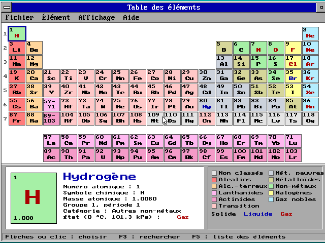 <i>Table des éléments</i></td>
		<td align="center">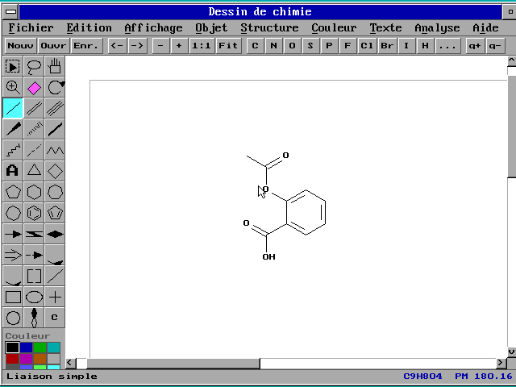 <i>Dessin de chimie (aspirine importée en SMILES)</i></td>
	</tr>
</table>

Les cinq programmes partagent une couche d'OS/2 qui remplace l'unité Graph du BGI, Crt et la souris : le dessin va dans une image en mémoire de 640 x 480 en 256 couleurs (palette d'origine et couleurs supplémentaires), montrée par <code>GpiDrawBits</code> et figée pendant qu'un menu ou une autre fenêtre est au premier plan ; la file de messages de PM alimente les boucles d'origine (touches, clics, choix des menus). La barre de menus dessinée par chaque programme est remplacée par celle de PM. Les saisies et les messages de l'Anatomie 3D, de la Table des éléments et du Dessin de chimie passent aussi par les boîtes de dialogue de PM. L'Anatomie 3D lit son modèle <code>HUMAN.C3D</code> et sa physiologie <code>PHYSIO.CFG</code> à côté de son programme ; ils sont copiés sur le CD-ROM et installés avec elle.

Ce travail a corrigé un défaut d'<b>OS2PC</b>, valable pour tous les programmes : une constante réelle déclarée dans une procédure (<code>Const G = 0.01720209895;</code>) était écrite en données sur 8 octets (Double) mais relue selon le type de son littéral (Extended, 10 octets, ou Single) : elle valait NaN ou 0 (la vue des comètes d'Astronomie bouclait sans fin). Elle est maintenant écrite dans le type de son littéral. Une sous-routine locale d'Astronomie qui déclarait un tableau de 1000 étoiles (100 Ko) sur la pile est passée sur le tas.

<h3>Productivité : Maximilien CRM, Sample Accounting, Acrodoc, News Master et PresentPoint (APPS)</h3>

Le dossier <b>Productivité</b> du bureau reçoit cinq applications du dépôt <b>OFFICE-0</b>, portées vers Presentation Manager avec l'apparence d'OS/2 et ses menus, chacune en un seul fichier source du dossier <b>APPS</b> :

<table>
	<tr><th>Application</th><th>Source</th><th>Contenu</th><th>Composants d'OS/2</th></tr>
	<tr><td>Maximilien CRM</td><td><code>APPS/MAXIMIZE.PAS</code> (MAXIMIZE.EXE)</td><td>Gestion des relations clients (clone de Maximizer CRM) : moteur MyISAM (.frm, .MYD, .MYI) et SQL intégrés, carnet d'adresses, contacts, notes, journée de travail, opportunités, hotlist, calendrier, courriels, bibliothèque de documents, commandes (OrderDesk), plans d'action, publipostage, rapports, console SQL ; accueil (exemple, nouveau CRM vide, CRM existant).</td><td>Barre de menus de PM (neuf menus, coches), menu contextuel de PM (clic droit, F9) avec ses sous-menus et ses choix grisés, fiches de PM (étiquettes, champs de saisie, cases à cocher, boutons de liste, barre de défilement, Tab et Maj+Tab, F2, F4), listes de PM, visionneuse de rapports avec barres de défilement de PM, boîtes de message et de saisie de PM ; tables, éditeur de texte, chronomètre et À propos dans des fenêtres de PM à part avec de vrais boutons ; boutons de PM sur l'écran d'accueil ; titre de la fenêtre = nom du CRM ouvert.</td></tr>
	<tr><td>Sample Accounting</td><td><code>APPS/SIMPLY.PAS</code> (SIMPLY.EXE)</td><td>Comptabilité (clone de Simply Accounting) : grand livre, comptes, fournisseurs, clients, paie, inventaire, projets, transactions, conciliation, rapports (bilan, état des résultats, journaux), graphiques.</td><td>Barre de menus de PM (neuf menus), fenêtres de la version DOS refaites en contrôles de PM (champs, cases, listes déroulantes, boutons, onglets), boîtes de message de PM.</td></tr>
	<tr><td>Acrodoc</td><td><code>APPS/ACROBAT.PAS</code> (ACROBAT.EXE)</td><td>Visionneuse et éditeur PDF (clone d'Acrobat) : filtres Flate, ASCIIHex, ASCII85, polices, images JPEG, JPEG 2000, JBIG2, CCITT, dégradés, calques ; commentaires (texte, note, surlignage, crayon, formes, tampon, signature, biffure), pages (insertion, rotation, recadrage, filigrane, numérotation), recherche, vignettes, enregistrement incrémental, exportation en texte et en BMP.</td><td>Barre de menus de PM (six menus, coches et choix grisés), rendu dans une image de 256 couleurs (cube 6 x 6 x 6 et gris), formulaires de PM (champs, listes déroulantes, cases à cocher, échantillons de couleur), boîte de fichiers de PM, boîtes de message de PM ; sélecteur de couleurs et boîtes d'information (À propos avec son illustration) dans des fenêtres de PM à part.</td></tr>
	<tr><td>News Master</td><td><code>APPS/NEWS.PAS</code> (NEWS.EXE)</td><td>Mise en page de journaux (clone de NewsMaster) : pages, colonnes, titres, textes, images, polices, impression.</td><td>Barre de menus de PM, menu principal et boîtes de la version DOS en boîtes de PM (boutons, saisies), boîte de fichiers de PM.</td></tr>
	<tr><td>PresentPoint</td><td><code>APPS/POWERPNT.PAS</code> (POWERPNT.EXE)</td><td>Présentations (clone de PowerPoint) : diapositives, texte, formes vectorielles, thèmes, transitions, animations, diaporama, mode plan.</td><td>Barre de menus de PM sur deux lignes (dix menus), boîte de fichiers de PM, boîtes de message et de saisie de PM.</td></tr>
</table>

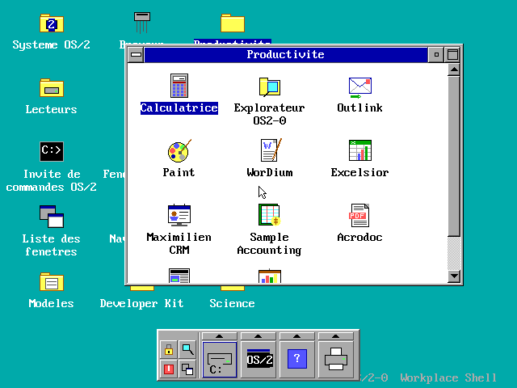

<table>
	<tr>
		<td align="center">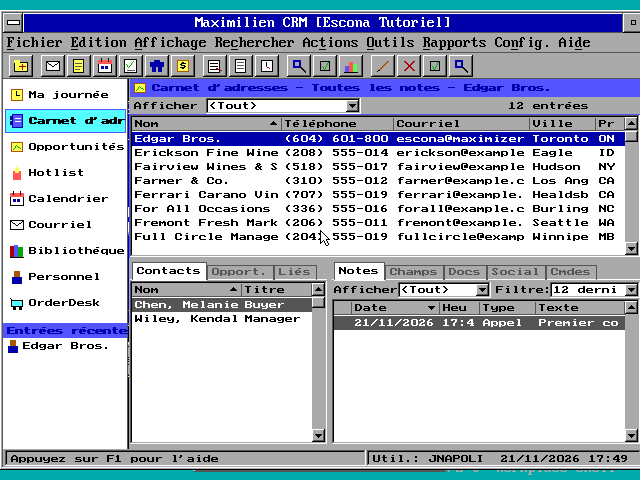 <i>Maximilien CRM : carnet d'adresses</i></td>
		<td align="center">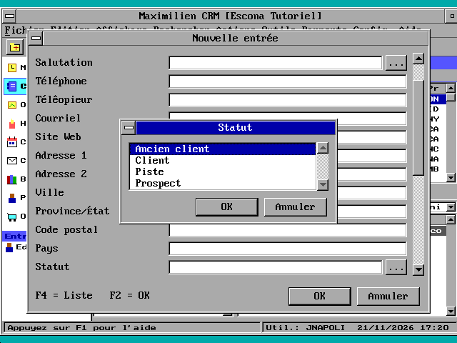 <i>Fiche de PM (liste F4 « Statut »)</i></td>
	</tr>
	<tr>
		<td align="center">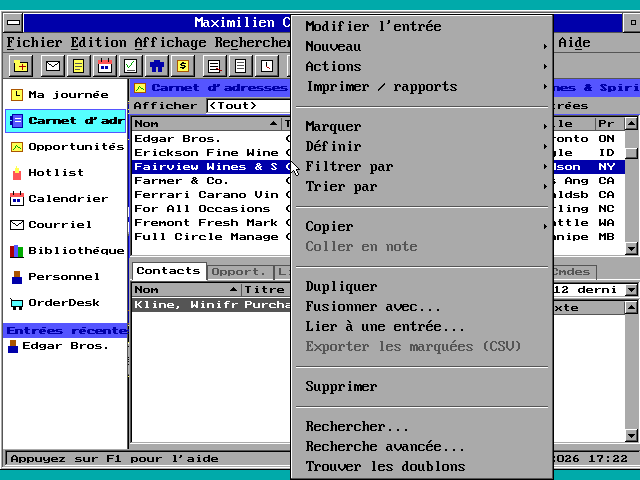 <i>Menu contextuel de PM (clic droit)</i></td>
		<td align="center">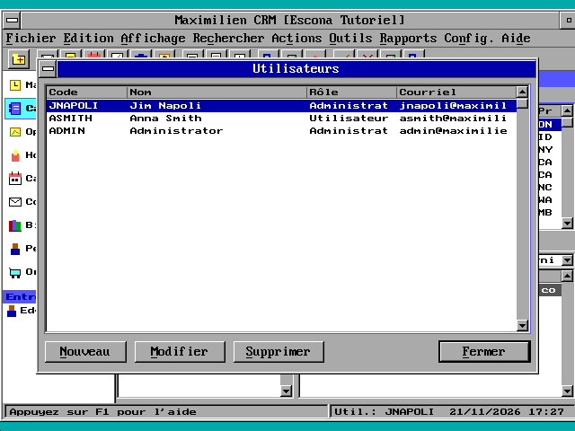 <i>Table des utilisateurs dans sa fenêtre de PM</i></td>
	</tr>
	<tr>
		<td align="center">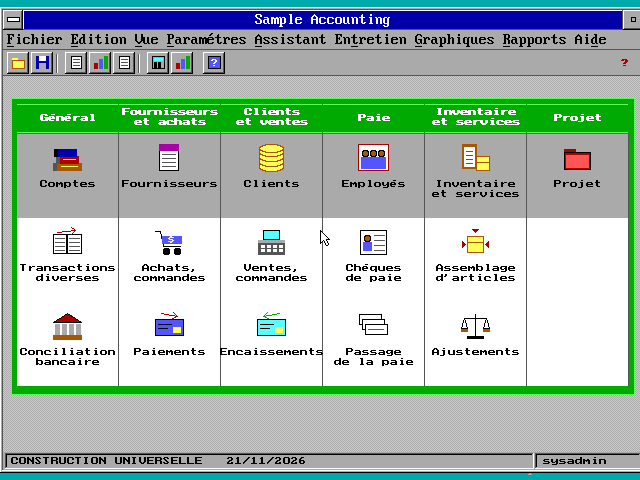 <i>Sample Accounting</i></td>
		<td align="center">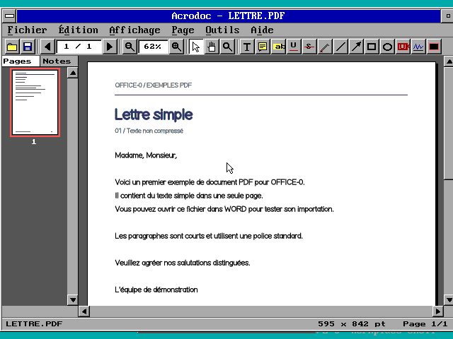 <i>Acrodoc : LETTRE.PDF</i></td>
	</tr>
	<tr>
		<td align="center">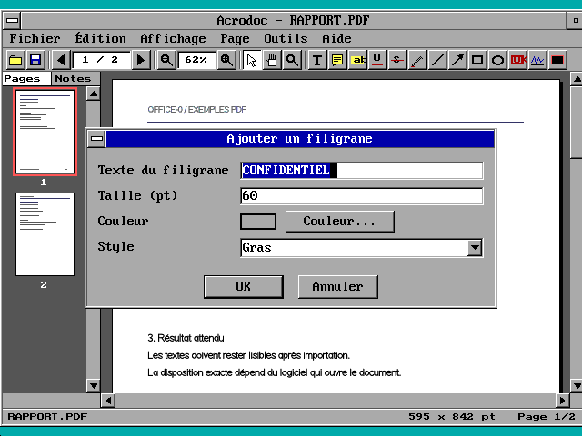 <i>Acrodoc : formulaire de PM (filigrane)</i></td>
		<td align="center">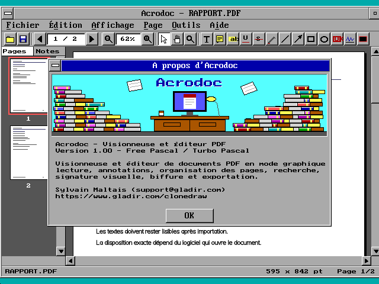 <i>Acrodoc : À propos</i></td>
	</tr>
	<tr>
		<td align="center">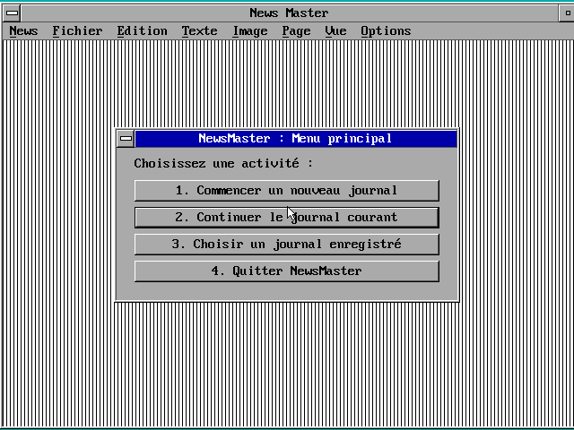 <i>News Master : menu principal</i></td>
		<td align="center">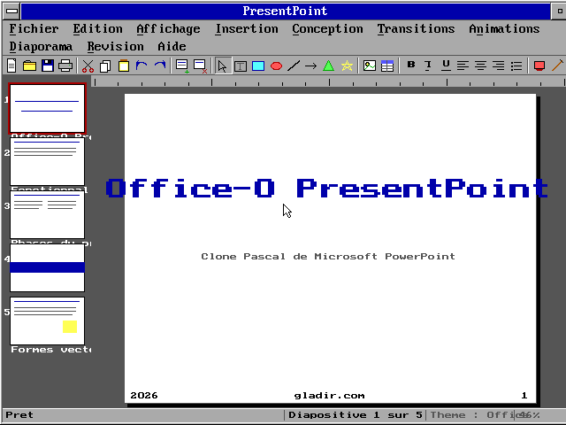 <i>PresentPoint</i></td>
	</tr>
</table>

Les cinq programmes partagent la couche d'OS/2 du dossier Science (unité Graph, Crt et souris sur la file de messages de PM, image en mémoire montrée par <code>GpiDrawBits</code>) ; la barre de titre et la barre de menus qu'ils dessinaient sont celles d'OS/2. Les fenêtres de PM communes (boucle modale qui garde sa boîte, vue dessinée dans une fenêtre de PM à part dont les boutons sont de vrais boutons de PM transmis au bouton dessiné, l'image d'avant revenant dans la fenêtre principale à la fermeture) servent à Maximilien CRM et à Acrodoc. <b>PMWIN</b> resserre l'espacement des titres d'une barre de menus qui ne tient pas sur une ligne, puis la répartit sur plusieurs lignes (Sample Accounting, PresentPoint) ; <code>WinCalcFrameRect</code> en tient compte.

Ce travail a corrigé deux défauts d'<b>OS2PC</b>, valables pour tous les programmes : <code>FillChar(X, N, ' ')</code> remplissait avec l'octet de poids faible de l'adresse de la chaîne <code>' '</code> au lieu du code du caractère (les champs vides des fiches de Maximilien CRM contenaient des <code>ÿ</code>) ; <code>With F(I)^ Do</code>, où <code>F</code> est une fonction qui rend un pointeur, n'était pas reconnu et les champs étaient pris pour des variables globales (Acrodoc l'emploie 29 fois). Le <code>FindNext</code> d'Acrodoc (recherche du texte suivant), du même nom que <code>FindNext(SR)</code> de l'unité DOS, est renommé.

<h3>Bloc-notes (APPS/NOTEPAD.PAS)</h3>

Le dossier <b>Productivité</b> a maintenant un <b>Bloc-notes</b> (NOTEPAD.EXE, avant Maximilien CRM) : celui de Pasdows 95, une application intégrée au noyau de Pasdows (<code>KERNEL/VMM32.PAS</code>), porté vers l'API d'OS/2 et compilé par OS2PC en un seul fichier source, <code>APPS/NOTEPAD.PAS</code>. Les fenêtres internes, la barre de menus, les boîtes Ouvrir, Enregistrer sous et Rechercher dessinées, le presse-papiers et les boîtes de message du noyau de Pasdows sont remplacés par les composants de Presentation Manager :

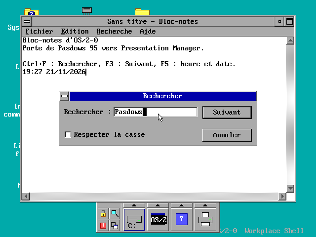

<table>
	<tr><th>Élément</th><th>Pasdows 95</th><th>OS/2-0 (Presentation Manager)</th></tr>
	<tr><td>Fenêtre</td><td>Fenêtre interne du noyau</td><td>WinCreateStdWindow : titre, menu système, réduction, agrandissement, liste des fenêtres, bordure de taille, barres de défilement de PM (verticale et horizontale)</td></tr>
	<tr><td>Menus</td><td>Barre de menus dessinée</td><td>Gabarit de menu et WinCreateMenu : Fichier, Édition, Recherche, Aide ; mnémoniques, raccourcis, choix grisés à l'ouverture du menu (WM_INITMENU)</td></tr>
	<tr><td>Ouvrir, Enregistrer sous</td><td>Boîtes dessinées</td><td>Boîte de PM : champ du nom (WC_ENTRYFIELD), répertoire, liste des répertoires et des fichiers (WC_LISTBOX, DosFindFirst), masque, boutons</td></tr>
	<tr><td>Rechercher</td><td>Boîte dessinée</td><td>Boîte de PM : champ de saisie, case Respecter la casse, boutons Suivant et Annuler ; F3 cherche encore</td></tr>
	<tr><td>Presse-papiers, messages</td><td>Du noyau de Pasdows</td><td>Presse-papiers de PM (CF_TEXT) ; WinMessageBox (À propos, « Voulez-vous enregistrer les modifications ? » avec Oui, Non et Annuler)</td></tr>
	<tr><td>Fichiers</td><td>API du noyau</td><td>DosOpen, DosRead, DosWrite (CR LF ; LF seul et Ctrl+Z acceptés à la lecture)</td></tr>
</table>

Texte jusqu'à 256 Ko, sélection à la souris ou avec Maj et les flèches, Annuler (un second Annuler rétablit), Couper, Copier, Coller, Supprimer, Sélectionner tout, Heure/Date (F5), Rechercher (Ctrl+F) et Suivant (F3). Le bureau ouvre les fichiers .TXT, .INI, .LOG, .PAS, .CFG et .SYS avec le Bloc-notes (icône de bloc à spirale), et <code>NOTEPAD fichier</code> l'ouvre depuis l'invite de commandes. Ce travail a corrigé la constante <code>MB_YESNOCANCEL</code> (5 ; la valeur 3 donnait Abandonner, Réessayer, Ignorer) dans le Bloc-notes, Lecteur MP3, Pascal Developer, Audio numérique, Maximilien CRM, Sample Accounting et Acrodoc.

<h3>Calculatrice (CALC.PAS)</h3>

OS/2 Warp 3 n'avait pas de calculatrice. OS/2-0 en a une : celle de Pasdows 95 (<code>APPS/CALC.PAS</code>, programme Win32), portée vers l'API d'OS/2 et l'apparence de Warp. Elle est dans le nouveau dossier <b>Productivité</b> de Système OS/2 (objet <b>Calculatrice</b>) ; <code>CALC</code> à l'invite de commandes la lance aussi. Le programme d'installation la copie toujours.

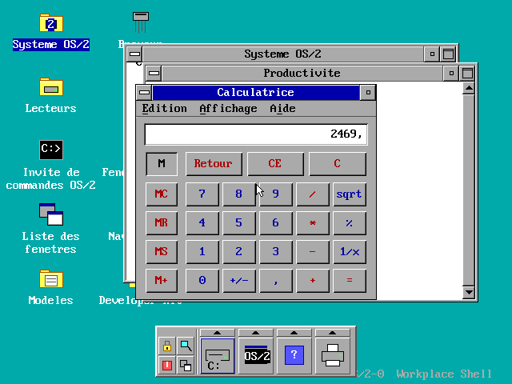

<table>
	<tr><th>Élément</th><th>Pasdows 95 (Win32)</th><th>OS/2-0 (Presentation Manager)</th></tr>
	<tr><td>Fenêtre</td><td>RegisterClassA, CreateWindowExA, AdjustWindowRect</td><td>WinRegisterClass, WinCreateStdWindow (titre, menu système, réduction, liste des fenêtres, bordure de dialogue : taille fixe), taille du cadre calculée par WinQueryWindowRect</td></tr>
	<tr><td>Menus</td><td>CreateMenu, AppendMenuA</td><td>Gabarit de menu de PM (MENUTEMPLATE) et WinCreateMenu : <u>É</u>dition (Copier Ctrl+C, Coller Ctrl+V), <u>A</u>ffichage (Standard coché, Scientifique désactivé), A<u>i</u>de (À propos)</td></tr>
	<tr><td>Dessin</td><td>GDI : FillRect, crayons, LineTo, TextOutA</td><td>WinFillRect, GpiSetColor, GpiMove, GpiLine, WinDrawText (DT_CENTER, DT_RIGHT, DT_VCENTER) ; origine en bas à gauche</td></tr>
	<tr><td>Apparence</td><td>Boutons en relief de Windows 95</td><td>Boutons poussoirs de PMWIN (blanc et noir à l'extérieur, gris foncé à l'intérieur ; inversés quand enfoncés), affichage en creux comme une zone de saisie, couleurs foncées lisibles même en VGA 16 couleurs</td></tr>
	<tr><td>Clavier et souris</td><td>WM_CHAR, WM_KEYDOWN, SetCapture</td><td>WM_CHAR de PM (KC_CHAR, KC_VIRTUALKEY, KC_CTRL), WM_BUTTON1DOWN/UP, WinSetCapture</td></tr>
	<tr><td>Presse-papiers</td><td>GlobalAlloc, SetClipboardData</td><td>WinOpenClipbrd, WinSetClipbrdData (CF_TEXT, CFI_POINTER), WinQueryClipbrdData</td></tr>
	<tr><td>Séparateur décimal</td><td>GetLocaleInfoA</td><td>Carnet Pays (OS2.INI, PM_National, sDecimal), sinon DosQueryCtryInfo</td></tr>
	<tr><td>Langue</td><td colspan="2">Variable <code>LANGUAGE</code> de CONFIG.SYS : français, anglais, allemand, italien, espagnol</td></tr>
	<tr><td>À propos, bip</td><td>MessageBoxA, MessageBeep</td><td>WinMessageBox, WinAlarm</td></tr>
</table>

Le calcul est celui de Pasdows 95, en double précision : chiffres, virgule, +/-, quatre opérations, racine carrée (<code>sqrt</code>), pourcentage, inverse (<code>1/x</code>), égal qui répète la dernière opération, mémoire (MC, MR, MS, M+, indicateur <b>M</b>), Retour arrière, CE et C ; affichage sur 15 chiffres significatifs, notation scientifique au-delà (<code>1,5e+020</code>). Clavier : chiffres, <code>.</code> ou <code>,</code>, <code>+ - * /</code>, Entrée ou <code>=</code>, <code>@</code> (racine), <code>%</code>, <code>R</code> (1/x), F9 (+/-), Retour arrière, Suppr (CE), Échap (C), Ctrl+L, R, M, P (mémoire), Ctrl+C et Ctrl+V (le texte collé est tapé touche par touche). Les exceptions du coprocesseur sont masquées et chaque résultat est vérifié : une division par zéro ou un dépassement affiche un message (« Impossible de diviser par zéro. », « Dépassement de capacité. ») au lieu d'une TRAP 0010 sous VirtualBox.

<h3>Paint (APPS/PAINT.PAS) : dessin bitmap</h3>

<b>Paint</b> est le programme de dessin d'OS/2-0, dans le dossier <b>Productivité</b> (bureau → Productivité → Paint ; <code>PAINT [fichier]</code> à l'invite). Une image (<code>.BMP</code>, <code>.PCX</code>, <code>.GIF</code>, <code>.PNG</code>, <code>.JPG</code>…) ouverte depuis un dossier du bureau ou depuis l'Explorateur OS2-Zero s'ouvre aussi dans Paint. C'est le <code>PAINT.PAS</code> de Pasdows 95 (lui-même issu de CloneDRAW, pour MS-DOS) : tous les outils (sélection, gomme, remplissage, pipette, loupe, crayon, pinceau, aérographe, texte, ligne, courbe, rectangle, polygone, ellipse, rectangle arrondi), les menus Fichier, Modifier, Affichage, Image, Couleurs, Outils et ?, Annuler/Rétablir, une trentaine de formats d'image en lecture et en écriture.

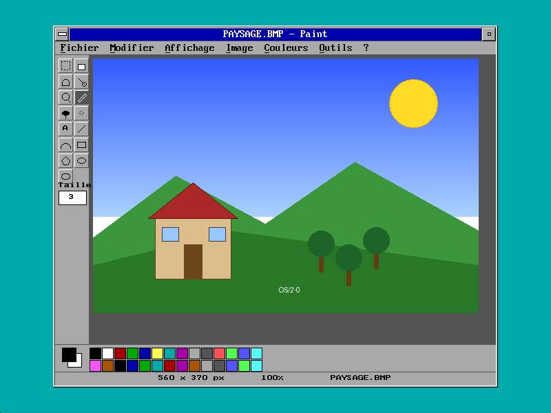
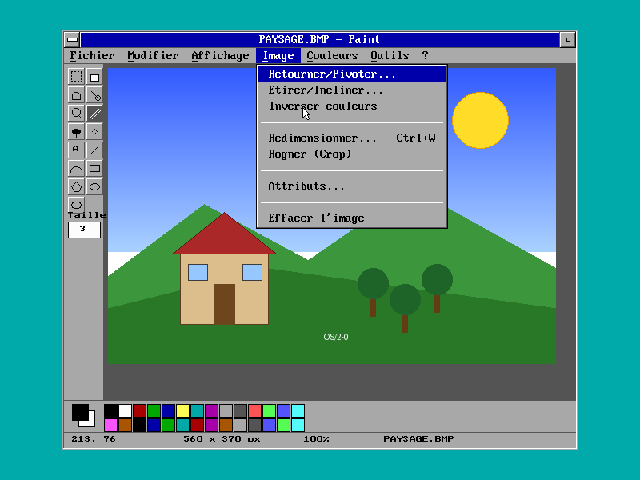

<table>
	<tr><th>Partie</th><th>Version Pasdows 95 (Win32)</th><th>OS/2-0 (Presentation Manager)</th></tr>
	<tr><td>Fenêtre</td><td>Fenêtre Win32 (CreateWindowEx), image de 256 couleurs montrée par SetDIBitsToDevice</td><td>Fenêtre de PM (WinCreateStdWindow : barre de titre, menu système, bouton de réduction, liste des fenêtres), image en mémoire (DosAllocMem) montrée par <code>GpiDrawBits</code>, zones modifiées seulement</td></tr>
	<tr><td>Menus</td><td>Barre de menus dessinée par PAINT</td><td>Barre de menus de PM construite à partir des menus de PAINT : lettres soulignées, raccourcis à droite, éléments grisés ou cochés ; une commande appelle <code>HandleMenuClick</code></td></tr>
	<tr><td>Souris et clavier</td><td>WM_MOUSEMOVE, WM_LBUTTONDOWN, WM_KEYDOWN, WM_CHAR</td><td>WM_MOUSEMOVE, WM_BUTTON1DOWN…, WM_CHAR de PM (codes de <code>ReadKey</code>) ; fermer la fenêtre ou Alt+F4 : Quitter avec confirmation ; F10 active la barre de menus, comme dans OS/2</td></tr>
	<tr><td>Fichiers</td><td colspan="2">Boîtes Ouvrir et Enregistrer sous de PAINT (dossiers et fichiers par DosFindFirst) ; le dossier racine vide d'un lecteur (disque virtuel D:) est maintenant accepté comme destination</td></tr>
</table>

PAINT est dessiné pour un écran de 640 × 480, sa barre de menus comprise. Sur un bureau d'au moins 800 × 600, Paint a une fenêtre complète de 640 × 480 (captures ci-dessus) ; sur un bureau de 640 × 480, comme la version Pasdows 95 qui passait alors en plein écran sans cadre, la fenêtre n'a que la barre de menus de PM, qui prend la place de celle de PAINT, et les boîtes de dialogue sont centrées au-dessus de la ligne d'état. L'exemple <b>PAYSAGE.BMP</b> (<code>IMAGE/EXEMPLES</code>) est copié sur le CD-ROM.

PAINT.PAS (45 000 lignes) est écrit pour Free Pascal : AnsiString, Int64, PByte, l'arithmétique des pointeurs, tableaux dynamiques, Try/Except. Il est compilé par OS2PC comme les autres programmes (fonctions <code>External 'PMWIN'</code> et <code>'PMGPI'</code>) : le compilateur de Pasdows 95, qui descend d'OS2PC et avait ajouté cette syntaxe, a été fusionné dans OS2PC (voir plus haut). Seule la couche de PAINT qui remplaçait Graph, Crt et la souris par Win32 est remplacée, par une couche qui utilise l'API d'OS/2 ; le reste du programme est celui de Pasdows 95. Le noyau fournit maintenant <code>sprintf</code> et <code>strtod</code>, que le runtime d'OS2PC appelle pour écrire et lire les réels (<code>Str</code>, <code>Write</code>, <code>Val</code>) : elles étaient listées dans DOSCALLS.DLL mais absentes, et tout programme qui affichait un réel s'arrêtait (SYS1804).

<h3>WorDium (WORDIUM.PAS) : traitement de texte</h3>

<b>WorDium</b> est le traitement de texte d'OS/2-0, dans le dossier <b>Productivité</b> (bureau → Productivité → WorDium ; <code>WORDIUM [/CLASSICMENU | /RUBANMENU] [document]</code> à l'invite, <code>WORDIUM /?</code> : aide). Un document (<code>.DOCX</code>, <code>.DOC</code>, <code>.PDF</code>, <code>.GAT</code>, <code>.GPX</code>, <code>.WPD</code>) ouvert depuis un dossier du bureau ou depuis l'Explorateur OS2-Zero s'ouvre aussi dans WorDium. C'est le <code>WORD.PAS</code> du dépôt OFFICE-0, écrit pour MS-DOS (BGI en 640 × 480, souris de l'interruption 33h), porté vers Presentation Manager avec toutes ses fonctions :

<ul>
	<li>saisie et mise en forme : gras, italique, souligné, tailles de 6 à 72 points, 16 couleurs, alignements (gauche, centré, droite, justifié), retraits, filets, sauts de page ; affichage Normal ou Mise en page, règle, zoom ;</li>
	<li>tableaux (insertion, lignes et colonnes, menu contextuel du bouton droit), images (BMP, PCX, GIF, JPEG, TIFF, XBM, BGX, GPX), symboles ;</li>
	<li>boîtes Police, Paragraphe, Zoom, Rechercher, Remplacer, Statistiques, Options, Sommaire de l'aide, À propos ; Annuler et Rétablir ;</li>
	<li>formats : <b>WPD</b> (format natif), <b>DOCX</b> (lecture et écriture : ZIP et Deflate écrits en Pascal, styles, numérotation, en-têtes et pieds de page, images), <b>DOC</b> de Word 97 (lecture), <b>PDF</b> (lecture : texte placé, flux FlateDecode, graphiques), <b>GAT</b> du MonsterBook (lecture et écriture : attributs gras, souligné, italique, double largeur, images <code>[DC:</code>), <b>GPX</b> ;</li>
	<li><b>correcteur d'orthographe</b> (F7) : français, anglais, allemand, espagnol et italien, suggestions, Remplacer, Ignorer ;</li>
	<li>cinq langues de l'interface, comme la version DOS : la variable <code>LANGUAGE</code> (réglée par Configuration du système) choisit le français, l'anglais (EN), l'espagnol (ES ou SP), l'italien (IT) ou l'allemand (DE ou GR) ;</li>
	<li>menus classiques (style Word 2003, par défaut) ou ruban (<code>/RUBANMENU</code>, style Word 2007).</li>
</ul>

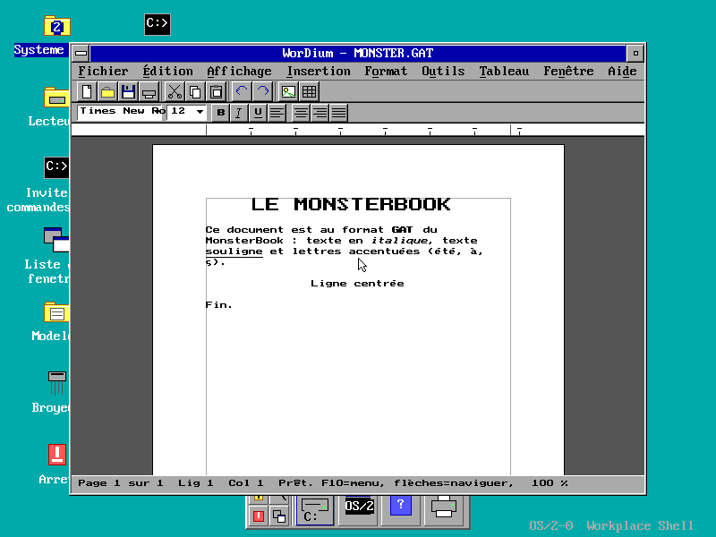
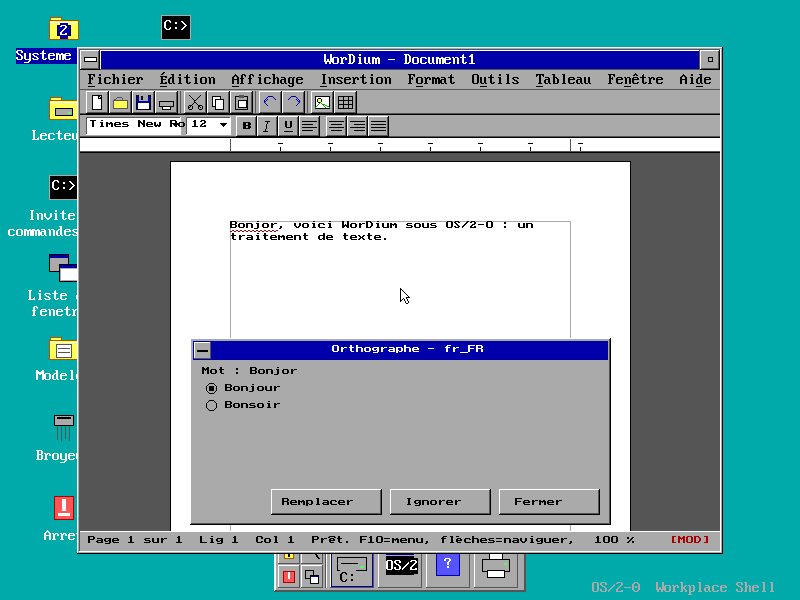

<table>
	<tr><th>Partie</th><th>Version DOS (OFFICE-0)</th><th>OS/2-0 (Presentation Manager)</th></tr>
	<tr><td>Fenêtre</td><td>Plein écran BGI 640 × 480, barre de menus dessinée par WorDium</td><td>Fenêtre de PM (barre de titre avec le nom du document, menu système, bouton de réduction, liste des fenêtres) ; l'image de 640 × 480 est gardée en mémoire et montrée par <code>GpiDrawBits</code>, zones modifiées seulement</td></tr>
	<tr><td>Menus</td><td>Menus déroulants de WorDium, F10, Alt+lettre</td><td>Barre de menus de PM construite à partir des menus de WorDium (lettres soulignées, raccourcis à droite, coches de l'Affichage) ; avec le ruban, les titres de la barre de menus de PM sont les onglets</td></tr>
	<tr><td>Boîtes</td><td>Cadres gris, barre de titre bleue</td><td>Barre de titre d'OS/2 (case du menu système, titre centré) ; messages et questions par <code>WinMessageBox</code></td></tr>
	<tr><td>Clavier et souris</td><td><code>ReadKey</code>, interruption 33h ou PtcMouse avec flèche dessinée par WorDium</td><td>WM_CHAR (codes de <code>ReadKey</code>, lettres accentuées de la page de codes 850 acceptées), WM_BUTTON*, pointeur de PM ; fermer la fenêtre : Fichier → Quitter</td></tr>
	<tr><td>Impression</td><td>Absente (« Impression disponible sous Windows »)</td><td>Tampon d'impression d'OS/2 : chaque page est dessinée par la GPI (<code>DevOpenDC</code> OD_QUEUED, PM_Q_STD) et imprimée par PMSPL et PicPrint en graphique ESC/P, page de 8 × 10,5 pouces</td></tr>
</table>

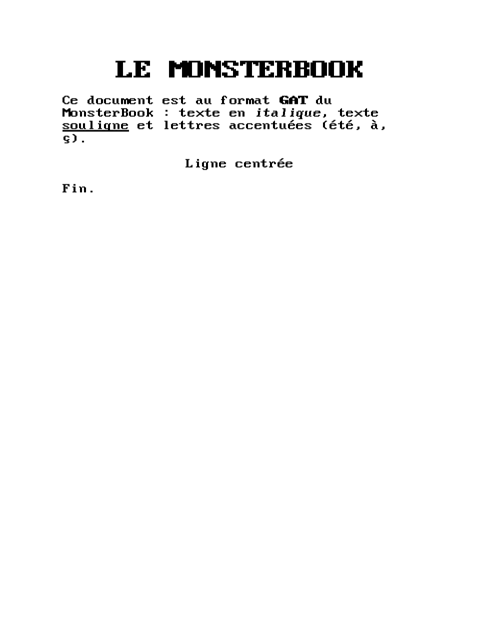

Les exemples <b>MONSTER.GAT</b> (MonsterBook) et <b>LETTRE.PDF</b> (<code>IMAGE/EXEMPLES</code>) sont copiés sur le CD-ROM. WORDIUM.PAS (18 000 lignes) est compilé par OS2PC ; le portage a été vérifié en comparant, fichier par fichier, ce que lisent et écrivent WorDium compilé par Free Pascal sous Linux et WorDium compilé par OS2PC sous OS/2-0 (quatre PDF, un GAT, un DOCX, les enregistrements DOCX, GAT et WPD, les suggestions du correcteur dans les cinq langues) : les résultats sont identiques, et LibreOffice ouvre les DOCX écrits par WorDium. Ce travail a corrigé OS2PC : <code>Assign</code>, <code>Reset</code>, <code>Rewrite</code>, <code>Close</code>… sur une variable fichier qui est un champ d'enregistrement (<code>Z.F</code>), <code>Byte('&lt;')</code> (code du caractère), paramètres <code>Const</code> chaîne recopiés à l'entrée (une chaîne temporaire pouvait être recouverte), types du programme qui masquent les types prédéfinis du même nom (<code>PWord</code>), champs d'un <code>With</code> prioritaires sur les variables, <code>ClrEol</code> qui applique la couleur courante (la ligne de titre de CMD est bleue sur toute la largeur). Le noyau sert les <code>GetMem</code> de 64 Ko et plus par de grands blocs de mémoire physique (le tas du noyau ne compte que quelques Mo) ; PMSPL transmet la taille de page <code>/W:</code> <code>/H:</code> à PicPrint.

<h3>Excelsior (EXCELSIO.PAS) : tableur</h3>

<b>Excelsior</b> est le tableur d'OS/2-0, dans le dossier <b>Productivité</b> (bureau → Productivité → Excelsior ; <code>EXCELSIO [/CLASSICMENU | /RUBANMENU] [classeur]</code> à l'invite, <code>EXCELSIO /?</code> : aide). Un classeur (<code>.XLC</code>, <code>.XLS</code>, <code>.XLSX</code>) ouvert depuis un dossier du bureau ou depuis l'Explorateur OS2-Zero s'ouvre aussi dans Excelsior. C'est le <code>EXCEL.PAS</code> du dépôt OFFICE-0, écrit pour MS-DOS (BGI en 640 × 480, souris de l'interruption 33h), porté vers Presentation Manager avec toutes ses fonctions :

<ul>
	<li>les mêmes dimensions que la version DOS : <b>16 feuilles de 4096 lignes sur 256 colonnes</b> (A à IV), lignes allouées à la demande ; onglets des feuilles (insérer, renommer, supprimer), largeurs des colonnes et hauteurs des lignes ;</li>
	<li>saisie et barre de formule ; <b>formules</b> avec opérateurs (+ − × ÷ ^ &amp; comparaisons), plages et références, recalcul automatique, erreurs (#DIV/0!, #VALUE!, #NAME?, #CIRC!) et une cinquantaine de fonctions en anglais ou en français (SUM, AVERAGE/MOYENNE, MIN, MAX, COUNT, PRODUCT/PRODUIT, IF/SI, ROUND/ARRONDI, SQRT/RACINE, POWER/PUISSANCE, LEFT/GAUCHE, MID/STXT, LEN/NBCAR, UPPER/MAJUSCULE, AND/ET, OR/OU, MOD, INT/ENT, PI, TODAY/AUJOURDHUI…) ;</li>
	<li>sélection (souris, F8), Couper, Copier, Coller, Annuler et Rétablir (30 niveaux), menus contextuels des cellules et des onglets ;</li>
	<li>mise en forme des cellules : gras, italique, souligné, alignements, formats Nombre, Pourcentage, Monétaire, Date et Texte, couleurs du texte et du fond ;</li>
	<li><b>graphiques</b> (barres, lignes, secteurs) et images BMP ancrés aux cellules ;</li>
	<li>formats : <b>XLC</b> (format natif), <b>XLS</b> d'Excel 97 à 2003 (BIFF8 dans un conteneur OLE2, lecture et écriture) et <b>XLSX</b> (ZIP et Deflate écrits en Pascal, lecture et écriture) ; boîtes Ouvrir et Enregistrer sous avec les lecteurs et les dossiers ;</li>
	<li>menus classiques (style Excel 2003, par défaut) ou ruban (<code>/RUBANMENU</code>, style Excel 2007).</li>
</ul>

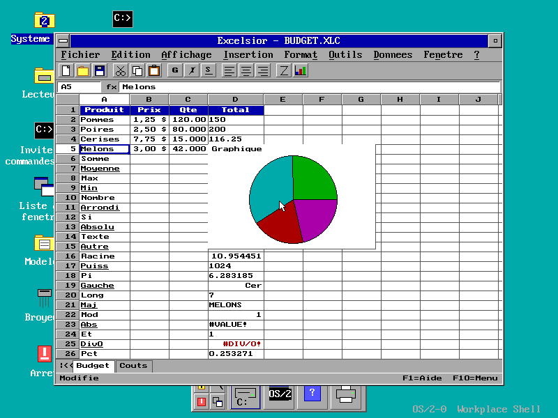
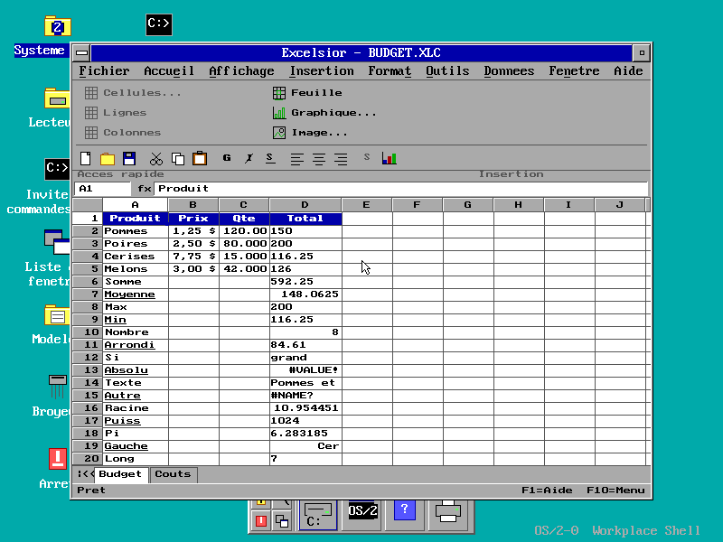

<table>
	<tr><th>Partie</th><th>Version DOS (OFFICE-0)</th><th>OS/2-0 (Presentation Manager)</th></tr>
	<tr><td>Fenêtre</td><td>Plein écran BGI 640 × 480, barre de menus dessinée par Excelsior</td><td>Fenêtre de PM (barre de titre avec le nom du classeur, menu système, bouton de réduction, liste des fenêtres) ; l'image de 640 × 480 est gardée en mémoire et montrée par <code>GpiDrawBits</code>, zones modifiées seulement</td></tr>
	<tr><td>Menus</td><td>Menus déroulants d'Excelsior, F10, Alt+lettre</td><td>Barre de menus de PM construite à partir des menus d'Excelsior (lettres soulignées, raccourcis à droite ; les commandes que la version DOS n'a pas sont grisées, comme dans son ruban) ; avec le ruban, les titres de la barre de menus de PM sont les onglets</td></tr>
	<tr><td>Boîtes</td><td>Cadres gris, barre de titre bleue</td><td>Barre de titre d'OS/2 (case du menu système, titre centré) ; messages et confirmations par <code>WinMessageBox</code></td></tr>
	<tr><td>Clavier et souris</td><td><code>ReadKey</code>, interruption 33h ou PtcMouse</td><td>WM_CHAR (codes de <code>ReadKey</code>), WM_BUTTON*, pointeur de PM ; Alt+F4 ou fermer la fenêtre : Quitter ; la boucle principale rend la main à OS/2 quand il n'y a rien à faire</td></tr>
</table>

L'exemple <b>BUDGET.XLC</b> (<code>IMAGE/EXEMPLES</code> : deux feuilles, une trentaine de formules, formats et couleurs) est copié sur le CD-ROM. EXCELSIO.PAS (9 400 lignes) est compilé par OS2PC ; le portage a été vérifié en comparant ce que lisent et écrivent Excelsior compilé par Free Pascal sous Linux et Excelsior compilé par OS2PC sous OS/2-0 (un XLC avec formules, un XLSX et un XLS écrits par LibreOffice ; pour chacun, les cellules calculées, puis les enregistrements XLC, XLS et XLSX relus) : les résultats sont identiques (les fichiers XLC d'OS/2 ont des fins de ligne CR-LF). Des défauts de la version DOS sont corrigés : le flux XLS de moins de 4096 octets (qui doit aller dans le mini-flux d'OLE2) est complété comme le fait Excel et la longueur de l'enregistrement FONT est la bonne (ni Excel, ni LibreOffice, ni Excelsior lui-même ne relisaient les XLS d'Excelsior ; LibreOffice les ouvre maintenant) ; la lecture XLS prend les nombres RK et MULRK et les résultats des formules (FORMULA, STRING) qu'écrivent Excel et LibreOffice ; une formule dont le résultat est un texte (<code>=SI(…;"grand";"petit")</code>, <code>=A2&amp;" et "&amp;A3</code>) est enregistrée en XLS et en XLSX avec ce texte, et non comme le nombre 0. Ce travail a corrigé OS2PC : un <code>Break</code> ou un <code>Continue</code> placé dans un <code>Case</code> laissait le sélecteur du <code>Case</code> sur la pile (la boucle <code>For</code> qui l'entourait relisait sa borne au mauvais endroit). Le noyau honore la réserve de pile de l'en-tête PE quand un programme demande plus de 1 Mo (<code>{$M}</code> d'OS2PC ; Excelsior prend 2 Mo pour l'évaluation récursive des formules) et sert jusqu'à 2048 grands blocs de mémoire par processus (une ligne d'Excelsior en est un).

<h3>Outlink (OUTLINK.PAS) : courrier IMAP, POP3 et SMTP</h3>

<b>Outlink</b> est le client de messagerie d'OS/2-0, dans le dossier <b>Productivité</b> (bureau → Productivité → Outlink ; <code>OUTLINK [/ACCOUNTS:fichier]</code> à l'invite). C'est un portage de <code>OUTLOOK.PAS</code>, le clone d'Outlook du dépôt OFFICE-0, écrit pour MS-DOS : la version d'origine dessine avec l'unité Graph du BGI, lit la souris par l'interruption 33h et passe par un pilote de paquets pour le réseau. Sous OS/2-0, Outlink est une vraie fenêtre de Presentation Manager, avec la barre de titre et la barre de menus d'OS/2 (Fichier, Édition, Affichage, Outils, Message, ?, avec leurs lettres soulignées et leurs raccourcis), et ses communications passent par l'API réseau d'OS/2 : les sockets de <b>TCPIP32.DLL</b> (<code>gethostbyname</code>, <code>socket</code>, <code>connect</code>, <code>send</code>, <code>recv</code>, <code>soclose</code>) et le chiffrement de <b>TLS32.DLL</b> (TLS 1.3 et 1.2).

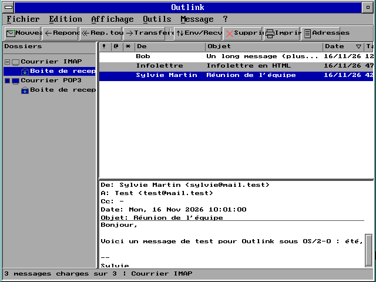
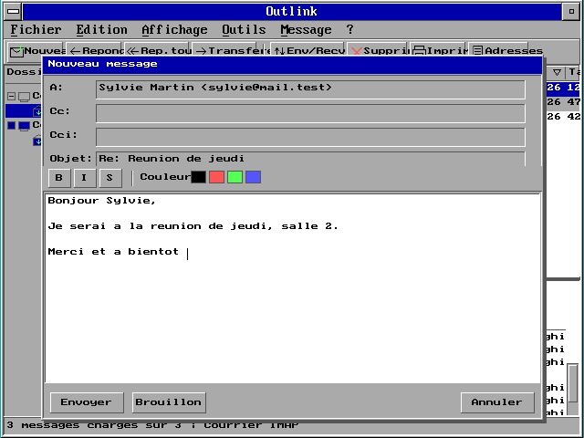

<table>
	<tr><th>Partie</th><th>Description</th></tr>
	<tr><td>Fenêtre</td><td>Barre d'outils (Nouveau, Répondre, Répondre à tous, Transférer, Envoyer/Recevoir, Supprimer, Imprimer, Adresses), dossiers des comptes, liste des messages (priorité, pièce jointe, indicateur, De, Objet, Date JJ/MM/AA, Taille ; tri par colonne), volet de prévisualisation avec défilement, barre d'état. L'image est dessinée en mémoire et seules les zones changées sont recopiées (<code>GpiDrawBits</code>).</td></tr>
	<tr><td>Comptes</td><td>Outils → Comptes (fichier <code>OUTLINK.ACC</code> à côté du programme, ou <code>/ACCOUNTS:</code>) : réception IMAP ou POP3, envoi SMTP (AUTH PLAIN) ; pour chaque serveur, sans chiffrement, TLS implicite (993, 995, 465) ou STARTTLS (IMAP, SMTP) / STLS (POP3).</td></tr>
	<tr><td>Envoyer/Recevoir (F5)</td><td>Relève la boîte de réception du compte choisi (les 100 messages les plus récents) ; au démarrage, relève du compte par défaut. Une fenêtre d'attente montre l'avancement.</td></tr>
	<tr><td>Lecture</td><td>Clic ou flèches, Pg préc./Pg suiv., Début, Fin (la liste défile ; la version DOS ne montrait que les premiers messages). En-têtes MIME (<code>=?UTF-8?Q?…?=</code>, <code>=?ISO-8859-1?B?…?=</code>), corps <i>quoted-printable</i> ou base64, parties <code>multipart</code> (le texte est choisi, les pièces jointes signalées), HTML ramené à du texte (paragraphes, listes, entités <code>&amp;eacute;</code> et <code>&amp;#233;</code>, style et script omis) ; UTF-8, ISO-8859-1 et Windows-1252 convertis en page de codes 850 : les accents sont conservés (la version DOS les retirait). Messages complets gardés dans de grands tampons (la version DOS se limitait à des chaînes de 255 caractères).</td></tr>
	<tr><td>Écriture</td><td>Nouveau message (Ctrl+N), Répondre (Ctrl+R), Transférer (Ctrl+F) : A, Cc, Cci (plusieurs adresses séparées par des virgules), Objet, texte ; envoi en Windows-1252 8 bits, transparence des points (<i>dot-stuffing</i>). Fichier → Ouvrir (.eml) et Enregistrer sous.</td></tr>
</table>

Les raccourcis affichés dans les menus (F1, F5, Ctrl+lettre, Suppr) sont maintenant tous traités ; Échap ferme les menus et les boîtes mais ne quitte plus le programme (Fichier → Quitter ou Alt+F4). Limites : les pièces jointes ne sont pas envoyées, et comme pour le Navigateur Web et WGET, le certificat du serveur n'est pas vérifié. Il faut le composant <b>Réseau TCP/IP</b> de l'installation (TCPIP32.DLL, TLS32.DLL et un pilote de carte).

Le portage a mis au jour quelques défauts corrigés au passage : <b>OS2PC</b> comparait mal deux chaînes calculées (<code>Copy(S,1,6) = T + ' '</code> était toujours vrai : l'opérande de gauche est maintenant copié dans un tampon avant la comparaison), <code>Delete(S, I, N)</code> lisait au-delà de la fin de la chaîne quand <code>N</code> dépassait la longueur (le nombre est maintenant borné), <code>GetFAttr</code> et <code>SetFAttr</code> lisaient le nom à la mauvaise place dans la variable fichier et réutilisaient les mêmes étiquettes à chaque appel (deux <code>GetFAttr</code> dans un programme faisaient boucler le second), et les zéros de fin du segment de données n'étaient pas écrits dans le .EXE (les données initialisées sont placées avant les tableaux à zéro, que le chargeur du noyau remplit déjà de zéros ; OUTLINK.EXE fait ainsi 1 Mo). <b>PMGPI.DLL</b> convertissait la couleur de chaque point dans <code>GpiDrawBits</code> ; une copie simple (SRCCOPY, sans étirement, image de 1, 4 ou 8 bits par point) convertit maintenant la palette une seule fois, ce qui accélère tous les programmes qui dessinent dans une image en mémoire (Outlink, Notator, les jeux).

<h3>Gestionnaire des tâches (TASKMGR.PAS)</h3>

L'OS/2 d'origine n'avait <b>pas de gestionnaire des tâches</b> : la Liste des fenêtres (Ctrl+Échap) permettait seulement de passer d'un programme à l'autre ou d'en fermer un, sans rien dire de l'occupation du processeur ni de la mémoire. OS/2-0 en ajoute un : <b>TASKMGR.PAS</b> (TASKMGR.EXE) reprend la présentation et les fonctions du Gestionnaire des tâches de Windows XP, avec l'apparence d'OS/2 Warp 3 (fond gris, reliefs, onglets de carnet, cadres de groupe gravés, boutons de PM). On l'ouvre par le menu contextuel du bureau (<b>Gestionnaire des tâches</b>) ou par son objet du dossier <b>Système OS/2</b> (icône d'un moniteur avec sa courbe).

<table>
	<tr>
		<td align="center">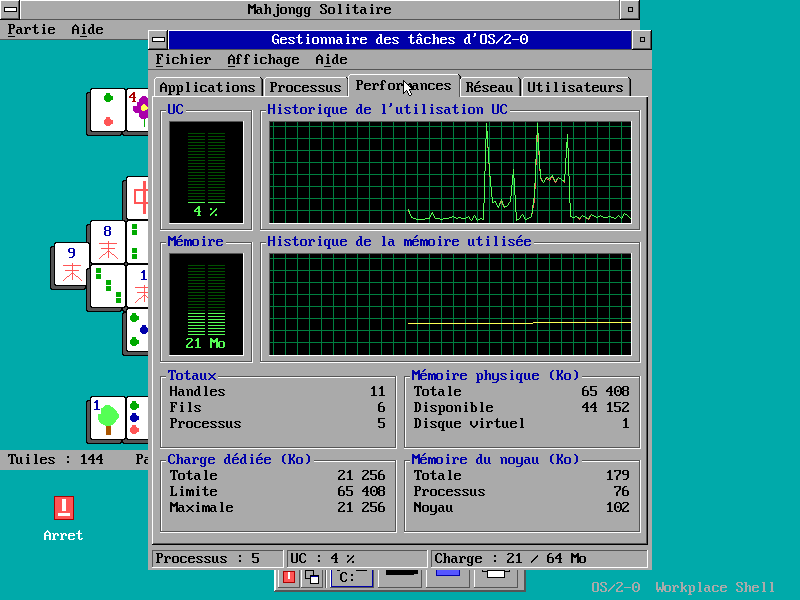 <i>Performances : utilisation du processeur (temps du noyau en rouge) et de la mémoire, pendant le lancement de Klondike puis de Mahjongg</i></td>
		<td align="center">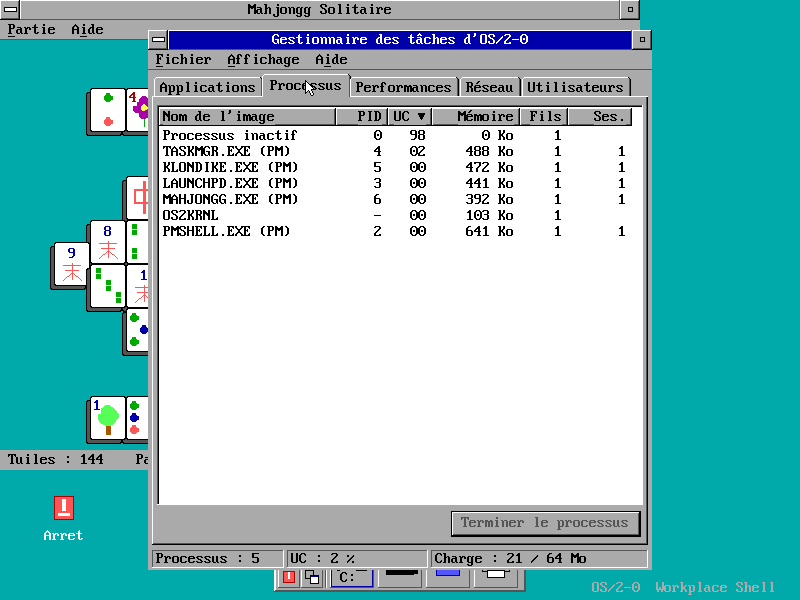 <i>Processus : nom, PID, processeur, mémoire, fils et session de chaque processus, triés par colonne</i></td>
	</tr>
	<tr>
		<td align="center">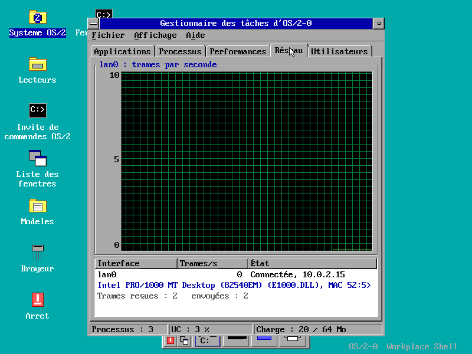 <i>Réseau : trames par seconde de l'interface lan0 (carte Intel PRO/1000, adresse obtenue par DHCP)</i></td>
		<td></td>
	</tr>
</table>

<table>
	<tr><th>Onglet</th><th>Contenu</th></tr>
	<tr><td><b>Applications</b></td><td>Fenêtres principales des programmes (cadres de PMWIN avec un titre) et sessions plein écran. <b>Fin de tâche</b> (WM_CLOSE à la fenêtre, ou arrêt des processus de la session), <b>Basculer vers</b> (double clic, Entrée), <b>Nouvelle tâche...</b> (dialogue « Créer une nouvelle tâche » : le programme est cherché dans le répertoire courant, le PATH et C:\ ; un programme de PM démarre dans la session de PM, les autres dans une nouvelle session ; .CMD et .BAT par CMD.EXE).</td></tr>
	<tr><td><b>Processus</b></td><td>Nom de l'image et type (PM, VIO, LX, DOS), PID, utilisation du processeur (%), mémoire (fenêtre du processus, blocs du tas du noyau, grands blocs), nombre de fils, session ; le <b>Processus inactif</b> et le noyau (<b>OS2KRNL</b>) ; tri en cliquant les titres des colonnes. <b>Terminer le processus</b> (Suppr), après confirmation : DosKillProcess.</td></tr>
	<tr><td><b>Performances</b></td><td>Jauge et historique de l'utilisation du processeur (vert vif sur grille vert sombre qui défile ; temps du noyau en rouge : menu Affichage), jauge et historique de la mémoire utilisée (jaune) ; <b>Totaux</b> (handles, fils, processus), <b>Mémoire physique</b> (totale, disponible, disque virtuel), <b>Charge dédiée</b> (totale, limite, maximale), <b>Mémoire du noyau</b> (totale, tas des processus, noyau).</td></tr>
	<tr><td><b>Réseau</b></td><td>Historique des trames par seconde de l'interface lan0 (échelle automatique), carte et pilote, adresse MAC, état de la liaison et adresse IP, trames reçues et envoyées (TCPIP32.DLL).</td></tr>
	<tr><td><b>Utilisateurs</b></td><td>Sessions de l'utilisateur : numéro, état (actif au premier plan, arrière-plan, inactif) et titre ; <b>Basculer vers</b>, <b>Fermer la session</b> (arrête ses programmes).</td></tr>
	<tr><td>Menus et barre d'état</td><td>Fichier (Nouvelle tâche, Quitter), Affichage (Actualiser maintenant F5, fréquence d'actualisation haute 0,5 s, normale 1 s, basse 4 s ou suspendue, temps du noyau), Aide ; barre d'état : processus, utilisation du processeur, charge dédiée. Ctrl+Tab change d'onglet.</td></tr>
</table>

Le multitâche du noyau existait (tâches, ordonnanceur préemptif, sessions) ; pour le Gestionnaire des tâches, le noyau compte maintenant le temps du processeur à chaque interruption de la minuterie (100 Hz) : temps <b>inactif</b> (processeur arrêté par hlt dans la boucle d'attente), temps de chaque <b>processus</b>, temps du <b>noyau</b> (code interrompu hors du programme : noyau et DLL du système). Deux nouvelles fonctions le donnent aux programmes : <b>KrnTaskCtl 34</b> (état du système : tops, temps inactif et du noyau, mémoire physique et disponible, tas du noyau, fils, processus, handles, disque virtuel) et <b>KrnTaskCtl 35</b> (un processus : PID, parent, fils, temps du processeur, mémoire, session, type, nom et chemin). PMWIN détruit maintenant les fenêtres d'un processus terminé de force (au plus une fois par seconde, pendant l'attente des messages) et efface le curseur d'une fenêtre détruite. Les graphiques utilisent des couleurs RGB (GpiCreateLogColorTable, LCOLF_RGB) quand l'écran a plus de 16 couleurs.

<a href="../README.md">&larr; Retour au README</a>

