<h1>OS2-0 : Bureau (Workplace Shell), installation et démarrage</h1>

<a href="../README.md">&larr; Retour au README</a>

<h3>Bureau PMSHELL.EXE (Workplace Shell)</h3>

Le fichier <b>PMSHELL.PAS</b> est le programme OS/2 <b>PMSHELL.EXE</b>, l'interpréteur de Presentation Manager : le CONFIG.SYS du CD-ROM contient <code>PROTSHELL=C:\PMSHELL.EXE</code> (et <code>SET RUNWORKPLACE=C:\PMSHELL.EXE</code>), le noyau le lance donc au démarrage à la place de CMD.EXE (et le relance s'il se termine), et OS/2-0 démarre sur son bureau, en 640 x 480 (mémoire linéaire VESA, sinon VGA 16 couleurs), prêt à être utilisé à la souris et au clavier. <code>COMSPEC</code> reste <code>C:\CMD.EXE</code> (le noyau ne le remplace plus quand CONFIG.SYS le fixe).

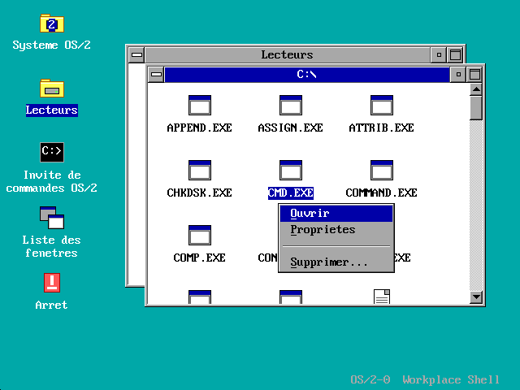

<table>
	<tr><th>Élément</th><th>Rôle</th></tr>
	<tr><td>Bureau</td><td>Fenêtre de tout l'écran, toujours sous les autres ; objets Système OS/2, Lecteurs, Invite de commandes OS/2, Liste des fenêtres, Modèles, Broyeur, Arrêt et Fenêtre OS/2, Navigateur Web, les dossiers Developer Kit, Productivité, Jeux, Multimédia, Loisirs et Science, puis le contenu du répertoire du bureau (<code>C:\DESKTOP</code>, ou <code>D:\DESKTOP</code> si C: est en lecture seule) et les raccourcis du bureau. Les icônes se déplacent à la souris ; leur position est gardée dans OS2.INI (application PMSHELL).</td></tr>
	<tr><td>Dossiers</td><td>Système OS/2 (invite de commandes, lecteurs, liste des fenêtres, configuration du système, informations sur le système, gestionnaire des tâches, aide, arrêt, fenêtres OS/2 et DOS), Productivité, Jeux, Multimédia, Loisirs et Science (directement sur le bureau), Lecteurs (une icône par unité : C: CD-ROM, D: disque virtuel HPFS...) et les répertoires : sous-répertoires, programmes (.EXE, .COM), fichiers de commandes (.CMD, .BAT) et fichiers de données, triés, avec barre de défilement. Un dossier déjà ouvert est activé au lieu d'être rouvert.</td></tr>
	<tr><td>Glisser-déposer</td><td>Avec le bouton 2 (ou le bouton 1 dans un dossier), entre le bureau et les dossiers : un objet déposé sur un dossier ou dans la fenêtre d'un dossier y est déplacé (copié avec Ctrl, ou d'une unité à une autre) ; sur le <b>Broyeur</b>, il est supprimé après confirmation ; sur le <b>LaunchPad</b>, il y est ajouté. Comme dans le Workplace Shell, un objet programme d'un dossier du système (Jeux, Productivité, Loisirs, Système OS/2…) ou un programme posé sur le bureau n'est pas un fichier du dossier : le déposer ailleurs crée un raccourci, son exécutable reste en place, et il ne peut pas être supprimé. Un glisser ne commence qu'au-delà de 10 pixels (un double clic un peu tremblé, ou la souris absolue de VirtualBox, ne déplace rien).</td></tr>
	<tr><td>Raccourcis (shadows)</td><td>Menu contextuel « Créer un raccourci » (sur le bureau), ou dépôt avec Ctrl+Maj : le raccourci (étiquette en couleur) ouvre l'objet d'origine ; le supprimer ne supprime que le raccourci. Ils sont gardés dans OS2.INI (application PMSHELL_RACCOURCIS).</td></tr>
	<tr><td>Modèles</td><td>Dossier Modèles : Dossier, Fichier de données, Fichier de commandes ; ouvrir un modèle (ou le déposer sur un dossier) crée un nouvel objet (DOSSIER, NOUVEAU.TXT, NOUVEAU.CMD, numérotés au besoin).</td></tr>
	<tr><td>Souris</td><td>Clic : sélection ; Ctrl+clic : ajouter un objet au choix ou l'en retirer ; double clic : ouvrir ; bouton 2 : menu contextuel de l'objet (Ouvrir, Ouvrir dans l'Explorateur, Modifier, Couper, Copier, Coller, Créer un raccourci ou Créer un autre, Supprimer, Renommer, Propriétés) ou du fond (Nouveau, Coller, Coller le raccourci, Sélectionner tout, Actualiser, Réorganiser, Liste des fenêtres, Informations système, Aide, Arrêt ; dans un dossier : Inverser la sélection, Dossier parent, Ouvrir dans l'Explorateur, Invite de commandes ici, Propriétés, Fermer). Clavier : Ctrl+A, Ctrl+X, Ctrl+C, Ctrl+V, Suppr, F2.</td></tr>
	<tr><td>Clavier</td><td>Flèches, Début, Fin, lettre : sélection ; Entrée : ouvrir ; Maj+F10 : menu contextuel ; Ctrl+Échap : liste des fenêtres ; F5 : actualiser ; Retour arrière : dossier parent ; Suppr : supprimer le fichier (après confirmation) ; F1 : aide ; Alt+F4 : fermer la fenêtre (sur le bureau : arrêt) ; Échap : fermer la visionneuse ou la liste des fenêtres.</td></tr>
	<tr><td>Programmes</td><td>Un programme, un fichier de commandes (COMSPEC /C) ou l'invite de commandes (COMSPEC) est lancé dans une nouvelle session plein écran (ou, pour les objets Fenêtre OS/2 et Fenêtre DOS, dans une fenêtre du bureau par PMVIOP.DLL), dans le répertoire de son dossier, et le bureau continue de s'exécuter : Ctrl+Échap y revient, la liste des fenêtres montre les sessions en cours et permet d'y retourner. Un programme de PM quitte sa session pour celle de Presentation Manager : ses fenêtres apparaissent sur le bureau, à côté des autres. Quand un programme en mode texte autre que l'invite de commandes se termine, le noyau attend une touche avant de revenir au bureau (pour lire ce qu'il a affiché).</td></tr>
	<tr><td>Visionneuse</td><td>Un fichier de données s'ouvre dans une fenêtre qui en montre les lignes (2000 au plus).</td></tr>
	<tr><td>Arrêt</td><td>Après confirmation, les fenêtres sont fermées, les fichiers écrits (DosShutdown) et l'écran indique que l'ordinateur peut être éteint ; <b>Ctrl+Alt+Suppr</b> (traité par le noyau, à tout moment) redémarre l'ordinateur.</td></tr>
	<tr><td>STARTUP.CMD</td><td>C:\STARTUP.CMD ou D:\STARTUP.CMD est exécuté au démarrage, avant l'affichage du bureau.</td></tr>
</table>

Pour cela, PMWIN.DLL a trois points d'entrée internes : WINSUSPENDSCREEN (1004) prête l'écran au programme lancé, WINRESUMESCREEN (1005) le rend à PM (tout est redessiné, les événements de la souris reçus entre-temps sont oubliés) et WINQUERYSCREENTAKEN (1006) dit si un programme de PM l'a pris. Les icônes sont dessinées par PMGPI.DLL sur l'espace de présentation des fenêtres ; les dossiers, menus, boîtes de message et listes sont ceux de PMWIN. Il n'y a pas de limite au nombre de fenêtres ni au nombre d'objets d'un dossier : les tables de PMSHELL grandissent à la demande (GetMem), et PMWIN.DLL gère jusqu'à 1024 fenêtres, 64 files de messages, 128 espaces de présentation et 128 minuteries. Avec <code>SET PMMODE=TEXTE</code>, le bureau s'affiche en mode texte. Pour démarrer sur la ligne de commande comme avant, mettre <code>PROTSHELL=C:\CMD.EXE</code> dans CONFIG.SYS.

Quand un programme s'arrête sur une exception (TRAP) ou, s'il est de Presentation Manager, sur une erreur d'exécution Pascal (Runtime error 200 à 217), le noyau garde le détail (KrnTaskCtl 21) et le bureau l'affiche dans une boîte <b>SYS3175</b>, comme OS/2 : programme, numéro et nom de l'exception, adresse (EIP, CR2). Sans elle, un programme de PM disparaissait sans message : l'écran texte du noyau est caché par PM, et la sortie standard d'un programme de PM n'est vue de personne.

<h3>Modes VESA et carnet « Système - Paramètres »</h3>

L'écran de Presentation Manager n'est plus limité au VGA 640 x 480 x 16 couleurs : OS/2-0 utilise le <b>BIOS VESA</b> (VBE) de la carte vidéo.

<table>
	<tr><th>Couche</th><th>Rôle</th></tr>
	<tr><td>Noyau (OS2KRNL)</td><td>Appel d'une interruption du BIOS en mode réel depuis le mode protégé : le petit programme <b>KERNEL/BIOSCALL.ASM</b> (assemblé une fois, recopié en 0000:7000) sauve CR0/CR3/CR4, la GDT et l'IDT, repasse en mode réel (pagination coupée, IVT du BIOS, PIC en 08h/70h avec les IRQ masquées), exécute INT 10h puis revient. Au démarrage, le noyau relève les modes du VBE (4F00h, 4F01h) : modes graphiques à mémoire linéaire de 640 x 480 au moins, 8 bits (palette) ou 15, 16, 24, 32 bits (couleurs directes) ; QEMU en propose 67 (VBE 3.0, 16 Mo). API <b>KrnVideo</b> : liste des modes, passage à un mode VESA (4F02h avec mémoire linéaire) ou à un mode du BIOS (retour au texte).</td></tr>
	<tr><td>VIOCALLS.DLL</td><td>VioSetMode accepte toute résolution VESA (hres, vres, bits par pel) ; VioGetMode donne l'adresse de la mémoire linéaire (buf_addr) et les octets par ligne (partial_length) ; le retour au mode texte, une fenêtre surgissante et la bascule des sessions quittent proprement le mode VESA.</td></tr>
	<tr><td>PMWIN.DLL, PMGPI.DLL</td><td>Dessin dans la mémoire linéaire en 8, 15, 16, 24 ou 32 bits par pel (remplissages par REP STOS, défilement par REP MOVS, pointeur, curseur, texte) ; les bitmaps gardent leurs couleurs RVB ; PMGPI dessine sur l'écran VESA (cible TG_LFB). La résolution se choisit par <code>SET PMRESOLUTION=1024x768x32</code> dans CONFIG.SYS, par OS2.INI (PM_Display, RESOLUTION) ou à chaud par WINSETSCREENMODE (ordinal interne 1007) : les fenêtres sont ramenées dans l'écran et tout est redessiné ; le LaunchPad se replace.</td></tr>
	<tr><td>PMSHELL.EXE</td><td>Carnet <b>Système - Paramètres</b> (Système OS/2 → Configuration du système → Système, Souris, Couleurs du bureau, Langue ou Pays ; ou le menu du bureau « Paramètres du système... ») : reliure à spirale et onglets comme sous Warp 3.</td></tr>
</table>

<table>
	<tr><th>Onglet</th><th>Réglages</th></tr>
	<tr><td>Écran</td><td>Écran choisi (VESA, version du VBE, mémoire) ; liste des résolutions « largeur x hauteur x nombre de couleurs » (VGA 640 x 480 x 16 et tous les modes VESA de la carte, jusqu'à 16 777 216 couleurs) ; fréquence de balayage ; Appliquer (changement immédiat, puis « La conserver ? »), Annuler, Par défaut (640 x 480 en mémoire linéaire), Capacités.</td></tr>
	<tr><td>Confirmations</td><td>Demander une confirmation avant de supprimer un dossier, un fichier ou un raccourci, avant l'arrêt du système.</td></tr>
	<tr><td>Titre</td><td>Objet de même nom : ajouter un numéro ou avertir sans créer l'objet.</td></tr>
	<tr><td>Fenêtre</td><td>Objet déjà ouvert : afficher la fenêtre existante ou en ouvrir une nouvelle.</td></tr>
	<tr><td>Entrée</td><td>Délai du double clic, boutons de la souris inversés (gaucher : SV_SWAPBUTTON, géré par PMWIN).</td></tr>
	<tr><td>Logo</td><td>Logo au démarrage du bureau : aucun, 3 ou 5 secondes, jusqu'à un clic.</td></tr>
	<tr><td>Général</td><td>Couleur du fond du bureau (16 couleurs).</td></tr>
	<tr><td>Langue</td><td>Langue des programmes (<code>SET LANGUAGE=</code> de CONFIG.SYS et environnement du système) : français, anglais, allemand, espagnol, italien, albanais, portugais, suédois, danois, japonais (romaji). Aussi par l'objet Langue de Configuration du système.</td></tr>
</table>

Les réglages sont gardés dans OS2.INI (application PMSHELL). Le programme <b>DLL/TESTVIO.PAS</b> vérifie les modes VESA (800 x 600 x 256 et 1024 x 768 x 32 bits : pels de la mémoire linéaire, retour au texte) ; TESTGPI et TESTWIN passent aussi en 1024 x 768 x 32 bits. Une correction d'OS2PC a accompagné ce travail : dans les blocs asm, STOSW, MOVSW, LODSW, SCASW et CMPSW (avec ou sans REP) sont maintenant de vraies instructions sur des mots de 16 bits (préfixe 66h) au lieu de devenir STOSD, MOVSD...

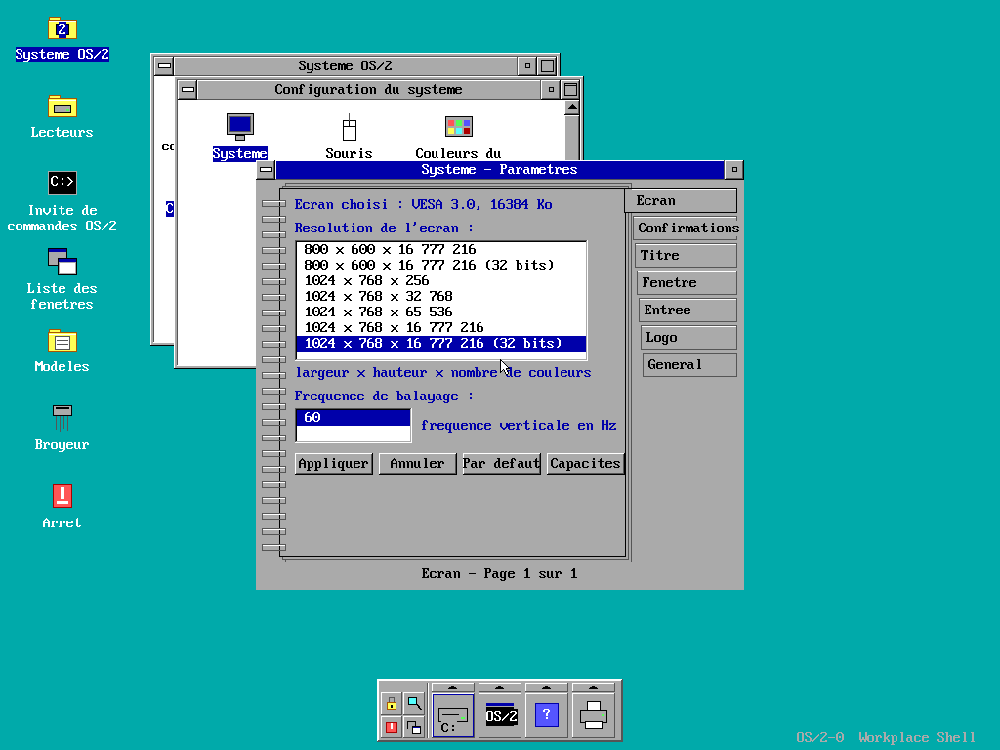

<h3>Carnet « Souris - Paramètres »</h3>

L'objet <b>Souris</b> (Système OS/2 → Configuration du système) ouvre le carnet de la souris de Warp 3, dont chaque réglage agit tout de suite et est gardé dans OS2.INI (application PMSHELL) :

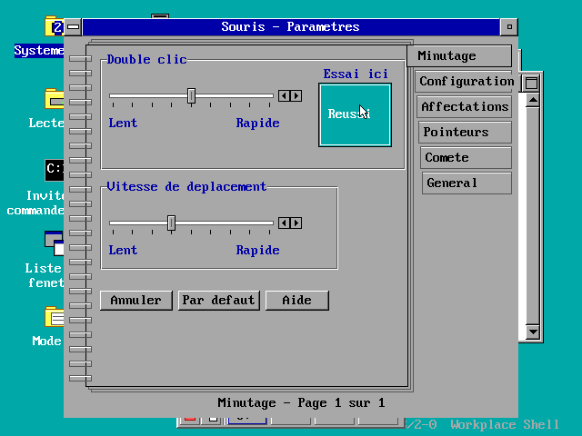

<table>
	<tr><th>Onglet</th><th>Réglages</th></tr>
	<tr><td>Minutage</td><td>Double clic : curseur de Lent à Rapide (1000 à 200 ms, SV_DBLCLKTIME) et <b>zone d'essai</b> qui change de couleur quand le double clic est reconnu ; vitesse de déplacement : curseur de Lent à Rapide (facteurs d'échelle et seuils d'accélération de MOUCALLS.DLL : MouSetScaleFact, MouSetThreshold) ; Annuler, Par défaut, Aide. Les curseurs se glissent à la souris ou s'avancent par leurs flèches.</td></tr>
	<tr><td>Configuration</td><td>Droitier ou gaucher (boutons 1 et 2 inversés par PMWIN : SV_SWAPBUTTON), avec le dessin de la souris.</td></tr>
	<tr><td>Affectations</td><td>Liste des fenêtres : clic du bouton 3 (milieu), double clic du bouton 1 sur le fond du bureau, ou aucun ; menus contextuels : clic du bouton 2 ou Maj + clic du bouton 1 ; glisser-déposer : bouton 2 (et 1) ou bouton 1 seulement.</td></tr>
	<tr><td>Pointeurs</td><td>Taille normale (16 x 16) ou grande (32 x 32), blanc à bord noir ou noir à bord blanc, avec un aperçu (PMWIN : WINSETPOINTERSTYLE, ordinal interne 1009).</td></tr>
	<tr><td>Comète</td><td>Pointeur comète : une traînée d'images grises suit le pointeur et s'efface quand la souris s'arrête ; longueur de la traînée (1 à 6).</td></tr>
	<tr><td>Général</td><td>Titre de l'objet (renomme l'objet et le carnet) ; souris détectée (nombre de boutons) et réglages courants.</td></tr>
</table>

Le pointeur de PMWIN est maintenant fait de « lutins » : les pels qu'ils couvrent sont gardés (valeur du périphérique en mémoire linéaire, couleur sur les plans du VGA) et rendus dans l'ordre inverse du dessin, ce qui permet la grande taille et la traînée.

<h3>Carnet « Pays - Paramètres »</h3>

L'objet <b>Pays</b> de Configuration du système (Système OS/2 → Configuration du système → Pays) ouvre le carnet « Pays - Paramètres » de Warp 3 : reliure à spirale, onglets, boutons Annuler (valeurs à l'ouverture du carnet), Par défaut (valeurs du pays) et Aide, et un exemple mis à jour à chaque changement.

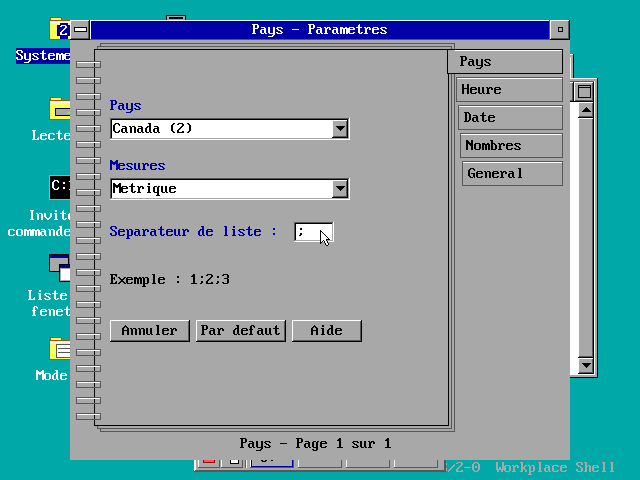

<table>
	<tr><th>Onglet</th><th>Réglages</th></tr>
	<tr><td>Pays</td><td>Pays (liste déroulante : États-Unis, Canada, Amérique latine, Pays-Bas, Belgique, France, Espagne, Italie, Suisse, Royaume-Uni, Danemark, Suède, Norvège, Allemagne, Brésil, Australie, Japon, Portugal, Albanie, Finlande) : tous les formats prennent les valeurs du pays (DosQueryCtryInfo), la ligne <code>COUNTRY=</code> de CONFIG.SYS et la variable <code>COUNTRY</code> de l'environnement changent ; mesures (métriques ou anglo-saxonnes) ; séparateur de liste.</td></tr>
	<tr><td>Heure</td><td>12 ou 24 heures, textes avant midi et après midi (AM, PM), séparateur.</td></tr>
	<tr><td>Date</td><td>Ordre (mois-jour-année, jour-mois-année, année-mois-jour), séparateur.</td></tr>
	<tr><td>Nombres</td><td>Séparateurs des milliers et des décimales, nombre de décimales, zéro avant la virgule, symbole monétaire et sa position (avant ou après le montant, avec ou sans espace).</td></tr>
	<tr><td>Général</td><td>Titre de l'objet.</td></tr>
</table>

Les valeurs sont gardées dans OS2.INI, application <code>PM_National</code>, sous les clés d'OS/2 (<code>iCountry</code>, <code>iMeasurement</code>, <code>sList</code>, <code>iTime</code>, <code>s1159</code>, <code>s2359</code>, <code>sTime</code>, <code>iDate</code>, <code>sDate</code>, <code>sThousand</code>, <code>sDecimal</code>, <code>iDigits</code>, <code>iLzero</code>, <code>sCurrency</code>, <code>iCurrency</code>), que les programmes de Presentation Manager lisent par PrfQueryProfileString. Le noyau met la ligne <code>COUNTRY=</code> de CONFIG.SYS dans la variable <code>COUNTRY</code> ; DOSCALLS.DLL la relit à chaque DosQueryCtryInfo (le changement de pays vaut tout de suite) et connaît maintenant les 20 pays de la liste (NLS.DLL : Albanie ajoutée). Les champs combinés de PMWIN (classe <code>WC_COMBOBOX</code>) déroulent maintenant leur liste au clic : choix au clic ou par Entrée, fermeture par un clic ailleurs.

<h3>Bureau : menu Nouveau et fenêtres redimensionnables</h3>

Le menu contextuel du bureau (clic droit sur le fond, ou Maj+F10) et celui d'un dossier ont un sous-menu <b>Nouveau</b> : <b>Dossier</b> (« Nouveau dossier »), <b>Document texte</b> (« Nouveau document.TXT », ouvert par le Bloc-notes), <b>Image bitmap</b> (« Nouvelle image.BMP », une image BMP 24 bits blanche de 320 x 240, ouverte par Paint), <b>Document HTML</b> (« Nouvelle page.HTML », une page HTML minimale, ouverte par le Navigateur Web) et <b>Fichier de commandes</b> (« Nouveau fichier de commandes.CMD »). Un numéro est ajouté si le nom existe déjà.

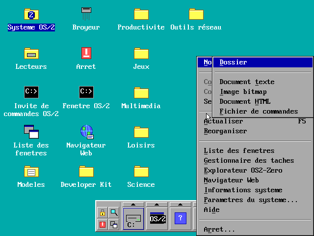

<h3>Bureau et dossiers : Couper, Copier, Coller, Sélectionner tout, Renommer</h3>

Le menu contextuel d'un objet (bouton 2 sur une icône du bureau ou d'un dossier) a maintenant les commandes d'un explorateur de fichiers :

<table>
	<tr><th>Commande</th><th>Effet</th></tr>
	<tr><td>Ouvrir</td><td>Ouvre l'objet, ou tous les objets choisis.</td></tr>
	<tr><td>Ouvrir dans l'Explorateur</td><td>Sur un dossier : l'Explorateur OS2-Zero sur ce dossier. Aussi « Invite de commandes ici ».</td></tr>
	<tr><td>Modifier (Bloc-notes)</td><td>Sur un fichier de commandes, une page HTML ou un fichier de données : l'ouvre dans le Bloc-notes au lieu de l'exécuter ou de l'afficher.</td></tr>
	<tr><td>Couper (Ctrl+X), Copier (Ctrl+C)</td><td>Met les objets choisis dans le presse-papiers, celui de l'Explorateur OS2-Zero (mémoire partagée <code>\SHAREMEM\EXPLORER.CLP</code> et texte CF_TEXT) : on copie sur le bureau et on colle dans l'Explorateur, ou l'inverse. Un programme ou un objet du système (dossier Jeux, Fenêtre OS/2…) se copie mais ne se coupe pas : Coller en fait un raccourci, comme le Workplace Shell.</td></tr>
	<tr><td>Coller (Ctrl+V)</td><td>Sur le fond : dans le bureau ou le dossier ; sur un dossier : dans ce dossier. Copie d'un lecteur à l'autre, déplacement (DosMove) sur le même lecteur pour Couper, « Copie de nom » si l'objet est collé dans son propre dossier, confirmation avant de remplacer un objet du même nom, refus de coller un dossier dans lui-même.</td></tr>
	<tr><td>Coller le raccourci</td><td>Crée des raccourcis vers les objets copiés.</td></tr>
	<tr><td>Sélectionner tout (Ctrl+A), Inverser la sélection</td><td>Choix de plusieurs objets ; Ctrl+clic ajoute un objet au choix ou l'en retire. Couper, Copier, Supprimer, Ouvrir et Propriétés agissent sur tout le choix.</td></tr>
	<tr><td>Supprimer… (Suppr)</td><td>Une seule confirmation pour plusieurs objets (« Supprimer ces 2 objets ? ») ; les objets du système ne sont jamais supprimés.</td></tr>
	<tr><td>Renommer… (F2)</td><td>Boîte Renommer (le nom sans l'extension est choisi) pour un fichier, un dossier ou un raccourci ; la position de l'icône sur le bureau suit le nouveau nom.</td></tr>
	<tr><td>Propriétés</td><td>Pour les fichiers et dossiers, la boîte Propriétés de l'Explorateur OS2-Zero (<code>EXPLORER /FPROPS fichier…</code>) : type, emplacement, taille, contenu, dates de création, de modification et de dernier accès, attributs modifiables ; pour plusieurs objets, leur taille totale. Sur le fond d'un dossier : les propriétés du dossier.</td></tr>
</table>

Les commandes qui ne s'appliquent pas sont grisées (MIA_DISABLED) : Couper, Supprimer et Renommer sur un objet du système, Coller quand le presse-papiers ne contient pas d'objets.

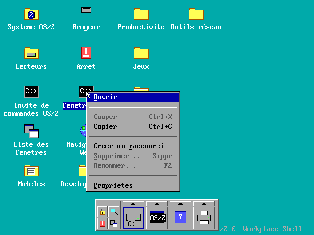

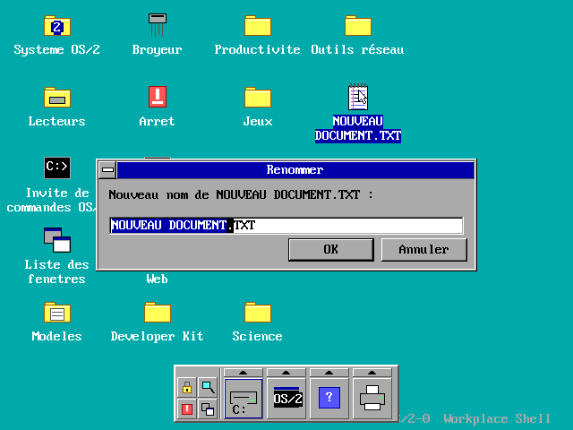

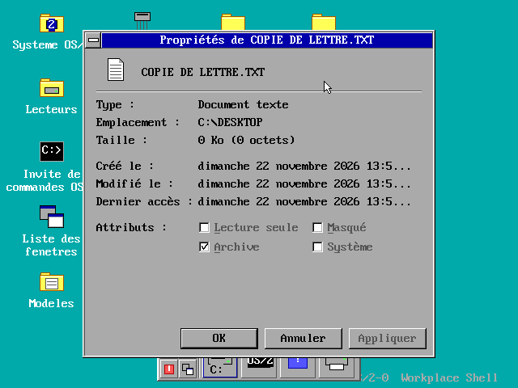

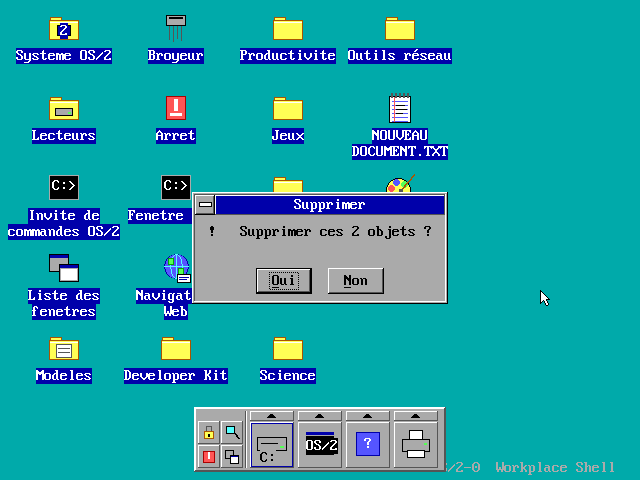

Les fenêtres à bordure de taille (FCF_SIZEBORDER), dont les dossiers du bureau, se redimensionnent maintenant à la souris : <b>PMWIN</b> reconnaît le bord gauche, droit, haut ou bas et les quatre coins (16 pels) d'un cadre, même quand la souris est sur un contrôle du cadre (les coins du bas débordent sur le bouton de la barre de défilement), capture la souris et suit le glissement par WinSetWindowPos (taille d'au moins 100 x 60 pels) ; la fenêtre cliente reçoit WM_SIZE et se redessine. Le pointeur prend la forme des flèches de taille d'OS/2 (horizontale, verticale ou diagonale, comme SPTR_SIZEWE, SPTR_SIZENS, SPTR_SIZENWSE et SPTR_SIZENESW) dès qu'il survole un bord ou un coin.

<b>Lecteurs</b> : au démarrage du CD-ROM, C: est le CD-ROM ; au démarrage du disque dur où OS/2-0 est installé, C: est sa partition et le CD-ROM reçoit maintenant la première lettre libre après les partitions (D: le plus souvent) : le noyau lit son volume ISO 9660 par l'ATAPI (IDE ou AHCI) avec le même code que le C: d'un démarrage du CD-ROM. Le dossier Lecteurs montre « Lecteur C » et « Lecteur D (CD-ROM) » ; avant, le CD-ROM n'avait pas de lettre et C: était toujours appelé CD-ROM.

<h3>LaunchPad (LAUNCHPAD.PAS)</h3>

Le fichier <b>LAUNCHPAD.PAS</b> est le <b>LaunchPad</b> d'OS/2 Warp 3 (<b>LAUNCHPD.EXE</b> sur le CD-ROM, nom 8.3 de l'ISO 9660) : PMSHELL le lance au démarrage du bureau (sauf si OS2.INI contient PMSHELL, LAUNCHPAD = 0), dans la session de Presentation Manager, et les deux programmes s'exécutent en même temps. C'est une petite barre toujours visible, en bas au centre de l'écran (déplaçable en glissant son fond ; position gardée dans OS2.INI).

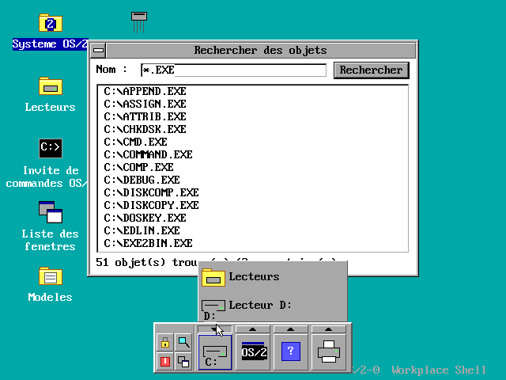

<table>
	<tr><th>Élément</th><th>Rôle</th></tr>
	<tr><td>Actions (petits boutons)</td><td><b>Verrouiller</b> : écran de verrouillage (fenêtre système modale qui capture la souris et le clavier ; mot de passe facultatif, OS2.INI LAUNCHPAD MOTDEPASSE) ; <b>Rechercher</b> : recherche de fichiers sur toutes les unités (masque avec * et ?), faite en arrière-plan quelques répertoires à la fois, un double clic ou Entrée ouvre le résultat ; <b>Arrêt</b> ; <b>Liste des fenêtres</b>.</td></tr>
	<tr><td>Objets (grands boutons)</td><td>Lecteur C:, Invite de commandes OS/2, Aide, Imprimante (file d'attente du spouleur PMSPL.DLL : travaux, annulation, « Imprimer... » un fichier par SplQmWriteFile).</td></tr>
	<tr><td>Tiroirs</td><td>La flèche au-dessus d'un objet ouvre son tiroir : Lecteurs et les autres unités ; Système OS/2 et Modèles ; Informations sur le système ; Imprimer un fichier...</td></tr>
	<tr><td>Ajouter, retirer</td><td>Sans limite : on dépose un objet du bureau ou d'un dossier sur la barre (sur un bouton : dans son tiroir), ou menu contextuel (bouton 2) : Ajouter un programme ou un dossier..., Retirer cet objet, Mot de passe de verrouillage..., Fermer le LaunchPad. Les objets sont gardés dans OS2.INI (application LAUNCHPAD).</td></tr>
	<tr><td>Aide et clavier</td><td>La souris immobile sur un bouton affiche son nom (bulle d'aide). Barre active : flèches gauche et droite, Entrée ou espace, flèche haut (tiroir), Échap.</td></tr>
</table>

Les dossiers, les programmes et les fichiers sont ouverts par le bureau : le LaunchPad écrit la demande dans OS2.INI (PMSHELL, REQ<i>n</i> : OPEN, DRIVES, SYS, TEMPL, CMD, RUN, BATCH, VIEW, WINLIST, HELP, INFO, SHUTDOWN) et poste WM_USER + 1 à la fenêtre du bureau (PMSHELL, HWND) ; un objet déposé par PMSHELL arrive par LAUNCHPAD, DEPOT et WM_USER + 1 à la barre.

Pour que deux programmes de PM partagent l'écran, PMWIN.DLL remet maintenant la souris et le clavier à la file de la fenêtre visée, même quand c'est un autre processus qui a lu l'événement (une touche pour un autre processus lui est mise en attente : ses crochets, accélérateurs et procédures sont appelés par lui), et une fenêtre qui se dessine fait redessiner les fenêtres des autres processus placées au-dessus d'elle. Deux corrections d'OS2PC ont aussi été nécessaires : l'instruction <code>F(x)^.champ := valeur</code> (fonction qui rend un pointeur) était compilée comme un simple appel, et <code>GetMem(Pointer(v), n)</code> rangeait le pointeur ailleurs que dans <code>v</code>.

<h3>Installation sur un disque dur (INSTALL.PAS, CD-ROM IMAGE/OS2INST.ISO)</h3>

Le fichier <b>INSTALL.PAS</b> est le programme OS/2 <b>INSTALL.EXE</b>, le programme d'installation graphique d'OS/2-0, à l'apparence de l'installation d'OS/2 Warp 3 (fenêtres de Presentation Manager sur fond turquoise). Le nouveau CD-ROM <b>IMAGE/OS2INST.ISO</b> contient les mêmes fichiers que <b>IMAGE/OS2CD.ISO</b>, avec le CONFIG.SYS de <b>IMAGE/INSTALL</b> (<code>PROTSHELL=C:\INSTALL.EXE</code>) : il démarre directement dans l'installation. Une fois OS/2-0 installé, l'ordinateur démarre du disque dur, sans CD-ROM, et la partition HPFS devient l'unité C:.

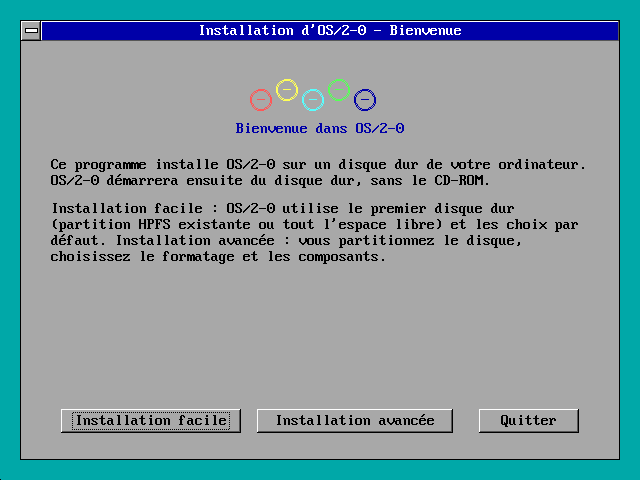
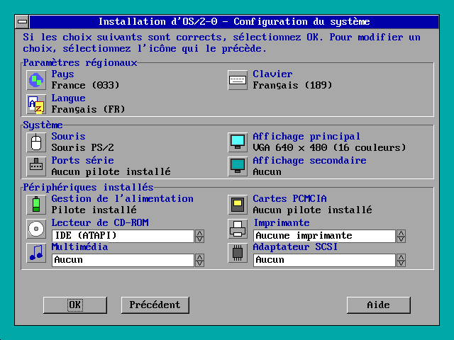

<table>
	<tr><th>Étape</th><th>Rôle</th></tr>
	<tr><td>Bienvenue</td><td>Installation facile (premier disque dur : partition HPFS existante, ou tout l'espace libre ; choix par défaut) ou avancée ; Quitter redémarre l'ordinateur.</td></tr>
	<tr><td>Configuration du système</td><td>Le tableau de bord de Warp 3 : pays, clavier, <b>langue</b> (nouveau, français par défaut), souris, ports série, affichage principal (VGA 640 x 480 ou un mode VESA : <code>SET PMRESOLUTION=</code>), affichage secondaire, gestion de l'alimentation, PCMCIA, CD-ROM, imprimante, multimédia, SCSI. Un clic sur l'icône (ou le titre) d'un choix ouvre la liste de ses valeurs ; les champs à flèches changent de valeur. L'assistant change aussitôt de langue (français, anglais, allemand, espagnol, italien, albanais ; le portugais, le suédois, le danois et le japonais sont affichés en anglais), le pays et le clavier suivent.</td></tr>
	<tr><td>Partitionnement du disque dur</td><td>Comme FDISK : disques IDE (modèle, taille), partitions principales et espaces libres ; création d'une partition HPFS (07h) dont on donne la taille en Mo (alignée sur 1 Mo, après les 4 premiers Mo du disque), suppression (après confirmation), choix de la partition. La table est écrite au secteur 0 du disque.</td></tr>
	<tr><td>Formatage</td><td><b>HPFS</b> (choix par défaut, le système de fichiers d'OS/2, par HPFS.IFS : FS_FSCTL 8000h) ou <b>NTFS</b> (par NTFS.IFS : KrnDiskCtl 11 ; les fichiers se partagent alors facilement avec Windows et Linux), avec le nom du volume ; « Ne pas formater » garde les fichiers d'une partition HPFS ou NTFS existante (réinstallation). <code>SET INSTALL_FS=NTFS</code> dans le CONFIG.SYS du CD-ROM d'installation fait de NTFS le choix initial (et le choix de l'installation facile).</td></tr>
	<tr><td>Composants</td><td>Système de base et Presentation Manager (obligatoire), bureau et LaunchPad (sinon <code>PROTSHELL=C:\CMD.EXE</code>), utilitaires, programmes d'essai TEST*.EXE, disque virtuel de 4 Mo (les applications, dont celles des dossiers Science et Productivité, sont toujours installées), jeux (Solitaire - Klondike, Échecs, Mahjongg, Sudoku, Othello, TileMan, Hex 2048, Backgammon, Poker, Billard, Checkers, Yahtzee, Bataille navale, Puissance 4, Soko-Ban, Baccarat, Tours de Hanoï, Baby, 421, Mille-pattes, Astéroïde, Badugi, Tic-Tac-Toe, Baseball, Excavateur, Pinball, Barbu, Casse-Brique, Bataille, Invasion de l'espace, FreeCell, Commandement des missiles, L25) et loisirs (Astromancie, Onirologie et son récit d'exemple REVE.TXT), multimédia (Audio numérique, Lecteur MP3 et son morceau d'exemple, Notator for OS2-Zero et ses exemples, MDM.DLL, pilotes des cartes son, sons), réseau TCP/IP (TCPIP32.DLL, E1000.DLL, PCNET.DLL, IFCONFIG, PING, HOST, WGET, Outlink) ; espace nécessaire et espace disponible.</td></tr>
	<tr><td>Transfert des fichiers</td><td>Barre de progression aux logos OS/2, fichier courant ; copie des fichiers du CD-ROM, création de C:\DESKTOP et C:\AIDE, CONFIG.SYS du disque dur (<code>IFS=C:\HPFS.IFS /CACHE:64 /AUTOCHECK:C</code>, <code>SET LANGUAGE=</code>, <code>COUNTRY=</code>, <code>DEVINFO=KBD,...</code>, <code>SET PMRESOLUTION=</code>...), zone d'amorçage et secteur d'amorce principal.</td></tr>
	<tr><td>Fin</td><td>Retirer le CD-ROM puis Redémarrer (les tampons des volumes sont vidés, puis remise à zéro par le contrôleur du clavier).</td></tr>
</table>

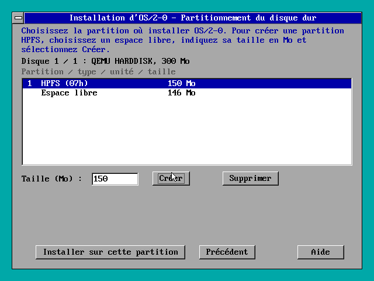
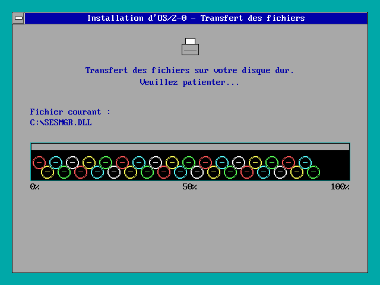

Démarrage du disque dur : le secteur d'amorce principal (<b>KERNEL/HDBOOT.ASM</b>, assemblé une fois et recopié dans le tableau MbrCode de INSTALL.PAS) cherche la partition active, lit le répertoire de la <b>zone d'amorçage</b> (secteur 1 du disque : <code>OS20BOOT</code>, puis des entrées nom, LBA, taille) et charge OS2LDR en 2000:0000 ; la zone d'amorçage (secteurs 1 à 8191, avant la première partition) contient OS2LDR, OS2KRNL et HPFS.IFS. OS2LDR lit alors des secteurs de 512 octets au lieu de 2048, charge le noyau et recopie HPFS.IFS en 00600000h ; le bloc d'information d'amorçage reçoit <code>'HD'</code> (+34h), le début de la partition active (+38h) et l'adresse de HPFS.IFS (+40h). Le noyau charge ce pilote depuis la mémoire, monte la partition active en <b>C:</b> (HPFS), puis lit C:\CONFIG.SYS et les DLL sur le disque ; le lecteur de CD-ROM n'est plus nécessaire. Nouvelle API du noyau <b>KrnDiskCtl</b> (disques IDE : description, lecture et écriture de secteurs, formatage et montage d'une partition, démontage, vidage des tampons, redémarrage) et <b>SetEnvironmentVariableA</b> (environnement du système).

<pre>qemu-img create -f raw disque.img 300M
qemu-system-i386 -m 64 -cdrom IMAGE/OS2INST.ISO -hda disque.img -boot d
qemu-system-i386 -m 64 -hda disque.img</pre>

<h3>Écran de démarrage graphique</h3>

Au démarrage du disque dur, les messages du noyau ne défilent plus à la console : OS2KRNL passe aussitôt en 640 × 480 × 16 couleurs (mode 12h du BIOS) et montre la boîte <b>Démarrage d'OS/2-0</b>, avec le logo d'OS/2 Zero, la liste des étapes et une progression faite de cercles. Chaque étape terminée est cochée en vert, une flèche et le gras désignent l'étape en cours, et les cercles se remplissent d'une étape à l'autre, ainsi qu'à chaque module (DLL, pilote IFS) chargé. La boîte reste à l'écran jusqu'à ce que Presentation Manager le prenne.

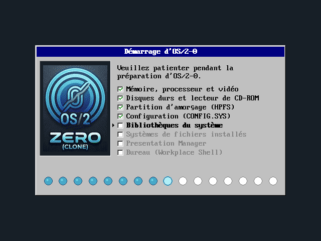

<table>
	<tr><th>Étape</th><th>Travail du noyau</th></tr>
	<tr><td>Mémoire, processeur et vidéo</td><td>Relevé des modes VESA (INT 10h, 4F00h/4F01h).</td></tr>
	<tr><td>Disques durs et lecteur de CD-ROM</td><td>Contrôleurs IDE et lecteur ATAPI.</td></tr>
	<tr><td>Partition d'amorçage (HPFS ou NTFS)</td><td>Pilote IFS chargé par OS2LDR, partitions, montage de C:.</td></tr>
	<tr><td>Configuration (CONFIG.SYS)</td><td>Lecture de C:\CONFIG.SYS.</td></tr>
	<tr><td>Bibliothèques du système</td><td>DOSCALLS.DLL.</td></tr>
	<tr><td>Systèmes de fichiers installés</td><td>Lignes <code>IFS=</code>, autres volumes, disque virtuel.</td></tr>
	<tr><td>Presentation Manager</td><td>Chargement du processeur de commandes (PMSHELL.EXE) et de ses DLL : un cercle par module.</td></tr>
	<tr><td>Bureau (Workplace Shell)</td><td>Démarrage du bureau, jusqu'à la première file de messages de PM.</td></tr>
</table>

Le journal reste complet : les messages vont toujours au port série et dans l'écran texte de la session 0, dont les pages B8000h sont redirigées vers son tampon pendant que la carte est en mode graphique. <b>Échap</b> ramène la console texte avec tout le journal ; une erreur du noyau (<code>SYS…</code>, <code>OS2KRNL:</code>), une exception, un programme en mode texte qui lit le clavier (PROTSHELL=C:\CMD.EXE) ou un processeur de commandes qui se termine avant PM font de même. <code>SET BOOTSCREEN=TEXTE</code> dans CONFIG.SYS garde la console. Le dessin se fait dans un tampon d'un octet par point, recopié plan par plan dans la mémoire de la carte VGA, zones modifiées seulement. Le logo (128 × 172 points, palette de 16 couleurs programmée dans le DAC) est dans <b>KERNEL/LOGO.INC</b>, produit par <b>TOOLS/MKLOGO.PY</b> à partir de <b>IMAGE/LOGO_OS2ZERO.png</b>. VIOCALLS.DLL, chargée pendant l'écran de démarrage, ne lit plus l'état d'origine du VGA (police, palette, registres) sur la carte, alors en mode graphique, mais dans l'état du mode texte que le noyau a relevé juste avant (<code>KrnVideo</code> 6) : le bureau garde sa police et les sessions plein écran leurs couleurs.

Langue : la variable <code>LANGUAGE</code> de CONFIG.SYS (convention commune avec MSDOS-0, Pasdows95...) vaut <code>FR</code> (français, par défaut), <code>EN</code> (anglais), <code>GR</code> (allemand), <code>SP</code> (espagnol), <code>IT</code> (italien), <code>ALB</code> ou <code>SQ</code> (albanais, shqip), <code>PT</code> ou <code>PRT</code> (portugais), <code>SE</code> ou <code>SWE</code> (suédois), <code>DK</code> ou <code>DNK</code> (danois), <code>JP</code> ou <code>JPN</code> (japonais en romaji) ; <code>ES</code> est aussi accepté pour l'espagnol. Après l'installation, elle se change dans <b>Système OS/2 → Configuration du système → Langue</b> (onglet Langue du carnet Système - Paramètres) : la ligne <code>SET LANGUAGE=</code> de C:\CONFIG.SYS est modifiée et l'environnement du système aussi (les programmes lancés ensuite, comme CMD.EXE et les commandes, utilisent la nouvelle langue).

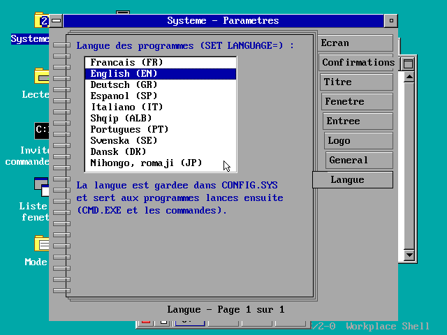

Le CD-ROM amorçable <b>IMAGE/OS2CD.ISO</b> contient OS2BOOT, OS2LDR, OS2KRNL, CONFIG.SYS, DOSCALLS.DLL, FKA.DLL, HPFS.IFS, VIOCALLS.DLL, MOUCALLS.DLL, NLS.DLL, KBDCALLS.DLL, MONCALLS.DLL, MSG.DLL, NAMPIPES.DLL, SESMGR.DLL, QUECALLS.DLL, SPOOLCP.DLL, RMINFO.DLL, OS2SM.DLL, HELPMGR.DLL, LIBUNI.DLL, PMDRAG.DLL, PMWIN.DLL, PMGPI.DLL, PMMERGE.DLL, PMPIC.DLL, PMSHAPI.DLL, PMSPL.DLL, PMVIOP.DLL, API16.DLL, PMWP.DLL, PMCTLS.DLL, MDM.DLL, SBAUDIO.DLL, ICHAUDIO.DLL, ESAUDIO.DLL, VBOXGST.DLL, VMWTOOLS.DLL, TCPIP32.DLL, TLS32.DLL, NTFS.IFS, E1000.DLL, PCNET.DLL, CMD.EXE, PMSHELL.EXE, LAUNCHPD.EXE, INSTALL.EXE, KLONDIKE.EXE, ECHECS.EXE, MAHJONGG.EXE, DIGAUDIO.EXE, MP3PLAY.EXE, ASTROMAN.EXE, REVES.EXE, REVE.TXT, ASTRO.EXE, SIMUPLAN.EXE, CS3DA.EXE, HUMAN.C3D, PHYSIO.CFG, ELEMENTS.EXE, CHEMDRAW.EXE, DEVMGR.EXE, TASKMGR.EXE, BROWSER.EXE, IFCONFIG.EXE, PING.EXE, HOST.EXE, WGET.EXE, DEMARRE.WAV, CLOCHE.WAV, AURORE.MP3, TESTDOS.EXE, TESTFKA.EXE, TESTHPFS.EXE, TESTVIO.EXE, TESTMOU.EXE, TESTNLS.EXE, TESTKBD.EXE, TESTMON.EXE, TESTMSG.EXE, TESTNMP.EXE, TESTSES.EXE, TESTQUE.EXE, TESTPFS.EXE, TESTRM.EXE, TESTSM.EXE, TESTHLP.EXE, TESTUNI.EXE, TESTDRG.EXE, TESTWIN.EXE, TESTGPI.EXE, TESTMRG.EXE, TESTPIC.EXE, TESTSHA.EXE, TESTSPL.EXE, TESTVIOP.EXE, TESTMDM.EXE, TESTVDM.EXE et les commandes du dépôt compilées avec OS2PC. Il se fabrique avec <b>TOOLS/MAKEISO.PAS</b> (ISO 9660 + El Torito) ; le script <b>KERNEL/BUILD.sh</b> (ou <b>KERNEL/BUILD.BAT</b>) reconstruit le tout :

<pre>KERNEL/BUILD.sh
qemu-system-i386 -m 64 -cdrom IMAGE/OS2CD.ISO -boot d</pre>

Le même script fabrique aussi le CD-ROM d'installation <b>IMAGE/OS2INST.ISO</b>.

Pour essayer HPFS sur un disque dur, ajouter une image disque dont une partition est de type 07h (<code>-hda disque.img</code>) : formatée HPFS, elle devient l'unité D: (le disque virtuel passe à E:).

Voir <a href="../IMAGE/LISEZMOI.TXT">IMAGE/LISEZMOI.TXT</a> pour les détails (carte mémoire, CONFIG.SYS, limites).

<a href="../README.md">&larr; Retour au README</a>

