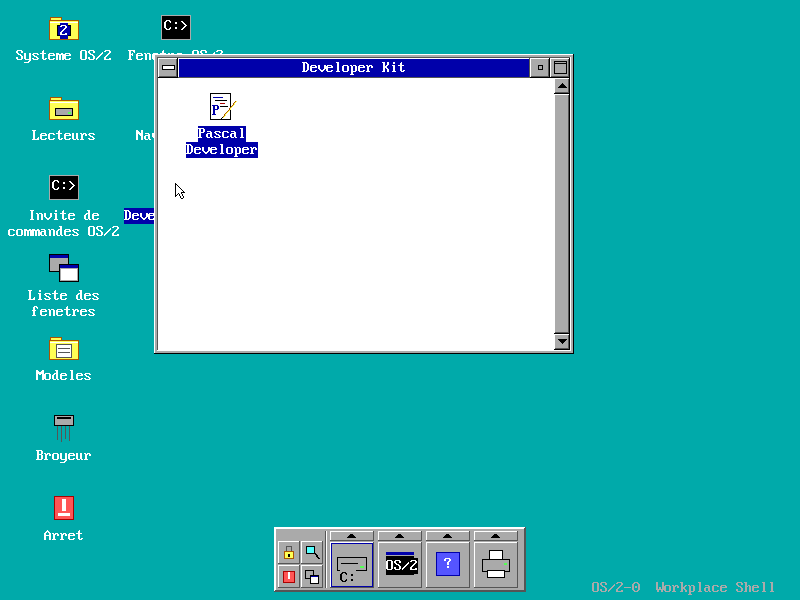
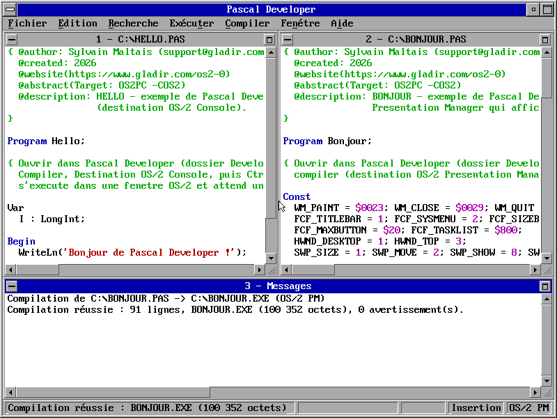
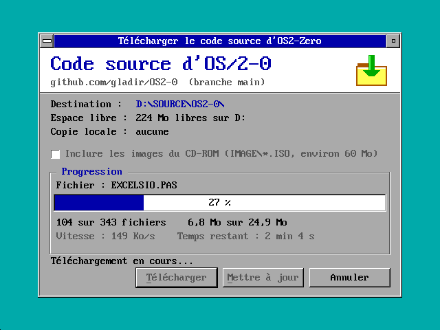
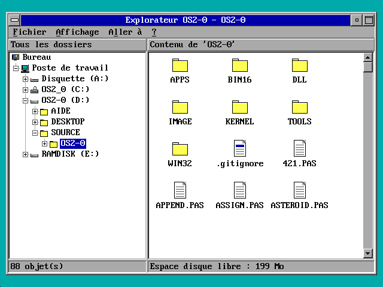
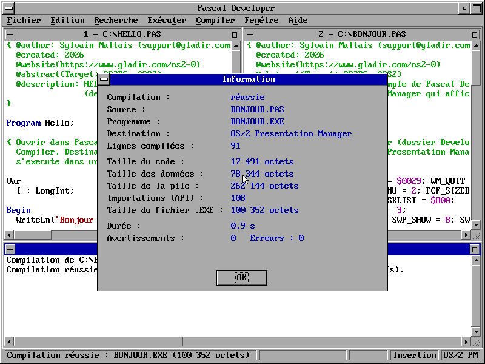
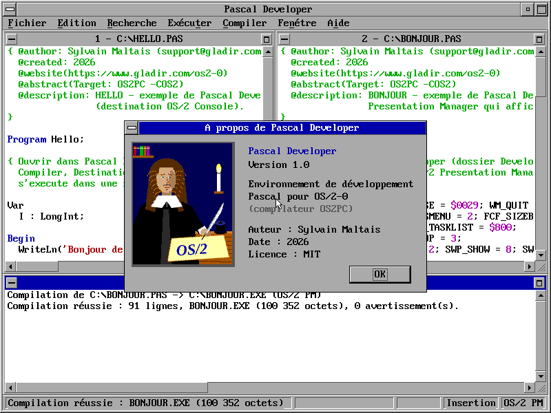
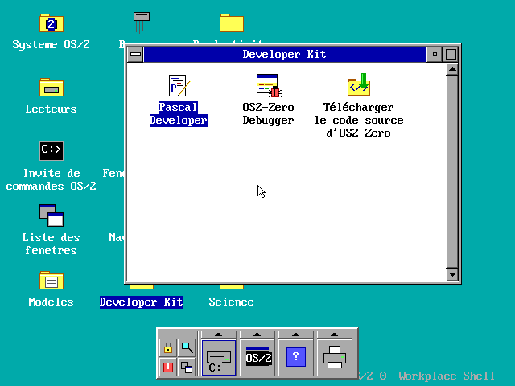
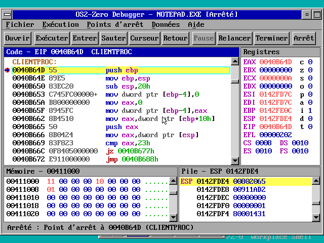
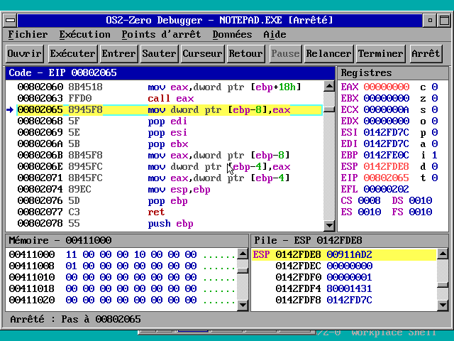
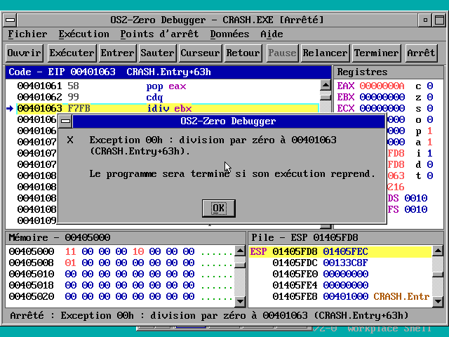

<h1>OS2-0 : Développement</h1>

<a href="../README.md">&larr; Retour au README</a>

<h3>Pascal Developer (PASDEV.PAS) et dossier Developer Kit</h3>

Le bureau a maintenant un dossier <b>Developer Kit</b> qui contient <b>Pascal Developer</b> (PASDEV.EXE), un environnement de développement intégré Pascal dans l'esprit de Borland Pascal, mais avec l'apparence d'OS/2 :

<table>
	<tr><th>Fonction</th><th>Description</th></tr>
	<tr><td>Fenêtres MDI</td><td>Les sources s'ouvrent dans des fenêtres d'édition dessinées dans la zone de travail : barre de titre aux couleurs du système (glisser pour déplacer, double clic ou case de droite pour agrandir, case de gauche pour fermer), barres de défilement, coin de redimensionnement ; menu Fenêtre : Mosaïque, Cascade, Suivante (F6), Messages, Liste (Alt+0), Fermer tout.</td></tr>
	<tr><td>Coloration syntaxique</td><td>Mots réservés, directives <code>{$...}</code>, commentaires <code>{ }</code>, <code>(* *)</code> et <code>//</code> (même sur plusieurs lignes), chaînes et caractères <code>#nn</code>, nombres décimaux et hexadécimaux.</td></tr>
	<tr><td>Fichier, Édition, Recherche</td><td>Nouveau (Ctrl+N), Ouvrir (F3 : liste des répertoires et des sources), Enregistrer (F2), Enregistrer sous, Enregistrer tout, Fermer (Alt+F3), Quitter (Alt+X) ; Couper, Copier, Coller (presse-papiers de PM, touches CUA et Borland), Effacer, Tout sélectionner ; Rechercher (Ctrl+F), Occurrence suivante (Ctrl+L), Aller à la ligne (Ctrl+G), Ouvrir le fichier au curseur (Ctrl+Entrée, pour un <code>Uses</code> ou un <code>{$I}</code>).</td></tr>
	<tr><td>Compiler (F9)</td><td>Le source est enregistré puis compilé par <b>OS2PC.EXE</b>, le compilateur OS2PC compilé par lui-même pour OS/2-0 ; sa sortie standard est redirigée vers un fichier et ses messages (erreurs, avertissements avec leur numéro de ligne) vont dans la fenêtre <b>Messages</b> : un double clic va à la ligne en cause. Le compilateur tourne en arrière-plan (DosExecPgm asynchrone, fin attendue par un minuteur et DosWaitChild) : l'EDI et le bureau restent utilisables pendant la compilation. Une boîte <b>Compilation</b>, comme celle de Borland Pascal, montre le fichier principal, la destination, l'étape (lecture du source, déclarations, procédures et instructions, génération du code, écriture du .EXE), la ligne en cours sur le nombre de lignes, les erreurs, les avertissements, la durée et une barre de progression ; elle se ferme à la fin. Son bouton <b>Annuler</b> (ou Échap) arrête le compilateur (DosKillProcess) : la sortie déjà produite reste dans la fenêtre Messages et l'EDI est aussitôt prêt pour une nouvelle compilation. OS2PC publie sa progression avec l'option <code>-PRG</code> dans la mémoire partagée <code>\SHAREMEM\OS2PC.PRG</code> créée par Pascal Developer (aucune écriture sur disque).</td></tr>
	<tr><td>Destination</td><td>Menu Compiler : <b>OS/2 Presentation Manager</b> (par défaut, symbole <code>OS2PM</code>) ou <b>OS/2 Console</b> (symbole <code>OS2CONSOLE</code>).</td></tr>
	<tr><td>Exécuter (Ctrl+F9)</td><td>Compile si le source a changé, puis lance le programme : directement pour PM, dans une fenêtre OS/2 (pause à la fin) pour une console ; un programme compilé pour PM qui n'ouvre aucune fenêtre (ni WinInitialize ni WinCreateStdWindow : un simple WriteLn) est lui aussi lancé dans une fenêtre OS/2, sinon sa sortie ne serait visible nulle part ; Paramètres : arguments du programme.</td></tr>
	<tr><td>Information</td><td>Taille du code, des données, de la pile et du fichier .EXE, importations, lignes compilées, durée, avertissements et erreurs de la dernière compilation.</td></tr>
	<tr><td>Barre d'état et menu contextuel</td><td>Ligne et colonne du curseur, Insertion ou Refrappe (touche Ins), fichier modifié, destination ; bouton 2 de la souris (ou Maj+F10) : Couper, Copier, Coller, Effacer, Tout sélectionner, Ouvrir le fichier au curseur, Aller à la ligne, Compiler, Exécuter, Information.</td></tr>
</table>

Alt+F9 (réduire) et F10 (menu) sont des touches du système d'OS/2 : la compilation est sur F9 (le « Make » de Borland). Deux exemples sont copiés sur le CD-ROM : <b>BONJOUR.PAS</b> (fenêtre de PM) et <b>HELLO.PAS</b> (console).

<h3>Télécharger le code source d'OS2-Zero (GETSRC.PAS)</h3>

Le dossier <b>Developer Kit</b> contient aussi <b>Télécharger le code source d'OS2-Zero</b> (GETSRC.EXE) : une boîte de dialogue qui copie le code source actuel d'OS/2-0 depuis GitHub (dépôt <code>gladir/OS2-0</code>, branche par défaut) dans le dossier <b>C:\SOURCE\OS2-0\</b>. Seuls les fichiers du projet sont copiés : ni l'historique ni les données de Git (pas de dossier <code>.git</code>). À la fin, l'<b>Explorateur OS2-Zero</b> s'ouvre sur le dossier.

<table>
	<tr><th>Fonction</th><th>Description</th></tr>
	<tr><td>Télécharger</td><td>La liste des fichiers vient de l'API de GitHub (arbre complet de la branche, <code>api.github.com</code>) ; chaque fichier est ensuite téléchargé de <code>raw.githubusercontent.com</code> en <b>https://</b> par TLS32.DLL, sur une seule connexion gardée ouverte d'un fichier à l'autre (HTTP/1.1), et les dossiers sont créés au besoin. Les noms et chemins sont ceux du dépôt.</td></tr>
	<tr><td>Mettre à jour</td><td>La liste <code>C:\SOURCE\OS2-0.LST</code> garde l'empreinte SHA-1 de Git et la taille de chaque fichier copié : seuls les fichiers nouveaux ou modifiés sont téléchargés, ceux qui ont été retirés du dépôt sont effacés. La liste est enregistrée en cours de route : après une coupure, Mettre à jour reprend où le téléchargement s'est arrêté.</td></tr>
	<tr><td>Annuler</td><td>Interrompt le téléchargement (le fichier en cours est effacé) ; une fois terminé, le bouton devient Fermer.</td></tr>
	<tr><td>Progression</td><td>Barre de progression avec pourcentage, nom du fichier en cours, nombre de fichiers et d'octets copiés, vitesse et temps restant ; le travail se fait dans un fil d'exécution à part, la fenêtre reste active.</td></tr>
	<tr><td>Images du CD-ROM</td><td>Les fichiers <code>IMAGE\*.ISO</code> (une soixantaine de Mo) ne sont copiés que si la case est cochée.</td></tr>
	<tr><td>Contrôles</td><td>Espace libre vérifié avant de commencer ; erreurs expliquées (réseau, disque, message de GitHub). L'API de GitHub permet 60 demandes par heure et par adresse sans jeton (deux par téléchargement) ; <code>SET GITHUB_TOKEN=...</code> permet d'en faire davantage. Proxy : <code>SET HTTP_PROXY=hôte:port</code>.</td></tr>
</table>

Essayé sous QEMU avec le vrai dépôt : 343 fichiers (25 Mo) copiés de raw.githubusercontent.com, puis Mettre à jour (aucun fichier à copier). La régression utilise un faux GitHub local en https:// (liste, fichiers, puis un fichier modifié, un ajouté et un retiré). Paramètres d'essai : <code>/DEST:dossier</code>, <code>/API:</code> et <code>/RAW:</code> (serveurs), <code>/AUTO</code>, <code>/UPDATE</code>, <code>/ISO</code>, <code>/NOEXPLORER</code>.

La boîte <b>À propos</b> montre Blaise Pascal écrivant OS/2 à la plume (image de 144 x 176 pels en 16 couleurs, tramée, rangée par rangée dans le source) :

Pour que OS2PC se compile lui-même et produise un OS2PC.EXE qui fonctionne sous OS/2-0, le compilateur a été corrigé : grandes tables allouées au démarrage (DosAllocMem), variables globales d'un type alias de <code>String</code>, <code>Pos</code> sur des chaînes Pascal (<code>Pos(#0, S)</code>), procédures imbriquées appelées par une procédure sœur (lien statique), variables portant le nom d'une fonction prédéfinie (<code>Mem</code>), <code>Move</code> avec recouvrement, procédure du programme prioritaire sur une prédéfinie du même nom (<code>InsLine</code> de Crt), caractère <code>#0</code> conservé par le lexeur. OS2PC.EXE produit les mêmes fichiers, octet pour octet, que le compilateur construit par Free Pascal (HELLO, TREE, KLONDIKE, BONJOUR, et PASDEV lui-même). OS2PC écrit le fichier .EXE par un tampon de 64 Ko : il l'écrivait octet par octet, et sous OS/2-0 chaque écriture devenait un DosWrite puis une écriture de secteur du disque (HPFS.IFS) ; compiler BONJOUR.PAS sur le disque dur faisait plus de 60 millions d'accès au contrôleur IDE et 817 000 lectures de l'horloge (sous VirtualBox au-dessus de Hyper-V, autant de sorties de la machine virtuelle : la compilation semblait figée), contre 2,2 millions (surtout le chargement d'OS2PC.EXE) et 45 maintenant ; les fichiers produits sont identiques octet pour octet. Ses tables n'ont <b>aucune taille maximale</b> : elles commencent petites et grandissent à la demande, tant qu'il reste de la mémoire (jetons, symboles, types, champs de record, procédures, données, constantes typées, commutateurs <code>{$I}</code> et <code>{$R}</code>, code machine, étiquettes, adresses à corriger, importations, exportations, relocalisations). Les tables d'enregistrements sont des tableaux de pointeurs vers des fiches allouées par blocs et jamais déplacées : seul le tableau des pointeurs grandit, si bien qu'une affectation comme <code>TypeTab^[T]^.Base := ParseType(...)</code> reste juste même si la fonction appelée ajoute des types (le code produit par OS2PC calcule l'adresse de gauche avant l'appel), et qu'aucun grand bloc contigu n'est nécessaire. Avant, OS2PC.EXE réservait environ 40 Mo au départ et avait des limites fixes (4 096 symboles, 384 types, 64 champs par record, 512 Ko de code, 8 192 étiquettes, 16 384 adresses à corriger…), au-delà desquelles certaines entrées étaient ignorées sans erreur. Maintenant, 64 Mo suffisent pour compiler PASDEV.PAS (4 000 lignes) dans OS/2-0, et un programme d'essai de 15 700 lignes (337 000 jetons, 6 600 symboles, plus de 700 types, un record de 100 champs, 1,6 Mo de code) se compile avec 256 Mo ; le compilateur construit par Free Pascal produit, pour tous les programmes du système, les mêmes fichiers octet pour octet qu'avant. Deux défauts faisaient échouer la compilation, dans OS/2-0, de programmes ordinaires (dès que la table des procédures dépassait 64 entrées, ou dès la 17e fonction externe), par exemple 421.PAS téléchargé par « Télécharger le code source d'OS2-Zero » : la compilation semblait ne jamais finir, ou finissait sur une fausse erreur « identificateur déjà déclaré ». D'abord, les petits blocs de <code>GetMem</code> et <code>New</code> de tous les programmes venaient du tas du noyau (quelques Mo partagés par tout le système), qu'OS2PC.EXE épuisait : <code>GetMem</code> rendait alors <code>Nil</code> sans erreur. Chaque processus prend maintenant au plus 256 Ko du tas du noyau ; ses autres petits blocs viennent de ses propres arènes, de la mémoire physique au-delà de 16 Mo (comme les grands blocs), découpées comme le tas du noyau et rendues à la fin du processus. Ensuite, OS2PC agrandissait ses tables de chaînes (<code>String[63]</code>, 64 octets avec Free Pascal) avec une taille d'élément écrite en dur (64), alors que le code produit par OS2PC donne 256 octets à toute chaîne courte : OS2PC.EXE écrivait au-delà de ces tables à partir de la 17e fonction externe. Les tailles s'écrivent maintenant <code>SizeOf(TProcStr)</code>, et OS2PC.EXE compile 421.PAS et FREECELL.PAS en des fichiers identiques, octet pour octet, à ceux du compilateur construit par Free Pascal.

<h3>OS2-Zero Debugger (APPS/OS2DBG.PAS)</h3>

Le dossier <b>Developer Kit</b> contient <b>OS2-Zero Debugger</b> (OS2DBG.EXE), un débogueur des programmes d'OS/2-0 dans l'esprit de la fenêtre CPU de Turbo Debugger, mais avec l'interface graphique d'OS/2 : fenêtre de Presentation Manager à bordure de taille, barre de menus (Fichier, Exécution, Points d'arrêt, Données, Aide), barre d'outils de boutons de PM, barre d'état, boîtes Ouvrir et Aller à l'adresse de PM, et quatre volets à barre de défilement de PM dont l'en-tête actif prend la couleur d'une barre de titre.

<table>
	<tr>
		<td align="center"> <i>Alt+F8 : retour de CLIENTPROC dans PMWIN.DLL (point d'arrêt matériel)</i></td>
		<td align="center"> <i>Exception (division par zéro) vue avant la fin du programme</i></td>
	</tr>
</table>

<table>
	<tr><th>Volet</th><th>Contenu</th></tr>
	<tr><td>Code</td><td>Désassemblage x86 32 bits en syntaxe Intel (instructions générales, système et du coprocesseur), colonnes adresse, octets et instruction ; <b>coloration syntaxique</b> : instructions en bleu, sauts, appels et retours en rouge foncé, registres en magenta, nombres en vert, symboles en brun, mots clés (<code>dword ptr</code>, <code>rep</code>, <code>offset</code>) en gris ; étiquettes des procédures ; ligne d'EIP surlignée en jaune avec une flèche ; points d'arrêt en rouge avec une pastille ; à la ligne d'EIP, un saut conditionnel indique « saut effectué ↑/↓ » ou « pas de saut » d'après EFLAGS ; destination d'un saut ou d'un appel nommée en commentaire.</td></tr>
	<tr><td>Registres</td><td>EAX à EIP, EFLAGS, CS, DS, ES, FS (et CR2 après un défaut de page), drapeaux c z s o p a i d t ; une valeur changée par le dernier pas ou la dernière exécution est en rouge. Entrée ou double clic : modifier le registre (boîte de saisie de PM) ; Espace ou double clic sur un drapeau : l'inverser.</td></tr>
	<tr><td>Mémoire</td><td>16 octets par ligne (8 dans une fenêtre étroite) en hexadécimal et en ASCII, à partir de la section de données du programme ; les octets changés depuis la dernière reprise sont en rouge.</td></tr>
	<tr><td>Pile</td><td>Doubles mots à partir d'ESP (ligne jaune), ESP et EBP marqués ; une adresse de retour est nommée (<code>CLIENTPROC+1Ah</code>, ou le nom d'une fonction exportée d'une DLL). Entrée ou double clic : montrer la valeur dans le volet Code ou Mémoire.</td></tr>
</table>

<table>
	<tr><th>Commande</th><th>Touche</th><th>Effet</th></tr>
	<tr><td>Ouvrir un programme</td><td>Ctrl+O</td><td>Lance le programme sous le débogueur (DosExecPgm, EXEC_TRACE) ; il s'arrête à son point d'entrée. <code>OS2DBG programme [arguments]</code> le fait au démarrage ; Fichier → Arguments change les arguments.</td></tr>
	<tr><td>Exécuter</td><td>F9</td><td>Jusqu'au prochain point d'arrêt, à une exception ou à la fin du programme</td></tr>
	<tr><td>Pas à pas (entrer)</td><td>F7</td><td>Une instruction (drapeau TF), en entrant dans les appels, y compris dans les DLL</td></tr>
	<tr><td>Pas (sauter les appels)</td><td>F8</td><td>Saute <code>call</code>, <code>int</code>, <code>loop</code> et les instructions <code>rep</code></td></tr>
	<tr><td>Jusqu'au curseur</td><td>F4</td><td>Jusqu'à la ligne choisie</td></tr>
	<tr><td>Jusqu'au retour</td><td>Alt+F8</td><td>Jusqu'à l'adresse de retour de la procédure (cadre EBP)</td></tr>
	<tr><td>Pause</td><td>F12</td><td>Arrête le programme qui s'exécute</td></tr>
	<tr><td>Point d'arrêt</td><td>F2, clic dans la marge, double clic</td><td>Pose ou retire un point d'arrêt (INT 3) ; liste et suppression de tous par le menu Points d'arrêt</td></tr>
	<tr><td>Redémarrer, Terminer</td><td>Ctrl+F2, Alt+F2</td><td>Relance le programme (les points d'arrêt sont gardés) ou le termine</td></tr>
	<tr><td>Aller à l'adresse</td><td>Ctrl+G</td><td>Dans le volet actif : adresse hexadécimale, registre, symbole (<code>CLIENTPROC</code>, <code>WinGetMsg</code>), avec + et -</td></tr>
	<tr><td>Origine</td><td>Ctrl+E</td><td>Revient à EIP</td></tr>
	<tr><td>Volet suivant</td><td>Tab, Maj+Tab</td><td>Code, Registres, Mémoire, Pile</td></tr>
</table>

Les <b>symboles</b> viennent de la table des importations du programme (les appels <code>call dword ptr [PMWIN.WinGetMsg]</code> et les fonctions des DLL où l'on entre en pas à pas), de la table des exportations de chaque DLL utilisée (lue en mémoire) et de la carte <code>.MAP</code> du programme, si elle est à côté de lui : <code>OS2PC -GD PROG.PAS</code> la produit (procédures et fonctions). Une exception du programme (division par zéro, protection générale, défaut de page…) est montrée avant la fin du programme, avec son nom et l'instruction fautive ; reprendre l'exécution le termine.

Le <b>noyau</b> donne au débogueur ce qu'il faut (<code>KrnTaskCtl</code> 60 à 70, que DOSCALLS appelle pour <code>DosExecPgm</code> avec <code>EXEC_TRACE</code> ou <code>EXEC_ASYNCRESULTDB</code>) : le programme lancé est suivi en pas à pas (drapeau TF) jusqu'à son point d'entrée, où sa tâche est mise à l'arrêt (nouvel état de tâche que l'ordonnanceur saute) ; INT 1 et INT 3 d'un programme débogué arrêtent sa tâche au lieu de le terminer, et une exception le garde arrêté jusqu'à ce que le débogueur le laisse finir. Le débogueur lit l'état, les registres du cadre d'interruption (avec ou sans code d'erreur), lit et écrit la mémoire du programme (sa fenêtre de 4 Mo est projetée le temps de la copie), le modifie, le reprend en pas à pas ou non, l'arrête (TF posé dans les drapeaux sauvés de ses tâches) et le termine ; le programme débogué meurt avec son débogueur. Les DLL étant partagées par tous les processus, un arrêt temporaire dans une DLL (F4, F8 ou Alt+F8 vers PMWIN) n'écrit pas INT 3 dans leur code, ce qui tuerait les autres programmes : c'est un <b>point d'arrêt matériel</b> (DR0, DR7) que le noyau charge seulement quand il passe au programme débogué, et qu'il retire quand il est atteint (DR6).

Écrire le débogueur a montré qu'un nom de variable identique à une constante prédéfinie d'OS2PC (<code>MONO</code> de l'unité Graph) est pris pour la constante : la variable s'appelle autrement.

<a href="../README.md">&larr; Retour au README</a>

