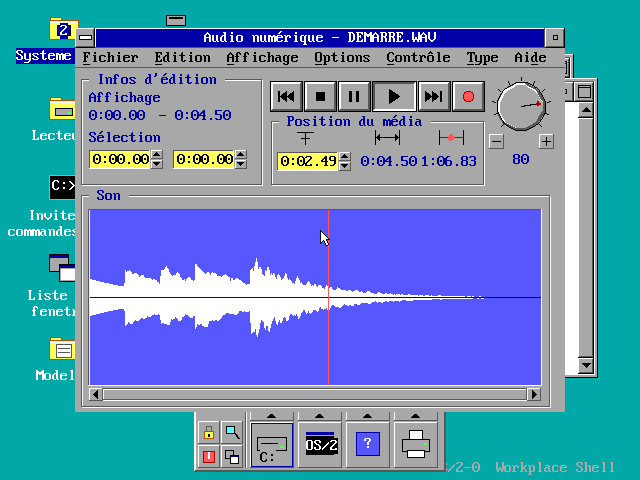
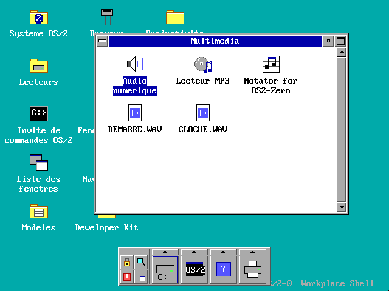
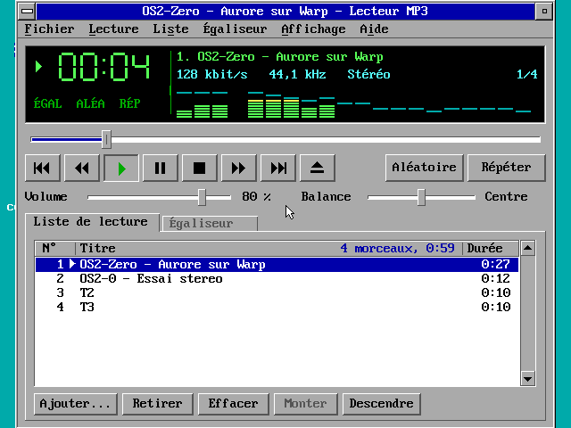
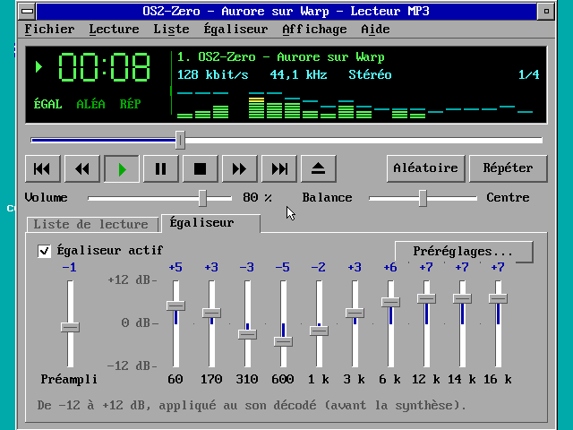
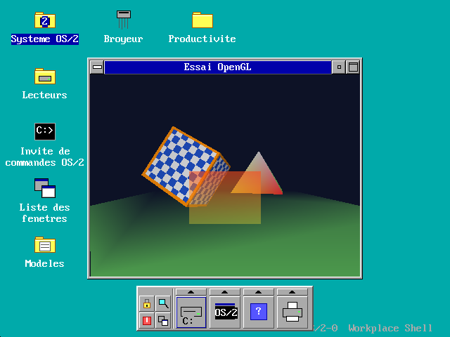
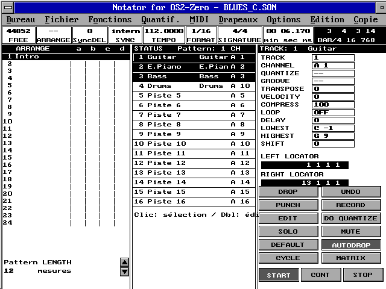
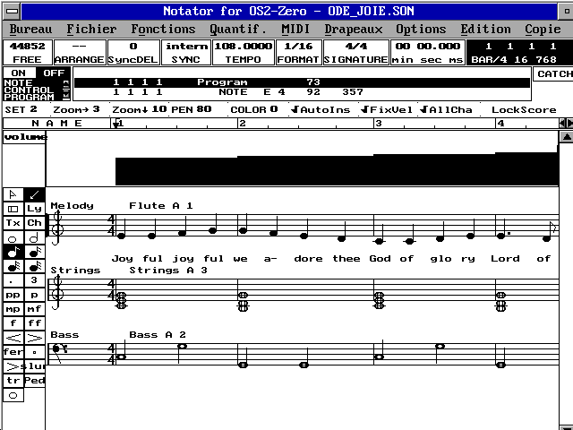
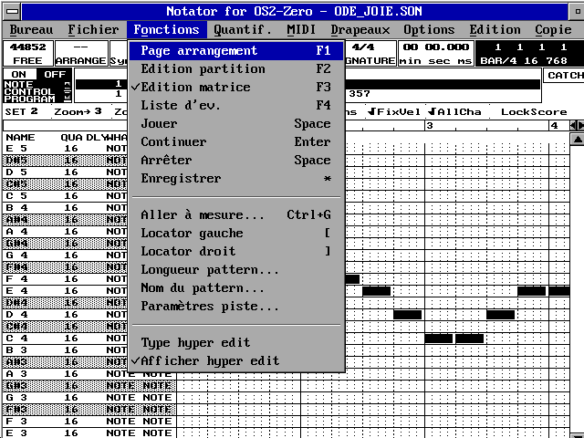

<h1>OS2-0 : Multimédia</h1>

<a href="../README.md">&larr; Retour au README</a>

<h3>Multimédia : Audio numérique (DIGAUDIO.PAS), MDM.DLL et pilotes des cartes son</h3>

Le dossier <b>Multimédia</b> du bureau contient <b>Audio numérique</b>, l'application « Digital Audio » de MMPM/2 (le multimédia d'OS/2 Warp), et les sons du système ; un fichier <code>.WAV</code> ouvert depuis un dossier du bureau s'ouvre aussi dans Audio numérique. Tout est écrit en Pascal et compilé par OS2PC, avec trois nouveaux pilotes pour les cartes son les plus répandues.

<table>
	<tr><th>Élément</th><th>Rôle</th></tr>
	<tr><td><b>Audio numérique</b> (DIGAUDIO.PAS → DIGAUDIO.EXE)</td><td>Fenêtre de Warp : informations d'édition (partie affichée, sélection avec champs à flèches), boutons début, arrêt, pause, lecture, fin, enregistrement, position du média (position, longueur, temps d'enregistrement disponible), bouton du volume, forme d'onde (clic : position ; glisser ou Maj+clic : sélection ; curseur de lecture ; barre de défilement). Menus Fichier (nouveau, ouvrir, enregistrer, enregistrer sous : boîte avec unités, répertoires et fichiers WAV), Édition (annuler, couper, copier, coller, supprimer, tout sélectionner), Affichage (zoom), Options (effets sur la sélection ou tout le son : inverser, amplifier, atténuer, fondus entrant et sortant, écho, silence), Contrôle, Type (11 025, 22 050, 44 100 Hz ; 8 ou 16 bits ; mono ou stéréo : le son est converti), Aide. Clavier : Espace lecture/arrêt, Début, Fin, flèches (Maj : sélection), Suppr, Ctrl+X, C, V, Z, R. L'enregistrement remplace la sélection ou s'insère à la position. Fichiers WAV PCM 8 ou 16 bits, mono ou stéréo, jusqu'à 3 Mo de son.</td></tr>
	<tr><td><b>MDM.DLL</b> (DLL/MDM.PAS)</td><td>Le « Media Device Manager » de MMPM/2 : choix du pilote (variable <code>AUDIODRIVER</code> de CONFIG.SYS : SBAUDIO, ICHAUDIO, ESAUDIO ou NONE ; sans elle, détection), fil de flux qui remplit le tampon circulaire de la carte en convertissant le son au format de la carte (8/16 bits, mono/stéréo, changement de fréquence) avec le volume ; interface de chaînes MCI <code>mciSendString</code> pour l'appareil <code>waveaudio</code> (open, play, record, stop, pause, resume, seek, status, set, save, close, info, capability, sysinfo ; positions en millisecondes, échantillons ou octets ; <code>notify</code> poste MM_MCINOTIFY) et <code>mciGetErrorString</code> ; points d'entrée internes MDMPLAY, MDMRECORD, MDMSTOP, MDMPAUSE, MDMPOSITION, MDMSTATE, MDMVOLUME, MDMAUDIOINFO, MDMCARDFORMAT, et MDMSTREAM, MDMFEED pour jouer en flux un son produit au fur et à mesure (Lecteur MP3).</td></tr>
	<tr><td><b>SBAUDIO.DLL</b> (DLL/SBAUDIO.PAS)</td><td>Creative Sound Blaster 1.x, 2.0, Pro, 16 (et AWE32/64, compatibles) : DSP aux ports 220h à 280h (ou variable <code>BLASTER</code>), version du DSP, DMA ISA 8 bits et 16 bits du 8237 en mode auto-initialisé, mélangeur ; SB16 : 8/16 bits, mono/stéréo, 5 000 à 44 100 Hz.</td></tr>
	<tr><td><b>ICHAUDIO.DLL</b> (DLL/ICHAUDIO.PAS)</td><td>AC'97 des jeux de composants Intel (ICH à ICH7, 440MX) et compatibles (nVidia nForce, AMD-8111) : recherche sur le bus PCI, remise à zéro du lien AC'97, codec (volumes, fréquence variable VRA), bus maître avec une liste de 32 descripteurs parcourue en boucle ; lecture et enregistrement.</td></tr>
	<tr><td><b>ESAUDIO.DLL</b> (DLL/ESAUDIO.PAS)</td><td>Ensoniq AudioPCI ES1370 (Sound Blaster PCI 64) : bus maître PCI, canaux DAC2 (lecture) et ADC (enregistrement) en boucle, diviseur de fréquence, codec AK4531 ; lecture et enregistrement.</td></tr>
</table>

Un pilote de carte son est une DLL à un seul point d'entrée, <code>AUDIOSTRATEGY</code> (ordinal 1), qui reçoit un paquet de requête comme un pilote de périphérique d'OS/2 : détecter, ouvrir (format demandé → format de la carte, tampon circulaire de 64 Ko pris dans le tas du noyau, en mémoire basse : convient au DMA ISA et au bus maître PCI), démarrer, position, arrêter, volume, fermer. La position est lue dans la carte (compteur du 8237, CIV/PICB de l'AC'97, compteur de trame de l'ES1370) : les pilotes n'ont pas besoin des interruptions. Un programme de Presentation Manager n'étant pas préempté, MDM.DLL alimente aussi le tampon quand le programme demande la position du flux.

Le noyau donne maintenant aux processus de grands blocs de mémoire (KrnTaskCtl 15 à 17 : mémoire physique au-delà de 16 Mo, vue à la même adresse, rendue à la fin du processus) : DOSCALLS.DLL les utilise pour DosAllocMem à partir de 64 Ko, au lieu du petit tas du noyau. Le programme <b>DLL/TESTMDM.PAS</b> vérifie MDM.DLL et le pilote (41 vérifications : lecture à 11 025, 22 050 et 44 100 Hz en 8 et 16 bits, mono et stéréo, pause, reprise, arrêt, chaînes MCI, enregistrement, sauvegarde et relecture d'un WAV) ; avec QEMU, <code>-audiodev wav</code> recueille le son produit :

<pre>qemu-system-i386 -m 64 -cdrom IMAGE/OS2CD.ISO -boot d -audiodev wav,id=son,path=sortie.wav -device sb16,audiodev=son
qemu-system-i386 -m 64 -cdrom IMAGE/OS2CD.ISO -boot d -audiodev pa,id=son -device AC97,audiodev=son
qemu-system-i386 -m 64 -cdrom IMAGE/OS2CD.ISO -boot d -audiodev pa,id=son -device ES1370,audiodev=son</pre>

Les sons <b>DEMARRE.WAV</b> (carillon, 22 050 Hz, 16 bits, mono) et <b>CLOCHE.WAV</b> (11 025 Hz, 8 bits, stéréo) de <b>IMAGE/SONS</b> sont des sons originaux synthétisés. Écrire ces programmes a fait apparaître d'autres pièges d'OS2PC : <code>Detect</code> (constante de l'unité Graph) et <code>Mem</code> (tableau de Turbo Pascal) sont des noms réservés qui ne peuvent pas nommer une fonction ou une variable.

<h3>Lecteur MP3 (MP3PLAY.PAS)</h3>

Le <b>Lecteur MP3</b> du dossier <b>Multimédia</b> joue les fichiers MP3 (MPEG-1, 2 et 2.5 Layer III, débit fixe ou variable, mono ou stéréo, 8 000 à 48 000 Hz) dans l'apparence des appareils multimédias de Warp, avec les menus déroulants habituels : afficheur noir (temps en chiffres à sept segments, titre défilant, débit, fréquence, stéréo, numéro du morceau, analyseur de spectre, voyants ÉGAL, ALÉA, RÉP), barre de position, boutons début, recul, lecture, pause, arrêt, avance, fin et éjection (ouvrir), volume, balance, aléatoire et répéter, et un carnet à deux onglets : <b>Liste de lecture</b> et <b>Égaliseur</b>. Tout est dans un seul fichier source, <b>MP3PLAY.PAS</b>, compilé par OS2PC : le décodeur vient de <code>PLAYMP3.PAS</code> (dépôt MP3-Player-0 : décodeur procédural sans bibliothèque externe ; tables Huffman et fenêtre de synthèse de PDMP3, domaine public ; tables de bandes et facteurs LSF de minimp3, CC0), accéléré pour le temps réel (table |x|^(4/3), synthèse polyphase et IMDCT par symétrie, anneau de synthèse, sous-bandes nulles sautées). Le son passe par MDM.DLL et le pilote de la carte son.

<table>
	<tr><th>Fonction</th><th>Détails</th></tr>
	<tr><td>Liste de lecture</td><td>Ajouter des fichiers ou un dossier entier, retirer, effacer, monter, descendre, trier (titre ou nom de fichier), mélanger ; double clic ou Entrée : jouer ; durée de chaque morceau (en-tête Xing/Info ou débit) et durée totale. Titre et artiste des étiquettes ID3 v1 et v2.2 à v2.4 (Latin-1, UTF-16, UTF-8). Listes M3U (ouvrir, enregistrer). La liste n'a pas de taille maximale. Elle est gardée d'une fois à l'autre (MP3PLAY.M3U dans le dossier du programme) avec le volume, la balance, l'égaliseur et les options (MP3PLAY.INI) ; au premier lancement, elle contient les MP3 du dossier du programme.</td></tr>
	<tr><td>Égaliseur</td><td>10 bandes (60 Hz à 16 kHz) et préamplification, de −12 à +12 dB, et 12 préréglages (Normal, Classique, Club, Danse, Basses, Aigus, Basses et aigus, Rock, Pop, Jazz, Voix, Salle de concert). Il agit sur les 576 raies de fréquence de chaque granule avant la synthèse ; le spectre affiché est celui du son en train d'être joué.</td></tr>
	<tr><td>Menus</td><td>Fichier (ouvrir, ajouter des fichiers ou un dossier, ouvrir et enregistrer une liste M3U, informations sur le morceau, quitter), Lecture (lecture/pause, arrêt, précédent, suivant, reculer et avancer de 5 s, aléatoire, répéter la liste ou le morceau), Liste (jouer la sélection, retirer, effacer, monter, descendre, trier, mélanger), Égaliseur (actif, préréglages), Affichage (onglet, temps écoulé ou restant, spectre), Aide.</td></tr>
	<tr><td>Clavier</td><td>Espace lecture/pause, S arrêt, ← et → (5 s), Pg préc. et Pg suiv. (morceau), + et − (volume), ↑ et ↓ (sélection), Entrée (jouer la sélection), Suppr (retirer), Ctrl+O (ouvrir), Ctrl+A (ajouter), F1 (aide).</td></tr>
	<tr><td>Ligne de commande</td><td><code>MP3PLAY [fichier.MP3 ... | liste.M3U] [/NOSAVE]</code> : les morceaux donnés sont joués tout de suite ; sans paramètre, la liste de la dernière fois. Un <code>.MP3</code> ou un <code>.M3U</code> ouvert depuis un dossier du bureau s'ouvre dans le Lecteur MP3.</td></tr>
</table>

Un fil d'exécution décode le MP3 en avance dans un anneau de 3 secondes que MDM.DLL joue en flux : <code>MDMSTREAM</code> (ordinal 109) donne l'anneau et le format, <code>MDMFEED</code> (ordinal 110) annonce le nombre d'octets écrits et rend la position jouée ; si le décodeur prend du retard, MDM joue du silence sans avancer. Un programme de Presentation Manager n'étant pas préempté, le fil du décodeur cède le processeur après chaque trame par <code>DosSleep(0)</code>, qui passe maintenant la main aux autres fils (KDelay(0) du noyau) : la fenêtre reste active pendant la lecture. Le morceau d'exemple <b>AURORE.MP3</b> de <b>IMAGE/MUSIQUE</b> (« Aurore sur Warp », 28 s, 128 kbit/s) est une composition originale synthétisée.

<h3>OpenGL (OPENGL.DLL) et Essai OpenGL (APPS/GLTEST.PAS)</h3>

OS/2-0 a maintenant <b>OpenGL 1.1</b> : <b>OPENGL.DLL</b> (DLL/OPENGL.PAS) est un rendu logiciel porté de l'OPENGL32.DLL de <a href="https://github.com/gladir/Pasdows95">Pasdows 95</a> (moteur de rastérisation et couche GL de son noyau VMM32), avec l'interface de Presentation Manager de l'OpenGL d'OS/2 Warp (<b>PGL</b>) à la place de WGL : <code>pglChooseConfig</code> (attributs PGL_RGBA, PGL_DOUBLEBUFFER, PGL_DEPTH_SIZE…), <code>pglQueryConfigs</code>, <code>pglCreateContext</code>, <code>pglMakeCurrent(hab, hgc, hwnd)</code>, <code>pglSwapBuffers(hab, hwnd)</code> (tampon arrière recopié dans la zone client par <code>GpiDrawBits</code> en 24 bits), <code>pglDestroyContext</code>, <code>pglGetCurrentContext</code>, <code>pglQueryVersion</code>… : 389 fonctions exportées (371 <code>gl*</code>, 18 <code>pgl*</code>).

<ul>
	<li>Sommets par glBegin/glEnd et tableaux de sommets (glDrawArrays, glDrawElements, glInterleavedArrays), piles de matrices, 8 lumières et matériaux, brouillard, découpage, textures 2D corrigées en perspective (deux unités), tampon Z de 24 bits, test et mélange alpha, glScissor, glPushAttrib, glGet*, glReadPixels et glDrawPixels.</li>
	<li>Les tampons suivent la taille de la fenêtre (agrandir la fenêtre les recrée).</li>
	<li>Comme dans Pasdows, les listes d'affichage, l'accumulation, le stencil, les évaluateurs, le mode sélection et <code>pglUseFont</code> sont acceptés sans effet ; seul le mode RVB existe (pas d'index de couleur).</li>
	<li>Les paramètres flottants suivent la convention de Pasdows : un <code>float</code> est passé par ses 32 bits IEEE (LongInt), un <code>double</code> en deux LongInt (bas, haut).</li>
	<li>PMGPI.DLL a un chemin rapide pour <code>GpiDrawBits</code> d'une image de 24 bits par pel (sans étirement) : la recopie de chaque image est environ trois fois plus rapide.</li>
</ul>

L'objet <b>Essai OpenGL</b> du dossier <b>Multimédia</b> (GLTEST.EXE, l'exemple de Pasdows réécrit pour Presentation Manager) dessine un cube texturé et éclairé (glBegin/glEnd), une pyramide en tableaux de sommets (glDrawElements), un sol dans le brouillard et un carré translucide (mélange alpha), en double tampon ; Échap ou la fermeture de la fenêtre pour quitter. Il écrit dans le journal le nom du rendu et, après 30 images, l'erreur GL (0).

<h3>Notator for OS2-Zero (NOTATOR.PAS)</h3>

<b>Notator for OS2-Zero</b> est le portage pour Presentation Manager de <code>NOTATOR.PAS</code> du dépôt OFFICE-0, un clone du séquenceur MIDI et éditeur de partition <i>Notator SL</i> (Turbo Pascal 7 et Free Pascal : BGI en 640 × 480, souris de l'interruption 33h, haut-parleur, MPU-401 ou synthétiseur de Windows). On le lance par l'objet <b>Notator for OS2-Zero</b> du dossier <b>Multimédia</b>, ou à l'invite : <code>NOTATOR [fichier.SON | fichier.MID] [/PLAY]</code> ; il s'ouvre (seul ou avec un morceau) sur l'édition de partition (F1 : page d'arrangement). Les exemples d'OFFICE-0 (<code>SAMPLES/NOTATOR</code>) sont fournis dans <b>IMAGE/NOTATOR</b> et copiés à la racine du CD-ROM et du disque : <code>BLUES_C</code>, <code>CANON_RE</code>, <code>FREREJAC</code> (<code>FRERE_JACQUES</code>, nom 8.3), <code>GROOVES</code>, <code>ODE_JOIE</code> et <code>TWINKLE</code>, chacun en <code>.SON</code> et en <code>.MID</code>, avec <code>NOTATOR.TXT</code>.

Toutes les fonctions de la version DOS sont conservées : page d'arrangement (4 chaînes de 99 patterns de 16 pistes, paramètres de piste, boutons DROP, PUNCH, SOLO, MUTE, CYCLE…), partition (clés, armures, ligatures, triolets, silences, paroles, palette de 14 symboles, hyper-éditeur de vélocité ou de contrôleurs), matrice (piano roll), liste d'événements avec filtres, quantification et groove adaptatif, transposition, vélocité, longueurs, copie de pistes, de patterns et de mesures, insertion et suppression de mesures, annulation, presse-papiers, enregistrement au clavier d'ordinateur (Z..M et Q..P), métronome, décompte, boucle entre locators, punch, morceau de démonstration, fichiers <code>.SON</code> et MIDI standard (lecture et écriture), impression de la partition et copie d'écran PBM, options dans <code>NOTATOR.OPT</code>, trois langues (<code>LANGUAGE=EN</code>, FR ou GR).

<table>
	<tr><th>Version DOS</th><th>Notator for OS2-Zero</th></tr>
	<tr><td>Écran BGI de 640 × 480 en 16 couleurs</td><td>Image de 640 × 480 en mémoire (un octet par point, couleurs du BGI) montrée dans la zone client par <code>GpiDrawBits</code>, seulement pour les zones modifiées ; les routines de Graph utilisées (Line, Rectangle, Bar, FillPoly, Ellipse, FillEllipse, Arc, PutPixel, GetPixel, OutTextXY avec la police 8 × 8, styles de trait et de remplissage, SetWriteMode) sont écrites dans le programme.</td></tr>
	<tr><td>Barre de menus et barre de titre GEM dessinées (lignes 0 à 33)</td><td>Barre de titre (nom du morceau, <code>*</code> s'il est modifié) et barre de menus de PM construites à partir des tables de menus d'origine (mêmes commandes, raccourcis affichés, coches et éléments grisés mis à jour par WM_INITMENU) ; F12 ouvre la barre de menus, F10 reste la touche de NOTATOR (valeur de note) ; la fermeture de la fenêtre passe par Quitter.</td></tr>
	<tr><td>Boîtes de dialogue noir et blanc</td><td>Style d'OS/2 : fond gris, barre de titre bleue avec menu système, boutons et champs en relief ; les confirmations sont des <code>WinMessageBox</code>. L'aide (F11) n'est plus tronquée à 255 caractères.</td></tr>
	<tr><td>KeyPressed, ReadKey, souris de l'Int 33h</td><td>File d'événements remplie par la procédure de fenêtre (WM_CHAR traduit en codes du BIOS, boutons et déplacements de la souris, commandes des menus) ; quand rien n'attend, le moteur avance (lecture, enregistrement, métronome) et le programme rend la main quelques millisecondes.</td></tr>
	<tr><td>Haut-parleur, MPU-401, synthétiseur waveOut de Windows</td><td>Le synthétiseur logiciel (ondes, enveloppes, sons de batterie) est joué par <b>MDM.DLL</b> sur la carte son (Sound Blaster 16, AC'97, ES1370) : un flux de 20 s (44 100 Hz, 16 bits, stéréo) rempli juste devant la position de lecture ; menu MIDI → Sortie MIDI : carte son, MPU-401 (réservé à la version DOS) ou aucune.</td></tr>
	<tr><td>Fichiers <code>.SON</code> écrits avec BlockWrite des enregistrements</td><td>Même disposition, octet par octet (OS2PC range les <code>String[n]</code> sur 256 octets) : un morceau enregistré par OS/2-0 est identique à celui de la version DOS.</td></tr>
	<tr><td>Cellule FREE : MemAvail</td><td>Mémoire libre du système en Ko (DosQuerySysInfo).</td></tr>
</table>

Le portage a aussi fait apparaître deux pièges d'OS2PC : une variable locale qui porte le nom d'une procédure (<code>Info</code>) donne, avec <code>@</code>, l'adresse de la procédure (MDM.DLL écrivait alors le nom de la carte son par-dessus son code) ; et les fonctions locales qui lisent les variables de la procédure englobante (<code>SlotOf</code> de LoadMidi, <code>Sc</code> de CmdResolution, <code>Fl</code> de LoadOptions) sont sorties au niveau du programme.

Les fichiers <code>.SON</code> et <code>.MID</code> s'ouvrent dans Notator depuis l'Explorateur OS2-Zero et depuis les dossiers du bureau (icône de Notator). Sous VirtualBox, Notator pouvait s'arrêter (SYS3175) pendant la lecture : <b>MDM.DLL</b> alimentait le flux depuis deux fils à la fois, son propre fil et celui du programme qui demande la position (<code>MdmPosition</code>), sans exclusion ; deux remplissages simultanés de l'anneau de la carte pouvaient écrire au-delà de sa fin. Un verrou (<code>XCHG</code> atomique) les sépare maintenant. L'assembleur intégré d'OS2PC ne codait <code>XCHG</code> qu'entre deux registres et omettait sans message <code>XCHG reg,[mem]</code> : il produit maintenant l'instruction (87h /r) dans les deux sens. Notator s'ouvre maintenant sur l'édition de partition ; pendant la lecture dans cette vue, les cases de position (en haut) et la tête de lecture étaient recopiées à l'écran en un seul rectangle, presque tout l'écran à chaque double croche, et le son se hachait : elles sont envoyées séparément, le synthétiseur est aussi alimenté pendant les longs dessins, et il calcule 200 ms d'avance au lieu de 50.

<a href="../README.md">&larr; Retour au README</a>

