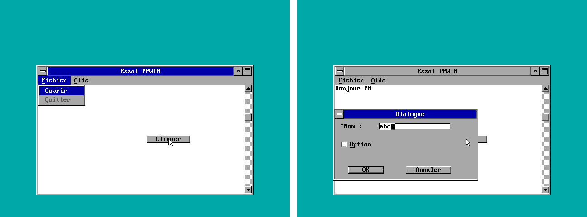
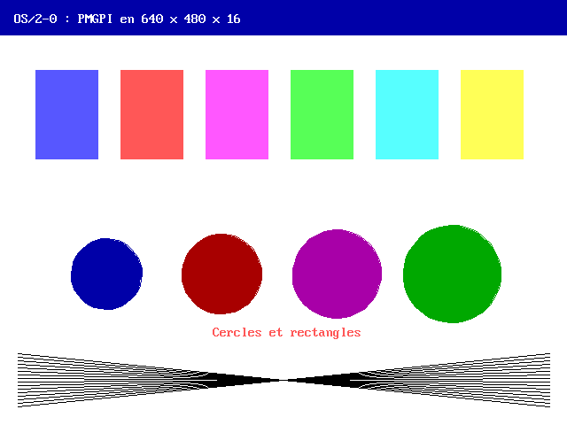
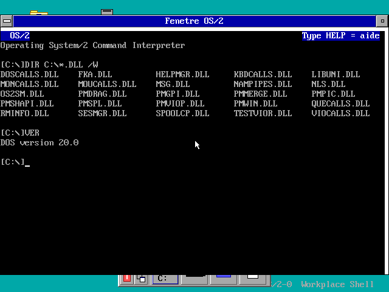
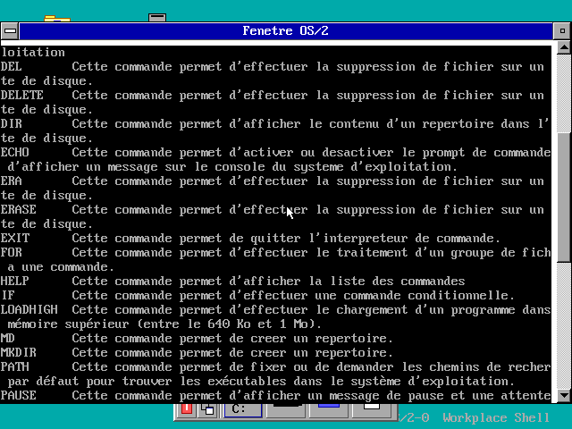
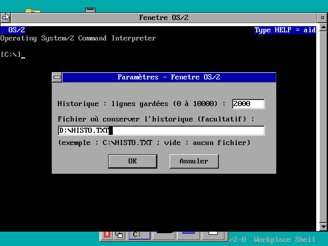

<h1>OS2-0 : Presentation Manager</h1>

<a href="../README.md">&larr; Retour au README</a>

<h3>Bibliothèque PMDRAG.DLL</h3>

Le fichier <b>DLL/PMDRAG.PAS</b> est la bibliothèque OS/2 <b>PMDRAG.DLL</b> (liée à 00A00000h), la manipulation directe (glisser-déposer) de Presentation Manager, avec ses 76 points d'entrée : ordinaux 1 à 31 (points d'entrée 16 bits, noms en majuscules) et 32 à 62 (32 bits) pour les 31 fonctions de base, 63 à 66 pour DrgDragFiles et DrgAcceptDroppedFiles, 67 à 76 pour le glissement différé et les fonctions de Warp. OS/2-0 n'a pas Presentation Manager : PMDRAG tient un registre de fenêtres (point d'entrée interne DRGREGISTERWINDOW : handle, rectangle de l'écran en pels, procédure de fenêtre _System ou Pascal d'OS2PC) qui reçoivent les messages DM_* ; DrgDrag suit la souris (MOUCALLS.DLL) jusqu'au relâchement du bouton ou à Échap.

<table>
	<tr><th>Fonctions</th><th>Rôle</th></tr>
	<tr><td>DrgAllocDraginfo, DrgReallocDraginfo, DrgFreeDraginfo, DrgAccessDraginfo, DrgPushDraginfo, DrgQueryDragitem, DrgQueryDragitemCount, DrgQueryDragitemPtr, DrgSetDragitem, DrgQueryDraginfoPtr...</td><td>Structures DRAGINFO et DRAGITEM (mémoire partagée, accès comptés : après DM_DROP, la cible libère).</td></tr>
	<tr><td>DrgAddStrHandle, DrgDeleteStrHandle, DrgQueryStrName, DrgQueryStrNameLen, DrgDeleteDraginfoStrHandles</td><td>Chaînes par handles (HSTR C000h à C0FFh, partagées et comptées).</td></tr>
	<tr><td>DrgQueryNativeRMF, DrgVerifyRMF, DrgVerifyNativeRMF, DrgQueryFormat, DrgQueryTrueType, DrgVerifyTrueType, DrgVerifyType, DrgVerifyTypeSet</td><td>Mécanismes et formats de rendu (&lt;m,f&gt; et (m1,m2)x(f1,f2)), types.</td></tr>
	<tr><td>DrgDrag, DrgLazyDrag, DrgLazyDrop, DrgCancelLazyDrag, DrgQueryDragStatus, DrgSetDragPointer, DrgSetDragImage</td><td>Glissement à la souris (DM_DRAGOVER, DM_DRAGLEAVE, DM_DROP) ou différé.</td></tr>
	<tr><td>DrgAllocDragtransfer, DrgFreeDragtransfer, DrgSendTransferMsg, DrgPostTransferMsg</td><td>Transferts (DRAGTRANSFER) ; messages envoyés ou postés (remis à la fin du message en cours).</td></tr>
	<tr><td>DrgDragFiles, DrgAcceptDroppedFiles</td><td>Glissement de fichiers : la fenêtre cible copie ou déplace les fichiers dans son répertoire (DM_ENDCONVERSATION, DM_DRAGFILECOMPLETE ; DM_RENDERFILE si la source fait le rendu).</td></tr>
	<tr><td>DrgGetPS, DrgGetClipPS, DrgReleasePS</td><td>Espaces de présentation (handles sans dessin : pas de GPI).</td></tr>
</table>

Le programme <b>DLL/TESTDRG.PAS</b> vérifie ces fonctions (42 vérifications ; il se termine par trois glissements à la souris, voir son en-tête pour les événements à envoyer avec QEMU).

<h3>Bibliothèque PMWIN.DLL</h3>

Le fichier <b>DLL/PMWIN.PAS</b> est la bibliothèque OS/2 <b>PMWIN.DLL</b> (liée à 00B00000h), le gestionnaire de fenêtres de Presentation Manager, avec ses 649 ordinaux (387 fonctions : ordinaux 1 à 640 de l'interface 16 bits, noms en majuscules quand la fonction est aussi exportée à un ordinal 32 bits, et 700 à 996), plus les points d'entrée internes WINSYSCLASSPROC (ordinal 1000, procédure des classes du système), WINQUERYPSINFO (ordinal 1001, fenêtre, origine et rectangle visible d'un HPS, utilisé par PMGPI.DLL), WINQUERYSCREENTEXT (ordinal 1002, texte écrit à l'écran, pour les programmes d'essai) et WINHIDEOVERLAYS (ordinal 1003, retire le pointeur et le curseur avant un dessin direct de PMGPI.DLL).

PMWIN dessine en mode graphique : la première file de messages passe l'écran en 640 x 480 (VioSetMode ; origine en bas à gauche). Par défaut, c'est un mode VESA à mémoire linéaire (32, sinon 16 bits par pel, avec les couleurs du VGA) ; sans BIOS VESA, c'est le mode 12h du VGA (640 x 480 x 16 couleurs, quatre plans). <code>SET PMRESOLUTION=640x480x4</code> force le mode 12h. Le dessin direct dans les plans demandait, pour chaque octet, une lecture et une écriture de la fenêtre A0000h et des écritures dans les ports du VGA : sous VirtualBox au-dessus de Hyper-V, chacune est une sortie de la machine virtuelle et le dessin y devenait très lent (environ 420 000 accès pour afficher le bureau). En VGA 16 couleurs, PMWIN et PMGPI dessinent maintenant dans un <b>écran fantôme</b> en mémoire (un octet par pel, comme une mémoire linéaire de 8 bits) ; quand la file de messages est au repos (au plus toutes les 60 ms pendant un dessin continu), <code>GFlush</code> compare l'écran fantôme à ce que le VGA affiche et ne recopie que les groupes de 32 pels qui ont changé : une écriture de 32 bits en mode d'écriture 2 pour un groupe d'une seule couleur, quatre (une par plan, en mode d'écriture 0) sinon, et quatre écritures de port pour tout le vidage. Les zones effacées puis redessinées à l'identique ne vont plus au VGA, et rien n'y est relu. Ouvrir puis fermer un dossier : environ 632 000 accès au VGA avant, environ 20 000 écritures de 32 bits et 128 accès aux ports avec l'écran fantôme, pour une image identique au pel près. <code>SET PMSHADOW=NON</code> revient au dessin direct. Les fenêtres sont dessinées en pels, comme sous OS/2 Warp :

<table>
	<tr><th>Élément</th><th>Dessin</th></tr>
	<tr><td>Cadre (FS_SIZEBORDER, FS_DLGBORDER, FS_BORDER)</td><td>Bordure grise en relief de 4, 3 ou 1 pel ; barre de titre de 20 pels (couleur de la fenêtre active ou inactive, titre centré) ; menu système et boutons de réduction et d'agrandissement (ou de restauration) en relief ; une fenêtre se déplace en tirant sa barre de titre.</td></tr>
	<tr><td>Menus</td><td>Barre d'actions de 20 pels, menus déroulants en relief (lignes de 20 pels, mnémoniques soulignés, coches, séparateurs gravés, flèche des sous-menus, raccourcis après une tabulation alignés à droite), article choisi en surbrillance.</td></tr>
	<tr><td>Boutons</td><td>Boutons poussoirs en relief (enfoncés quand on clique, cadre noir pour le bouton par défaut, pointillés autour du texte qui a le focus), cases à cocher (coche dessinée, état indéterminé), boutons radio ronds.</td></tr>
	<tr><td>Champs, listes, défilement</td><td>Champs de saisie et textes multilignes en creux avec un curseur vertical, listes en creux (sélection en surbrillance, article courant en pointillés), listes déroulantes avec leur bouton, barres de défilement (flèches, curseur proportionnel à SBM_SETTHUMBSIZE que l'on peut glisser : SB_SLIDERTRACK puis SB_SLIDERPOSITION), groupes au cadre gravé.</td></tr>
	<tr><td>Dessin du programme</td><td>WinFillRect, WinDrawText (mnémonique souligné), WinDrawBorder, WinInvertRect, WinDrawBitmap (bitmaps OS/2 de 1, 4, 8 et 24 bits, étirées ; bitmaps du système), WinDrawPointer, WinScrollWindow (pels déplacés par octets entiers) ; les fonctions Gpi* de PMGPI.DLL dessinent dans les mêmes espaces de présentation.</td></tr>
	<tr><td>Pointeur et curseur</td><td>Flèche noire et blanche suivant la souris (positions en pels), curseur en rectangle inversé ; ils sont retirés avant un dessin qui les touche et remis quand le programme lit ses messages.</td></tr>
</table>

Le texte est celui de la police 8 x 16 du VGA ; les couleurs CLR_*, SYSCLR_* et RVB deviennent les 16 couleurs du VGA. Quand le dernier programme de PM appelle WinTerminate, l'écran revient au mode texte ; CMD.EXE y revient aussi quand un programme se termine en laissant l'écran en mode graphique. Avec <b>SET PMMODE=TEXTE</b>, PM reste dans l'écran texte de 80 x 25 cellules, vu en coordonnées de 640 x 400 pels (une cellule = 8 x 16 pels). Le clavier (KBDCALLS.DLL) et la souris (MOUCALLS.DLL) sont lus par WinGetMsg et WinPeekMsg. Les procédures de fenêtre d'un programme OS2PC (adresses 00400000h à 007FFFFFh) sont appelées avec la convention Pascal, les autres avec la convention _System.

<table>
	<tr><th>Fonctions</th><th>Rôle</th></tr>
	<tr><td>WinInitialize, WinTerminate, WinCreateMsgQueue, WinDestroyMsgQueue, WinGetLastError, WinGetErrorInfo, WinQueryVersion...</td><td>Ancres (HAB), files de messages (HMQ), erreurs PMERR_* (gravité 4).</td></tr>
	<tr><td>WinRegisterClass, WinCreateWindow, WinCreateStdWindow, WinDestroyWindow, WinSetWindowPos, WinQueryWindow, WinQueryWindowULong, WinSetParent, WinWindowFromID, WinBeginEnumWindows...</td><td>Classes, arbre des parents et des propriétaires, ordre de superposition, mots réservés, texte, énumération.</td></tr>
	<tr><td>WinSendMsg, WinPostMsg, WinGetMsg, WinPeekMsg, WinDispatchMsg, WinBroadcastMsg, WinStartTimer, WinSetHook, WinSetFocus, WinSetActiveWindow, WinSetCapture...</td><td>Messages, WM_PAINT, minuteries, crochets (HK_INPUT, HK_SENDMSG, HK_MSGFILTER...), focus, activation, capture, clavier (WM_CHAR) et souris (WM_BUTTONxDOWN...).</td></tr>
	<tr><td>WinBeginPaint, WinGetPS, WinFillRect, WinDrawText, WinDrawBorder, WinInvalidateRect, WinUpdateWindow, WinScrollWindow, WinSetRect, WinIntersectRect...</td><td>Espaces de présentation, mise à jour, dessin en pels (en cellules avec PMMODE=TEXTE), rectangles.</td></tr>
	<tr><td>WinDefWindowProc, WinDefDlgProc, WinCreateDlg, WinDlgBox, WinProcessDlg, WinDismissDlg, WinMessageBox, WinCreateMenu, WinLoadMenu, WinPopupMenu...</td><td>Contrôles (cadre, barre de titre, bouton, statique, champ de saisie, liste, liste déroulante, barre de défilement, menu, texte multiligne), dialogues (modèles DLGTEMPLATE, unités de dialogue = 2 pels), boîtes de message, menus (barre d'actions, sous-menus, mnémoniques).</td></tr>
	<tr><td>WinCreateAccelTable, WinTranslateAccel, WinOpenClipbrd, WinSetClipbrdData, WinAddAtom, WinCreateHeap, WinLoadString, WinQuerySysValue, WinSetSysColors, WinUpper, WinCpTranslateString, WinSetPresParam...</td><td>Accélérateurs, presse-papiers, atomes, tas, ressources (RT_STRING, RT_MESSAGE, RT_MENU, RT_DIALOG, RT_ACCELTABLE), valeurs et couleurs du système, pages de codes 437 et 850, paramètres de présentation.</td></tr>
</table>

Limites : les fonctions Gpi* sont dans PMGPI.DLL (qui accepte les HPS et HDC de PMWIN) ; les régions de PMWIN se limitent à la fenêtre entière (en mode texte, une bitmap est dessinée en trame) ; une seule police ; les pointeurs du système sont dessinés en flèche ; WinCatch et WinThrow ne peuvent dérouler la pile (WinThrow rend FALSE), les messages envoyés à une fenêtre d'un autre processus ne sont remis que si sa procédure est dans une DLL. Le programme <b>DLL/TESTWIN.PAS</b> vérifie ces fonctions (75 vérifications ; il se termine par des entrées du clavier et de la souris, voir son en-tête pour les événements à envoyer avec QEMU).

<h3>Bibliothèque PMGPI.DLL</h3>

Le fichier <b>DLL/PMGPI.PAS</b> est la bibliothèque OS/2 <b>PMGPI.DLL</b> (base préférée 00800000h, relogée par le noyau si la place est prise), l'interface graphique GPI de Presentation Manager, avec ses 572 ordinaux (303 fonctions Dev*, Gpi*, Dsp*, Mt*, Segs* et Fmt* : ordinaux 1 à 312 de l'interface 16 bits, noms en majuscules quand la fonction est aussi exportée à un ordinal 32 bits, et 351 à 657). Elle dessine dans quatre sortes de cibles :

<table>
	<tr><th>Cible</th><th>Dessin</th></tr>
	<tr><td>Bitmap en mémoire (DevOpenDC OD_MEMORY + GpiSetBitmap)</td><td>1, 4, 8 ou 24 bits par pel, lignes de bas en haut alignées sur 4 octets, table de couleurs RVB (format BITMAPINFOHEADER et BITMAPINFOHEADER2).</td></tr>
	<tr><td>Écran graphique (DevOpenDC OD_DIRECT, mode choisi par VioSetMode)</td><td>640 x 480 x 16 couleurs (mode 12h, VGA en mode d'écriture 2), 640 x 480 x 2, 640 x 350 x 16, 640 x 200 x 16, 320 x 200 x 16 et 320 x 200 x 256 couleurs (13h). Les couleurs par défaut de PM vont aux index usuels du pilote VGA (CLR_BLUE = bleu vif 9, CLR_DARKBLUE = 1...).</td></tr>
	<tr><td>Espaces de présentation de PMWIN (WinGetPS, WinBeginPaint, WinGetScreenPS)</td><td>Écran graphique de PM (640 x 480 x 16 couleurs), découpé par le rectangle visible de la fenêtre ; le pointeur et le curseur de PMWIN sont retirés avant le dessin. Avec PMMODE=TEXTE : 640 x 400 pels sur 80 x 25 cellules (une zone colore le fond des cellules, le texte s'écrit dans les cellules).</td></tr>
	<tr><td>Métafichier (OD_METAFILE)</td><td>Journal des appels Gpi* (rejoué par GpiPlayMetaFile, enregistré par GpiSaveMetaFile sous l'en-tête « OS20MF01 »).</td></tr>
	<tr><td>Tampon d'impression (OD_QUEUED)</td><td>Travail de PMSPL.DLL : DEVESC_STARTDOC, DEVESC_ENDDOC (numéro du travail), DEVESC_ABORTDOC, DEVESC_RAWDATA ; en PM_Q_STD, les appels Gpi* sont enregistrés comme un métafichier puis imprimés par PicPrint.</td></tr>
</table>

<table>
	<tr><th>Fonctions</th><th>Rôle</th></tr>
	<tr><td>DevOpenDC, DevCloseDC, DevQueryCaps, DevEscape, DevQueryDeviceNames, DevPostDeviceModes...</td><td>Contextes de périphériques (CAPS_*), la fermeture d'un DC de métafichier rend le HMF.</td></tr>
	<tr><td>GpiCreatePS, GpiAssociate, GpiDestroyPS, GpiSavePS, GpiRestorePS, GpiResetPS, GpiErase, GpiSetPS, GpiQueryPS...</td><td>Espaces de présentation (micro-PS et PS normaux, unités PU_PELS, PU_LOMETRIC, PU_HIMETRIC, PU_LOENGLISH, PU_HIENGLISH, PU_TWIPS, PU_ARBITRARY).</td></tr>
	<tr><td>GpiMove, GpiLine, GpiPolyLine, GpiBox, GpiFullArc, GpiPartialArc, GpiPointArc, GpiPolySpline, GpiPolyFillet, GpiPolyFilletSharp, GpiCharStringAt, GpiCharStringPosAt, GpiMarker, GpiPolyMarker, GpiImage, GpiSetPel, GpiQueryPel, GpiFloodFill, GpiPolygons...</td><td>Primitives : types et épaisseur de ligne, coins arrondis, arcs d'ellipse, Bézier, coniques, texte 8 x 16 de la police VGA (boîte de caractères, angle, cisaillement, direction, alignement), marqueurs, mélanges FM_* et BM_*, motifs PATSYM_* et motifs de bitmap.</td></tr>
	<tr><td>GpiBeginArea, GpiEndArea, GpiBeginPath, GpiEndPath, GpiFillPath, GpiStrokePath, GpiOutlinePath, GpiModifyPath, GpiPathToRegion, GpiSetClipPath...</td><td>Zones et chemins (alternance ou enroulement).</td></tr>
	<tr><td>GpiCreateRegion, GpiCombineRegion, GpiEqualRegion, GpiOffsetRegion, GpiPtInRegion, GpiRectInRegion, GpiQueryRegionRects, GpiPaintRegion, GpiSetClipRegion, GpiIntersectClipRectangle, GpiExcludeClipRectangle...</td><td>Régions (listes de rectangles), découpage.</td></tr>
	<tr><td>GpiSetModelTransformMatrix, GpiSetDefaultViewMatrix, GpiSetSegmentTransformMatrix, GpiTranslate, GpiScale, GpiRotate, GpiConvert, GpiSetPageViewport, GpiSetGraphicsField, GpiSetViewingLimits...</td><td>Transformations (MATRIXLF en FIXED 16.16), espaces de coordonnées monde, modèle, page par défaut, page et périphérique.</td></tr>
	<tr><td>GpiCreateBitmap, GpiSetBitmap, GpiQueryBitmapBits, GpiSetBitmapBits, GpiBitBlt, GpiWCBitBlt, GpiDrawBits, GpiLoadBitmap...</td><td>Bitmaps, transferts de blocs (les 256 opérations ROP sur source, motif et destination, étirement ou réduction par échantillonnage), conversion monochrome et couleur.</td></tr>
	<tr><td>GpiCreateLogColorTable, GpiQueryRGBColor, GpiCreatePalette, GpiSelectPalette, GpiQueryFonts, GpiCreateLogFont, GpiQueryFontMetrics, GpiLoadFonts...</td><td>Tables de couleurs (index, RVB), palettes, polices (System VIO et System Monospaced).</td></tr>
	<tr><td>GpiOpenSegment, GpiCloseSegment, GpiDrawChain, GpiDrawSegment, GpiSetElementPointer, GpiLabel, GpiQueryElement, GpiPutData, GpiCorrelateChain, GpiQueryBoundaryData, GpiPlayMetaFile, GpiLoadMetaFile, GpiSaveMetaFile...</td><td>Segments retenus (DM_RETAIN, éléments, étiquettes, attributs et priorités), corrélation (zone de sélection, balises), données de limites, métafichiers.</td></tr>
</table>

Limites : une seule police (8 x 16 de VIOCALLS, agrandie ou réduite par la boîte de caractères) ; les éléments des segments et des métafichiers sont des appels Gpi* enregistrés (pas d'ordres GOCA) ; les codes PMERR_* sont transmis à WinGetLastError de PMWIN ; un programme qui passe l'écran en mode graphique doit revenir au mode texte (VioSetMode) avant de rendre la main à CMD. L'ordinal 541 porte le nom GPISETPATTERNSET de la liste fournie et appelle GpiSetPatternSet (dans OS/2, cet ordinal est GpiSetPattern). Les codes PMERR_* sont des valeurs approchées. Le programme <b>DLL/TESTGPI.PAS</b> vérifie ces fonctions (68 vérifications ; il affiche quelques secondes l'écran ci-dessus en 640 x 480, puis dessine dans un espace de présentation de PMWIN).

<h3>Bibliothèque PMMERGE.DLL</h3>

Le fichier <b>DLL/PMMERGE.PAS</b> est la bibliothèque OS/2 <b>PMMERGE.DLL</b> (base préférée 00800000h, relogée par le noyau si la place est prise), qui réunit dans OS/2 Warp 4 PMWIN, PMSHAPI (profils, liste des programmes) et des points d'entrée internes de PMGRE et de PMVIOP. Elle a 1039 ordinaux (2000 à 10021 ; le nom Win32CalcFrameRect est donné deux fois, l'ordinal 5118 l'exporte en majuscules) :

<table>
	<tr><th>Fonctions</th><th>Réalisation</th></tr>
	<tr><td>Win* et Win32* du gestionnaire de fenêtres (WinCreateWindow, Win32SendMsg, WinGetPS...)</td><td>Transmises à PMWIN.DLL (et GpiLoadBitmap), qui garde l'état : fenêtres, files, écran graphique.</td></tr>
	<tr><td>Liste des tâches et démarrage (WinAddSwitchEntry, WinQuerySwitchList, WinSwitchToProgram, SheSystemShutdown, StartSystemExecutables...)</td><td>Transmises à OS2SM.DLL ; WinStartApp démarre aussi un programme de Presentation Manager ; WinHAPPfromPID et WinHSWITCHfromHAPP lisent la liste des tâches.</td></tr>
	<tr><td>PrfOpenProfile, PrfQueryProfileString, PrfWriteProfileData, PrfQueryProfileSize, PrfReset, PrfQueryProfile, Prf32*, WinQueryProfile*, WinWriteProfile*, PrfWriteToDisk, PrfSuspendWriteToDisk...</td><td>Profils dans des fichiers INI au format binaire d'OS/2 (en-tête FFFFFFFFh, applications, clés, données) : HINI_USERPROFILE (OS2.INI), HINI_SYSTEMPROFILE (OS2SYS.INI), HINI_PROFILE (les deux en lecture), fichiers ouverts par PrfOpenProfile ; noms pris dans USER_INI et SYSTEM_INI (par défaut C:\OS2.INI et C:\OS2SYS.INI) ; listes des applications et des clés, suppression, écriture à chaque modification (ou retardée).</td></tr>
	<tr><td>PrfAddProgram, PrfChangeProgram, PrfQueryDefinition, PrfQueryProgramTitles, PrfCreateGroup, PrfDestroyGroup, PrfQueryProgramHandle, WinAddProgram, WinQueryProgramTitles...</td><td>Liste des programmes et des groupes (PROGDETAILS, PROGTITLE, SGH_ROOT), gardée dans le profil (applications PM_Programs et PM_Groups).</td></tr>
	<tr><td>WinSetProperty, WinQueryProperty, WinEnumProperties, WinSetClassProperty..., WinSetControlColors, WinQueryDesktopWorkArea, DAXCREATECARET, DaxSwapMouseButton, Win32AddClipbrdViewer, Win32IsWindowOfClass, WinMessageBox2, WinDrawTabbedText...</td><td>Fonctions de Warp 4 : propriétés des fenêtres et des classes, couleurs des contrôles (paramètres de présentation), zone de travail du bureau, curseur DAX, chaîne des visualiseurs du presse-papiers, boîte de message à boutons choisis.</td></tr>
	<tr><td>Edit* (EditCreate, EditSetSelection, EditReplace, EditCopy, EditCXFromICH...)</td><td>Agissent sur un champ de saisie de PMWIN désigné par son HWND.</td></tr>
	<tr><td>WinXX* (tas), SS* (mémoire), RamSem*, PMRequestMutexSem, WinMsp*...</td><td>Tas dans la mémoire partagée de la DLL, blocs de DosAllocMem, sémaphores en mémoire (LongInt : processus propriétaire), sémaphores mutex de DOSCALLS.</td></tr>
	<tr><td>Gre*, PmWinGreEntry*, InnerGre32Entry*, Dispatch16Gate*, PFN*R2, *_Call_16, GRE16*...</td><td>Entrées du moteur graphique et du code 16 bits, absents d'OS/2-0 : elles rendent 0 (fonction inconnue).</td></tr>
</table>

Limites : les entrées de données de Warp 4 (ShellWindow, PMSemaphores, PHandleTable, PSharedHeap, GreMemptrs, FPen, VPAULDefaultColors) sont des fonctions qui rendent l'adresse de la donnée ; GetIconWindows* ne lit pas les icônes de Windows ; les noms d'applications et de clés des profils distinguent les majuscules. Le programme <b>DLL/TESTMRG.PAS</b> vérifie ces fonctions (47 vérifications : ordinaux, profil et format du fichier INI, programmes et groupes, relais vers PMWIN, propriétés, champ de saisie, couleurs, tas, mémoire, sémaphores).

<h3>Bibliothèque PMPIC.DLL</h3>

Le fichier <b>DLL/PMPIC.PAS</b> est la bibliothèque OS/2 <b>PMPIC.DLL</b> (base préférée 00800000h, relogée si la place est prise), celle des outils PICPRINT et PICICHG d'OS/2 :

<table>
	<tr><th>Fonction</th><th>Rôle</th></tr>
	<tr><td>PicPrint(hab, pszFilename, lType, pszParams) (1)</td><td>Imprime un métafichier (PIP_MF 1) ou un fichier PIF (PIP_PIF 2) : l'image est dessinée par PMGPI.DLL dans une page de 640 x 480 pels (options /W:n et /H:n), puis envoyée en graphique ESC/P (ESC @, bandes de 8 lignes ESC * 1 à 120 points par pouce et ESC J 24, saut de page) à PRN, LPT1 à LPT3 ou à un fichier (premier mot de pszParams ; PRN par défaut).</td></tr>
	<tr><td>PicIchg(hab, pszFilename1, pszFilename2, lType) (2)</td><td>Conversion PIC_PIFTOMET (0) : fichier PIF -> métafichier ; PIC_SSTOFONT (2, jeu de symboles de GDDM -> police) rend FALSE.</td></tr>
	<tr><td>pif2met(pszPif, pszMet) (3)</td><td>Conversion d'un fichier PIF en métafichier de PMGPI.DLL.</td></tr>
</table>

Le fichier PIF (Picture Interchange Format de GDDM) est lu comme une suite d'ordres de dessin GDF/GOCA (nombres de 16 bits, octet fort en premier ; texte en EBCDIC, page de codes 037) : couleur et couleur étendue, mélanges, motif, type et largeur de ligne, marqueur, position courante, paramètres d'arc, boîte et angle des caractères, lignes (absolues et relatives), boîtes, cercles, arcs, filets, marqueurs, texte, zones ; les autres ordres (segments, commentaires...) sont sautés d'après leur longueur (formes courte, longue et très longue). Limites : les en-têtes d'enregistrements des fichiers de GDDM ne sont pas interprétés (le fichier doit commencer par les ordres), PIC_SSTOFONT n'est pas réalisée, l'impression est en noir et blanc (seuil de luminance) pour une imprimante ESC/P. Le programme <b>DLL/TESTPIC.PAS</b> vérifie ces fonctions (17 vérifications : conversion, pels du métafichier rejoué, sorties d'impression ; avec QEMU, <code>-parallel file:sortie.txt</code> recueille ce qui est envoyé à PRN).

<h3>Bibliothèque PMSHAPI.DLL</h3>

Le fichier <b>DLL/PMSHAPI.PAS</b> est la bibliothèque OS/2 <b>PMSHAPI.DLL</b> (base préférée 00800000h, relogée si la place est prise), l'interface de l'interpréteur de Presentation Manager d'OS/2 1.x, 2.x et Warp 3 : 144 ordinaux (1 à 213) pour les profils (Prf*, WinQueryProfile*, WinWriteProfile*), la liste des programmes et des groupes (PrfAddProgram, PrfQueryProgramTitles, WinAddProgram, WinCreateGroup...), la liste des tâches et le démarrage des programmes (WinAddSwitchEntry, WinQuerySwitchList, WinSwitchToProgram, WinStartApp, WinHAPPfromPID...) et les points d'entrée internes de l'interpréteur (ShePI*, Shp*, SheSystemShutdown, StartSystemExecutables, ShellWindow...).

Comme sous OS/2 Warp 4, où ces fonctions sont passées dans PMMERGE.DLL, chaque point d'entrée de PMSHAPI appelle par son nom la fonction de <b>PMMERGE.DLL</b> qui la réalise : un programme voit les mêmes profils, les mêmes programmes et la même liste des tâches, qu'il soit lié à PMSHAPI ou à PMMERGE. Quand un nom figure deux fois (ordinal 16 bits et ordinal 32 bits : PrfQueryProfileInt 32 et 114, WinStartApp 119 et 201...), l'ordinal le plus bas est exporté sous le nom en majuscules (PRFQUERYPROFILEINT, WINSTARTAPP). PMSHAPI ajoute le crochet des profils : <b>SheSetProfileHook</b>(pfnHook) l'installe ou le retire pour le processus appelant, il est appelé (fl = HINI, pszApp, pszKey) après chaque écriture réussie faite par PMSHAPI (PrfWriteProfileString, PrfWriteProfileData, WinWriteProfileString, WinWriteProfileData), et <b>SheProfileHook</b>(fl, pszApp, pszKey) l'appelle et rend sa valeur. Le programme <b>DLL/TESTSHA.PAS</b> vérifie ces fonctions (34 vérifications : ordinaux et noms, profils lus et écrits par PMSHAPI et PMMERGE, crochet, programmes et groupes, liste des tâches).

<h3>Bibliothèque PMSPL.DLL</h3>

Le fichier <b>DLL/PMSPL.PAS</b> est la bibliothèque OS/2 <b>PMSPL.DLL</b> (base préférée 00800000h, relogée si la place est prise), le tampon d'impression (spouleur) de Presentation Manager : 44 ordinaux (1 à 90, noms en majuscules) et un point d'entrée interne (1001, procédure de la fenêtre du délai de SplMessageBox).

<table>
	<tr><th>Fonctions</th><th>Rôle</th></tr>
	<tr><td>SPLQMOPEN, SPLQMSTARTDOC, SPLQMWRITE, SPLQMENDDOC, SPLQMCLOSE, SPLQMABORTDOC, SPLQMABORT (1 à 8)</td><td>Travail d'impression : SplQmOpen(pszToken, lCount, DEVOPENSTRUC) choisit la file (pszLogAddress : file, imprimante ou port ; vide : file par défaut) et le type de données (PM_Q_STD par défaut, PM_Q_RAW) et rend un HSPL ; les données vont dans le fichier de spoule <code>C:\SPOOL\file\nnnnn.SPL</code> ; SplQmEndDoc rend le numéro du travail ; SplQmClose termine le document commencé, SplQmAbort l'abandonne.</td></tr>
	<tr><td>SPLMESSAGEBOX (7)</td><td>Boîte de message du spouleur (file de messages créée si besoin) : texte complété par l'imprimante et les erreurs SPLDATA_*, icône d'après SPLINFO_* ; après trois minutes (clé MSGTIMEOUT de PM_SPOOLER, en secondes), elle rend MBID_RETRY.</td></tr>
	<tr><td>SPLINIT (20)</td><td>Initialisation : lit les files et les imprimantes du profil du système (applications PM_SPOOLER, PM_SPOOLER_QUEUE, PM_SPOOLER_QUEUE_DESCR, PM_SPOOLER_PRINTER, PM_SPOOLER_PRINTER_DESCR d'OS2SYS.INI) ; sans file, crée PRINTER1 (LPT1, pilote IBMNULL) et LPT1Q.</td></tr>
	<tr><td>SPLQMLISTQUEUES, SPLQMQUERYQINFO, SPLQMLISTJOBS, SPLQMQUERYJINFO, SPLQMQUERYPINFO (21 à 24, 33)</td><td>Listes et informations au format 32 bits d'OS/2 : PRQINFO3, PRQINFO6, niveau 4 (file suivie de ses PRJINFO2), numéros de travaux (niveau 0), PRJINFO2, PRJINFO3, PRDINFO3 ; chaînes placées à la fin du tampon ; ERROR_MORE_DATA, NERR_BufTooSmall et pcbNeeded.</td></tr>
	<tr><td>SPLQMHOLDQUEUE, SPLQMRELEASEQUEUE, SPLQMHOLDJOB, SPLQMRELEASEJOB, SPLQMCANCELJOB, SPLQMRESTARTJOB, SPLQMREPEATJOB, SPLQMPRINTJOBNEXT, SPLQMCHANGEJOBPRTY, SPLQMSETSTATUS, SPLQMUPDATEQPROCPARMS (25 à 32, 34, 36, 42)</td><td>Gestion : retenir et libérer une file ou un travail, annuler, reprendre depuis le début, copier un travail, le mettre en tête, changer sa priorité (1 à 99, 50 par défaut, PRTY=n), fixer les bits d'état PRJ_* et le texte d'état, changer les paramètres du processeur (COP=n : copies).</td></tr>
	<tr><td>SPLQMWRITEFILE, SPLQMQUERYPRINTDATA (35, 41)</td><td>Un fichier devient un travail PM_Q_RAW (commande PRINT) ; lecture des données d'un travail.</td></tr>
	<tr><td>SPLQMCREATEQUEUE, SPLQMDESTROYQUEUE, SPLQMLISTAVAILQUEUES, SPLQMLISTDIRECTPRINTERS (37 à 40)</td><td>Création d'une file (PRQINFO3 ; pszPrinters : imprimante, port ou « nom=port », le port pouvant être PRN, LPT1 à LPT3, COMn, NUL ou un fichier), suppression, noms des files, ports parallèles présents.</td></tr>
	<tr><td>SPLSTDOPEN, SPLSTDCLOSE, SPLSTDSTART, SPLSTDSTOP, SPLSTDDELETE, SPLSTDGETBITS, SPLSTDQUERYLENGTH (50 à 56)</td><td>Données PM_Q_STD : les appels de la GPI faits sur un DC de PMGPI.DLL sont enregistrés dans un métafichier (HSTD), lu par SplStdGetBits.</td></tr>
	<tr><td>PRTOPEN, PRTWRITE, PRTDEVIOCTL, PRTCLOSE, PRTABORT (70 à 73, 75)</td><td>Accès à l'imprimante : si une file sert le port, les données forment un travail PM_Q_RAW (imprimé à PrtClose, abandonné par PrtAbort), sinon le port est ouvert directement ; PrtDevIOCtl (ordre d'OS/2 1.x) gère la catégorie 5 (contrôle de la page, réessai, initialisation, police, état du port parallèle).</td></tr>
	<tr><td>SPLRING3 (90)</td><td>Appelle pfn(ulParam) et rend sa valeur (tout s'exécute en anneau 0 sous OS/2-0).</td></tr>
</table>

Un travail est imprimé dès qu'il est complet si sa file et lui-même ne sont pas retenus et si l'heure est dans la plage de la file. Le processeur PMPRINT envoie le fichier séparateur puis les données : PM_Q_RAW telles quelles, PM_Q_STD dessinées par PicPrint de PMPIC.DLL (graphique ESC/P) ; un port qui ne s'ouvre pas laisse le travail retenu avec PRJ_ERROR et PRJ_DESTOFFLINE. Un DC <b>OD_QUEUED</b> de PMGPI.DLL est maintenant un travail du spouleur : SplQmOpen à DevOpenDC, DEVESC_STARTDOC, DEVESC_ENDDOC (rend le numéro du travail), DEVESC_ABORTDOC, DEVESC_RAWDATA, et en PM_Q_STD l'enregistrement des appels de la GPI (points d'entrée internes GPISTDSTART 1001 et GPISTDSTOP 1002 de PMGPI). Limites : 16 files, 16 imprimantes, 64 travaux ; l'impression se fait dans le processus qui termine le travail ; un travail PM_Q_STD tient sur une page ; les pilotes d'imprimante ne sont pas chargés. Le programme <b>DLL/TESTSPL.PAS</b> vérifie ces fonctions (46 vérifications : files, travaux, impression dans un fichier, port en erreur, Prt* vers LPT1, SplStd*, DC OD_QUEUED imprimé par PicPrint, délai de SplMessageBox, SplRing3).

<h3>Bibliothèque PMVIOP.DLL et fenêtres OS/2</h3>

Le fichier <b>DLL/PMVIOP.PAS</b> est la bibliothèque OS/2 <b>PMVIOP.DLL</b> (base préférée 00800000h, relogée si la place est prise), le « bouclier VIO » (VIO Shield) de Presentation Manager : il montre un écran de caractères (cellules caractère + attribut du mode texte) dans une fenêtre de PM. C'est la base des <b>fenêtres OS/2</b> : l'objet <b>Fenêtre OS/2</b> du bureau (et du dossier Système OS/2) lance CMD.EXE dans une nouvelle session dont l'écran est montré dans une fenêtre, à côté des autres, pendant que le bureau reste visible. Elle exporte les 73 ordinaux de la liste d'OS/2 (1 à 57 et 101 à 122), avec les noms en majuscules du PMVIOP.DLL d'origine (un module LX surtout en 16 bits, de 64 entrées : 44, 45, 50, 51 et 55 viennent d'une version plus récente) ; les variables de l'original (102, 104, 107, 108, 110 à 121, dans son segment de données) sont rendues par des fonctions (OS2PC n'exporte que des constantes).

<b>Historique et barre de défilement.</b> Une fenêtre OS/2 garde les lignes qui sortent en haut de l'écran de sa session (1000 par défaut, jusqu'à 10 000) : la barre de défilement verticale, <b>Maj+Pg.préc.</b>, <b>Maj+Pg.suiv.</b>, <b>Maj+↑</b>, <b>Maj+↓</b>, <b>Ctrl+Maj+Début</b> et <b>Ctrl+Maj+Fin</b> parcourent cet historique ; Marquer et Copier prennent les lignes affichées, et une touche frappée pour le programme ramène à l'écran de la session. Les lignes sont gardées par le noyau, dans un tampon circulaire par session (<code>KrnSesCtl</code> 22 : taille ; 23 : lecture), au moment où elles quittent l'écran : aucune n'est perdue, même quand la sortie défile plus vite que la fenêtre ne se redessine. L'article <b>Paramètres...</b> du menu système (icône de la fenêtre) et du menu du bouton 2 ouvre une boîte où l'on choisit le nombre de lignes gardées et un <b>fichier d'historique</b> facultatif (par exemple <code>C:\HISTO.TXT</code>) : chaque ligne qui sort de l'écran y est ajoutée, puis le contenu de l'écran à la fermeture de la fenêtre. Ces choix sont retenus dans OS2.INI (application <code>PMVIOP</code>, clés <code>LIGNES</code> et <code>FICHIER</code>).

<table>
	<tr>
		<td align="center"> <i>Maj+Pg.préc. : les lignes de HELP sorties de l'écran, barre de défilement à droite</i></td>
		<td align="center"> <i>Paramètres : lignes gardées et fichier d'historique</i></td>
	</tr>
</table>

<table>
	<tr><th>Fonctions</th><th>Rôle</th></tr>
	<tr><td>WinCreateConsole, WinDestroyConsole, QueryConsole, HFrameWindowFromConsole, MakeVisible (1, 2, 41, 122, 42)</td><td>Console : fenêtre à titre, menu système et bouton de réduction (zone client de la classe PMVIOP_SHIELD, procédure VioShieldWindowProc ; cadre sous-classé par ShieldFrameProc) ; fl : 1 visible, 2 session (numéro dans les bits 8 à 15), 4 clavier ouvert. La fenêtre est bornée par l'écran (en 640 x 480 : 79 colonnes visibles, la zone visible suit le curseur). Handle 56430001h + rang (16 consoles).</td></tr>
	<tr><td>WinSyncWithPS, LockVioPS, UnlockVioPS, UnlockSemaphores, ClearData (3, 27, 28, 39, 40)</td><td>Console privée : son tampon est rempli depuis un espace de présentation AVIO de VIOCALLS.DLL (cellules de 2 ou 4 octets, taille du PS) ; verrou du redessin ; tampon vidé.</td></tr>
	<tr><td>ScreenGroupToFPConsole (101)</td><td>Console montrant une session : le tampon vidéo logique de la session est relu toutes les 120 ms (KrnSesCtl 18), les lignes changées et le curseur sont redessinés ; les touches frappées dans la fenêtre vont au clavier de la session (KrnSesCtl 19) ; pour une session DOS, la souris va aussi au pilote INT 33h de la machine (KrnSesCtl 21) ; la console se ferme quand la session se termine.</td></tr>
	<tr><td>WinConsoleSetStatus, WinConsoleGetStatus, WinShieldPreThaw, WinShieldAbort (6, 7, 35, 24)</td><td>État : 1 gelée (l'écran n'est plus redessiné), 2 marquage, 4 sélection faite ; dégel avec redessin complet ; abandon : fin des programmes de la session (KrnSesCtl 20) et console détruite.</td></tr>
	<tr><td>WinConsoleSetCP, WinConsoleGetCP, WinConsoleKbdXlate, WinConsoleSetCustXt, PCharXlateTblDefault (8, 10, 11, 12, 111)</td><td>Page de codes (437, 850, 852, 857, 860, 861, 863, 865, 866, 869) ; traduction d'une KBDKEYINFO par la table de la console (256 octets) ou la table par défaut.</td></tr>
	<tr><td>WinConsoleOpenKbd, WinConsoleCloseKbd, WinConsoleGetFocus, WinConsoleFreeFocus, WinConsoleReadKeyEvent, WinConsoleFlushKeyEvents, WinConsoleGetKbdHandle, KeyboardEvent, EstablishKbdEnvironment (4, 5, 13 à 16, 31, 105, 106)</td><td>Clavier : file de 32 événements (WM_CHAR de la fenêtre ou KeyboardEvent) lus en KBDKEYINFO, avec ou sans attente ; focus d'un processus (ERROR_BUSY pour les autres).</td></tr>
	<tr><td>WinConsoleQueuedPointerEvents, WinConsoleReadPointerEvent, WinConsoleFlushPointerEvents, WinConsoleGet/SetPointerFilterMask, WinConsoleGet/SetPtrPos, WinConsoleAttach/DetachMouseUser (17 à 23, 32, 33)</td><td>Souris : file de 32 MOUEVENTINFO (ligne et colonne de la cellule) pour les utilisateurs attachés ; masque des événements ignorés ; position du pointeur en cellules.</td></tr>
	<tr><td>WinDefAVioWindowProc (30)</td><td>Procédure AVIO par défaut : une application AVIO lui passe tous les WM_SIZE de la fenêtre à laquelle son espace de présentation AVIO est associé, avec les paramètres reçus ; la taille de la fenêtre est gardée dans le PS (VIOCALLS) qui est redessiné, et, pour une console, les cellules visibles sont recalculées. Ce n'est pas un remplacement de WinDefWindowProc, que l'application appelle comme d'habitude : les autres messages ne sont pas traités (elle rend 0).</td></tr>
	<tr><td>MarkingWindowProc, TaskMgrSubClassProc, GetPasteChar (29, 34, 43)</td><td>Bouton 2 dans la fenêtre (ou Maj+F10) : menu Marquer, Copier, Tout copier, Coller, Plein écran, Fermer. Marquer : glisser avec le bouton 1 choisit un rectangle de cellules (inversé), Copier le met dans le presse-papiers de PM (texte) ; Coller envoie le texte du presse-papiers au programme quelques caractères à la fois ; Fermer demande confirmation si un programme s'exécute.</td></tr>
	<tr><td>WinInitShield, Mortician, HMQTaskmgr, HMyModuleHandle, NPSZStrings, GetSelAccess, SelCommonList, usCommonSegSize, APFNVDMServ (36, 37, 110, 107, 104, 103, 119, 120, 102)</td><td>Initialisation (classes publiques, file de la liste des tâches) ; consoles des processus terminés ; données internes (chaînes, liste des consoles, table des services).</td></tr>
	<tr><td>Seamless*, VDM*, PM32ClipDDENotify, TerminateClipDDE, NotifyAllVDMs, Get32DisplayType, VdmRegisterHook, VdmDeregisterHook, FKbdHook, FMouHook, FSeamlessCaptured, HAPPSeamlessCommonVDM*, HMODSeamless (44 à 57, 108, 112 à 121)</td><td>Il n'y a pas de WIN-OS/2 dans OS/2-0 : SeamlessCommonVDM rend ERROR_NOT_SUPPORTED, les objets « seamless » sont seulement enregistrés ; NotifyAllVDMs poste un message à toutes les consoles ; Get32DisplayType rend 3 (VGA) ou 8 (BIOS VESA).</td></tr>
</table>

Le noyau a trois nouvelles opérations de KrnSesCtl : 18 (écran d'une session : tampon vidéo, curseur, lignes, colonnes, nombre de processus), 19 (touche ajoutée au clavier d'une session) et 20 (fin des processus d'une session). Le programme <b>DLL/TESTVIOP.PAS</b> vérifie ces fonctions (70 vérifications : ordinaux, console privée remplie depuis un PS AVIO et dessinée, fenêtre AVIO d'un programme (WM_SIZE passé à WinDefAVioWindowProc, PS associé au DC de la fenêtre et dessiné dedans, VioSetOrg), console redimensionnée, état, page de codes, traduction, clavier et souris par messages, marquage et presse-papiers, menu, entrées seamless et VDM, puis CMD.EXE dans une fenêtre OS/2 : commandes tapées par KeyboardEvent, WM_CHAR et Coller, sortie dessinée dans la fenêtre, WinShieldAbort).

<a href="../README.md">&larr; Retour au README</a>

