<h1>OS2-0 : Explorateur, réseau et Web</h1>

<a href="../README.md">&larr; Retour au README</a>

<h3>Explorateur OS2-Zero (EXPLORER.PAS)</h3>

Le Workplace Shell d'OS/2 montre les fichiers dans des dossiers d'objets, une fenêtre par dossier. Ce modèle convient à beaucoup de travaux, mais pas à tous : certains utilisateurs veulent parfois un explorateur à deux volets, l'arbre des dossiers d'un côté et le contenu de l'autre. <b>Explorateur OS2-Zero</b> répond à ce besoin sans toucher au bureau : c'est une application de Presentation Manager indépendante (comme un traitement de texte ou la Calculatrice), portée de l'Explorateur Pasdows de Pasdows 95, qui faisait partie du noyau <code>VMM32</code> et devient ici un programme qui utilise l'API d'OS/2. On l'ouvre de deux façons : l'objet <b>Explorateur OS2-Zero</b> du dossier <b>Productivité</b> (Système OS/2), ou le menu contextuel du bureau (bouton 2), entre <i>Gestionnaire des tâches</i> et <i>Navigateur Web</i>. <code>EXPLORER [dossier]</code> à l'invite l'ouvre aussi.

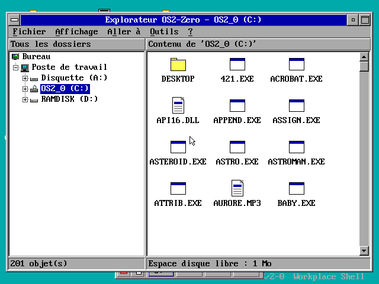
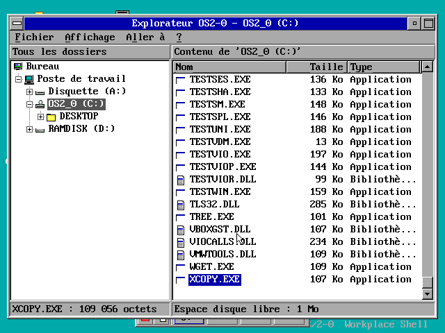

<table>
	<tr><th>Partie</th><th>Description</th></tr>
	<tr><td>Arbre « Tous les dossiers »</td><td>Bureau, Poste de travail, lecteurs (disque, CD-ROM, disquette), dossiers ; cases + et −, traits pointillés, branches dépliées à la demande ; l'arbre suit le dossier affiché. Clavier : flèches haut et bas (le contenu suit), gauche (replier ou remonter), droite (déplier).</td></tr>
	<tr><td>« Contenu de »</td><td><b>Grandes icônes</b> (cellules de 100 × 70 comme Pasdows 95, étiquettes sur deux lignes) ou <b>Détails</b> (nom, taille en Ko, type, date de modification). Dossiers d'abord, puis fichiers, par ordre alphabétique. Barres de défilement, flèches, Début, Fin, Pg.préc., Pg.suiv., une lettre : objet suivant qui commence par elle.</td></tr>
	<tr><td>Barre d'état</td><td>Nombre d'objets ou objet choisi (taille en octets ; espace libre et capacité d'un lecteur), espace disque libre du lecteur.</td></tr>
	<tr><td>Ouvrir (double clic, Entrée)</td><td>Dossier ou lecteur : l'affiche. <code>.EXE</code>, <code>.COM</code> : lance le programme (nouvelle session, comme les objets programme du bureau) ; <code>.CMD</code>, <code>.BAT</code> : par CMD.EXE ; textes et sources (<code>.TXT</code>, <code>.PAS</code>, <code>.INI</code>…) : Pascal Developer ; <code>.WAV</code> : Audio numérique ; <code>.MP3</code>, <code>.M3U</code> : Lecteur MP3 ; <code>.HTM</code> : Navigateur Web.</td></tr>
	<tr><td>Menus</td><td>Fichier (Ouvrir, Nouveau dossier, Supprimer, Renommer, Propriétés, Fermer), Édition (Couper, Copier, Coller, Sélectionner tout, Inverser la sélection), Affichage (Grandes icônes, Détails, Actualiser F5), Aller à (Dossier parent : Retour arrière, Poste de travail), Outils (Connecter un lecteur réseau…, Déconnecter un lecteur réseau…), ? (À propos). Bouton 2 : menu contextuel (voir ci-dessous) ; sur le Poste de travail et ses lecteurs, aussi Connecter et Déconnecter un lecteur réseau ; sur un lecteur réseau, Déconnecter. Tab passe de l'arbre au contenu.</td></tr>
	<tr><td>Propriétés (Alt+Entrée)</td><td>Fichier, dossier ou plusieurs éléments : boîte <b>Propriétés</b> (voir ci-dessous). Lecteur : boîte <b>Propriétés de (C:)</b> de Pasdows 95 (voir ci-dessous).</td></tr>
</table>

<b>Couper, Copier, Coller, Sélectionner tout, Propriétés.</b> L'Explorateur OS2-Zero reprend les nouveautés de l'Explorateur de Pasdows 95 (menus contextuels de Windows 95), avec l'API d'OS/2 :

<ul>
	<li><b>Menus contextuels</b> (bouton 2) : sur un fichier ou un dossier, <i>Ouvrir</i>, <b>Couper</b>, <b>Copier</b>, <b>Coller</b> (dans ce dossier), <i>Supprimer</i>, <i>Renommer</i>, <b>Sélectionner tout</b> et <b>Propriétés</b> ; sur le fond du dossier, <b>Sélectionner tout</b>, <b>Actualiser</b>, <b>Coller</b>, <i>Nouveau dossier</i> et <i>Propriétés</i> ; sur un dossier de l'arbre, <i>Coller</i> et <i>Nouveau dossier</i>.</li>
	<li><b>Sélection multiple</b> : <b>Ctrl+clic</b> ajoute ou retire un élément, <b>Maj+clic</b> (ou Maj+flèches) choisit une plage, <b>Sélectionner tout</b> (<b>Ctrl+A</b>) tout le dossier, <i>Inverser la sélection</i> ; la barre d'état donne « <i>n</i> objet(s) sélectionné(s) » et leur taille. Couper, Copier, Supprimer et Propriétés portent sur tous les éléments choisis (« Voulez-vous vraiment supprimer ces 2 éléments ? ») ; Renommer, sur un seul.</li>
	<li><b>Couper / Copier / Coller</b> (<b>Ctrl+X</b>, <b>Ctrl+C</b>, <b>Ctrl+V</b>) : fichiers et dossiers avec tout leur contenu (<code>DosCopy</code>), d'un lecteur à l'autre (HPFS, NTFS, disque virtuel, lecteurs réseau SMB, depuis le CD-ROM) ; Couper déplace (<code>DosMove</code> sur le même lecteur, sinon copie puis suppression). Copier dans le même dossier crée « Copie de <i>nom</i> », « Copie (2) de <i>nom</i> »… ; un élément qui existe déjà fait demander <i>Voulez-vous le remplacer ?</i> (Oui, Non, Annuler) ; copier un dossier dans lui-même est refusé. La liste des fichiers est gardée dans une mémoire partagée nommée (<code>\SHAREMEM\EXPLORER.CLP</code> : d'un Explorateur à l'autre) et le presse-papiers de PM reçoit leurs chemins en texte (un texte copié ensuite remplace la liste).</li>
	<li><b>Supprimer</b> (<b>Suppr</b>) avec confirmation, dossiers compris ; <b>Renommer</b> (<b>F2</b>) ; <b>Nouveau dossier</b> (« Nouveau dossier », puis la boîte Renommer comme sous Windows).</li>
	<li><b>Propriétés</b> d'un fichier ou d'un dossier (boîte de Presentation Manager) : icône et nom, <b>type</b>, <b>emplacement</b>, <b>taille</b> (« 126 Ko (129 024 octets) »), <b>contenu</b> d'un dossier (fichiers et sous-dossiers, taille totale), dates de <b>création</b>, de <b>modification</b> et de <b>dernier accès</b> (« samedi 21 novembre 2026 22:37:34 ») et <b>attributs</b> <i>Lecture seule</i>, <i>Masqué</i>, <i>Archive</i>, <i>Système</i>, modifiables (<code>DosSetPathInfo</code>) par OK ou Appliquer, grisés sur le CD-ROM. Pour plusieurs éléments : nombre de fichiers et de dossiers, dossier commun, taille totale, attributs communs.</li>
	<li>Un fichier <code>.MP3</code>, <code>.M3U</code> ou <code>.PLS</code> s'ouvre dans le <b>Lecteur MP3</b> (il n'était associé à rien).</li>
</ul>

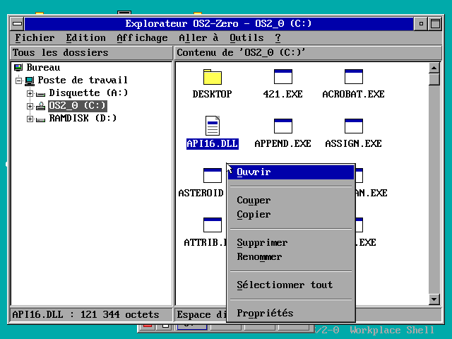
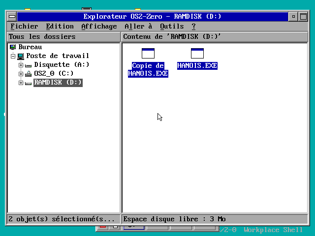
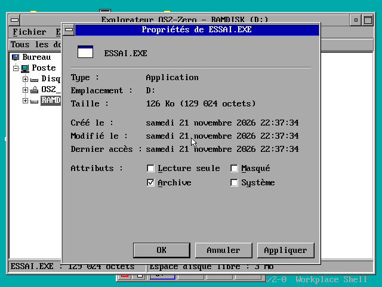
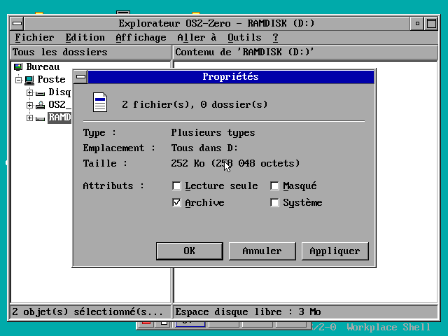
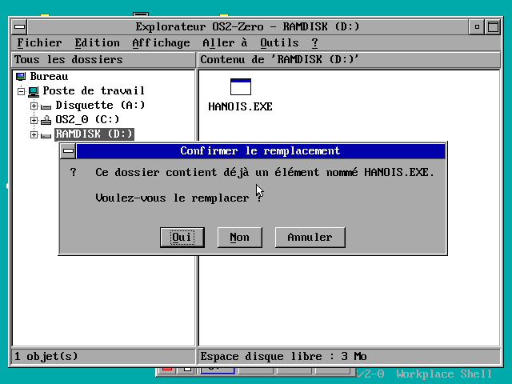

La boîte <b>Propriétés de (C:)</b> d'un lecteur reprend celle de Pasdows 95 : onglet <b>Général</b> avec l'icône du lecteur, son nom de volume (modifiable sur un disque dur ou le disque virtuel : <code>DosSetFSInfo</code> niveau 2, bouton Appliquer), son type et son système de fichiers, l'espace utilisé (bleu) et l'espace libre (magenta) en octets et en Ko, Mo ou Go, la capacité, et un <b>camembert en relief</b> (ellipse et flanc dessinés par segments, part libre dans le sens trigonométrique depuis 0°) avec « Lecteur C » ; onglet <b>Outils</b> (Vérifier maintenant… lance CHKDSK ; sauvegarde et défragmentation grisées) ; onglet <b>Partage</b> ; boutons OK, Annuler, Appliquer ; Tab et Maj+Tab changent d'onglet, Entrée vaut OK, Échap Annuler. Elle s'ouvre par Fichier → Propriétés ou le menu contextuel d'un lecteur dans l'Explorateur, et aussi par le menu contextuel d'un lecteur du dossier <b>Lecteurs</b> du bureau, qui lance <code>EXPLORER /PROPS:C:</code> (la boîte seule). De même, <code>EXPLORER /FPROPS fichier…</code> ouvre seule la boîte Propriétés de fichiers ou de dossiers (menu contextuel du bureau et des dossiers).

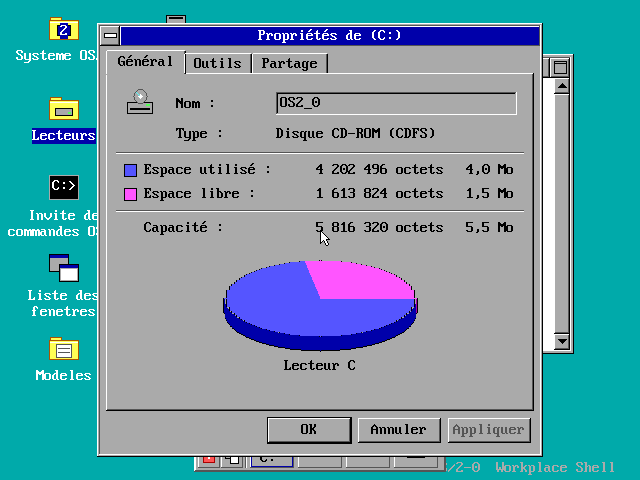

Le portage remplace les services du noyau de Pasdows par l'API d'OS/2 : <code>DosFindFirst</code>/<code>DosFindNext</code> (FILEFINDBUF3 : nom, taille, attributs, date) au lieu du parcours direct des répertoires FAT et ISO 9660 ; <code>DosQueryCurrentDisk</code> pour les lecteurs, <code>DosQueryFSInfo</code> (étiquette de volume, espace libre) et <code>DosQueryFSAttach</code> (nom du système de fichiers) ; <code>DosExecPgm</code> pour ouvrir ; fenêtre standard, gabarit de menu, <code>WinPopupMenu</code> et <code>WinMessageBox</code> de PM. Les icônes de Pasdows 95 (grille de 32 × 32 mise à l'échelle : 32 points dans le contenu, 16 dans l'arbre et les Détails) sont redessinées par <code>WinFillRect</code> et <code>GpiLine</code> ; les reliefs, les en-têtes et la barre d'état gardent l'apparence de Windows 95. Langue : variable <code>LANGUAGE</code> (français, anglais, allemand, italien, espagnol).

<h3>Lecteurs réseau : Connecter un lecteur réseau (SMB.IFS, Windows Server, Samba)</h3>

L'Explorateur OS2-Zero monte maintenant un dossier partagé d'un serveur Windows (Windows Server 2019, 2016, 2022, Windows 10 et 11) ou Samba comme une unité d'OS/2-0 : menu <b>Outils → Connecter un lecteur réseau…</b>, ou bouton 2 sur le <b>Poste de travail</b> (dans l'arbre ou dans le contenu). C'est la boîte de Pasdows 95, faite ici des contrôles de Presentation Manager (liste déroulante, champs de saisie, case à cocher, boutons) :

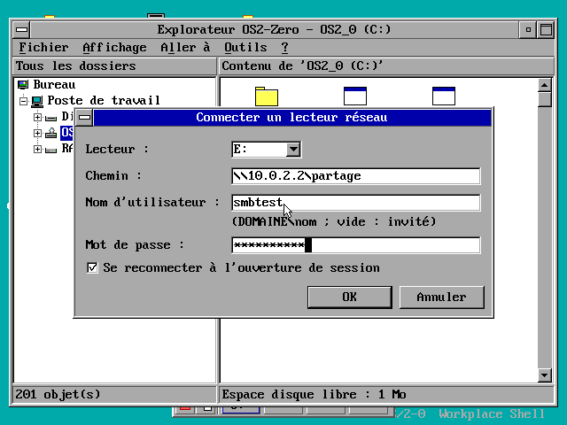

<table>
	<tr><th>Champ</th><th>Rôle</th></tr>
	<tr><td>Lecteur</td><td>Les lettres libres de D: à Z: ; la première est proposée.</td></tr>
	<tr><td>Chemin</td><td><code>\\serveur\partage</code> : nom DNS ou adresse IP du serveur (par exemple <code>\\192.168.1.10\Public</code>), puis le nom du partage. Les barres obliques <code>/</code> sont acceptées et les <code>\\</code> ajoutés s'ils manquent.</td></tr>
	<tr><td>Nom d'utilisateur</td><td><code>nom</code>, ou <code>DOMAINE\nom</code> pour un compte de domaine Active Directory ; vide : compte invité.</td></tr>
	<tr><td>Mot de passe</td><td>Affiché en astérisques ; il ne reste pas en mémoire : SMB.IFS n'en garde que la clé NT (MD4).</td></tr>
	<tr><td>Se reconnecter à l'ouverture de session</td><td>Le lecteur est gardé dans OS2.INI (application <code>PM_NetworkDrives</code>, clé = la lettre : chemin, utilisateur et clé NT, jamais le mot de passe) ; au démarrage, le bureau (PMSHELL) le rattache sans attendre le serveur : la connexion se fait au premier accès.</td></tr>
</table>

En cas d'échec, une boîte explique pourquoi : serveur injoignable sur le port 445, partage introuvable, nom d'utilisateur ou mot de passe incorrect (le champ du mot de passe est alors sélectionné pour le retaper), accès refusé, lettre déjà utilisée. Une fois connecté, l'Explorateur ouvre le lecteur : <code>partage sur 'serveur' (Z:)</code>, avec l'icône d'un disque branché au réseau. On y lit, copie, renomme, crée et supprime fichiers et dossiers depuis l'Explorateur, les dossiers du bureau (le dossier <b>Lecteurs</b> montre `Lecteur Z (\\serveur\partage)`), CMD.EXE et tous les programmes, comme sur un disque local. <b>Outils → Déconnecter un lecteur réseau…</b> (liste des lecteurs réseau) ou <b>Déconnecter</b> du menu contextuel d'un lecteur réseau le détache et l'oublie dans OS2.INI.

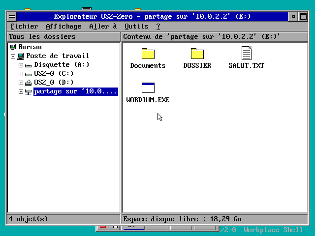
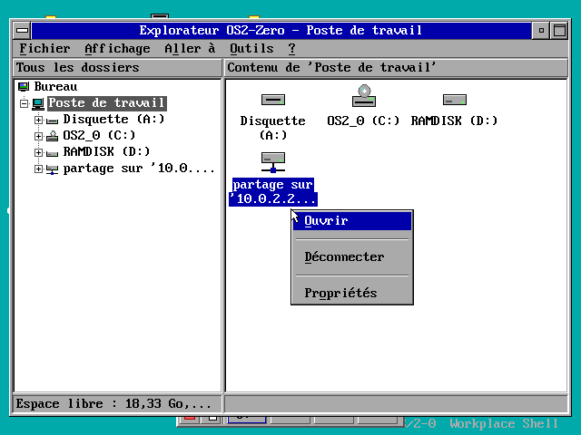

<table>
	<tr><th>Élément</th><th>Rôle</th></tr>
	<tr><td><b>SMB.IFS</b> (DLL/SMB.PAS)</td><td>Système de fichiers installable <b>distant</b> (<code>FS_NAME</code> = <code>SMB</code>), comme le Requester de LAN Server : client <b>SMB2</b> (dialectes 2.0.2 et 2.1 ; Windows Server 2019 les accepte toujours, SMB1 n'est pas utilisé), session <b>NTLMv2</b> dans SPNEGO, messages <b>signés</b> (HMAC-SHA256, exigé par les contrôleurs de domaine et par <code>server signing = mandatory</code> de Samba), MD4, MD5, HMAC-MD5 et SHA-256 écrits en Pascal. Il porte le client SMB de Pasdows 95 vers les points d'entrée FS_* d'OS/2 : FS_ATTACH (attacher, détacher, informations), FS_OPENCREATE, FS_READ, FS_WRITE, FS_CHGFILEPTR, FS_CLOSE, FS_FINDFIRST/FINDNEXT/FINDCLOSE (QUERY_DIRECTORY, FILEFINDBUF3 avec dates et attributs), FS_PATHINFO et FS_FILEINFO, FS_MKDIR, FS_RMDIR, FS_DELETE, FS_MOVE (renommage), FS_NEWSIZE, FS_FILEATTRIBUTE, FS_FSINFO (espace libre : FileFsSizeInformation) ; FS_COPY laisse la copie au noyau. Lectures et écritures par blocs de la taille négociée avec le serveur ; une connexion perdue (serveur redémarré, réseau coupé) est rouverte à l'accès suivant. Le transport passe par les sockets de TCPIP32.DLL (port 445). Le point d'entrée <code>SMBLASTERROR</code> donne le texte de la dernière erreur (statut NT du serveur).</td></tr>
	<tr><td><b>DosFSAttach</b>, <b>DosQueryFSAttach</b> (DOSCALLS.DLL)</td><td>L'API d'OS/2 des unités distantes : <code>DosFSAttach("Z:", "SMB", "\\serveur\partage" 0 utilisateur 0 mot de passe 0, cb, FS_ATTACH)</code> attache l'unité, <code>FS_DETACH</code> la détache ; <code>DosQueryFSAttach</code> rend <code>FSAT_REMOTEDRV</code> (4), le nom du FSD (<code>SMB</code>) et le chemin réseau. Le noyau charge <code>C:\SMB.IFS</code> à la première demande (pas de ligne <code>IFS=</code> à ajouter) et lui envoie toutes les opérations de l'unité (<code>KrnDiskCtl</code> 13, 14 et 15).</td></tr>
	<tr><td><b>NET.EXE</b> (NET.PAS)</td><td>La commande <code>NET USE</code> du Requester d'OS/2 à l'invite : <code>NET USE</code> (liste), <code>NET USE Z: \\serveur\partage [motdepasse | *] [/USER:[domaine\]nom]</code>, <code>NET USE * …</code> (première lettre libre en partant de Z:), <code>NET USE Z: /DELETE</code>. <code>*</code> demande le mot de passe sans l'afficher.</td></tr>
</table>

Pour un serveur Windows Server 2019 : partager le dossier (Propriétés → Partage → Partage avancé, et les droits NTFS du compte), vérifier que le pare-feu laisse passer le « Partage de fichiers et d'imprimantes (SMB-Entrée) », port TCP 445. Le nom NetBIOS seul d'un serveur n'est pas résolu (pas de diffusion NetBIOS) : utiliser son nom DNS ou son adresse IP. Sous VirtualBox, la carte en NAT atteint un serveur du réseau local par son adresse IP ; en « accès par pont », OS/2-0 est sur le même réseau que le serveur. Essais : Samba 4 (signature obligatoire, NTLMv2 seulement) depuis QEMU, avec copie de fichiers de 165 Ko et 1,1 Mo dans les deux sens (identiques), MD, REN, RD, DEL, DIR avec les dates, connexion permanente rétablie au redémarrage d'une installation sur disque dur.

<h3>Outils réseau : Client FTP (APPS/FTPCLI.PAS)</h3>

Le dossier <b>Outils réseau</b> du bureau contient le <b>Client FTP</b> (FTPCLI.EXE), dans le genre de FileZilla : celui de <a href="https://github.com/gladir/Pasdows95">Pasdows 95</a>, porté de l'API Win32 vers celle d'OS/2 (PMWIN, PMGPI, DOSCALLS, TCPIP32) et compilé par OS2PC en un seul fichier source. Toutes ses fonctions sont reprises :

<ul>
	<li><b>FTP</b> : EPSV/PASV, FEAT, UTF-8, MLSD ou LIST (Unix et MS-DOS) ; <b>SFTP v3</b> sur SSH-2 : curve25519-sha256, clés d'hôte ssh-ed25519 et rsa-sha2-512/256 vérifiées, aes128-ctr, hmac-sha2-256, kex strict, mot de passe ou clavier interactif ; clé d'hôte inconnue présentée avec son empreinte SHA-256, puis mémorisée dans <code>knownhosts.txt</code> (commun avec le Client SSH).</li>
	<li>Barre d'outils, <b>connexion rapide</b> avec historique (<code>recentservers.xml</code>), journal en couleurs, panneaux <b>Site local</b> et <b>Site distant</b> (colonnes triables, sélection multiple, glisser-déposer).</li>
	<li><b>File d'attente</b> avec progression, onglets <i>Fichiers en attente</i>, <i>Transferts échoués</i> et <i>Transferts réussis</i> ; dossiers envoyés et téléchargés avec tout leur contenu ; transferts dans un fil de travail (<code>DosCreateThread</code>, sémaphore).</li>
	<li>Menus déroulants et contextuels : envoyer, télécharger, créer un dossier, supprimer, renommer, copier l'URL, <b>droits d'accès</b> (chmod), commande personnalisée, fichiers masqués, fichier existant (remplacer, reprendre, renommer, ignorer).</li>
	<li><b>Gestionnaire de sites</b> : <code>sitemanager.xml</code> au format de FileZilla 3 (dossiers, protocole, type d'ouverture de session, mot de passe en base64), importation et exportation.</li>
	<li>Les fichiers de configuration sont dans <code>C:\RESEAU\</code> (ou <code>D:\RESEAU\</code> au démarrage du CD-ROM).</li>
</ul>

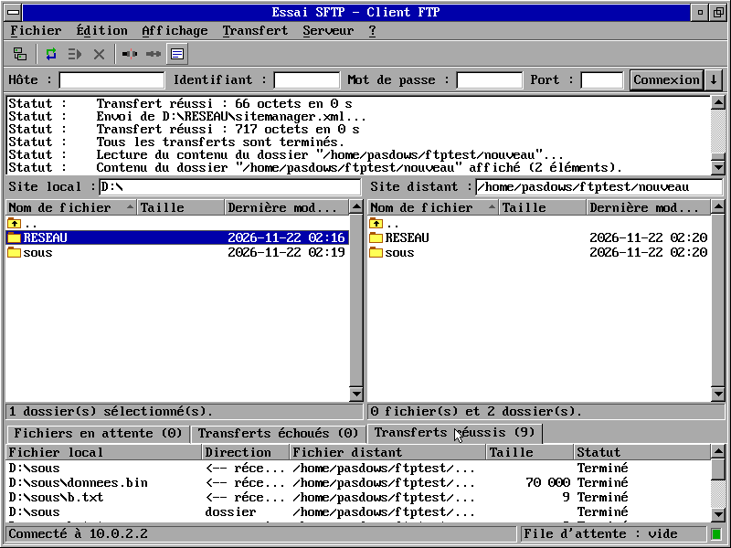
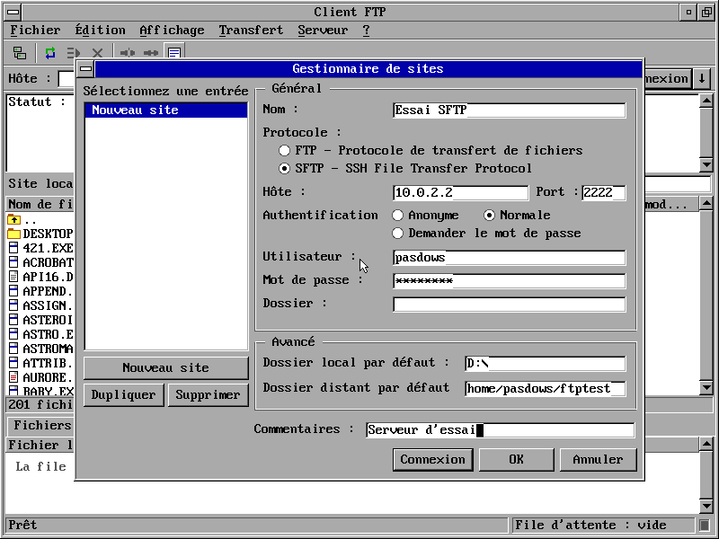
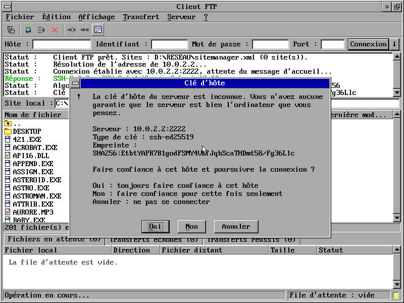
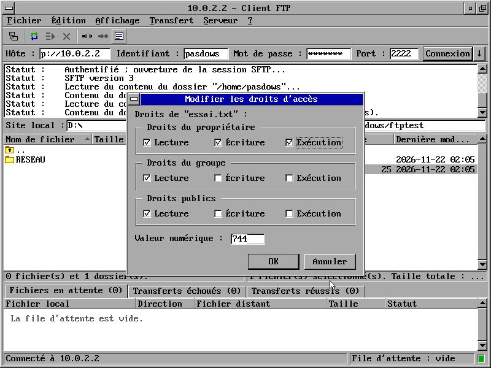
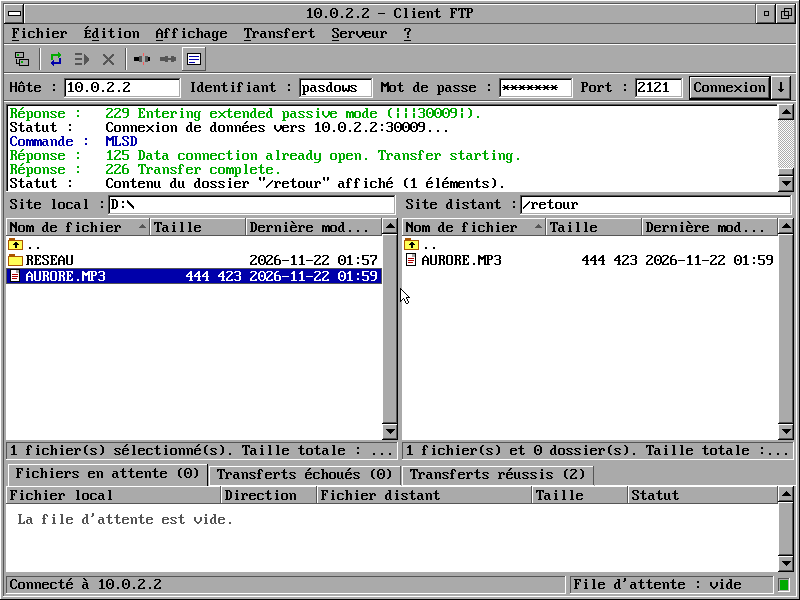
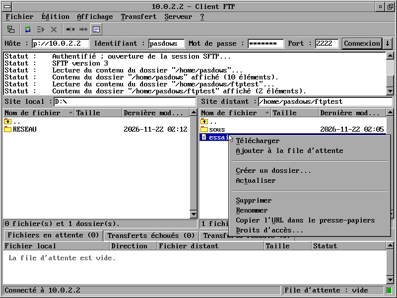

Écarts avec l'original : <i>Importer</i> et <i>Exporter</i> du Gestionnaire de sites demandent le chemin dans une boîte de saisie (la boîte standard de fichiers n'existe pas encore) ; <i>Ouvrir</i> un fichier local choisit l'application d'après l'extension, comme l'Explorateur OS2-Zero.

<h3>Outils réseau : Client SSH (APPS/SSHCLI.PAS)</h3>

Le dossier <b>Outils réseau</b> contient aussi le <b>Client SSH</b> (SSHCLI.EXE), dans le genre de MobaXterm : celui de Pasdows 95, porté de Win32 vers Presentation Manager, DOSCALLS et TCPIP32, et compilé par OS2PC en un seul fichier source. Toutes ses fonctions sont reprises :

<ul>
	<li><b>SSH-2</b> : curve25519-sha256, clés d'hôte ssh-ed25519 et rsa-sha2-512/256 vérifiées (<code>knownhosts.txt</code>, commun avec le Client FTP), aes128-ctr, hmac-sha2-256, kex strict, mot de passe ou clavier interactif ; canal session, pty-req, shell ou exec, maintien de la connexion, code de sortie (« Session terminée (code de sortie 3) »).</li>
	<li><b>Terminal xterm</b> : couleurs 16, 256 et RVB, région de défilement, écran alternatif (<code>top</code>, <code>vi</code>), UTF-8 affiché en page de codes, graphismes DEC, historique, sélection, copier, coller, changement de taille (window-change).</li>
	<li>Barre d'outils à grandes icônes, menus Terminal, Sessions, Affichage, Outils, Paramètres, Macros et ?, barre d'état ; <b>onglets des sessions</b> (accueil, jusqu'à 8 sessions, menu contextuel), <b>MultiExec</b> (la frappe va à toutes les sessions), reconnexion.</li>
	<li>Panneau de gauche : <b>connexion rapide</b> (<code>utilisateur@serveur:port</code>) et quatre onglets : <b>Sessions</b> (arbre à dossiers, <code>sessions.xml</code>, mot de passe facultatif en base64), <b>Outils</b> (programmes d'OS/2-0 : Invite de commandes, Gestionnaire des tâches, Gestionnaire de périphériques, Explorateur OS2-Zero, Bloc-notes, Calculatrice, Client FTP, Navigateur Web ; table ASCII, générateur de mots de passe), <b>Macros</b> (enregistrement des frappes, <code>macros.xml</code>) et <b>SFTP</b> (navigateur de la session active : télécharger, envoyer, créer, renommer, supprimer).</li>
	<li>Une tâche par session (<code>DosCreateThread</code>) qui attend le réseau par <b>select</b> ; un contexte SSH par tâche, échangé sous un sémaphore d'exclusion. Pour cela, <b>TCPIP32.DLL</b> exporte maintenant <code>select</code> (ordinal 12, select d'OS/2 : tableau de sockets, délai en millisecondes) et <code>bsdselect</code> (ordinal 32, select de BSD : <code>fd_set</code> et <code>timeval</code>).</li>
	<li>Les fichiers <code>sessions.xml</code>, <code>macros.xml</code>, <code>settings.xml</code> et <code>knownhosts.txt</code> sont dans <code>C:\RESEAU\</code> (ou <code>D:\RESEAU\</code> si C: est en lecture seule).</li>
</ul>

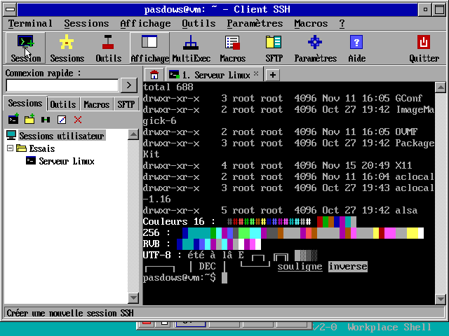
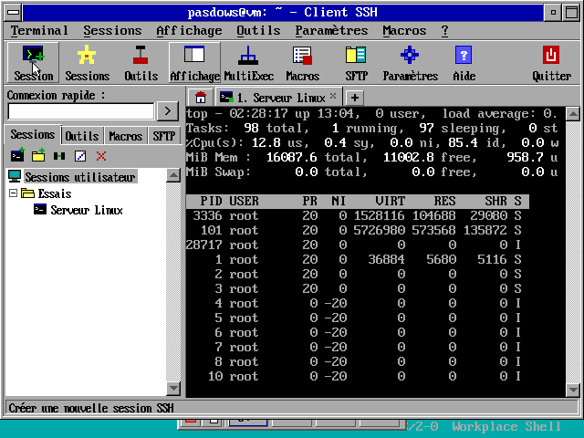
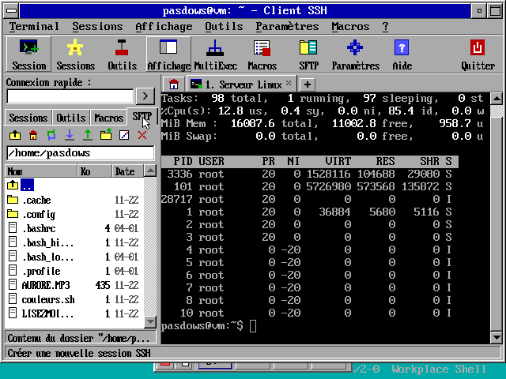
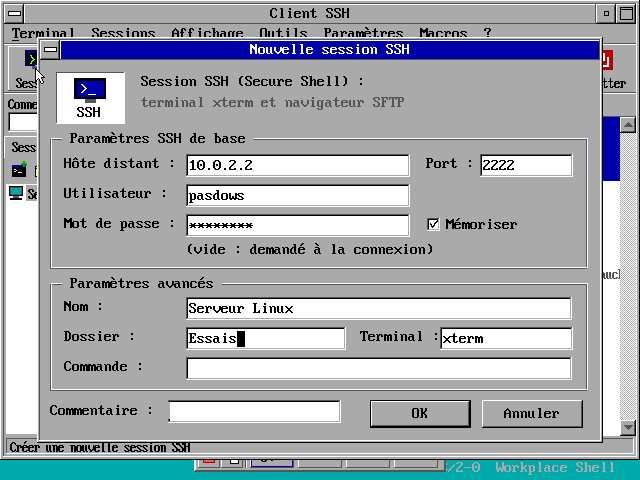
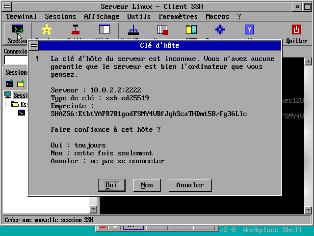
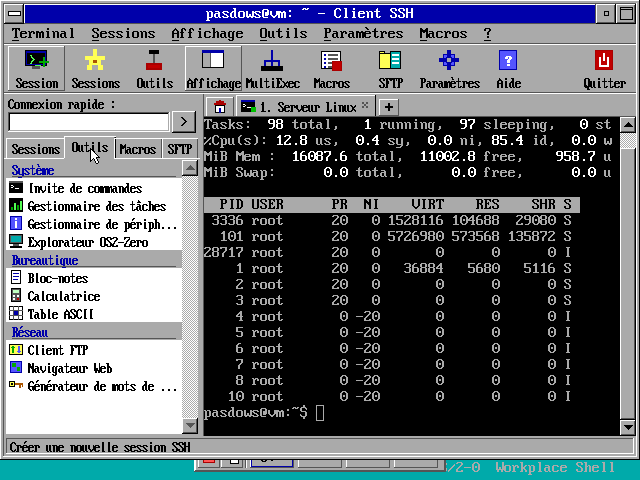

<h3>Navigateur Web (BROWSER.PAS)</h3>

On a beaucoup reproché à OS/2 Warp 3 sa faiblesse sur le <b>Web</b> : à l'heure où Internet arrivait chez tout le monde, il n'offrait qu'un navigateur à part, le WebExplorer de l'Internet Access Kit, vite dépassé (ni JavaScript, ni outils pour les développeurs) et mal intégré au reste du système. OS/2-0 en a un, intégré au bureau : <b>BROWSER.PAS</b> (BROWSER.EXE). On l'ouvre par le menu contextuel du bureau (<b>Navigateur Web</b>), par son icône du bureau (un globe devant une page) ou par son objet du dossier <b>Système OS/2</b> ; depuis CMD, <code>BROWSER adresse</code> l'ouvre sur une page.

<table>
	<tr>
		<td align="center">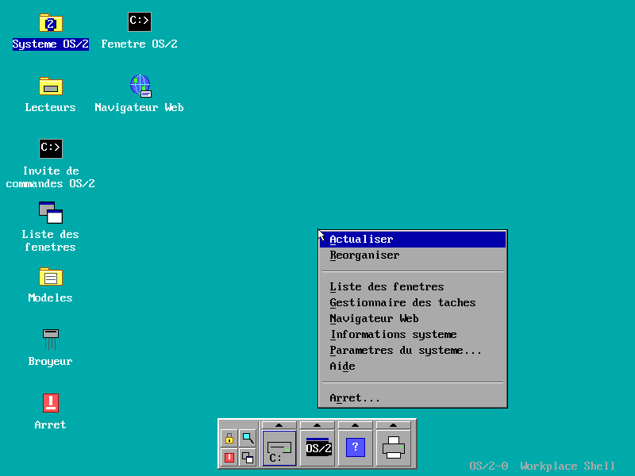 <i>Le Navigateur Web sur le bureau et dans son menu contextuel</i></td>
		<td align="center">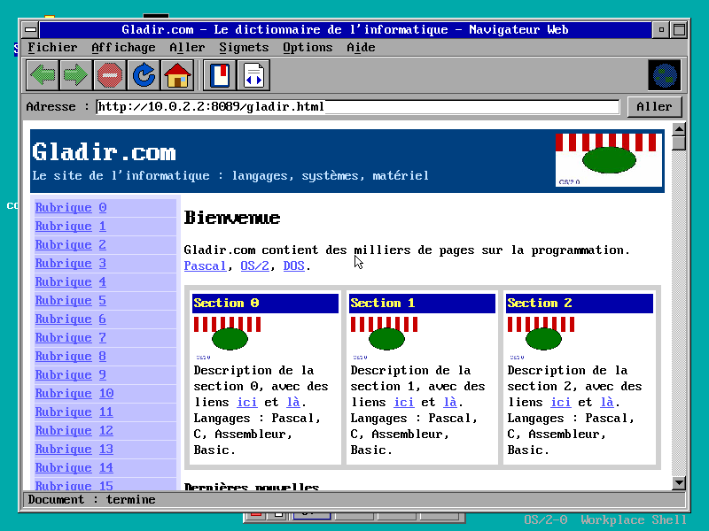 <i>Page reproduisant la structure de www.gladir.com : bandeau, colonne de rubriques, tableaux imbriqués, images</i></td>
	</tr>
	<tr>
		<td align="center">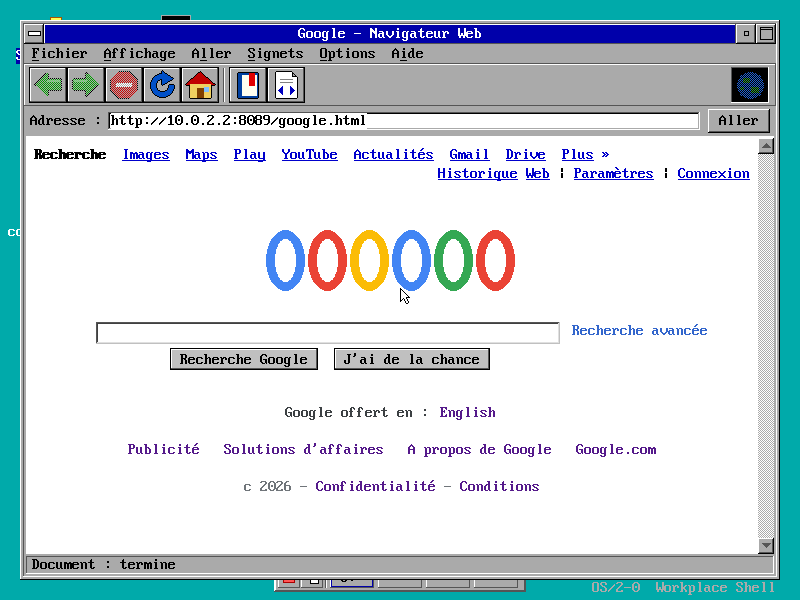 <i>Page reproduisant celle de www.google.ca : logo PNG, formulaire de recherche, scripts</i></td>
		<td align="center">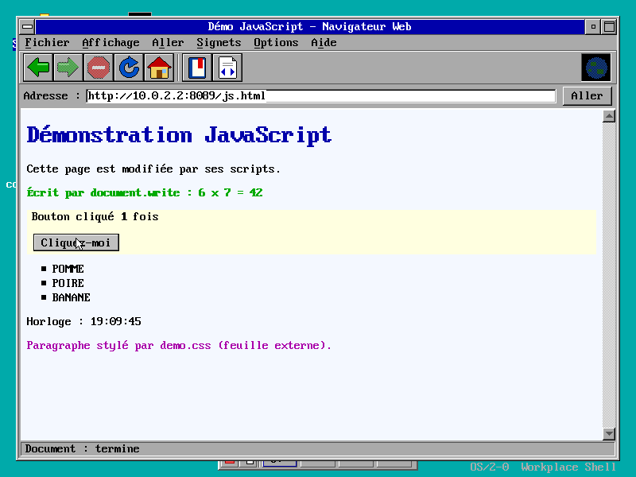 <i>JavaScript : document.write, DOM modifié par un clic, horloge (setInterval), feuille CSS externe</i></td>
	</tr>
</table>

<h4>Le concept : le navigateur de DEV-COOLS, refait pour Presentation Manager</h4>

Le point de départ est le navigateur graphique <b>BROWSER.PAS</b> du dépôt <b>DEV-COOLS</b> (Turbo Pascal / Free Pascal, unité Graph, WinInet). Son architecture est gardée : lecture de la source HTML, analyseur qui construit un arbre de nœuds, moteur de rendu par balises, décodeurs d'images GIF, PNG, JPEG et BMP, historique, favoris, barre d'adresse et boutons Précédent / Suivant / Actualiser. Tout le reste est refait pour qu'il soit un vrai programme d'OS/2, qui ne pourrait pas tourner ailleurs :

<table>
	<tr><th>Élément</th><th>Avec l'apparence d'OS/2 Warp 3</th></tr>
	<tr><td>Fenêtre</td><td>Cadre de PM redimensionnable (titre, menu système, bordure), vrai menu de PM (Fichier, Affichage, Aller, Signets, Options, Aide), raccourcis (Alt+Gauche, F5, Ctrl+U, F12...), barre d'état gravée, boîtes de message et dialogues de PM.</td></tr>
	<tr><td>Barre d'outils</td><td>Boutons en relief portant des <b>icônes d'OS/2</b> créées par l'API des pointeurs et icônes (WinCreatePointerIndirect, WinDrawPointer) : Précédent, Suivant, Arrêter, Actualiser, Accueil, Signets, Code source ; grisées (DP_HALFTONED) quand l'action est impossible ; globe d'OS/2 allumé pendant le chargement, grisé ensuite.</td></tr>
	<tr><td>Contrôles</td><td>Champ d'adresse WC_ENTRYFIELD (tout sélectionné à l'activation : la frappe remplace l'adresse), barre de défilement WC_SCROLLBAR, menu contextuel par WinCreateMenu et WinPopupMenu, presse-papiers de PM.</td></tr>
	<tr><td>Dessin</td><td>GPI : couleurs RGB, polices mises à l'échelle (GpiSetCharBox), images par GpiDrawBits, à partir d'une liste d'affichage ; le défilement et les scripts ne redessinent que ce qui change. En 16 couleurs, les couleurs des pages sont ramenées à celles de la palette.</td></tr>
	<tr><td>Réseau</td><td>TCPIP32.DLL d'OS/2-0 (HTTP/1.1 : redirections, transfert « chunked », proxy HTTP), dans un fil d'exécution à part : la fenêtre reste vivante pendant le chargement (bouton Arrêter).</td></tr>
	<tr><td>Réglages</td><td>Signets, page d'accueil, proxy et options dans <b>OS2.INI</b> (application BROWSER).</td></tr>
</table>

<h4>Les problèmes corrigés</h4>

Le navigateur d'origine plantait sur <b>www.google.ca</b> et sur <b>www.gladir.com</b>. Les causes, et celles trouvées en chemin dans OS/2-0 lui-même, sont corrigées :

<table>
	<tr><th>Problème</th><th>Correction</th></tr>
	<tr><td>Le contenu des &lt;script&gt; et &lt;style&gt; était analysé comme du HTML (un <code>a&lt;b</code> d'un script ouvrait des balises sans fin)</td><td>Contenu de &lt;script&gt;, &lt;style&gt; et &lt;textarea&gt; lu comme texte brut, jusqu'à sa balise de fin.</td></tr>
	<tr><td>Pages très imbriquées (tableaux dans des tableaux), pages énormes</td><td>Profondeur de l'arbre et de la récursion bornées, tableaux aux colonnes et lignes bornées (au-delà de 12 niveaux, cellules mesurées simplement), corps des réponses et images de taille bornée, mémoire épuisée gérée (page tronquée au lieu d'un plantage).</td></tr>
	<tr><td>Accents illisibles</td><td>UTF-8 reconnu par validation des séquences complètes, converti en page de codes 850 ; entités inconnues gardées telles quelles.</td></tr>
	<tr><td>Attributs sans valeur ou mal fermés, images tronquées ou corrompues</td><td>Analyseur tolérant ; décodeurs d'images vérifiés à chaque lecture (image ignorée au lieu d'un plantage).</td></tr>
	<tr><td>Boucle sans fin dans un script</td><td>Budget d'instructions et mémoire bornée pour le JavaScript : le script est arrêté, avec un message dans la Console.</td></tr>
	<tr><td>Débordement de pile (« runtime error 216 ») sur certaines pages</td><td>Défaut du compilateur <b>OS2PC</b> : ses routines de chaînes écrivaient un octet nul <i>après</i> le 255e caractère, une case trop loin. Elles sont maintenant limitées à 254 caractères.</td></tr>
	<tr><td><code>Break</code> compilé comme un appel de procédure, appels à des procédures inexistantes acceptés sans rien dire</td><td>OS2PC : un littéral d'un caractère comme <code>')'</code> était confondu avec la ponctuation, ce qui faussait la suite de l'instruction. Il avertit aussi maintenant des procédures et fonctions non définies (et, avec -w, des variables implicites).</td></tr>
	<tr><td>Fonction qui s'appelait elle-même sans fin (plantage TRAP 6)</td><td>OS2PC compile le nom d'une fonction lu dans son propre corps comme un appel récursif : le navigateur utilise une variable locale pour le résultat.</td></tr>
	<tr><td>Calculs en virgule flottante faux quand plusieurs programmes tournent</td><td>Noyau : l'état du coprocesseur x87 est sauvé et rendu à chaque changement de tâche (FNSAVE, FRSTOR).</td></tr>
	<tr><td>F12 agissait comme F5</td><td>PMWIN : codes de balayage de F11 et F12 (0x57 et 0x58) traduits en VK_F11 et VK_F12.</td></tr>
	<tr><td>Page qui clignotait chaque seconde avec une horloge en JavaScript</td><td>Redessin partiel : après chaque mise en page, seules les opérations de dessin qui ont changé sont invalidées.</td></tr>
</table>

Pour s'en assurer, le moteur (analyseur, CSS, mise en page, JavaScript) est aussi compilé par Free Pascal sur l'hôte, avec vérification des bornes, et passé au <b>test aléatoire</b> : 400 pages HTML et 600 scripts déformés au hasard, sans aucun plantage ; puis 40 pages dans OS/2-0 sous QEMU. Remarque : l'environnement des essais n'avait pas accès aux vrais sites ; www.google.ca et www.gladir.com ont donc été <b>reproduits</b> sur un petit serveur HTTP local (même structure, mêmes pièges : scripts, tableaux imbriqués, UTF-8, images), que QEMU voit à l'adresse 10.0.2.2.

<h4>Les possibilités</h4>

<table>
	<tr>
		<td align="center">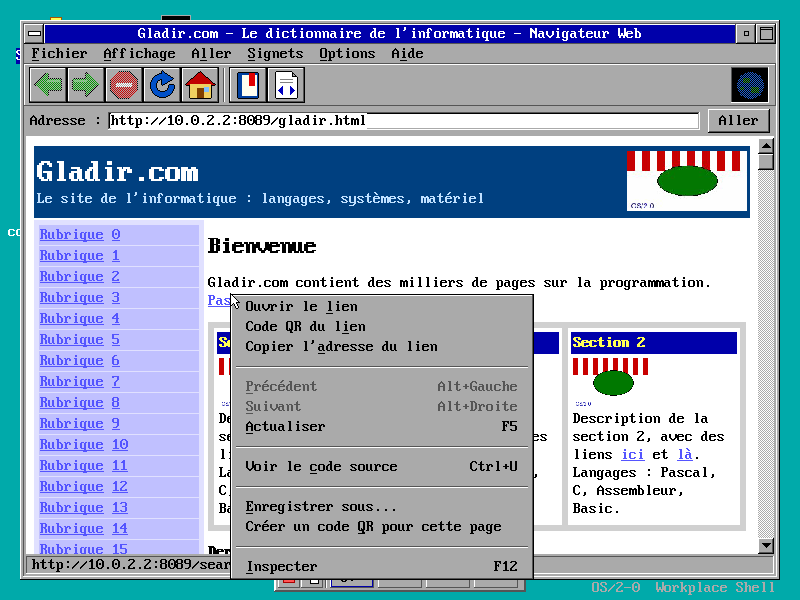 <i>Bouton 2 sur un lien : menu contextuel de PM</i></td>
		<td align="center">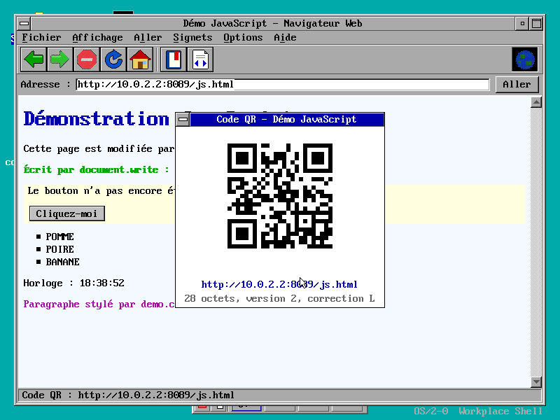 <i>Créer un code QR pour cette page : à lire avec un téléphone</i></td>
	</tr>
	<tr>
		<td align="center">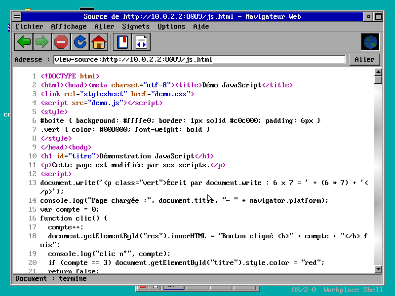 <i>Code source (view-source:, Ctrl+U) numéroté et coloré</i></td>
		<td align="center">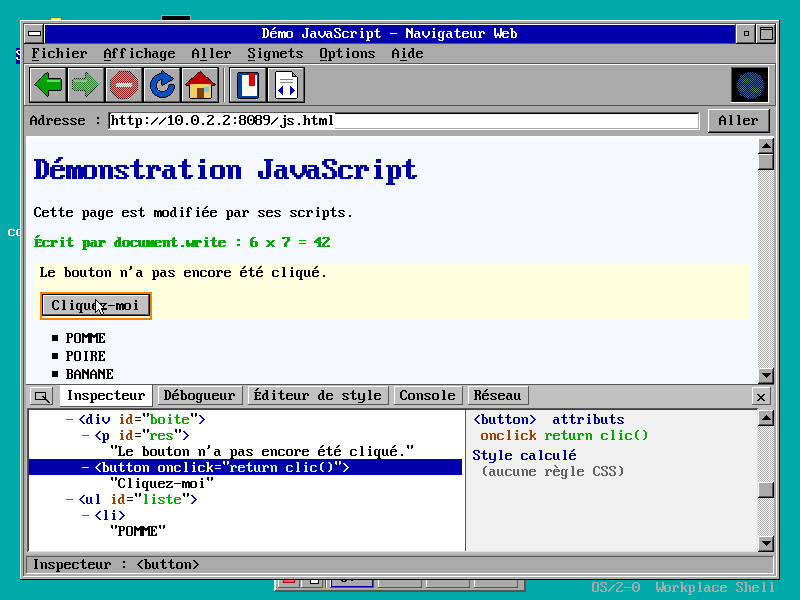 <i>F12, Inspecteur : élément choisi à la souris, encadré en orange dans la page</i></td>
	</tr>
	<tr>
		<td align="center">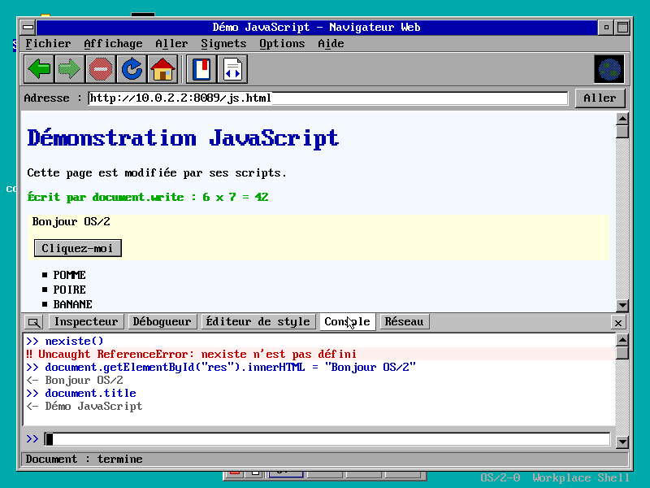 <i>Console : expressions évaluées, erreurs, DOM modifié en direct</i></td>
		<td align="center">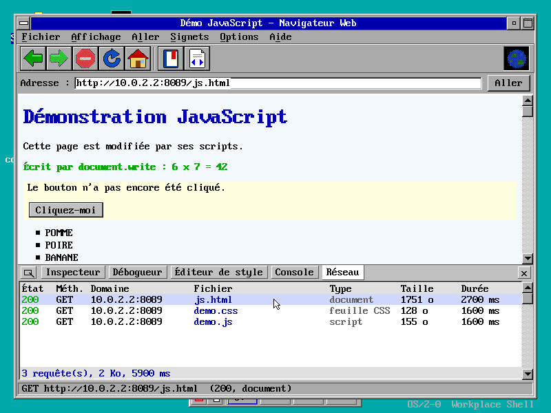 <i>Réseau : chaque requête de la page (état, type, taille, durée)</i></td>
	</tr>
	<tr>
		<td align="center">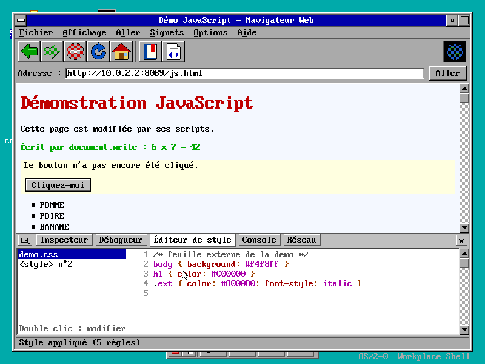 <i>Éditeur de style : la couleur du titre changée en direct dans demo.css</i></td>
		<td align="center">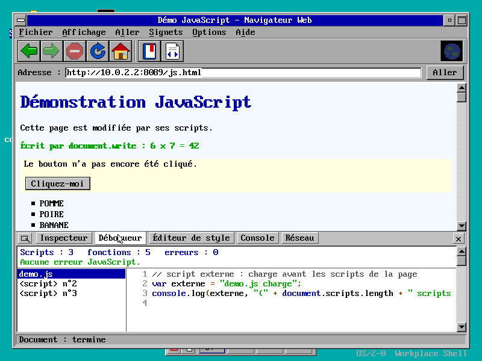 <i>Débogueur : scripts de la page, internes et externes</i></td>
	</tr>
	<tr>
		<td align="center">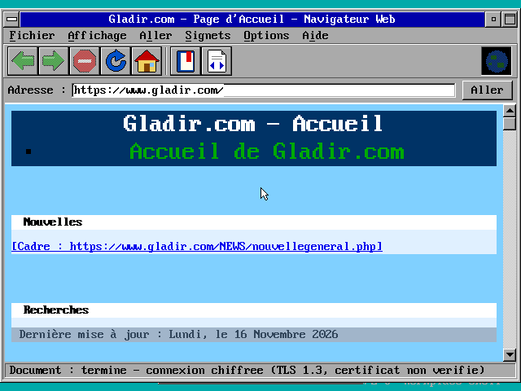 <i>https://www.gladir.com/ (le vrai site) en TLS 1.3 par TLS32.DLL : la barre d'état indique la connexion chiffrée</i></td>
		<td></td>
	</tr>
</table>

<h4>HTTPS : TLS32.DLL</h4>

Les adresses <b>https://</b> sont chiffrées par <b>TLS32.DLL</b> (DLL/TLS32.PAS), entièrement écrite en Pascal pour OS/2-0 : <b>TLS 1.3</b> (RFC 8446, suite TLS_AES_128_GCM_SHA256) et, pour les serveurs qui ne le connaissent pas, <b>TLS 1.2</b> (ECDHE-RSA et ECDHE-ECDSA avec AES-128-GCM et SHA-256). L'échange de clés se fait en <b>X25519</b> (RFC 7748). SHA-256, HMAC, HKDF, la PRF de TLS 1.2, AES-128 et GCM sont aussi écrits en Pascal, sans entiers de 64 bits (OS2PC n'en a pas). Le chiffrement a été vérifié avec les vecteurs d'essai des normes, puis en connexion avec OpenSSL (TLS 1.3, TLS 1.2 RSA et ECDSA, demande de certificat client) et avec de vrais sites. Le Navigateur Web et <code>WGET https://...</code> s'en servent ; avec un proxy, la connexion passe par un tunnel <code>CONNECT</code>.
Le navigateur masque les exceptions du coprocesseur (arithmétique IEEE du JavaScript : <code>1/0</code> donne <code>Infinity</code>) : le runtime d'OS2PC les démasque comme Free Pascal, et sous VirtualBox (virtualisation matérielle, CR0.NE) le calcul de <code>Infinity</code> arrêtait le navigateur (SYS3175, TRAP 0010) dès qu'une page comme https://www.gladir.com/ exécutait son JavaScript ; QEMU, en émulation, ne lève pas cette exception.
<b>Limite :</b> la chaîne de certificats du serveur n'est <b>pas vérifiée</b> (OS/2-0 n'a pas de magasin d'autorités de certification). La connexion est chiffrée et le message Finished du serveur est vérifié, mais un intermédiaire actif pourrait se faire passer pour le serveur ; la barre d'état le rappelle (« certificat non vérifié »). Un serveur qui n'accepte que la courbe P-256 pour l'échange de clés refuse la connexion.

<table>
	<tr><th>Fonction</th><th>Détails</th></tr>
	<tr><td><b>Pages</b></td><td>HTML (titres, paragraphes, listes, tableaux, formulaires, liens, ancres, &lt;meta refresh&gt;), CSS (feuilles &lt;link&gt; et &lt;style&gt;, attribut style ; couleurs, fonds, polices, alignement, marges et espacements), images GIF, PNG, JPEG et BMP, pages text/plain, adresses http://, file:///C:/... et about:home. Enregistrer sous : les octets reçus tels quels, avec confirmation avant de remplacer un fichier.</td></tr>
	<tr><td><b>JavaScript</b></td><td>Sous-ensemble d'ECMAScript 5 et 6 : var, let, const, fonctions et fonctions fléchées, objets, tableaux (map, filter, reduce, forEach...), chaînes, décomposition (...), switch, try/catch, for-in/for-of, Math, Date, JSON ; document.write, DOM (getElementById, querySelector, innerHTML, textContent, style, classList, createElement, appendChild...), événements (onclick, addEventListener, onload, DOMContentLoaded, onsubmit, onchange, survol), setTimeout et setInterval, location, history, alert.</td></tr>
	<tr><td><b>Code source</b></td><td>view-source:adresse, Ctrl+U ou menu Affichage : lignes numérotées ; balises, attributs, valeurs, commentaires, scripts et styles en couleurs.</td></tr>
	<tr><td><b>Menu contextuel</b></td><td>Bouton 2 dans la page : Ouvrir le lien, Code QR du lien, Copier l'adresse du lien (presse-papiers de PM), Précédent, Suivant, Actualiser, Voir le code source, Enregistrer sous..., Créer un code QR pour cette page, Inspecter (F12). Les actions impossibles sont grisées.</td></tr>
	<tr><td><b>Code QR</b></td><td>Générateur écrit pour OS/2-0 : versions 1 à 10 (jusqu'à 271 octets), niveau de correction L, blocs Reed-Solomon entrelacés, choix du meilleur des 8 masques. Vérifié par un vérificateur indépendant (format BCH, syndromes Reed-Solomon) et, module par module, sur la capture d'écran.</td></tr>
	<tr><td><b>Outils de développement (F12)</b></td><td>Panneau ancré sous la page, à la manière de <b>Firebug</b> : <b>Inspecteur</b> (arbre du DOM repliable, attributs, style calculé ; bouton de sélection puis clic dans la page, ou Inspecter du menu contextuel), <b>Débogueur</b> (scripts internes et externes), <b>Éditeur de style</b> (double clic sur une ligne d'une feuille : la page est restylée aussitôt), <b>Console</b> (messages de console.log, warn et error, erreurs des scripts ; Entrée évalue une expression dans la page, flèches haut et bas pour l'historique), <b>Réseau</b> (état, méthode, domaine, fichier, type, taille et durée de chaque requête ; clic : détails dans la barre d'état).</td></tr>
	<tr><td><b>Presse-papiers</b></td><td>Ajouté pour l'occasion aux champs de saisie de PMWIN, avec les touches CUA d'OS/2 : Maj+Inser (coller), Ctrl+Inser (copier), Maj+Suppr (couper), et aussi Ctrl+V, Ctrl+C et Ctrl+X.</td></tr>
	<tr><td><b>Diagnostic</b></td><td><code>SET BROWSER_TRACE=1</code> dans CONFIG.SYS recopie la console et les étapes du chargement sur la sortie standard (le port série sous QEMU).</td></tr>
</table>

Pour l'essayer sous QEMU, il faut une carte réseau : <code>qemu-system-i386 -m 64 -cdrom IMAGE/OS2CD.ISO -boot d -nic user,model=e1000</code>. Les sites en <b>https://</b> passent par <b>TLS32.DLL</b> (voir plus bas) ; un proxy HTTP reste possible (menu Options - Proxy, ou <code>SET HTTP_PROXY=hôte:port</code> : tunnel CONNECT). Du navigateur d'origine, ne sont pas encore repris : les flux RSS/Atom, les cadres &lt;iframe&gt; affichés dans la page (ils sont remplacés par un lien), la liste des répertoires ftp://, le texte des PDF et les images SVG.

<a href="../README.md">&larr; Retour au README</a>

