<h1>OS2-0 : Machines virtuelles, sessions DOS et anciens programmes</h1>

<a href="../README.md">&larr; Retour au README</a>

<h3>VirtualBox : Additions d'OS/2-0, réseau TCP/IP et Gestionnaire de périphériques</h3>

OS/2-0 reconnaît maintenant le matériel des machines virtuelles de <b>VirtualBox</b> et en a les pilotes, comme les « Additions invitées » :

<table>
	<tr><th>Élément</th><th>Rôle</th></tr>
	<tr><td><b>VBOXGST.DLL</b> (DLL/VBOXGST.PAS)</td><td>Pilote du « VirtualBox Guest Service » (VMMDev, PCI 80EE:CAFE) : il se présente à l'hôte (ReportGuestInfo, ReportGuestInfo2 avec la version de l'hôte, ReportGuestStatus), annonce qu'il sait changer la taille de l'écran (SetGuestCapabilities : graphisme) et la souris absolue, cache le pointeur de l'hôte au-dessus de la machine (un seul pointeur : celui d'OS/2-0) et lit les demandes de l'hôte (AcknowledgeEvents, GetDisplayChangeRequest2), sans interruption.</td></tr>
	<tr><td>Souris intégrée</td><td>MOUCALLS.DLL lit la position absolue (GetMouseStatus) à chaque paquet de la souris PS/2 que VirtualBox envoie : le pointeur d'OS/2-0 suit exactement celui de l'hôte, sans capture de la souris ni pointeur en double ; si l'hôte ne veut plus de souris absolue (souris capturée), les déplacements relatifs reprennent.</td></tr>
	<tr><td>Taille de l'écran</td><td>VIOCALLS.DLL sait programmer l'adaptateur graphique de VirtualBox (VBoxVGA, VMSVGA) par l'interface VBE DISPI (ports 1CEh/1CFh) à <b>n'importe quelle</b> résolution (mémoire linéaire des modes VESA, taille de la mémoire vidéo vérifiée) ; PMWIN.DLL lit toutes les 300 ms les demandes de l'hôte (fenêtre de la machine redimensionnée, « Ajuster automatiquement la taille de l'écran », menu Écran virtuel → Redimensionner) et passe l'écran à cette taille (WINSETSCREENMODE) ; le bureau (WM_SYSVALUECHANGED) et le LaunchPad se réorganisent. La même interface DISPI existe dans QEMU et Bochs (<code>SET PMRESOLUTION=</code> accepte alors toute taille).</td></tr>
	<tr><td><b>E1000.DLL</b> (DLL/E1000.PAS)</td><td>Intel PRO/1000 : 82540EM (« Intel PRO/1000 MT Desktop », la carte par défaut de VirtualBox ; QEMU <code>e1000</code>), 82543GC, 82545EM, 82544, 82574L : registres en mémoire, anneaux de descripteurs (bus maître), adresse MAC de l'EEPROM.</td></tr>
	<tr><td><b>PCNET.DLL</b> (DLL/PCNET.PAS)</td><td>AMD PCnet-PCI II (Am79C970A) et PCnet-FAST III (Am79C973), les autres cartes de VirtualBox (QEMU <code>pcnet</code>) : mode 32 bits, structures de style 2, bloc d'initialisation, anneaux de descripteurs.</td></tr>
	<tr><td><b>TLS32.DLL</b> (DLL/TLS32.PAS)</td><td>Connexions chiffrées <b>TLS 1.3</b> (TLS_AES_128_GCM_SHA256) et <b>TLS 1.2</b> (ECDHE-RSA et ECDHE-ECDSA-AES128-GCM-SHA256) sur une socket de TCPIP32.DLL, échange de clés <b>X25519</b> ; SHA-256, HMAC, HKDF, PRF, AES-128, GCM et X25519 écrits en Pascal. Points d'entrée <code>TLSOPEN</code>, <code>TLSSEND</code>, <code>TLSRECV</code>, <code>TLSCLOSE</code>, <code>TLSERROR</code>, <code>TLSINFO</code> ; utilisée par le Navigateur Web et WGET pour <code>https://</code>. Les certificats du serveur ne sont pas vérifiés (pas de magasin d'autorités) : la connexion est chiffrée, pas authentifiée.</td></tr>
	<tr><td><b>TCPIP32.DLL</b> (DLL/TCPIP32.PAS)</td><td>Pile TCP/IP : ARP, IPv4, ICMP (réponse aux échos, sockets bruts), UDP, DHCP (au premier usage ; sinon <code>SET IP_ADDRESS=</code>, <code>IP_NETMASK</code>, <code>IP_GATEWAY</code>, <code>IP_DNS</code>), DNS, TCP client (ouverture en trois temps, MSS, accusés de réception et réémission, fenêtre, FIN, RST) ; interface des sockets d'OS/2 : <code>sock_init</code>, <code>socket</code>, <code>bind</code>, <code>connect</code>, <code>send</code>, <code>recv</code>, <code>sendto</code>, <code>recvfrom</code>, <code>soclose</code>, <code>shutdown</code>, <code>sock_errno</code>, <code>gethostbyname</code>, <code>gethostid</code>, <code>inet_addr</code>. Pilote : <code>SET NETDRIVER=E1000</code>, <code>PCNET</code> ou <code>NONE</code>, sinon détection.</td></tr>
	<tr><td>Commandes</td><td><b>IFCONFIG</b> (interface lan0 : carte, MAC, adresse, masque, passerelle, DNS, DHCP et bail ; <code>/RENEW</code>), <b>PING</b> hôte [nombre], <b>HOST</b> nom (DNS), <b>WGET</b> http[s]://hôte[:port]/chemin [fichier] (HTTP/1.0 ; https:// par TLS32.DLL), <b>NET USE</b> (lecteurs réseau Windows et Samba par SMB.IFS, voir <i>Lecteurs réseau</i>).</td></tr>
	<tr><td><b>Gestionnaire de périphériques</b> (DEVMGR.PAS)</td><td>Système OS/2 → Configuration du système : le matériel par catégorie (affichage, réseau, multimédia, stockage, entrée, ports, système, ponts, USB) lu sur le bus PCI, dans la zone du BIOS et auprès du noyau, avec ses ressources, son pilote d'OS/2-0 et son état (en rouge : aucun pilote). Sous VirtualBox : VirtualBox Guest Service (VBOXGST.DLL), adaptateur graphique VirtualBox (DISPI), souris VirtualBox intégrée, carte réseau (E1000.DLL ou PCNET.DLL, avec son adresse MAC).</td></tr>
</table>

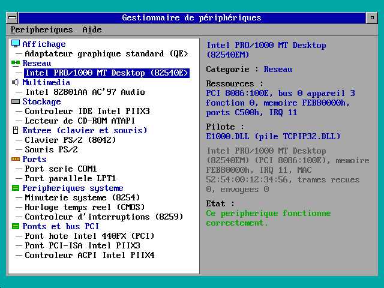

Réglages conseillés de la machine virtuelle : type « OS/2 Warp 3 » (ou « Autre »), contrôleur graphique VBoxVGA ou VMSVGA, carte réseau Intel PRO/1000 MT Desktop ou PCnet-FAST III en NAT, souris PS/2. Les Additions ne demandent aucune installation : VBOXGST.DLL est chargé dès qu'il trouve le VMMDev.

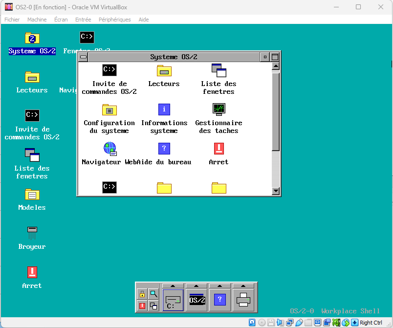

<i>OS/2-0 dans <b>VirtualBox 7.0</b> sous Windows (VirtualBox au-dessus de Hyper-V) : le bureau, le dossier Système OS/2 et le LaunchPad.</i>

<b>Installation depuis VirtualBox.</b> Le CD-ROM d'installation s'arrêtait dès le démarrage du noyau : « OS/2-0 OS2LDR...... » restait affiché et plus rien ne se passait. Trois causes ont été trouvées et corrigées :

<table>
	<tr><th>Réglage de VirtualBox</th><th>Problème</th><th>Correction</th></tr>
	<tr><td>Tous (la panne principale), surtout quand VirtualBox tourne au-dessus de Hyper-V (mode « NEM », journal : <code>HM: ... fall back to NEM</code>)</td><td>OS2LDR copie le noyau en mémoire étendue par INT 15h AH=87h ; le BIOS de VirtualBox laisse la <b>ligne A20 coupée</b> à la sortie de ces copies. Le noyau démarrait donc avec A20 coupée : sous Hyper-V, VirtualBox retire alors de la machine la zone 1 Mo – 1 Mo + 64 Ko et exécute ce qui s'y trouve (les gestionnaires d'interruptions et la console du noyau) en repliant les adresses sur la mémoire basse. Journal : <code>A20 disabled (changed 221 times)</code>, des millions d'instructions émulées (<code>/IEM/CPU0/cPotentialExits</code>), processeur arrêté dans le noyau avec une pile perdue.</td><td>OS2LDR réactive la ligne A20 après le chargement, juste avant le passage en mode protégé, et vérifie qu'elle l'est (0000:0500 et FFFF:0510 ne doivent pas désigner la même case) ; sinon il passe par le contrôleur du clavier (commande D1h). La régression reproduit la panne (OS2LDR d'essai qui coupe A20 : QEMU replie alors toute la mémoire) et vérifie que le bureau s'affiche.</td></tr>
	<tr><td>Plus de 2 Go de mémoire (les types Windows proposent 2 à 4 Go)</td><td>Le noyau calcule les adresses en entiers signés de 32 bits : la taille de la mémoire devenait négative, et l'appel au BIOS vidéo qui suit partait dans le vide (écran figé après « Mémoire : … Ko »).</td><td>La mémoire gérée est plafonnée à 1792 Mo (OS/2-0 n'en demande pas plus) ; la vraie taille reste affichée.</td></tr>
	<tr><td>Disque et CD-ROM sur un contrôleur <b>SATA</b> (AHCI), le choix par défaut de nombreux types, et le seul du chipset ICH9</td><td>Le noyau ne connaissait que l'IDE : « lecteur de CD-ROM ATAPI introuvable », puis aucun disque où installer.</td><td>Nouveau pilote AHCI dans le noyau : contrôleur cherché sur le bus PCI (classe 01h, sous-classe 06h), ports SATA, lecteur ATAPI (PACKET, READ(10)) et disques ATA (IDENTIFY, lecture et écriture DMA 48 bits, vidage du cache). Installation, démarrage du disque dur SATA et fichiers sur C: fonctionnent comme en IDE.</td></tr>
</table>

Ces cas sont reproduits dans la régression avec QEMU (<code>-m 3584</code> ; <code>-M q35</code>, dont le disque et le lecteur de CD-ROM sont en SATA) ; le CD d'installation démarre aussi sous Bochs, dont le BIOS est l'ancêtre de celui de VirtualBox. Il faut enfin laisser <b>EFI désactivé</b> (Système → Carte mère) : le CD-ROM d'OS/2-0 démarre par le BIOS (El Torito), comme celui d'OS/2 Warp 3.

<pre>qemu-system-i386 -m 3584 -cdrom IMAGE/OS2INST.ISO -boot d -drive file=disque.img,format=raw,if=ide
qemu-system-i386 -M q35 -m 512 -cdrom IMAGE/OS2INST.ISO -boot d -drive file=disque.img,format=raw,if=ide</pre>

<pre>qemu-system-i386 -m 64 -cdrom IMAGE/OS2CD.ISO -boot d -nic user,model=e1000
qemu-system-i386 -m 64 -cdrom IMAGE/OS2CD.ISO -boot d -nic user,model=pcnet</pre>

<h3>VMware Workstation : VMware Tools d'OS/2-0</h3>

Sous <b>VMware Workstation</b> (et VMware Player, Fusion, ESXi), OS/2-0 a aussi ses pilotes, comme les « VMware Tools » :

<table>
	<tr><th>Élément</th><th>Rôle</th></tr>
	<tr><td><b>VMWTOOLS.DLL</b> (DLL/VMWTOOLS.PAS)</td><td>VMware Tools d'OS/2-0 : porte dérobée de VMware (port 5658h, nombre magique 564D5868h ; GETVERSION), souris <b>vmmouse</b> (ABSPOINTER : READ_ID, REQUEST_ABSOLUTE, file des paquets) et canal <b>GuestRPC</b> (RPCI pour parler à l'hôte, TCLO pour en recevoir les ordres) : version des Tools (<code>tools.set.version</code>), capacités (<code>tools.capability.resolution_set</code>, <code>resolution_server toolbox</code>, <code>resolution_min</code>), réponses à <code>reset</code>, <code>ping</code>, <code>Capabilities_Register</code>, <code>Set_Option</code> et <b><code>Resolution_Set</code></b> (taille de l'écran voulue par l'hôte). Chargé par MOUCALLS.DLL et PMWIN.DLL seulement si la porte dérobée répond <b>et</b> que la carte VMware SVGA II est sur le bus PCI (QEMU répond aussi à la porte dérobée).</td></tr>
	<tr><td>Souris</td><td>MOUCALLS.DLL lit la position absolue de la vmmouse (0..65535) et ses boutons à chaque paquet PS/2 : le pointeur d'OS/2-0 suit exactement celui de l'hôte, qui le masque au-dessus de la machine — un seul pointeur, sans capture (Ctrl+Alt) ni pointeur en double.</td></tr>
	<tr><td>Carte graphique <b>VMware SVGA II</b></td><td>VIOCALLS.DLL programme la carte (PCI 15AD:0405) par ses registres (ports BAR0 : index et valeur ; identification SVGA_ID_2) : n'importe quelle résolution jusqu'au maximum de la carte, en 32 bits par pel, mémoire linéaire (FB_START + FB_OFFSET, BYTES_PER_LINE), file de commandes (FIFO : MIN, MAX, NEXT_CMD, STOP) ; PMWIN.DLL envoie au plus toutes les 30 ms la commande UPDATE pour que l'hôte recopie l'écran, et un curseur matériel transparent (DEFINE_CURSOR) est défini si la carte en a. Sous VMware, le bureau passe en 32 bits dès le démarrage, puis prend la taille que VMware Workstation demande (fenêtre redimensionnée, « Ajuster l'invité maintenant », plein écran, menu Affichage → Taille automatique) : le bureau et le LaunchPad se réorganisent.</td></tr>
	<tr><td>Carte réseau</td><td>Les cartes de VMware Workstation : <b>vlance</b> (AMD PCnet-PCI II : PCNET.DLL), <b>e1000</b> (Intel 82545EM : E1000.DLL) et <b>e1000e</b> (Intel 82574L : E1000.DLL), avec la pile TCP/IP (DHCP du NAT de VMware). La carte paravirtuelle VMXNET3 n'a pas de pilote : choisir e1000 ou vlance (<code>ethernet0.virtualDev = "e1000"</code> dans le fichier .vmx).</td></tr>
	<tr><td>Gestionnaire de périphériques</td><td>Sous VMware : « VMware Tools d'OS/2-0 » (VMWTOOLS.DLL : version de la machine virtuelle, souris absolue, canal des Tools et nombre d'ordres reçus de l'hôte), « Souris VMware (PS/2 + vmmouse absolue) », « Adaptateur graphique VMware SVGA II » (pilote SVGA II de VIOCALLS.DLL), carte réseau VMware (vlance ou e1000), et le reste du matériel de VMware (VMCI, ponts PCI Express, USB, SATA, VMXNET3).</td></tr>
</table>

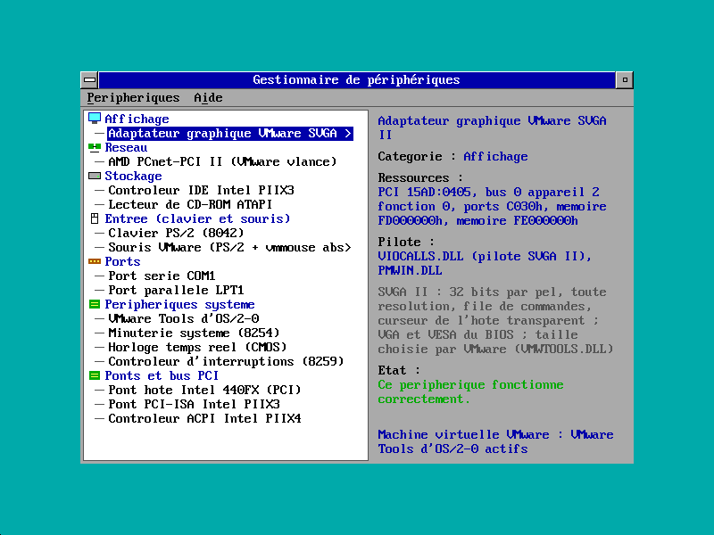

Réglages conseillés de la machine virtuelle : système invité « OS/2 » (ou « Autre »), carte réseau e1000 ou vlance (NAT), mémoire 64 Mo ou plus. Rien à installer : VMWTOOLS.DLL est chargé dès qu'il trouve VMware. Dans QEMU, <code>-vga vmware</code> donne la même carte SVGA II et la même souris vmmouse (QEMU n'a pas le canal GuestRPC : pas de Resolution_Set) :

<pre>qemu-system-i386 -m 64 -cdrom IMAGE/OS2CD.ISO -boot d -vga vmware -nic user,model=pcnet</pre>

<h3>Sessions DOS : machine virtuelle 8086 (Turbo Pascal, DPMI, EMS, XMS)</h3>

Comme OS/2 2.0, OS/2-0 exécute les programmes <b>MS-DOS</b> (fichiers <b>.COM</b>, et <b>.EXE</b> sans en-tête PE ni NE) dans une <b>machine virtuelle DOS</b> en <b>mode virtuel 8086</b>. Le moniteur, le BIOS, le DOS, la souris, XMS, EMS et le serveur DPMI viennent de la machine virtuelle de <a href="https://github.com/gladir/Pasdows95">Pasdows 95</a> (KERNEL/VMM32.PAS, partie 17), adaptés au noyau d'OS/2-0 (partie 13b de KERNEL/OS2KRNL.PAS). On lance un programme DOS depuis l'invite de commandes OS/2 (CMD.EXE l'attend, comme un programme OS/2), depuis un dossier du bureau, ou on ouvre <b>Fenêtre DOS</b> ou <b>DOS plein écran</b> (dossier Système OS/2) : l'interpréteur de commandes intégré de la machine (COMMAND.COM : DIR, CD, COPY, DEL, MD, RD, REN, TYPE, SET, VER, EXIT, programmes...).

<table>
	<tr><th>Élément</th><th>Rôle</th></tr>
	<tr><td>Mode virtuel 8086</td><td>Une tâche du noyau exécute le code 16 bits (EFLAGS.VM, IOPL 0). Le processeur a maintenant une <b>TSS</b> (pile de l'anneau 0 de chaque tâche, ESP0 changé avec la tâche) et une <b>LDT</b> (sélecteurs des clients DPMI) ; les procédures <i>Interrupt</i> du noyau rechargent DS et ES (compilateur OS2PC), car une interruption peut survenir en mode V86 ou en anneau 3. L'horloge partage le temps entre la machine et les autres tâches.</td></tr>
	<tr><td>Mémoire</td><td>Le premier mégaoctet de la machine est projeté par la <b>table de pages de sa session</b> (entrée 0 du répertoire de pages, qui suit la session) : 0 à 9FFFFh, B0000h à B7FFFh et C0000h à FFFFFh sont 1 Mo de mémoire physique de la machine ; A0000h à AFFFFh et B8000h à BFFFFh sont l'écran de la session (la carte au premier plan, le tampon de la session sinon). Les tâches du noyau gardent les pages d'identité (CtxSwitch change l'entrée 0 après le changement de pile).</td></tr>
	<tr><td>Moniteur</td><td>INT, IRET, PUSHF, POPF, CLI, STI, HLT, IN, OUT provoquent une faute de protection générale émulée ; IF virtuel ; horloge (INT 08h, 1Ch, minuterie reprogrammable), clavier (INT 09h, port 60h : les codes de balayage de la session au premier plan) et souris PS/2 sont des interruptions virtuelles.</td></tr>
	<tr><td>BIOS et DOS 5.00</td><td>BIOS écrit en Pascal (INT 10h, 11h, 12h, 13h, 15h, 16h, 1Ah, zone de données), DOS (INT 21h : mémoire MCB, PSP, chargement des .COM et .EXE, EXEC, fichiers du noyau sur toutes les unités, recherche, répertoire courant par unité, pays...), INT 2Fh, souris INT 33h (pointeur en mode texte).</td></tr>
	<tr><td><b>Fenêtre DOS</b></td><td>Comme sous OS/2, la session DOS s'exécute dans une <b>fenêtre de Presentation Manager</b>, à côté des programmes OS/2 : PMVIOP.DLL (bouclier VIO) relit l'écran de la session et y dessine les lignes changées et le curseur ; les touches de la fenêtre vont au clavier de la machine (le code « traduit » de PM, Ctrl+F9 = 66h par exemple, redevient le code matériel de la touche, avec Maj, Ctrl et Alt du message WM_CHAR) et la souris va au pilote INT 33h de la machine (position en cellules, boutons ; KrnSesCtl 21). Un programme qui passe en <b>mode graphique</b> fait passer la session en plein écran ; elle revient dans sa fenêtre quand il retourne au mode texte. Les raccourcis du système (Alt+F4, Alt+F5, Alt+F9, Alt+F10, F10) restent à PM, comme sous OS/2 : on utilise alors les menus du programme.</td></tr>
	<tr><td>Écran plein écran</td><td>Au premier plan, la session utilise directement la carte VGA : mode texte dans B8000h, <b>modes graphiques par le vrai BIOS</b> (appel en mode réel, BDA vidéo et tampons recopiés) et ports de la carte (3B0h à 3DFh) ; le haut-parleur (port 61h, canal 2 de la minuterie) aussi. À l'arrière-plan (Ctrl+Échap, Alt+Échap), un programme en mode texte continue dans le tampon de la session ; un programme en mode graphique est suspendu, ses plans, son mode et sa palette sont sauvés et rendus à son retour.</td></tr>
	<tr><td>XMS 3.0, EMS 4.0, DPMI 0.9</td><td>Mémoire étendue XMS (INT 2Fh 4300h/4310h, blocs pris dans la mémoire physique), mémoire paginée EMS (INT 67h, cadre en E000h projeté par la table de pages de la session), serveur <b>DPMI</b> (INT 2Fh 1687h, client 16 ou 32 bits en anneau 3, services de l'INT 31h, extensions MS-DOS) : les programmes de Borland Pascal en mode protégé (RTM.EXE, DPMI16BI.OVL) comme <b>TPX.EXE</b> fonctionnent.</td></tr>
	<tr><td>Disquette A:</td><td>Lecteur A: (contrôleur 765, DMA, IRQ 6) en <b>FAT12</b> (et FAT16), en lecture, vu par toutes les API de fichiers du noyau (CMD et sessions DOS) ; un changement de disquette est détecté (DSKCHG).</td></tr>
	<tr><td><b>TESTVDM.EXE</b> (DLL/TESTVDM.PAS)</td><td>Programme MS-DOS 16 bits compilé par <b>OS2PC -CD</b> : 36 vérifications (version, fichiers, recherche, mémoire, BIOS, souris, XMS, EMS, DPMI).</td></tr>
</table>

<b>Turbo Pascal 7</b> s'installe depuis ses quatre disquettes : <i>qemu-system-i386 ... -fda Disk01.img</i>, puis <b>A:</b> et <b>INSTALL</b> dans une fenêtre DOS ou l'invite de commandes ; on change de disquette dans le moniteur de QEMU (<i>change floppy0 Disk02.img</i>) quand l'installateur la demande. L'EDI (<b>TURBO</b>) fonctionne entièrement, dans sa fenêtre du bureau comme en plein écran : édition, menus au clavier et à la souris, compilation et exécution (Ctrl+F9), écran utilisateur (Alt+F5 en plein écran, menu Debug - User screen dans une fenêtre) ; le compilateur <b>TPC</b>, les programmes graphiques comme <b>BGIDEMO</b> (VGA 640 x 480, pilote EGAVGA.BGI) et l'EDI en mode protégé <b>TPX</b> (DPMI, plus de 34 Mo de mémoire protégée libre).

<table>
	<tr>
		<td align="center">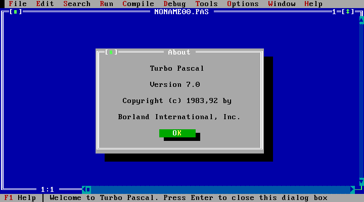 <i>L'EDI de Turbo Pascal 7 dans une fenêtre DOS du bureau</i></td>
		<td align="center">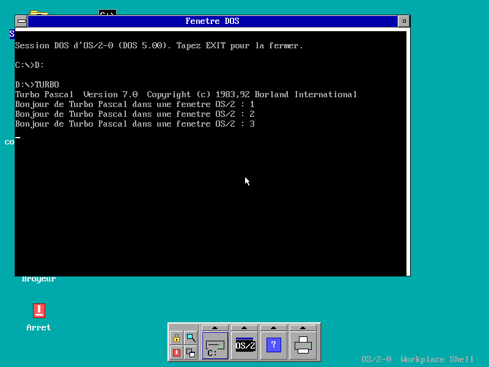 <i>Le programme compilé et exécuté (Ctrl+F9) : écran utilisateur</i></td>
	</tr>
	<tr>
		<td align="center">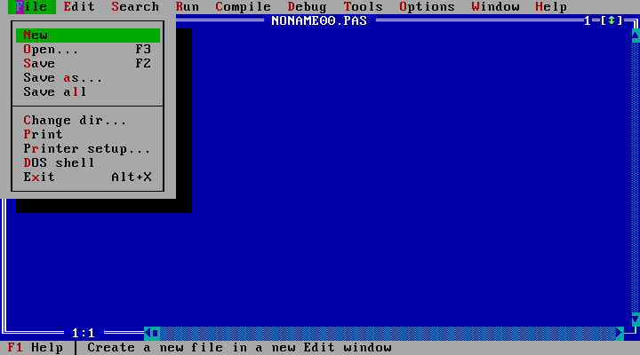 <i>Menu Edit ouvert à la souris, dans la fenêtre</i></td>
		<td align="center">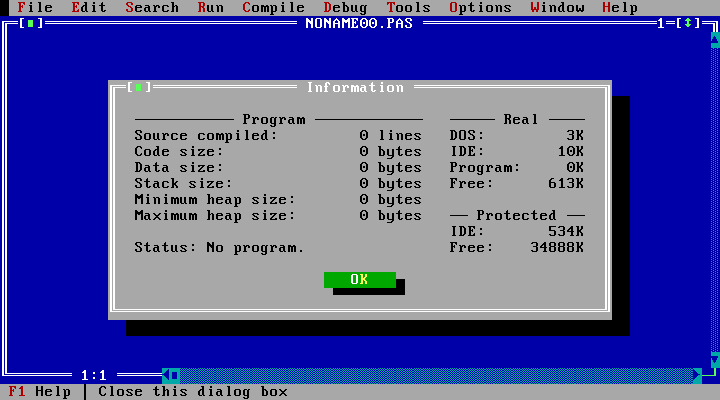 <i>TPX.EXE (DPMI) dans une fenêtre : 34 Mo de mémoire protégée libre</i></td>
	</tr>
	<tr>
		<td align="center">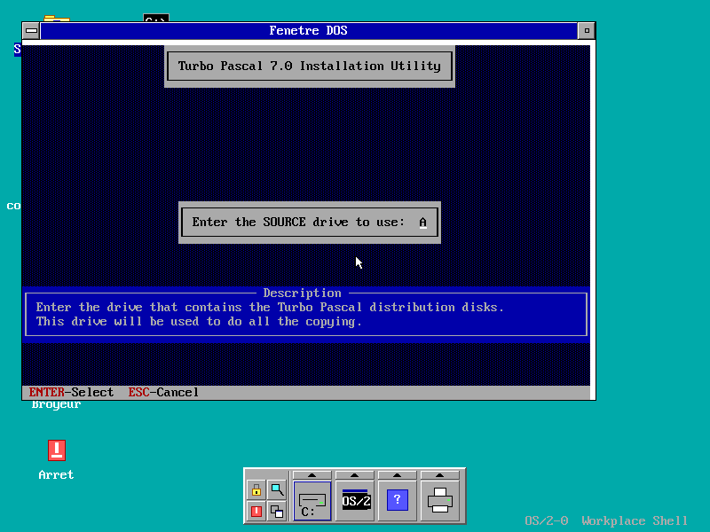 <i>INSTALL.EXE depuis la disquette A:, dans une fenêtre</i></td>
		<td align="center">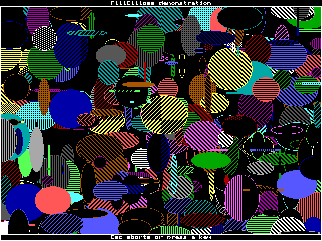 <i>BGIDEMO (VGA 640x480 16 couleurs) : le mode graphique passe en plein écran</i></td>
	</tr>
</table>

Limites : une seule session DOS à la fois ; les modes graphiques s'affichent en plein écran seulement (pas dans une fenêtre) ; la disquette est en lecture seule ; pas de carte son émulée pour la machine (le haut-parleur seulement) ; pas de modes VESA pour les programmes DOS ; la zone haute (HMA) n'est pas disponible ; seuls des clients DPMI 16 bits (Borland Pascal) ont été essayés.

<h3>Programmes d'OS/2 2.x (LX) et d'OS/2 1.x (NE 16 bits)</h3>

Pour exécuter les vrais programmes d'OS/2 (pas seulement ceux compilés par OS2PC), le noyau charge aussi les deux formats d'exécutables d'IBM :

<table>
	<tr><th>Format</th><th>Chargement</th></tr>
	<tr><td><b>LX</b> (OS/2 2.x, 32 bits ; partie 13c du noyau)</td><td>Objets et pages (normales, itérées EXEPACK 1 et EXEPACK 2), corrections internes et importations (par ordinal ou par nom), table des points d'entrée, ressources ; programme dans la fenêtre du processus (00400000h), DLL dans la région des DLL (_DLL_InitTerm appelée). Le HMODULE est un en-tête PE synthétique (exportations et ressources), si bien que DosQueryProcAddr, DosGetResource et WinLoadString fonctionnent tels quels ; TIB et PIB par FS, convention _System. Une importation inconnue reçoit une souche qui l'écrit dans le journal du noyau.</td></tr>
	<tr><td><b>NE</b> (OS/2 1.x, 16 bits ; partie 13d du noyau et <b>DLL/API16.PAS</b>)</td><td>Comme OS/2 2.x, OS/2-0 exécute les programmes 16 bits d'OS/2 1.x : segments (normaux et itérés) dans la fenêtre du processus, un sélecteur de la LDT (16 bits, anneau 3) par segment, corrections internes et importations (DOSHUGEINCR et DOSHUGESHIFT sont des constantes). Le programme s'exécute à l'<b>anneau 3</b> (pile de l'anneau 0 par fil dans la TSS) ; chaque fonction du système qu'il importe reçoit une souche 16 bits (<code>mov ax,n ; call far porte:0 ; retf taille</code>) et une <b>porte d'appel</b> de la LDT mène au noyau, qui appelle la fonction de <b>API16.DLL</b> : arguments lus sur la pile 16 bits (convention Pascal), pointeurs 16:16 convertis (KrnTaskCtl 30), structures de 16 bits traduites (FILESTATUS, FILEFINDBUF...), puis appel des fonctions 32 bits de DOSCALLS, VIOCALLS, KBDCALLS, NLS et MSG. DosAllocSeg, DosReallocSeg, DosFreeSeg, DosCreateThread (fils 16 bits, DS et ES du créateur) et DosExit sont faits par le noyau ; sémaphores en mémoire (DosSemSet, DosSemClear, DosSemWait), fichiers (DosOpen2, DosRead, DosWrite, DosChgFilePtr, DosFindFirst2, DosQPathInfo, DosSetFileInfo...), messages liés au programme (DosGetMessage avec segment de messages), écran et clavier VIO. Environ 50 fonctions sont fournies ; une fonction absente est signalée dans le journal du noyau.</td></tr>
</table>

<h3>IBM Works sous OS/2-0</h3>

<b>IBM Works</b> (Footprint Works, disquettes WORKS01 à WORKS05), la suite bureautique livrée avec OS/2 Warp 3, sert d'essai grandeur nature pour les vrais programmes d'OS/2. Ses archives <code>.@</code> se décompressent sous OS/2-0 avec son propre décompresseur <b>FPWTUPCK.EXE</b> — un programme <b>16 bits</b> d'OS/2 1.x avec trois fils et des sémaphores — puis son gestionnaire d'informations personnelles <b>FPWPIM.EXE</b> (LX, Presentation Manager, avec ses DLL FEN20PDE, FPWPIMR...) s'exécute sur le bureau d'OS/2-0, dans ses cinq modes : carnet de rendez-vous (<code>-M</code>), bottin (<code>-P</code>), bloc-notes (<code>-N</code>), agenda (<code>-G</code>) et liste des tâches (<code>-T</code>).

<table>
	<tr>
		<td align="center">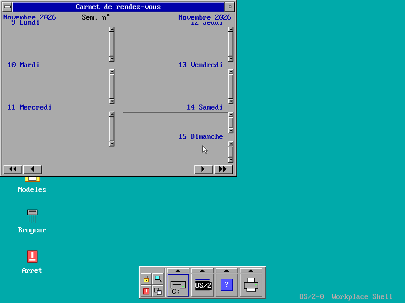 <i>FPWPIM -M : carnet de rendez-vous de la semaine</i></td>
		<td align="center">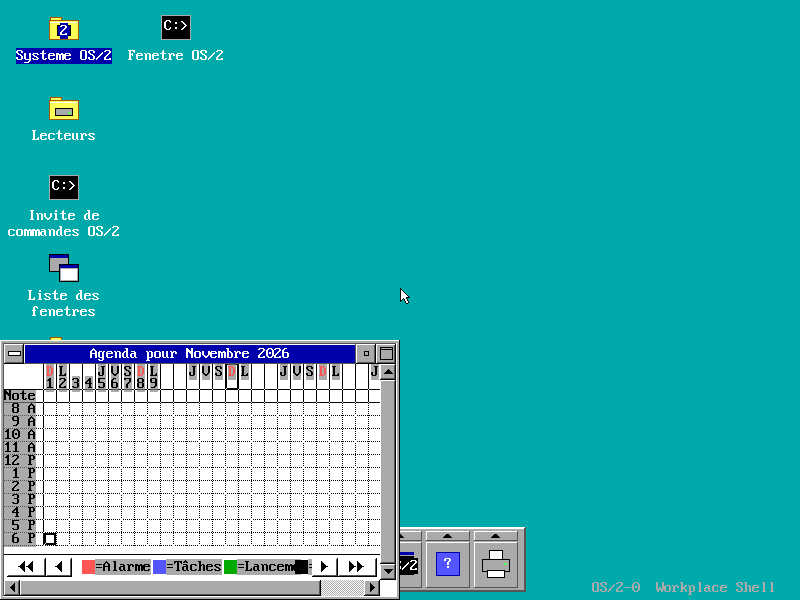 <i>FPWPIM -G : agenda du mois (alarmes, tâches, lancements)</i></td>
	</tr>
	<tr>
		<td align="center">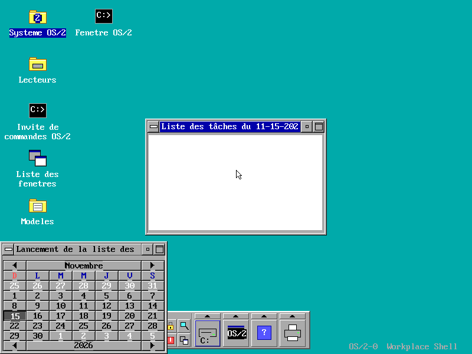 <i>FPWPIM -T : liste des tâches</i></td>
		<td align="center">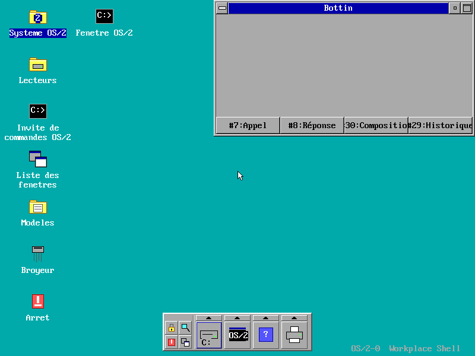 <i>FPWPIM -P : bottin (carnet d'adresses)</i></td>
	</tr>
</table>

Pour y arriver, OS/2-0 a reçu : les programmes NE 16 bits (ci-dessus) et <b>API16.DLL</b> (dont DosGetMessage avec les segments de messages MSGBIND), les tables d'aide à 8 octets de <b>HELPMGR.DLL</b>, les tables de couleurs logiques (GpiCreateLogColorTable) dans PMWIN, <b>PMWP.DLL</b> (objets du Workplace Shell : WinCreateObject, WinSetObjectData, WinQueryObject, WinOpenObject, WinLoadFileIcon..., objets conservés dans OS2.INI), <b>PMCTLS.DLL</b> (dialogues standard WinFileDlg et WinFontDlg), SplQueryQueue et SplEnumQueue dans PMSPL, <code>LIBPATH=.;C:\;</code> dans CONFIG.SYS, les fichiers de commandes de CMD.EXE et la copie avec * et ?. L'installation (<b>INSTALL.EXE</b>) démarre depuis la disquette A:, décompresse ses fichiers et lance <b>FPWIDLDS.EXE</b>, qui demande encore les objets <b>16:16</b> des programmes LX (DosFlatToSel, DosSelToFlat) ; le traitement de texte et le tableur d'IBM Works (FPWWP, FPWSS) demandent en plus les classes SOM du Workplace Shell. Le travail continue ; chaque étape franchie est vérifiée par la régression.

<a href="../README.md">&larr; Retour au README</a>

