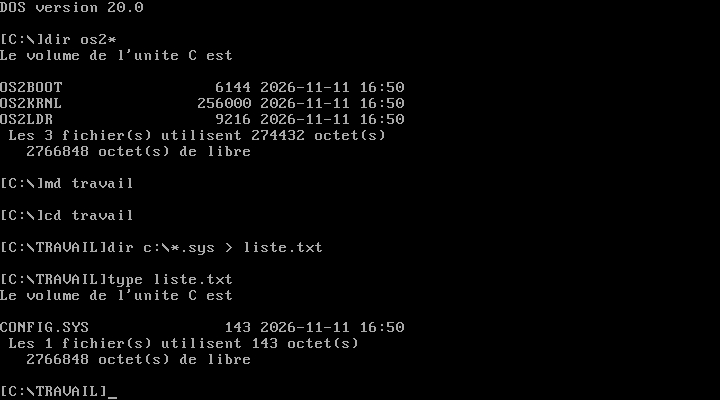

# OS2-0
Clone d'OS/2 en Pascal (Turbo Pascal ou Free Pascal)

<h2>Liste des fichiers</h2>

Voici la liste des différents fichiers proposés dans OS2-0 :

<table>
		<tr>
			<th>Nom</th>
			<th>Description</th>	
		</tr>
		<tr>
		 	<td><b>APPEND.PAS</b></td>
			<td>Cette commande permet d'ouvrir des fichiers quelconque se trouvant dans les répertoires spécifiés comme s'il s'agissait du répertoire courant.</td>
		</tr>
		<tr>
			<td><b>ASSIGN.PAS</b></td>
			<td>Cette commande permet de créer un disque virtuel à partir d'un autre disque.</td>
		</tr>
		<tr>
			<td><b>ATTRIB.PAS</b></td>
			<td>Cette commande permet de demander ou de changer les attributs d'un fichier.</td>
		</tr>
		<tr>
			<td><b>CHKDSK.PAS</b></td>
			<td>Cette commande permet de vérifier le disque. Cette commande est inspiré du DOS.</td>
		</tr>		
		<tr>
			<td><b>CMD.PAS</b></td>
			<td>Cette commande permet de lancer l'interpréteur de commande OS/2. Il s'agit d'un équivalent du CMD de OS/2.</td>
		</tr>  
		<tr>
			<td><b>COMMAND.PAS</b></td>
			<td>Logiciel clone d'un <i>COMMAND.COM</i> du système d'exploitation <a href="https://www.gladir.com/OS/DOS/intro.htm"><i>DOS</i></a>.</td>
		</tr>
		<tr>
			<td><b>COMP.PAS</b></td>
			<td>Cette commande permet de comparer deux fichiers. Cette commande est un equivalent du <a href="https://www.gladir.com/OS/PCDOS/intro.htm">PC-DOS</a> ou <a href="https://www.gladir.com/OS/MSDOS/intro.htm">MS-DOS</a>.</td>
		</tr>
		<tr>
			 <td><b>DEBUG.PAS</b></td>
			 <td>Cette commande permet de deboguer un programme.</td>
		</tr>
		<tr>
			<td><b>DISKCOMP.PAS</b></td>
			<td>Cette commande permet de comparer des disquettes ou des images.</td>
		</tr>		
		<tr>
		    	<td><b>DISKCOPY.PAS</b></td>
		    	<td>Cette commande permet de copier des disquettes ou des images.</td>
		</tr>	
		<tr>
			<td><b>DOSKEY.PAS</b></td>
			<td>Cette commande permet de charger le programme DOSKEY.</td>
		</tr>
		<tr>
			<td><b>EDLIN.PAS</b></td>
			<td>Cette commande permet de lancer l'éditeur en ligne de commande.</td>
		</tr>
		<tr>
			<td><b>EXE2BIN.PAS</b></td>
			<td>Cette commande permet de convertir un fichier EXE en binaire (COM).</td>
		</tr>
		<tr>
			<td><b>FIND.PAS</b></td>
			<td>Cette commande permet de rechercher une chaine de caractères dans des fichiers. Cette commande est un équivalent du DOS.</td>
		</tr>
		<tr>
			<td><b>FORMAT.PAS</b></td>
			<td>Cette commande permet de formater un unite de disquette.</td>
		</tr>
		<tr>
			<td><b>GRAFTABL.PAS</b></td>
			<td>Cette commande permet d'effectuer le chargement en mémoire conventionnelle d'une table de police de caractères pour les modes graphiques.</td>
		</tr>
		<tr>
			<td><b>LABEL.PAS</b></td>
			<td>Cette commande permet de changer le nom d'un volume.</td>
		</tr>
		<tr>
			<td><b>MEM.PAS</b></td>
			<td>Cette commande permet d'afficher les informations sur la mémoire. Cette commande est un clone de la commande MS-DOS ou PC-DOS.</td>
		</tr>
		<tr>
			<td><b>MODE.PAS</b></td>
			<td>Cette commande permet d'effectuer la gestion des paramètres d'un périphérique.</td>
		</tr>
		<tr>
			<td><b>MORE.PAS</b></td>
			<td>Cette commande permet de recevoir l'entrée puis l'affichage sur un périphérique un écran à la fois.</td>
    		</tr>	
    		<tr>
			<td><b>MOVE.PAS</td>
			<td>Cette commande permet de déplacer un fichier.</td>
		</tr>
		<tr>
			<td><b>REPLACE.PAS</b></td>
			<td>Cette commande permet de remplacer un fichier. Cette commande est un équivalent du DOS.</td>
		</tr>
		<tr>
			<td><b>SORT.PAS</b></td>
			<td>Cette commande permet de trier une fichier texte ASCII et de retourner le résultat. Cette commande est un équivalent de la commande du DOS.</td>
		</tr>
		<tr>
			<td><b>TREE.PAS</b></td>
			<td>Cette commande permet d'afficher un arbre de répertoire.</td>
		</tr>
		<tr>
			<td><b>XCOPY.PAS</b></td>
			<td>Cette commande permet d'effectuer la copie étendue avec sous-répertoire de fichier(s) vers un nouvel emplacement.</td>
		</tr>
	</table>

<h2>Noyau OS/2 32 bits et CD-ROM amorçable</h2>

OS2-0 possède son propre noyau OS/2 32 bits écrit en Pascal. Comme sous OS/2, le démarrage se fait en trois fichiers, chacun écrit dans un seul fichier source Pascal (dossier <b>KERNEL</b>) :

<table>
	<tr><th>Fichier</th><th>Source</th><th>Description</th></tr>
	<tr><td><b>OS2BOOT</b></td><td>KERNEL/OS2BOOT.PAS</td><td>Secteur d'amorce du CD-ROM (El Torito sans émulation, mode réel 8086) : lit le système de fichiers ISO 9660 par l'INT 13h étendue et charge OS2LDR en 2000:0000.</td></tr>
	<tr><td><b>OS2LDR</b></td><td>KERNEL/OS2LDR.PAS</td><td>Chargeur 16 bits : charge l'image PE du noyau à 1 Mo (INT 15h/87h), relève la carte mémoire (E820h), active la ligne A20, installe une GDT plate et passe en mode protégé.</td></tr>
	<tr><td><b>OS2KRNL</b></td><td>KERNEL/OS2KRNL.PAS</td><td>Noyau 32 bits (80386, mode protégé) : console VGA, IDT, exceptions (écran TRAP), PIC, minuterie, clavier, tas, pagination, pilote ATAPI, disques durs IDE, ISO 9660 et disque virtuel en mémoire, systèmes de fichiers installables (IFS=), couche API DOSCALLS, chargeur de programmes PE et processus, lecture de CONFIG.SYS et lancement de <b>CMD.EXE</b>.</td></tr>
</table>

Le compilateur <b>OS2PC.PAS</b> (« OS/2 Pascal Compiler », dossier <b>TOOLS</b>) est dérivé de <b>TPCW32.PAS</b> du dépôt <a href="https://github.com/gladir/DEV-COOLS">DEV-COOLS</a>. Il ajoute les destinations suivantes :

<table>
	<tr><th>Option</th><th>Description</th></tr>
	<tr><td><b>-COS2BOOT</b></td><td>Image binaire brute 8086 chargée en 07C0:0000, sans DOS (OS2BOOT).</td></tr>
	<tr><td><b>-COS2LDR</b></td><td>Image binaire brute 8086 chargée en 2000:0000, sans DOS (OS2LDR).</td></tr>
	<tr><td><b>-COS2KRNL</b></td><td>Noyau 32 bits : image PE liée à 1 Mo, assembleur 80386 natif (IN/OUT, INT, LGDT, LIDT, MOV CRn, IRETD...), procédures <i>Interrupt</i>, accès direct à Mem/MemW/MemL/Port/PortW ; les fonctions utilisées par le runtime (WriteFile, CreateFileA...) sont les procédures Pascal du noyau, exportées sous le nom DOSCALLS.DLL.</td></tr>
	<tr><td><b>-COS2</b></td><td>Destination par défaut : programme 32 bits pour OS/2-0 (CMD.EXE et les commandes), dont les importations sont liées par le noyau. Un source commençant par <code>Library</code> produit une DLL (clause <code>exports nom [Name 'externe'] [Index ordinal]</code>, base fixée par <code>{$IMAGEBASE $00D00000}</code> ; une constante <code>Const NOM = 'texte';</code> ou entière peut aussi être exportée comme donnée) ; une fonction déclarée <code>External 'DLL' [Name 'nom']</code> est importée de cette DLL.</td></tr>
</table>

<h3>Bibliothèque DOSCALLS.DLL</h3>

Le fichier <b>DLL/DOSCALLS.PAS</b> est la bibliothèque OS/2 <b>DOSCALLS.DLL</b> : elle implémente les 315 fonctions <b>Dos*</b> des API d'OS/2 1.x et 2.x : fichiers et répertoires, recherche, attributs, tuyaux anonymes et nommés, mémoire (objets, mémoire partagée, segments, sous-allocation), sémaphores (événement, mutex, MuxWait, système, RAM), minuteries, processus et processus légers, exceptions et signaux, modules et ressources, pays, pages de codes et messages, périphériques, moniteurs, etc. Elle se compile avec OS2PC (<code>Library DOSCALLS; ... exports ...</code>) en une DLL liée à 00C00000h, que le noyau charge au démarrage et partage entre tous les processus. Un programme l'utilise ainsi (convention <i>_System</i> d'OS/2) :

<pre>Function DosBeep(Freq, Duration : LongInt) : LongInt; External 'DOSCALLS';</pre>

Le programme <b>DLL/TESTDOS.PAS</b> vérifie un échantillon de ces fonctions sous OS/2-0 (59 vérifications).

<h3>Bibliothèque FKA.DLL</h3>

Le fichier <b>DLL/FKA.PAS</b> est la bibliothèque OS/2 <b>FKA.DLL</b> (<i>Function Key Area</i>, zone des touches de fonction des versions DBCS d'OS/2), liée à 00D00000h, avec ses ordinaux d'origine :

<table>
	<tr><th>Fonction</th><th>Ordinal</th><th>Description</th></tr>
	<tr><td>FKAInit</td><td>64</td><td>Initialiser la FKA pour le processus.</td></tr>
	<tr><td>QueryFKADisplayDetails</td><td>65</td><td>Détails d'affichage (forme, lignes, touches, focus, touche choisie).</td></tr>
	<tr><td>WINFKAWNDPROC</td><td>66</td><td>Procédure de fenêtre : WM_CHAR (F1-F12, flèches, Entrée), WM_PAINT, WM_DESTROY, FKAM_SETTEXT...</td></tr>
	<tr><td>WINLOADFKA</td><td>67</td><td>Charger une FKA (ressource RT_FKA ou fichier FKAnnnn.TXT).</td></tr>
	<tr><td>WINCREATEFKA</td><td>68</td><td>Créer une FKA à partir de libellés.</td></tr>
	<tr><td>WINSETFKAFORM</td><td>69</td><td>Fixer la forme : masquée, courte (1 ligne) ou longue (2 lignes).</td></tr>
	<tr><td>WINQUERYFKAFORM</td><td>70</td><td>Demander la forme.</td></tr>
	<tr><td>WINGOTOFKA</td><td>71</td><td>Donner le focus à la FKA.</td></tr>
	<tr><td>WINGOFROMFKA</td><td>72</td><td>Rendre le focus à l'application.</td></tr>
</table>

Sans Presentation Manager, la zone est dessinée en mode texte sur les dernières lignes de l'écran, retirées de la zone de défilement de la console. Le programme <b>DLL/TESTFKA.PAS</b> la vérifie (24 vérifications, et <code>TESTFKA VOIR</code> pour la parcourir au clavier).

<h3>Système de fichiers HPFS.IFS</h3>

Le fichier <b>DLL/HPFS.PAS</b> est le pilote de système de fichiers installable OS/2 <b>HPFS.IFS</b> (<i>High Performance File System</i>), lié à 00E00000h. Il utilise le vrai format HPFS sur disque : secteur d'amorce, superbloc, bloc de réserve, bitmaps par bandes de 8 Mo, bande des répertoires, fnodes, arbres B+ d'allocation (anodes), répertoires en arbres B de dnodes triés sans tenir compte de la casse (page de codes 850), noms longs (254 caractères) à casse conservée, dates de création, d'accès et d'écriture, attributs étendus (EA). Le noyau le charge d'après CONFIG.SYS :

<pre>IFS=C:\HPFS.IFS /CACHE:32 /AUTOCHECK:D /RAMDISK:4096</pre>

puis lui présente les partitions de type 07h des disques durs IDE et un disque virtuel de 4 Mo (<code>/RAMDISK</code>, formaté au démarrage). Chaque volume reconnu reçoit une lettre d'unité (D:, E:...) : CMD.EXE, DOSCALLS.DLL et tous les programmes y accèdent normalement (DIR, COPY, MD, programmes lancés depuis D:...), le noyau aiguillant les fichiers de ces unités vers les points d'entrée du pilote. Un volume mal fermé cité par <code>/AUTOCHECK</code> est vérifié et corrigé au démarrage.

Le pilote exporte les 43 points d'entrée d'un IFS d'OS/2 (adaptés à OS/2-0 : paramètres de 32 bits, convention <i>_System</i>) :

<table>
	<tr><th>Points d'entrée</th><th>Rôle</th></tr>
	<tr><td>FS_NAME, FS_ATTRIBUTE</td><td>Données exportées : nom du système de fichiers (« HPFS ») et attributs du pilote.</td></tr>
	<tr><td>FS_INIT, FS_MOUNT, FS_ATTACH, FS_FSINFO, FS_FSCTL, FS_FLUSHBUF, FS_SHUTDOWN, FS_EXIT</td><td>Initialisation, reconnaissance des volumes, nom de volume et espace libre, contrôle du pilote (formatage, vérification de type CHKDSK, statistiques), écriture des tampons, arrêt, fin de processus.</td></tr>
	<tr><td>FS_OPENCREATE, FS_CLOSE, FS_READ, FS_WRITE, FS_CHGFILEPTR, FS_NEWSIZE, FS_COMMIT, FS_FILEINFO, FS_FILEIO, FS_FILELOCKS, FS_CANCELLOCKREQUEST, FS_IOCTL</td><td>Fichiers ouverts : partage, lecture et écriture, taille, informations et EA, entrées/sorties groupées, verrous de plages, contrôle de périphérique.</td></tr>
	<tr><td>FS_PATHINFO, FS_FILEATTRIBUTE, FS_DELETE, FS_MKDIR, FS_RMDIR, FS_MOVE, FS_COPY, FS_CHDIR, FS_PROCESSNAME</td><td>Opérations par chemin : informations, attributs, suppression, répertoires, renommage et déplacement, copie avec les EA, répertoire courant, forme canonique des noms.</td></tr>
	<tr><td>FS_FINDFIRST, FS_FINDNEXT, FS_FINDFROMNAME, FS_FINDCLOSE, FS_FINDNOTIFYFIRST, FS_FINDNOTIFYNEXT, FS_FINDNOTIFYCLOSE</td><td>Recherche de fichiers (niveaux 1 à 3, avec EA) et surveillance des changements d'un répertoire.</td></tr>
	<tr><td>FS_OPENPAGEFILE, FS_ALLOCATEPAGESPACE, FS_DOPAGEIO, FS_SETSWAP</td><td>Fichier d'échange (pages de 4 Ko).</td></tr>
	<tr><td>FS_NMPIPE</td><td>Tuyaux nommés : ils ne sont pas sur un volume HPFS (ERROR_NOT_SUPPORTED, comme sous OS/2).</td></tr>
</table>

Le programme <b>DLL/TESTHPFS.PAS</b> vérifie ces points d'entrée (79 vérifications : arbre B de 150 fichiers, fichiers fragmentés à anodes, EA, verrous, copie, déplacement, cohérence du volume...).

<h3>Bibliothèque VIOCALLS.DLL</h3>

Le fichier <b>DLL/VIOCALLS.PAS</b> est le sous-système vidéo OS/2 <b>VIOCALLS.DLL</b> (lié à 00F00000h), avec ses 76 fonctions et leurs ordinaux d'origine (1 VioEndPopup ... 76 XVioGetCAState ; alias VioScrollRi, VioSetCursorPos et VioScrollLe). Les programmes et les DLL d'OS/2-0 s'exécutant en anneau 0, VIOCALLS écrit directement dans la mémoire de l'écran (000B8000h) et programme le VGA par ses ports (OS2PC émet de vraies instructions IN/OUT dans les blocs asm de la cible -COS2) ; la position du curseur et l'attribut courant sont ceux de la console du noyau, si bien que VIO et WriteLn restent cohérents.

<table>
	<tr><th>Fonctions</th><th>Rôle</th></tr>
	<tr><td>VioWrtCharStr, VioWrtCharStrAtt, VioWrtCellStr, VioWrtNChar, VioWrtNAttr, VioWrtNCell, VioReadCharStr, VioReadCellStr</td><td>Écriture et lecture de caractères, d'attributs et de cellules.</td></tr>
	<tr><td>VioScrollUp, VioScrollDn, VioScrollLf, VioScrollRt</td><td>Défilement d'un rectangle dans les quatre directions.</td></tr>
	<tr><td>VioWrtTty, VioGetAnsi, VioSetAnsi</td><td>Sortie télétype avec les séquences ANSI (position, déplacements, effacements, couleurs).</td></tr>
	<tr><td>VioGetCurPos, VioSetCurPos, VioGetCurType, VioSetCurType</td><td>Position et forme du curseur (registres du CRTC).</td></tr>
	<tr><td>VioGetMode, VioSetMode, VioGetConfig, VioGetState, VioSetState, VioGetFont, VioSetFont, VioGetCp, VioSetCp</td><td>Mode texte 80 x 25, configuration, palette, registres de couleur, bordure, clignotement, soulignement, police du générateur de caractères, page de codes.</td></tr>
	<tr><td>VioGetBuf, VioShowBuf, VioGetPhysBuf</td><td>Tampon vidéo logique (LVB) et accès au tampon physique.</td></tr>
	<tr><td>VioPopUp, VioEndPopup, VioScrLock, VioScrUnlock, VioSavRedrawWait, VioSavRedrawUndo, VioModeWait, VioModeUndo, VioSave, VioRestore, VioSswSwitch, VioRedrawSize, VioSrfBlock, VioSrfUnblock</td><td>Fenêtres surgissantes, verrou de l'écran, attentes du gestionnaire de sessions, sauvegarde, bascule et blocage de l'affichage.</td></tr>
	<tr><td>VioPrtSc, VioPrtScToggle, Avs_Prtsc, Avs_PrtscToggle</td><td>Impression et capture de l'écran (fichier C:\PRTSC.TXT, copie de la sortie télétype).</td></tr>
	<tr><td>VioRegister, VioGlobalReg, VioDeRegister</td><td>Remplacement de fonctions par un sous-système vidéo chargé depuis une DLL.</td></tr>
	<tr><td>VioCreatePS, VioDestroyPS, VioAssociate, VioShowPS, VioSetOrg, VioGetOrg, VioCreateLogFont, VioDeleteSetId, VioQuerySetIds, VioQueryFonts, VioGetDeviceCellSize, VioSetDeviceCellSize, VioGetPSAddress</td><td>Espaces de présentation AVIO (cellules de 2 ou 4 octets), affichés à l'écran une fois associés.</td></tr>
	<tr><td>VioInit, VioShellInit, VioHetInit, VioFree, VioQueryConsole</td><td>Initialisation, remise à l'état d'origine du VGA, libération des ressources d'un processus, état de la console.</td></tr>
	<tr><td>VioCheckCharType, XVioCheckCharType, XVioCreateCA, XVioDestroyCA, XVioSetCAState, XVioGetCAState</td><td>Caractères à double octet (pages de codes 932, 936, 942, 949, 950) et jeux d'attributs étendus.</td></tr>
</table>

Le programme <b>DLL/TESTVIO.PAS</b> vérifie ces fonctions (116 vérifications, relues par VIO, directement dans la mémoire de l'écran et dans les registres du VGA) avec la DLL de remplacement <b>DLL/TESTVIOR.PAS</b>.

Le CD-ROM amorçable <b>IMAGE/OS2CD.ISO</b> contient OS2BOOT, OS2LDR, OS2KRNL, CONFIG.SYS, DOSCALLS.DLL, FKA.DLL, HPFS.IFS, VIOCALLS.DLL, CMD.EXE, TESTDOS.EXE, TESTFKA.EXE, TESTHPFS.EXE, TESTVIO.EXE et les commandes du dépôt compilées avec OS2PC. Il se fabrique avec <b>TOOLS/MAKEISO.PAS</b> (ISO 9660 + El Torito) ; le script <b>KERNEL/BUILD.sh</b> (ou <b>KERNEL/BUILD.BAT</b>) reconstruit le tout :

<pre>KERNEL/BUILD.sh
qemu-system-i386 -m 64 -cdrom IMAGE/OS2CD.ISO -boot d</pre>

Pour essayer HPFS sur un disque dur, ajouter une image disque dont une partition est de type 07h (<code>-hda disque.img</code>) : formatée HPFS, elle devient l'unité D: (le disque virtuel passe à E:).

Voir <a href="IMAGE/LISEZMOI.TXT">IMAGE/LISEZMOI.TXT</a> pour les détails (carte mémoire, CONFIG.SYS, limites).

<h2>Compilation</h2>
	
Les fichiers Pascal n'ont aucune dépendances, il suffit de télécharger le fichier désiré et de le compiler avec Free Pascal avec la syntaxe de commande  :

<pre><b>fpc</b> <i>LEFICHIER.PAS</i></pre>
	
Sinon, vous pouvez également le compiler avec le Turbo Pascal à l'aide de la syntaxe de commande suivante :	

<pre><b>tpc</b> <i>LEFICHIER.PAS</i></pre>
	
Par exemple, si vous voulez compiler CMD.PAS, vous devrez tapez la commande suivante :

<pre><b>fpc</b> CMD.PAS</pre>

<h2>Licence</h2>
<ul>
 <li>Le code source est publié sous la licence <a href="https://github.com/gladir/OS2-0/blob/main/LICENSE">MIT</a>.</li>
 <li>Le paquet original est publié sous la licence <a href="https://github.com/gladir/OS2-0/blob/main/LICENSE">MIT</a>.</li>
</ul>
