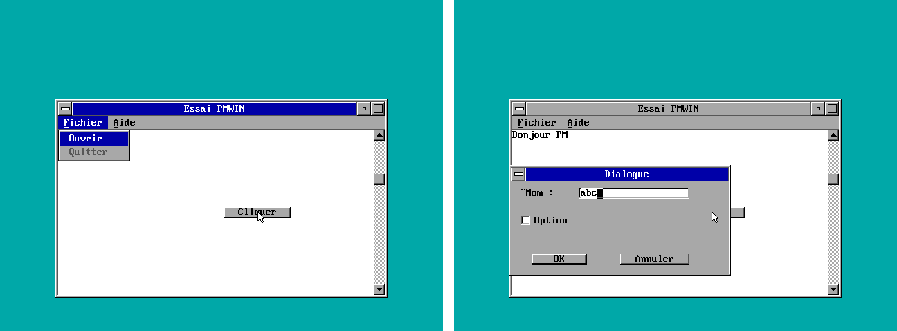
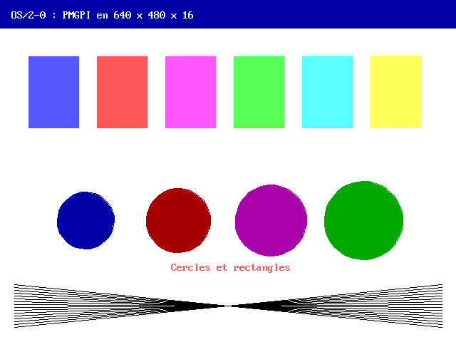

# OS2-0
Clone d'OS/2 en Pascal (Turbo Pascal ou Free Pascal)

<h2>Liste des fichiers</h2>

Voici la liste des différents fichiers proposés dans OS2-0 :

<table>
		<tr>
			<th>Nom</th>
			<th>Description</th>	
		</tr>
		<tr>
		 	<td><b>APPEND.PAS</b></td>
			<td>Cette commande permet d'ouvrir des fichiers quelconque se trouvant dans les répertoires spécifiés comme s'il s'agissait du répertoire courant.</td>
		</tr>
		<tr>
			<td><b>ASSIGN.PAS</b></td>
			<td>Cette commande permet de créer un disque virtuel à partir d'un autre disque.</td>
		</tr>
		<tr>
			<td><b>ATTRIB.PAS</b></td>
			<td>Cette commande permet de demander ou de changer les attributs d'un fichier.</td>
		</tr>
		<tr>
			<td><b>CHKDSK.PAS</b></td>
			<td>Cette commande permet de vérifier le disque. Cette commande est inspiré du DOS.</td>
		</tr>		
		<tr>
			<td><b>CMD.PAS</b></td>
			<td>Cette commande permet de lancer l'interpréteur de commande OS/2. Il s'agit d'un équivalent du CMD de OS/2.</td>
		</tr>  
		<tr>
			<td><b>COMMAND.PAS</b></td>
			<td>Logiciel clone d'un <i>COMMAND.COM</i> du système d'exploitation <a href="https://www.gladir.com/OS/DOS/intro.htm"><i>DOS</i></a>.</td>
		</tr>
		<tr>
			<td><b>COMP.PAS</b></td>
			<td>Cette commande permet de comparer deux fichiers. Cette commande est un equivalent du <a href="https://www.gladir.com/OS/PCDOS/intro.htm">PC-DOS</a> ou <a href="https://www.gladir.com/OS/MSDOS/intro.htm">MS-DOS</a>.</td>
		</tr>
		<tr>
			 <td><b>DEBUG.PAS</b></td>
			 <td>Cette commande permet de deboguer un programme.</td>
		</tr>
		<tr>
			<td><b>DISKCOMP.PAS</b></td>
			<td>Cette commande permet de comparer des disquettes ou des images.</td>
		</tr>		
		<tr>
		    	<td><b>DISKCOPY.PAS</b></td>
		    	<td>Cette commande permet de copier des disquettes ou des images.</td>
		</tr>	
		<tr>
			<td><b>DOSKEY.PAS</b></td>
			<td>Cette commande permet de charger le programme DOSKEY.</td>
		</tr>
		<tr>
			<td><b>EDLIN.PAS</b></td>
			<td>Cette commande permet de lancer l'éditeur en ligne de commande.</td>
		</tr>
		<tr>
			<td><b>EXE2BIN.PAS</b></td>
			<td>Cette commande permet de convertir un fichier EXE en binaire (COM).</td>
		</tr>
		<tr>
			<td><b>FIND.PAS</b></td>
			<td>Cette commande permet de rechercher une chaine de caractères dans des fichiers. Cette commande est un équivalent du DOS.</td>
		</tr>
		<tr>
			<td><b>FORMAT.PAS</b></td>
			<td>Cette commande permet de formater un unite de disquette.</td>
		</tr>
		<tr>
			<td><b>GRAFTABL.PAS</b></td>
			<td>Cette commande permet d'effectuer le chargement en mémoire conventionnelle d'une table de police de caractères pour les modes graphiques.</td>
		</tr>
		<tr>
			<td><b>LABEL.PAS</b></td>
			<td>Cette commande permet de changer le nom d'un volume.</td>
		</tr>
		<tr>
			<td><b>MEM.PAS</b></td>
			<td>Cette commande permet d'afficher les informations sur la mémoire. Cette commande est un clone de la commande MS-DOS ou PC-DOS.</td>
		</tr>
		<tr>
			<td><b>MODE.PAS</b></td>
			<td>Cette commande permet d'effectuer la gestion des paramètres d'un périphérique.</td>
		</tr>
		<tr>
			<td><b>MORE.PAS</b></td>
			<td>Cette commande permet de recevoir l'entrée puis l'affichage sur un périphérique un écran à la fois.</td>
    		</tr>	
    		<tr>
			<td><b>MOVE.PAS</td>
			<td>Cette commande permet de déplacer un fichier.</td>
		</tr>
		<tr>
			<td><b>REPLACE.PAS</b></td>
			<td>Cette commande permet de remplacer un fichier. Cette commande est un équivalent du DOS.</td>
		</tr>
		<tr>
			<td><b>SORT.PAS</b></td>
			<td>Cette commande permet de trier une fichier texte ASCII et de retourner le résultat. Cette commande est un équivalent de la commande du DOS.</td>
		</tr>
		<tr>
			<td><b>TREE.PAS</b></td>
			<td>Cette commande permet d'afficher un arbre de répertoire.</td>
		</tr>
		<tr>
			<td><b>XCOPY.PAS</b></td>
			<td>Cette commande permet d'effectuer la copie étendue avec sous-répertoire de fichier(s) vers un nouvel emplacement.</td>
		</tr>
	</table>

<h2>Noyau OS/2 32 bits et CD-ROM amorçable</h2>

OS2-0 possède son propre noyau OS/2 32 bits écrit en Pascal. Comme sous OS/2, le démarrage se fait en trois fichiers, chacun écrit dans un seul fichier source Pascal (dossier <b>KERNEL</b>) :

<table>
	<tr><th>Fichier</th><th>Source</th><th>Description</th></tr>
	<tr><td><b>OS2BOOT</b></td><td>KERNEL/OS2BOOT.PAS</td><td>Secteur d'amorce du CD-ROM (El Torito sans émulation, mode réel 8086) : lit le système de fichiers ISO 9660 par l'INT 13h étendue et charge OS2LDR en 2000:0000.</td></tr>
	<tr><td><b>OS2LDR</b></td><td>KERNEL/OS2LDR.PAS</td><td>Chargeur 16 bits : charge l'image PE du noyau à 1 Mo (INT 15h/87h), relève la carte mémoire (E820h), active la ligne A20, installe une GDT plate et passe en mode protégé.</td></tr>
	<tr><td><b>OS2KRNL</b></td><td>KERNEL/OS2KRNL.PAS</td><td>Noyau 32 bits (80386, mode protégé) : console VGA, IDT, exceptions (écran TRAP), PIC, minuterie, clavier, souris PS/2, tas, pagination, pilote ATAPI, disques durs IDE, ISO 9660 et disque virtuel en mémoire, systèmes de fichiers installables (IFS=), couche API DOSCALLS, chargeur de programmes PE et processus, lecture de CONFIG.SYS et lancement de <b>CMD.EXE</b>.</td></tr>
</table>

Le compilateur <b>OS2PC.PAS</b> (« OS/2 Pascal Compiler », dossier <b>TOOLS</b>) est dérivé de <b>TPCW32.PAS</b> du dépôt <a href="https://github.com/gladir/DEV-COOLS">DEV-COOLS</a>. Il ajoute les destinations suivantes :

<table>
	<tr><th>Option</th><th>Description</th></tr>
	<tr><td><b>-COS2BOOT</b></td><td>Image binaire brute 8086 chargée en 07C0:0000, sans DOS (OS2BOOT).</td></tr>
	<tr><td><b>-COS2LDR</b></td><td>Image binaire brute 8086 chargée en 2000:0000, sans DOS (OS2LDR).</td></tr>
	<tr><td><b>-COS2KRNL</b></td><td>Noyau 32 bits : image PE liée à 1 Mo, assembleur 80386 natif (IN/OUT, INT, LGDT, LIDT, MOV CRn, IRETD...), procédures <i>Interrupt</i>, accès direct à Mem/MemW/MemL/Port/PortW ; les fonctions utilisées par le runtime (WriteFile, CreateFileA...) sont les procédures Pascal du noyau, exportées sous le nom DOSCALLS.DLL.</td></tr>
	<tr><td><b>-COS2</b></td><td>Destination par défaut : programme 32 bits pour OS/2-0 (CMD.EXE et les commandes), dont les importations sont liées par le noyau. Un source commençant par <code>Library</code> produit une DLL (clause <code>exports nom [Name 'externe'] [Index ordinal]</code>, jusqu'à 4095 exportations, base préférée fixée par <code>{$IMAGEBASE $00D00000}</code>, section <code>.reloc</code> produite pour que le noyau puisse la reloger ; une constante <code>Const NOM = 'texte';</code> ou entière peut aussi être exportée comme donnée) ; une fonction déclarée <code>External 'DLL' [Name 'nom']</code> est importée de cette DLL.</td></tr>
</table>

<h3>Bibliothèque DOSCALLS.DLL</h3>

Le fichier <b>DLL/DOSCALLS.PAS</b> est la bibliothèque OS/2 <b>DOSCALLS.DLL</b> : elle implémente les 315 fonctions <b>Dos*</b> des API d'OS/2 1.x et 2.x : fichiers et répertoires, recherche, attributs, tuyaux anonymes et nommés, mémoire (objets, mémoire partagée, segments, sous-allocation), sémaphores (événement, mutex, MuxWait, système, RAM), minuteries, processus et processus légers, exceptions et signaux, modules et ressources, pays, pages de codes et messages, périphériques, moniteurs, etc. Elle se compile avec OS2PC (<code>Library DOSCALLS; ... exports ...</code>) en une DLL liée à 00C00000h, que le noyau charge au démarrage et partage entre tous les processus. Le noyau place chaque DLL à sa base préférée si la place est libre, sinon il la reloge (section <code>.reloc</code> produite par OS2PC) à la première place libre de la région 00800000h-00FFFFFFh ; la table des modules grandit au besoin, si bien que le nombre de DLL n'est limité que par la place dans cette région (8 Mo). Un programme l'utilise ainsi (convention <i>_System</i> d'OS/2) :

<pre>Function DosBeep(Freq, Duration : LongInt) : LongInt; External 'DOSCALLS';</pre>

Le programme <b>DLL/TESTDOS.PAS</b> vérifie un échantillon de ces fonctions sous OS/2-0 (59 vérifications).

<h3>Bibliothèque FKA.DLL</h3>

Le fichier <b>DLL/FKA.PAS</b> est la bibliothèque OS/2 <b>FKA.DLL</b> (<i>Function Key Area</i>, zone des touches de fonction des versions DBCS d'OS/2), liée à 00D00000h, avec ses ordinaux d'origine :

<table>
	<tr><th>Fonction</th><th>Ordinal</th><th>Description</th></tr>
	<tr><td>FKAInit</td><td>64</td><td>Initialiser la FKA pour le processus.</td></tr>
	<tr><td>QueryFKADisplayDetails</td><td>65</td><td>Détails d'affichage (forme, lignes, touches, focus, touche choisie).</td></tr>
	<tr><td>WINFKAWNDPROC</td><td>66</td><td>Procédure de fenêtre : WM_CHAR (F1-F12, flèches, Entrée), WM_PAINT, WM_DESTROY, FKAM_SETTEXT...</td></tr>
	<tr><td>WINLOADFKA</td><td>67</td><td>Charger une FKA (ressource RT_FKA ou fichier FKAnnnn.TXT).</td></tr>
	<tr><td>WINCREATEFKA</td><td>68</td><td>Créer une FKA à partir de libellés.</td></tr>
	<tr><td>WINSETFKAFORM</td><td>69</td><td>Fixer la forme : masquée, courte (1 ligne) ou longue (2 lignes).</td></tr>
	<tr><td>WINQUERYFKAFORM</td><td>70</td><td>Demander la forme.</td></tr>
	<tr><td>WINGOTOFKA</td><td>71</td><td>Donner le focus à la FKA.</td></tr>
	<tr><td>WINGOFROMFKA</td><td>72</td><td>Rendre le focus à l'application.</td></tr>
</table>

Sans Presentation Manager, la zone est dessinée en mode texte sur les dernières lignes de l'écran, retirées de la zone de défilement de la console. Le programme <b>DLL/TESTFKA.PAS</b> la vérifie (24 vérifications, et <code>TESTFKA VOIR</code> pour la parcourir au clavier).

<h3>Système de fichiers HPFS.IFS</h3>

Le fichier <b>DLL/HPFS.PAS</b> est le pilote de système de fichiers installable OS/2 <b>HPFS.IFS</b> (<i>High Performance File System</i>), lié à 00E00000h. Il utilise le vrai format HPFS sur disque : secteur d'amorce, superbloc, bloc de réserve, bitmaps par bandes de 8 Mo, bande des répertoires, fnodes, arbres B+ d'allocation (anodes), répertoires en arbres B de dnodes triés sans tenir compte de la casse (page de codes 850), noms longs (254 caractères) à casse conservée, dates de création, d'accès et d'écriture, attributs étendus (EA). Le noyau le charge d'après CONFIG.SYS :

<pre>IFS=C:\HPFS.IFS /CACHE:32 /AUTOCHECK:D /RAMDISK:4096</pre>

puis lui présente les partitions de type 07h des disques durs IDE et un disque virtuel de 4 Mo (<code>/RAMDISK</code>, formaté au démarrage). Chaque volume reconnu reçoit une lettre d'unité (D:, E:...) : CMD.EXE, DOSCALLS.DLL et tous les programmes y accèdent normalement (DIR, COPY, MD, programmes lancés depuis D:...), le noyau aiguillant les fichiers de ces unités vers les points d'entrée du pilote. Un volume mal fermé cité par <code>/AUTOCHECK</code> est vérifié et corrigé au démarrage.

Le pilote exporte les 43 points d'entrée d'un IFS d'OS/2 (adaptés à OS/2-0 : paramètres de 32 bits, convention <i>_System</i>) :

<table>
	<tr><th>Points d'entrée</th><th>Rôle</th></tr>
	<tr><td>FS_NAME, FS_ATTRIBUTE</td><td>Données exportées : nom du système de fichiers (« HPFS ») et attributs du pilote.</td></tr>
	<tr><td>FS_INIT, FS_MOUNT, FS_ATTACH, FS_FSINFO, FS_FSCTL, FS_FLUSHBUF, FS_SHUTDOWN, FS_EXIT</td><td>Initialisation, reconnaissance des volumes, nom de volume et espace libre, contrôle du pilote (formatage, vérification de type CHKDSK, statistiques), écriture des tampons, arrêt, fin de processus.</td></tr>
	<tr><td>FS_OPENCREATE, FS_CLOSE, FS_READ, FS_WRITE, FS_CHGFILEPTR, FS_NEWSIZE, FS_COMMIT, FS_FILEINFO, FS_FILEIO, FS_FILELOCKS, FS_CANCELLOCKREQUEST, FS_IOCTL</td><td>Fichiers ouverts : partage, lecture et écriture, taille, informations et EA, entrées/sorties groupées, verrous de plages, contrôle de périphérique.</td></tr>
	<tr><td>FS_PATHINFO, FS_FILEATTRIBUTE, FS_DELETE, FS_MKDIR, FS_RMDIR, FS_MOVE, FS_COPY, FS_CHDIR, FS_PROCESSNAME</td><td>Opérations par chemin : informations, attributs, suppression, répertoires, renommage et déplacement, copie avec les EA, répertoire courant, forme canonique des noms.</td></tr>
	<tr><td>FS_FINDFIRST, FS_FINDNEXT, FS_FINDFROMNAME, FS_FINDCLOSE, FS_FINDNOTIFYFIRST, FS_FINDNOTIFYNEXT, FS_FINDNOTIFYCLOSE</td><td>Recherche de fichiers (niveaux 1 à 3, avec EA) et surveillance des changements d'un répertoire.</td></tr>
	<tr><td>FS_OPENPAGEFILE, FS_ALLOCATEPAGESPACE, FS_DOPAGEIO, FS_SETSWAP</td><td>Fichier d'échange (pages de 4 Ko).</td></tr>
	<tr><td>FS_NMPIPE</td><td>Tuyaux nommés : ils ne sont pas sur un volume HPFS (ERROR_NOT_SUPPORTED, comme sous OS/2).</td></tr>
</table>

Le programme <b>DLL/TESTHPFS.PAS</b> vérifie ces points d'entrée (79 vérifications : arbre B de 150 fichiers, fichiers fragmentés à anodes, EA, verrous, copie, déplacement, cohérence du volume...).

<h3>Bibliothèque VIOCALLS.DLL</h3>

Le fichier <b>DLL/VIOCALLS.PAS</b> est le sous-système vidéo OS/2 <b>VIOCALLS.DLL</b> (lié à 00F00000h), avec ses 76 fonctions et leurs ordinaux d'origine (1 VioEndPopup ... 76 XVioGetCAState ; alias VioScrollRi, VioSetCursorPos et VioScrollLe). Les programmes et les DLL d'OS/2-0 s'exécutant en anneau 0, VIOCALLS écrit directement dans la mémoire de l'écran (000B8000h) et programme le VGA par ses ports (OS2PC émet de vraies instructions IN/OUT dans les blocs asm de la cible -COS2) ; la position du curseur et l'attribut courant sont ceux de la console du noyau, si bien que VIO et WriteLn restent cohérents.

<table>
	<tr><th>Fonctions</th><th>Rôle</th></tr>
	<tr><td>VioWrtCharStr, VioWrtCharStrAtt, VioWrtCellStr, VioWrtNChar, VioWrtNAttr, VioWrtNCell, VioReadCharStr, VioReadCellStr</td><td>Écriture et lecture de caractères, d'attributs et de cellules.</td></tr>
	<tr><td>VioScrollUp, VioScrollDn, VioScrollLf, VioScrollRt</td><td>Défilement d'un rectangle dans les quatre directions.</td></tr>
	<tr><td>VioWrtTty, VioGetAnsi, VioSetAnsi</td><td>Sortie télétype avec les séquences ANSI (position, déplacements, effacements, couleurs).</td></tr>
	<tr><td>VioGetCurPos, VioSetCurPos, VioGetCurType, VioSetCurType</td><td>Position et forme du curseur (registres du CRTC).</td></tr>
	<tr><td>VioGetMode, VioSetMode, VioGetConfig, VioGetState, VioSetState, VioGetFont, VioSetFont, VioGetCp, VioSetCp</td><td>Mode texte 80 x 25 et modes graphiques du VGA : 640 x 480 x 16 (12h), 640 x 480 x 2 (11h), 640 x 350 x 16 (10h), 640 x 200 x 16 (0Eh), 320 x 200 x 16 (0Dh), 320 x 200 x 256 (13h), mémoire en 000A0000h par VioGetPhysBuf (les fonctions du mode texte rendent alors ERROR_VIO_MODE ; le retour au texte recharge la police et la palette) ; configuration, palette, registres de couleur, bordure, clignotement, soulignement, police du générateur de caractères, page de codes.</td></tr>
	<tr><td>VioGetBuf, VioShowBuf, VioGetPhysBuf</td><td>Tampon vidéo logique (LVB) et accès au tampon physique.</td></tr>
	<tr><td>VioPopUp, VioEndPopup, VioScrLock, VioScrUnlock, VioSavRedrawWait, VioSavRedrawUndo, VioModeWait, VioModeUndo, VioSave, VioRestore, VioSswSwitch, VioRedrawSize, VioSrfBlock, VioSrfUnblock</td><td>Fenêtres surgissantes, verrou de l'écran, attentes du gestionnaire de sessions, sauvegarde, bascule et blocage de l'affichage.</td></tr>
	<tr><td>VioPrtSc, VioPrtScToggle, Avs_Prtsc, Avs_PrtscToggle</td><td>Impression et capture de l'écran (fichier C:\PRTSC.TXT, copie de la sortie télétype).</td></tr>
	<tr><td>VioRegister, VioGlobalReg, VioDeRegister</td><td>Remplacement de fonctions par un sous-système vidéo chargé depuis une DLL.</td></tr>
	<tr><td>VioCreatePS, VioDestroyPS, VioAssociate, VioShowPS, VioSetOrg, VioGetOrg, VioCreateLogFont, VioDeleteSetId, VioQuerySetIds, VioQueryFonts, VioGetDeviceCellSize, VioSetDeviceCellSize, VioGetPSAddress</td><td>Espaces de présentation AVIO (cellules de 2 ou 4 octets), affichés à l'écran une fois associés.</td></tr>
	<tr><td>VioInit, VioShellInit, VioHetInit, VioFree, VioQueryConsole</td><td>Initialisation, remise à l'état d'origine du VGA, libération des ressources d'un processus, état de la console.</td></tr>
	<tr><td>VioCheckCharType, XVioCheckCharType, XVioCreateCA, XVioDestroyCA, XVioSetCAState, XVioGetCAState</td><td>Caractères à double octet (pages de codes 932, 936, 942, 949, 950) et jeux d'attributs étendus.</td></tr>
</table>

Le programme <b>DLL/TESTVIO.PAS</b> vérifie ces fonctions (127 vérifications, relues par VIO, directement dans la mémoire de l'écran et dans les registres du VGA, dont les modes graphiques) avec la DLL de remplacement <b>DLL/TESTVIOR.PAS</b>.

<h3>Bibliothèque MOUCALLS.DLL</h3>

Le fichier <b>DLL/MOUCALLS.PAS</b> est le sous-système souris OS/2 <b>MOUCALLS.DLL</b> (lié à 00F40000h), avec ses 29 fonctions et leurs ordinaux d'origine (1 MouGetPtrShape ... 30 MouSetThreshold). Le noyau reçoit les paquets de la souris PS/2 (IRQ 12, port auxiliaire du 8042) et les met à disposition par KrnMouRead ; MOUCALLS en fait des événements et dessine le pointeur dans l'écran texte. Quand l'écran est en mode graphique (VioSetMode), les lignes et colonnes rapportées sont des pels (0 à 479 et 0 à 639 en 640 x 480) et le pointeur est dessiné par le programme (PMWIN.DLL pour Presentation Manager).

<table>
	<tr><th>Fonctions</th><th>Rôle</th></tr>
	<tr><td>MouOpen, MouClose, MouFree, MouShellInit, MouInitReal, MouSynch</td><td>Ouverture et fermeture de la souris, libération, initialisation de l'interpréteur, pilote de pointeur, accès synchronisé.</td></tr>
	<tr><td>MouReadEventQue, MouGetNumQueEl, MouFlushQue, MouGetEventMask, MouSetEventMask</td><td>File de 64 événements (déplacements et boutons, avec ou sans attente) et masque des événements rapportés.</td></tr>
	<tr><td>MouGetPtrPos, MouSetPtrPos, MouGetPtrShape, MouSetPtrShape, MouDrawPtr, MouRemovePtr</td><td>Position du pointeur (ligne, colonne), forme (masques ET et OU exclusif de la cellule), dessin et zone d'exclusion.</td></tr>
	<tr><td>MouGetScaleFact, MouSetScaleFact, MouGetThreshold, MouSetThreshold, MouGetNumMickeys, MouGetNumButtons</td><td>Facteurs d'échelle (mickeys par 8 pels), seuils d'accélération, résolution et nombre de boutons.</td></tr>
	<tr><td>MouGetDevStatus, MouSetDevStatus, MouGetHotKey, MouSetHotKey</td><td>État du périphérique (pointeur désactivé, déplacements en mickeys) et boutons de la touche de session.</td></tr>
	<tr><td>MouRegister, MouDeRegister</td><td>Remplacement de fonctions par un sous-système souris chargé depuis une DLL.</td></tr>
</table>

Le programme <b>DLL/TESTMOU.PAS</b> vérifie ces fonctions (60 vérifications ; la seconde partie attend des événements de la souris, envoyés sous QEMU par <code>mouse_move</code> et <code>mouse_button</code>).

<h3>Bibliothèque NLS.DLL</h3>

Le fichier <b>DLL/NLS.PAS</b> est la bibliothèque OS/2 <b>NLS.DLL</b> (langues nationales, liée à 00D40000h), avec ses 8 fonctions et leurs ordinaux d'origine. Elle contient les données du fichier de pays d'OS/2 pour 29 pays et les pages de codes 437, 850, 852, 857, 860, 861, 863, 865, 866 ainsi que les pages à double octet 932, 942, 936, 949 et 950.

<table>
	<tr><th>Fonction</th><th>Ordinal</th><th>Description</th></tr>
	<tr><td>DosCaseMap</td><td>1</td><td>Conversion en majuscules (OS/2 1.x, COUNTRYCODE de 16 bits).</td></tr>
	<tr><td>DosGetCollate</td><td>2</td><td>Table de tri (OS/2 1.x).</td></tr>
	<tr><td>DosGetCtryInfo</td><td>3</td><td>Informations du pays (COUNTRYINFO de 16 bits, 38 octets).</td></tr>
	<tr><td>DosGetDBCSEv</td><td>4</td><td>Vecteur des octets de tête DBCS (OS/2 1.x).</td></tr>
	<tr><td>DosQueryCtryInfo</td><td>5</td><td>Informations du pays (COUNTRYINFO de 32 bits, 44 octets) : date, heure, monnaie, séparateurs.</td></tr>
	<tr><td>DosQueryDBCSEnv</td><td>6</td><td>Vecteur des octets de tête DBCS.</td></tr>
	<tr><td>DosMapCase</td><td>7</td><td>Conversion en majuscules selon le pays et la page de codes (lettres accentuées, turc, cyrillique ; octets de queue DBCS gardés).</td></tr>
	<tr><td>DosQueryCollate</td><td>8</td><td>Table de tri (accents ignorés, ordre scandinave des lettres Æ, Ø, Å, Ä, Ö).</td></tr>
</table>

Le programme <b>DLL/TESTNLS.PAS</b> vérifie ces fonctions (31 vérifications).

<h3>Bibliothèque KBDCALLS.DLL</h3>

Le fichier <b>DLL/KBDCALLS.PAS</b> est le sous-système clavier OS/2 <b>KBDCALLS.DLL</b> (lié à 00C80000h), avec ses 25 fonctions et leurs ordinaux d'origine (1 KbdSetCustXt ... 25 KbdSetHWId). Le noyau range chaque frappe (IRQ 1) avec l'état des touches de changement d'état et l'heure, et la met à disposition par KrnKbdRead et KrnKbdCtl ; KBDCALLS la traduit avec la table du clavier logique (codes étendus 00h ou E0h compatibles avec le BIOS et OS/2).

<table>
	<tr><th>Fonctions</th><th>Rôle</th></tr>
	<tr><td>KbdCharIn, KbdPeek, KbdFlushBuffer</td><td>Lecture d'un caractère (KBDKEYINFO, avec ou sans attente), consultation sans retrait, vidage du tampon.</td></tr>
	<tr><td>KbdStringIn</td><td>Lecture d'une chaîne : en mode ASCII avec édition (Retour arrière, Échap, gabarit F1 et F3) et écho, en mode binaire caractère par caractère.</td></tr>
	<tr><td>KbdGetStatus, KbdSetStatus</td><td>Écho, mode ASCII ou binaire, caractère de fin (1 ou 2 octets), rapport des touches de changement d'état, verrouillages (avec les voyants).</td></tr>
	<tr><td>KbdOpen, KbdClose, KbdGetFocus, KbdFreeFocus</td><td>Claviers logiques et attribution du clavier physique.</td></tr>
	<tr><td>KbdGetCp, KbdSetCp, KbdSetCustXt, KbdXlate</td><td>Page de codes, table de traduction personnalisée, traduction d'un code de balayage.</td></tr>
	<tr><td>KbdGetHWId, KbdSetHWId</td><td>Identification du clavier (AB41h, clavier étendu).</td></tr>
	<tr><td>KbdRegister, KbdDeRegister</td><td>Remplacement de fonctions par un sous-système clavier chargé depuis une DLL.</td></tr>
	<tr><td>KbdInit, KbdShellInit, KbdLoadInstance, KbdSwitchFgnd, KbdSetFgnd, KbdFree, KbdSynch</td><td>Initialisation de la session et de l'interpréteur, premier plan, libération des ressources d'un processus, accès synchronisé.</td></tr>
</table>

Le programme <b>DLL/TESTKBD.PAS</b> vérifie ces fonctions (97 vérifications ; la seconde partie lit des touches, envoyées sous QEMU par <code>sendkey</code>).

<h3>Bibliothèque MONCALLS.DLL</h3>

Le fichier <b>DLL/MONCALLS.PAS</b> est la bibliothèque OS/2 <b>MONCALLS.DLL</b> des moniteurs de périphériques (liée à 00CB0000h), avec ses 5 fonctions et leurs ordinaux d'origine. Un moniteur s'insère dans le flux de données d'un périphérique de caractères : le noyau détourne vers la chaîne des moniteurs les frappes du clavier (KBD$, avant KBDCALLS et la console), les paquets de la souris (MOUSE$, avant MOUCALLS) et les données écrites sur l'imprimante (LPT1 à LPT3 et PRN, avant le port parallèle) ; chaque moniteur peut modifier, supprimer ou ajouter des paquets. Les fonctions DosMon* de DOSCALLS.DLL sont transmises à MONCALLS.DLL.

<table>
	<tr><th>Fonction</th><th>Ordinal</th><th>Description</th></tr>
	<tr><td>DosMonWrite</td><td>1</td><td>Rendre un paquet au flux par le tampon de sortie : il passe au moniteur suivant, ou au périphérique après le dernier.</td></tr>
	<tr><td>DosMonRead</td><td>2</td><td>Lire le paquet suivant de la chaîne dans le tampon d'entrée (avec ou sans attente).</td></tr>
	<tr><td>DosMonClose</td><td>3</td><td>Terminer la surveillance (les paquets en attente continuent vers le périphérique).</td></tr>
	<tr><td>DosMonOpen</td><td>4</td><td>Ouvrir KBD$, MOUSE$, LPT1 à LPT3 ou PRN pour le surveiller.</td></tr>
	<tr><td>DosMonReg</td><td>5</td><td>Enregistrer les tampons d'entrée et de sortie (MONIN, MONOUT) au début, à la fin ou à la place par défaut de la chaîne.</td></tr>
</table>

Le programme <b>DLL/TESTMON.PAS</b> vérifie ces fonctions (52 vérifications : chaîne de trois moniteurs de l'imprimante, touches modifiées, supprimées ou ajoutées, déplacement de la souris doublé).

<h3>Bibliothèque MSG.DLL</h3>

Le fichier <b>DLL/MSG.PAS</b> est la bibliothèque OS/2 <b>MSG.DLL</b> des messages (liée à 00D80000h), avec ses 9 points d'entrée et leurs ordinaux d'origine. Elle lit les fichiers de messages d'OS/2 au format MKMSGF (index de mots ou de doubles mots, types E, W, I, H, P), cherche le fichier dans le chemin indiqué, le répertoire courant, DPATH, C:\ et C:\OS2\SYSTEM, garde les fichiers ouverts jusqu'à DosCloseMessageFile et consulte d'abord un segment de messages en mémoire s'il est fourni. Les principaux messages système (OSO001.MSG) y sont intégrés. Les fonctions de messages de DOSCALLS.DLL (DosGetMessage, DosInsertMessage, DosPutMessage, DosQueryMessageCP...) lui sont transmises.

<table>
	<tr><th>Fonction</th><th>Ordinal</th><th>Description</th></tr>
	<tr><td>Dos16PutMessage, DosPutMessage (Dos32PutMessage)</td><td>1, 5</td><td>Écrire un message dans un fichier ou à l'écran (lignes coupées entre les mots à 80 colonnes).</td></tr>
	<tr><td>Dos16TrueGetMessage, DosTrueGetMessage (Dos32TrueGetMessage)</td><td>2, 6</td><td>Lire un message (préfixe « SYS0002: » des erreurs et avertissements, %0 sans fin de ligne) et y insérer les variables %1 à %9 ; message d'erreur SYS0317, SYS0318 ou SYS0319 si le message ou le fichier est introuvable.</td></tr>
	<tr><td>DosInsMessage, DosInsertMessage (Dos32InsertMessage)</td><td>3, 4</td><td>Insérer les variables %1 à %9 dans un message en mémoire.</td></tr>
	<tr><td>Dos16IQueryMessageCP, DosIQueryMessageCP (Dos32IQueryMessageCP)</td><td>7, 8</td><td>Pages de codes et langue d'un fichier de messages.</td></tr>
	<tr><td>DosCloseMessageFile (Dos32CloseMessageFile)</td><td>9</td><td>Fermer un fichier de messages gardé ouvert.</td></tr>
</table>

Les points d'entrée d'OS/2 1.x (Dos16*, DosInsMessage) rendent les longueurs dans un mot, ceux d'OS/2 2.x dans un double mot. Le programme <b>DLL/TESTMSG.PAS</b> vérifie ces fonctions (45 vérifications, avec des fichiers de messages qu'il fabrique sur le disque virtuel HPFS).

<h3>Bibliothèque NAMPIPES.DLL</h3>

Le fichier <b>DLL/NAMPIPES.PAS</b> est la bibliothèque OS/2 <b>NAMPIPES.DLL</b> des tuyaux nommés (liée à 00DB0000h), avec ses 14 fonctions et leurs ordinaux d'origine. Elle gère les instances multiples d'un même nom (\PIPE\nom), les tuyaux d'octets et de messages (chaque message précédé d'un en-tête de 2 octets), l'accès entrant, sortant ou bidirectionnel, le mode bloquant et le mode de lecture propres à chaque bout, et les sémaphores attachées (système ou d'événement). Les handles des tuyaux sont ceux de DOSCALLS.DLL : DosOpen (client), DosRead, DosWrite et DosClose s'y appliquent, et les fonctions DosXxxNPipe d'OS/2 2.x de DOSCALLS.DLL lui sont transmises.

<table>
	<tr><th>Fonctions</th><th>Rôle</th></tr>
	<tr><td>DosMakeNmPipe, DosConnectNmPipe, DosDisConnectNmPipe, DosWaitNmPipe</td><td>Création d'une instance (créée à l'écoute), attente d'un client, déconnexion, attente d'une instance libre.</td></tr>
	<tr><td>DosQNmPipeInfo, DosQNmPHandState, DosSetNmPHandState</td><td>Informations (PIPEINFO), état du handle, mode bloquant et mode de lecture (octets ou messages).</td></tr>
	<tr><td>DosPeekNmPipe, DosRawReadNmPipe, DosRawWriteNmPipe</td><td>Lecture sans retrait (AVAILDATA, état), lecture et écriture brutes (avec les en-têtes des messages).</td></tr>
	<tr><td>DosTransactNmPipe, DosCallNmPipe</td><td>Transaction sur un tuyau de messages bidirectionnel, appel (ouverture, transaction, fermeture).</td></tr>
	<tr><td>DosSetNmPipeSem, DosQNmPipeSemState</td><td>Sémaphore libérée quand des données arrivent, que de la place se libère ou que l'autre bout ferme ; état (PIPESEMSTATE).</td></tr>
</table>

Les processus s'exécutant un à la fois, une opération qui devrait attendre l'autre bout rend aussitôt une erreur (ERROR_NO_DATA, ERROR_PIPE_NOT_CONNECTED ou ERROR_SEM_TIMEOUT). Le programme <b>DLL/TESTNMP.PAS</b> vérifie ces fonctions (58 vérifications).

<h3>Bibliothèque SESMGR.DLL</h3>

Le fichier <b>DLL/SESMGR.PAS</b> est le gestionnaire de sessions OS/2 <b>SESMGR.DLL</b> (lié à 00FA0000h), avec ses 41 points d'entrée et leurs ordinaux d'origine (1 DosSMSGDoPopup ... 41 DosRegisterNotification ; QhKeybdHandle et QhMouseHandle sont des données). La session 1 est celle de CMD.EXE. Une session démarrée au premier plan exécute aussitôt son programme sur un écran propre ; à sa fin, l'écran, le curseur et le clavier de la session d'origine sont rendus. Une session démarrée en arrière-plan attend d'être choisie pour s'exécuter.

<table>
	<tr><th>Fonctions</th><th>Rôle</th></tr>
	<tr><td>DOSSTARTSESSION, DOSSELECTSESSION, DOSSETSESSION, DOSSTOPSESSION, Dos32StartSession, Dos32SelectSession, Dos32SetSession, Dos32StopSession</td><td>Démarrage (STARTDATA : session enfant ou indépendante, premier plan ou arrière-plan, type, PgmControl dont SSF_CONTROL_NOAUTOCLOSE, ObjectBuffer), choix, réglage (sélectionnable, liée) et arrêt des sessions enfants.</td></tr>
	<tr><td>DosSMInitialize, DosSMStart, DosSMSwitch, DosSMTerminate, DosSMGetStatus, DosSMSetSessionType, DosSMParentSwitch, DosSetMNLockTime, DosGetTimes</td><td>Interpréteur propriétaire du gestionnaire : sessions de premier niveau, bascule, fin, état des sessions, type, retour au parent, durée minimale au premier plan.</td></tr>
	<tr><td>DosSMGetAppReq, DosSMServeAppReq, DosSMDoAppReq</td><td>Demandes des applications : tant qu'un interpréteur est propriétaire, les DosStartSession, DosSelectSession, DosSetSession et DosStopSession des autres processus lui sont confiés.</td></tr>
	<tr><td>DosSMSetTitle, DosSMPause, DosSMRealPrtSc, DosSMPMPresent</td><td>Titre de la session, pause (Ctrl+Verr num), impression de l'écran, présence de Presentation Manager (absent).</td></tr>
	<tr><td>DosSMSGDoPopup, DosSMSGEndPopup, DosScrLock, DosScrUnlock, DosSavRedrawWait, DosSavRedrawUndo, DosModeWait, DosModeUndo</td><td>Fenêtres surgissantes, verrou de l'écran et processus légers de sauvegarde et de retraçage (VIOCALLS.DLL).</td></tr>
	<tr><td>DOSSMREGISTERDD, DosSMOpenDD, DosSMNotifyDD, DosSMNotifyDD2, DosSMHDEInit, DosSMSysInit, DosRegisterNotification</td><td>Pilotes avertis des changements de session (KBD$ : KbdSwitchFgnd), HARDERR, DLL appelées à chaque démarrage, fin, passage au premier plan ou changement de titre.</td></tr>
</table>

Le programme <b>DLL/TESTSES.PAS</b> vérifie ces fonctions (59 vérifications ; ses sessions enfants exécutent TESTSES lui-même).

<h3>Bibliothèque QUECALLS.DLL</h3>

Le fichier <b>DLL/QUECALLS.PAS</b> est la bibliothèque OS/2 <b>QUECALLS.DLL</b> des files d'attente (liée à 00E70000h), avec ses 16 fonctions et leurs ordinaux d'origine : les 8 points d'entrée d'OS/2 1.x (1 DosReadQueue ... 8 DosCreateQueue) et leurs équivalents 32 bits (9 Dos32ReadQueue ... 16 Dos32CreateQueue). Le processus qui crée une file (\QUEUES\nom) en est le propriétaire et le seul à la lire ; les autres l'ouvrent pour y écrire. Les éléments (code de requête, longueur, adresse des données, priorité) sont lus selon l'ordre de la file : FIFO, LIFO ou par priorités (15 la plus haute). DosPeekQueue rend un code d'élément que DosReadQueue peut lire ensuite ; une sémaphore (1.x : DosSemClear, 2.x : DosPostEventSem) est signalée à chaque élément ajouté. Les points d'entrée 1.x rendent QUEUERESULT (deux mots), ceux de 2.x REQUESTDATA (deux doubles mots). SESMGR.DLL y écrit la fin des sessions enfants (TermQ).

Le programme <b>DLL/TESTQUE.PAS</b> vérifie ces fonctions (31 vérifications, avec un écrivain d'un autre processus et la file de fin d'une session).

<h3>Bibliothèque SPOOLCP.DLL</h3>

Le fichier <b>DLL/SPOOLCP.PAS</b> est la bibliothèque OS/2 <b>SPOOLCP.DLL</b>, le commutateur de polices des imprimantes (liée à 00EA0000h), avec ses 5 fonctions et leurs ordinaux d'origine. Pour chaque imprimante (PRN, LPT1 à LPT3), elle connaît les polices résidentes et celles d'un fichier de polices, et pour chaque fichier ouvert vers l'imprimante (handle du port ou fichier de spoule) la page de codes et la police actives. Activer une police écrit sur ce handle la séquence de commande qui la choisit, précédée la première fois des données à télécharger dans l'imprimante.

<table>
	<tr><th>Fonction</th><th>Ordinal</th><th>Description</th></tr>
	<tr><td>DosPFSCloseUser</td><td>1</td><td>Le fichier est fermé : sa page de codes et sa police actives sont oubliées.</td></tr>
	<tr><td>DosPFSQueryAct</td><td>2</td><td>Page de codes et police actives d'un fichier.</td></tr>
	<tr><td>DosPFSInit</td><td>3</td><td>Installer le commutateur d'une imprimante : polices résidentes (HWFONTS) et fichier de polices.</td></tr>
	<tr><td>DosPFSActivate</td><td>4</td><td>Activer une page de codes et une police (téléchargement, puis séquence de choix).</td></tr>
	<tr><td>DosPFSVerifyFont</td><td>5</td><td>La page de codes et la police sont-elles disponibles ?</td></tr>
</table>

Le fichier de polices est un fichier texte propre à OS/2-0 (lignes TYPE, FONT et LOAD, octets en hexadécimal), et non le format .DCP d'IBM. Le programme <b>DLL/TESTPFS.PAS</b> vérifie ces fonctions (26 vérifications ; avec QEMU, <code>-parallel file:</code> recueille les séquences envoyées à LPT1).

<h3>Bibliothèque RMINFO.DLL</h3>

Le fichier <b>DLL/RMINFO.PAS</b> est la bibliothèque OS/2 <b>RMINFO.DLL</b> du gestionnaire de ressources (Resource Manager, liée à 00800000h), avec ses 34 points d'entrée et leurs ordinaux d'origine (les fonctions _RMxxx sont les seconds points d'entrée des fonctions RMxxx). Elle tient l'arbre des pilotes, adaptateurs, périphériques détectés et ressources matérielles (ports d'entrée/sortie, interruptions, mémoire, DMA, minuteries) ; une ressource exclusive ne peut être allouée deux fois, une ressource partagée ou multiplexée peut l'être par plusieurs pilotes du même mode. Au chargement, l'arbre décrit le matériel géré par le noyau (pilote OS2KRNL : contrôleur d'interruptions, minuterie, horloge, clavier, souris, IDE, VGA, ports COM et LPT présents) avec leurs identificateurs PnP (PNP0303...).

<table>
	<tr><th>Fonctions</th><th>Rôle</th></tr>
	<tr><td>RMCreateDriver, RMDestroyDriver</td><td>Inscription d'un pilote (DRIVERSTRUCT) ; sa destruction retire ses adaptateurs, périphériques et ressources.</td></tr>
	<tr><td>RMAllocResource, RMDeallocResource</td><td>Allocation (RESOURCESTRUCT : exclusive, partagée ou multiplexée) et libération des ressources.</td></tr>
	<tr><td>RMCreateAdapter, RMDestroyAdapter, RMCreateDetected, RMDestroyDetected</td><td>Adaptateurs (éventuellement imbriqués) et périphériques détectés, avec leurs ressources (AHRESOURCE).</td></tr>
	<tr><td>RMEnumNodes, RMGetNodeInfo, RMHandleToResourceHandleList, RMDevIDToHandleList</td><td>Énumération des nœuds, informations d'un nœud, ressources d'un nœud, recherche par identificateurs (HANDLELIST).</td></tr>
	<tr><td>RMConvertID</td><td>Identificateur EISA/PnP compressé ↔ texte (0303D041h ↔ PNP0303).</td></tr>
	<tr><td>RMGetSnoopLevel, RMSetSnoopLevel, RMSaveDetectedData, RMDeleteDetectedData</td><td>Niveau de détection du matériel ; sauvegarde des périphériques détectés (C:\RMDETECT.DAT).</td></tr>
</table>

Le programme <b>DLL/TESTRM.PAS</b> vérifie ces fonctions (37 vérifications ; <code>TESTRM LISTE</code> affiche l'arbre).

<h3>Bibliothèque OS2SM.DLL</h3>

Le fichier <b>DLL/OS2SM.PAS</b> est la bibliothèque OS/2 <b>OS2SM.DLL</b> (liée à 00850000h), la partie « gestion des sessions » de l'interpréteur de Presentation Manager, avec ses 46 points d'entrée et leurs ordinaux d'origine (1 à 45 et la donnée SHELLWINDOW, ordinal 103). Elle tient la liste des tâches (switch list : structures SWCNTRL, SWENTRY et SWBLOCK) et s'appuie sur SESMGR.DLL : une entrée désigne une session, la choisir l'exécute. OS2SM s'inscrit auprès de SESMGR (DosRegisterNotification, point d'entrée interne OS2SMNOTIFY, ordinal 200) : chaque session démarrée reçoit une entrée, une session terminée quitte la liste et la session courante est suivie. OS/2-0 n'a pas Presentation Manager : les handles de fenêtres sont conservés tels quels et un programme PM (PROG_PM) est refusé.

<table>
	<tr><th>Fonctions</th><th>Rôle</th></tr>
	<tr><td>WinInitSessionMgr</td><td>Le processus devient l'interpréteur propriétaire du gestionnaire de sessions (DosSMInitialize).</td></tr>
	<tr><td>WinAddSwitchEntry, WinCreateSwitchEntry, WinChangeSwitchEntry, WinSetSwEntry, WinQuerySwitchEntry, WinRemoveSwitchEntry, WinInitSwEntry, WinQuerySwitchHandle, WinQuerySwitchList</td><td>Entrées de la liste des tâches (HSWITCH : indice et génération ; un handle périmé est refusé).</td></tr>
	<tr><td>WinSwitchToProgram, WinSwitchToProgram2, WinSwitchToTaskManager, WinSetFgndWindow, WinProcessHotKey</td><td>Passage d'un programme à l'autre (DosSMSwitch ; Ctrl+Échap, Alt+Échap et Alt+Tab).</td></tr>
	<tr><td>SheStartProgram, SheStartLongProgram, WinInstStartApp, WinExecProgram</td><td>Démarrage d'un programme dans une session (STARTDATA, PROGDETAILS) ou dans la session courante (DosExecPgm).</td></tr>
	<tr><td>WinEndProgram, WinStopProgram, WinEndWindowSession, WinTerminateApp, WinInitSession, WinEndSession</td><td>Fin d'un programme ou d'une session et de ses entrées.</td></tr>
	<tr><td>WinQueryTaskTitle, WinQuerySessionTitle, WinSetTitle, WinQueryTaskSizePos, WinQueryExtIdFocus, WinSetExtIdFocus</td><td>Titres, taille et position (SWP) des tâches ; focus du clavier étendu.</td></tr>
	<tr><td>SheInitializeIniFile, StartSystemExecutables, ShlLoadPublicFonts, ShlUnloadPublicFonts, WinSave</td><td>Fichier de l'interpréteur C:\OS2SM.INI (lignes RUN= et FONT=, section [Bureau]).</td></tr>
	<tr><td>SheSystemShutdown, WinNoShutdown</td><td>Arrêt du système (bureau sauvé, tampons vidés), qui peut être empêché.</td></tr>
	<tr><td>WinStpRegister, WinSwitchProgramRegister, WinCplRegister, WinPMFileRegister, LPFNSHELLWNDPROC, LPFNICONWNDPROC, FNBADAPPDLGPROC</td><td>Inscriptions de fenêtres et de modules ; procédures de fenêtre de l'interpréteur.</td></tr>
</table>

Le programme <b>DLL/TESTSM.PAS</b> vérifie ces fonctions (62 vérifications ; les sessions exécutent <code>TESTSM KID titre</code>).

<h3>Bibliothèque HELPMGR.DLL</h3>

Le fichier <b>DLL/HELPMGR.PAS</b> est la bibliothèque OS/2 <b>HELPMGR.DLL</b> (liée à 00880000h), le gestionnaire d'aide IPF (Information Presentation Facility), avec ses 6 points d'entrée et leurs ordinaux d'origine. Une application crée une instance d'aide à partir d'une structure HELPINIT (titre, tutoriel, bibliothèques .HLP, table d'aide), puis l'associe à ses fenêtres cadres. Les bibliothèques sont cherchées telles quelles, dans le répertoire courant, dans la variable HELP (<code>SET HELP=D:\AIDE;</code> dans le CONFIG.SYS du CD-ROM) puis dans C:\ ; un fichier .HLP commence par la signature HSP. OS/2-0 n'a pas Presentation Manager : les handles de fenêtres sont conservés tels quels.

<table>
	<tr><th>Fonction</th><th>Rôle</th></tr>
	<tr><td>WinCreateHelpInstance</td><td>Créer une instance d'aide (HELPINIT ; erreur dans ulReturnCode : HMERR_OPEN_LIB_FILE, HMERR_INVALID_LIB_FILE, HMERR_HELPTABLE_UNDEFINE, HMERR_NO_MEMORY).</td></tr>
	<tr><td>WinDestroyHelpInstance</td><td>Détruire une instance (ses associations sont retirées).</td></tr>
	<tr><td>WinAssociateHelpInstance, WinQueryHelpInstance</td><td>Associer une instance à une fenêtre cadre (instance nulle : retirer l'association) ; instance d'une fenêtre.</td></tr>
	<tr><td>WinCreateHelpTable, WinLoadHelpTable</td><td>Remplacer la table d'aide d'une instance : HELPTABLE et HELPSUBTABLE en mémoire (copiées), ou ressources RT_HELPTABLE et RT_HELPSUBTABLE d'un module (DosGetResource).</td></tr>
</table>

Deux points d'entrée internes à OS/2-0 donnent ce qu'IPF ferait à la touche F1 : HMQUERYPANELID (ordinal 100 : panneau d'aide d'une fenêtre selon la table d'aide) et HMQUERYINSTANCEINFO (ordinal 101). Le programme <b>DLL/TESTHLP.PAS</b> vérifie ces fonctions (29 vérifications ; OS2PC ne produisant pas de ressources, le module de WinLoadHelpTable est une image PE construite en mémoire).

<h3>Bibliothèque LIBUNI.DLL</h3>

Le fichier <b>DLL/LIBUNI.PAS</b> est la bibliothèque OS/2 <b>LIBUNI.DLL</b> (liée à 00900000h), les services Unicode et de locales (ULS, Universal Language Support), avec ses 78 points d'entrée et leurs ordinaux d'origine. Les chaînes sont en UniChar (UCS-2) ; les tables des caractères (attributs, majuscules et minuscules, valeurs numériques, classes bidirectionnelles, décompositions canoniques) couvrent le plan multilingue de base et sont générées à partir de la base Unicode 15.1. Douze locales sont fournies : C, POSIX, UNIVERSAL, en_US, en_GB, fr_FR, fr_CA, de_DE, es_ES, it_IT, nl_NL et pt_BR (jours, mois, formats des dates et des heures, nombres, monnaie, noms des langues et des pays) ; le nom vide désigne la locale par défaut (variables LC_ALL, LC_xxx, LANG, puis la fonction Locale).

<table>
	<tr><th>Fonctions</th><th>Rôle</th></tr>
	<tr><td>UniCreateLocaleObject, UniFreeLocaleObject, UniQueryLocaleObject, UniLocaleStrToToken, UniLocaleTokenToStr, UniMapCtryToLocale, Locale</td><td>Objets locales (nom, jeton, code de pays ; catégories LC_*).</td></tr>
	<tr><td>UniQueryLocaleItem, UniQueryLocaleValue, UniQueryLocaleInfo, UniFreeLocaleInfo, UniFreeMem</td><td>Éléments des locales (136 LocaleItem), structure UniLconv.</td></tr>
	<tr><td>UniQueryAlpha... UniQueryXdigit, UniQueryChar, UniQueryAttr, UniCreateAttrObject, UniQueryCharAttr, UniScanForAttr, UniFreeAttrObject</td><td>Attributs des caractères (CT_*).</td></tr>
	<tr><td>UniQueryCharType, UniQueryCharTypeTable, UniQueryStringType, UniQueryNumericValue</td><td>Types UNICTYPE (classe, bidi, écriture, attributs étendus, pages de codes), valeur numérique.</td></tr>
	<tr><td>UniToupper, UniTolower, UniTransUpper, UniTransLower, UniStrupr, UniStrlwr</td><td>Majuscules et minuscules.</td></tr>
	<tr><td>UniStrcat... UniStrtok (21 fonctions)</td><td>Chaînes UniChar.</td></tr>
	<tr><td>UniStrcoll, UniStrxfrm, UniMakeKey, UniGetColval</td><td>Collation à trois niveaux (lettre, accent, casse).</td></tr>
	<tr><td>UniCreateTransformObject, UniTransformStr, UniFreeTransformObject, UniProcessUconv</td><td>Transformations (upper, lower, compose, decompose, hiragana, katakana, fullwidth, halfwidth) ; page de codes 437 ou 850 vers Unicode.</td></tr>
	<tr><td>UniStrtol, UniStrtoul, UniStrtod, UniStrftime, UniStrptime, UniStrfmon</td><td>Nombres, dates et heures, montants selon la locale.</td></tr>
	<tr><td>UniMakeUserLocale, UniSetUserLocaleItem, UniGetOverride, UniDeleteUserLocale, UniCompleteUserLocale, UniQueryLocaleList, UniQueryLanguageName, UniQueryCountryName</td><td>Locales de l'utilisateur (C:\USERLOC.INI), liste des locales, noms des langues et des pays.</td></tr>
</table>

UniMakeKey, UniGetColval, UniGetOverride, UniProcessUconv et Locale ne sont pas documentées par IBM : leur rôle est décrit dans le source. Le programme <b>DLL/TESTUNI.PAS</b> vérifie ces fonctions (107 vérifications).

<h3>Bibliothèque PMDRAG.DLL</h3>

Le fichier <b>DLL/PMDRAG.PAS</b> est la bibliothèque OS/2 <b>PMDRAG.DLL</b> (liée à 00A00000h), la manipulation directe (glisser-déposer) de Presentation Manager, avec ses 76 points d'entrée : ordinaux 1 à 31 (points d'entrée 16 bits, noms en majuscules) et 32 à 62 (32 bits) pour les 31 fonctions de base, 63 à 66 pour DrgDragFiles et DrgAcceptDroppedFiles, 67 à 76 pour le glissement différé et les fonctions de Warp. OS/2-0 n'a pas Presentation Manager : PMDRAG tient un registre de fenêtres (point d'entrée interne DRGREGISTERWINDOW : handle, rectangle de l'écran en pels, procédure de fenêtre _System ou Pascal d'OS2PC) qui reçoivent les messages DM_* ; DrgDrag suit la souris (MOUCALLS.DLL) jusqu'au relâchement du bouton ou à Échap.

<table>
	<tr><th>Fonctions</th><th>Rôle</th></tr>
	<tr><td>DrgAllocDraginfo, DrgReallocDraginfo, DrgFreeDraginfo, DrgAccessDraginfo, DrgPushDraginfo, DrgQueryDragitem, DrgQueryDragitemCount, DrgQueryDragitemPtr, DrgSetDragitem, DrgQueryDraginfoPtr...</td><td>Structures DRAGINFO et DRAGITEM (mémoire partagée, accès comptés : après DM_DROP, la cible libère).</td></tr>
	<tr><td>DrgAddStrHandle, DrgDeleteStrHandle, DrgQueryStrName, DrgQueryStrNameLen, DrgDeleteDraginfoStrHandles</td><td>Chaînes par handles (HSTR C000h à C0FFh, partagées et comptées).</td></tr>
	<tr><td>DrgQueryNativeRMF, DrgVerifyRMF, DrgVerifyNativeRMF, DrgQueryFormat, DrgQueryTrueType, DrgVerifyTrueType, DrgVerifyType, DrgVerifyTypeSet</td><td>Mécanismes et formats de rendu (&lt;m,f&gt; et (m1,m2)x(f1,f2)), types.</td></tr>
	<tr><td>DrgDrag, DrgLazyDrag, DrgLazyDrop, DrgCancelLazyDrag, DrgQueryDragStatus, DrgSetDragPointer, DrgSetDragImage</td><td>Glissement à la souris (DM_DRAGOVER, DM_DRAGLEAVE, DM_DROP) ou différé.</td></tr>
	<tr><td>DrgAllocDragtransfer, DrgFreeDragtransfer, DrgSendTransferMsg, DrgPostTransferMsg</td><td>Transferts (DRAGTRANSFER) ; messages envoyés ou postés (remis à la fin du message en cours).</td></tr>
	<tr><td>DrgDragFiles, DrgAcceptDroppedFiles</td><td>Glissement de fichiers : la fenêtre cible copie ou déplace les fichiers dans son répertoire (DM_ENDCONVERSATION, DM_DRAGFILECOMPLETE ; DM_RENDERFILE si la source fait le rendu).</td></tr>
	<tr><td>DrgGetPS, DrgGetClipPS, DrgReleasePS</td><td>Espaces de présentation (handles sans dessin : pas de GPI).</td></tr>
</table>

Le programme <b>DLL/TESTDRG.PAS</b> vérifie ces fonctions (42 vérifications ; il se termine par trois glissements à la souris, voir son en-tête pour les événements à envoyer avec QEMU).

<h3>Bibliothèque PMWIN.DLL</h3>

Le fichier <b>DLL/PMWIN.PAS</b> est la bibliothèque OS/2 <b>PMWIN.DLL</b> (liée à 00B00000h), le gestionnaire de fenêtres de Presentation Manager, avec ses 649 ordinaux (387 fonctions : ordinaux 1 à 640 de l'interface 16 bits, noms en majuscules quand la fonction est aussi exportée à un ordinal 32 bits, et 700 à 996), plus les points d'entrée internes WINSYSCLASSPROC (ordinal 1000, procédure des classes du système), WINQUERYPSINFO (ordinal 1001, fenêtre, origine et rectangle visible d'un HPS, utilisé par PMGPI.DLL), WINQUERYSCREENTEXT (ordinal 1002, texte écrit à l'écran, pour les programmes d'essai) et WINHIDEOVERLAYS (ordinal 1003, retire le pointeur et le curseur avant un dessin direct de PMGPI.DLL).

PMWIN dessine en mode graphique : la première file de messages passe l'écran en 640 x 480 x 16 couleurs (VioSetMode, mode 12h du VGA ; origine en bas à gauche). Les fenêtres sont dessinées en pels, comme sous OS/2 Warp :

<table>
	<tr><th>Élément</th><th>Dessin</th></tr>
	<tr><td>Cadre (FS_SIZEBORDER, FS_DLGBORDER, FS_BORDER)</td><td>Bordure grise en relief de 4, 3 ou 1 pel ; barre de titre de 20 pels (couleur de la fenêtre active ou inactive, titre centré) ; menu système et boutons de réduction et d'agrandissement (ou de restauration) en relief ; une fenêtre se déplace en tirant sa barre de titre.</td></tr>
	<tr><td>Menus</td><td>Barre d'actions de 20 pels, menus déroulants en relief (lignes de 20 pels, mnémoniques soulignés, coches, séparateurs gravés, flèche des sous-menus, raccourcis après une tabulation alignés à droite), article choisi en surbrillance.</td></tr>
	<tr><td>Boutons</td><td>Boutons poussoirs en relief (enfoncés quand on clique, cadre noir pour le bouton par défaut, pointillés autour du texte qui a le focus), cases à cocher (coche dessinée, état indéterminé), boutons radio ronds.</td></tr>
	<tr><td>Champs, listes, défilement</td><td>Champs de saisie et textes multilignes en creux avec un curseur vertical, listes en creux (sélection en surbrillance, article courant en pointillés), listes déroulantes avec leur bouton, barres de défilement (flèches, curseur proportionnel à SBM_SETTHUMBSIZE que l'on peut glisser : SB_SLIDERTRACK puis SB_SLIDERPOSITION), groupes au cadre gravé.</td></tr>
	<tr><td>Dessin du programme</td><td>WinFillRect, WinDrawText (mnémonique souligné), WinDrawBorder, WinInvertRect, WinDrawBitmap (bitmaps OS/2 de 1, 4, 8 et 24 bits, étirées ; bitmaps du système), WinDrawPointer, WinScrollWindow (pels déplacés par octets entiers) ; les fonctions Gpi* de PMGPI.DLL dessinent dans les mêmes espaces de présentation.</td></tr>
	<tr><td>Pointeur et curseur</td><td>Flèche noire et blanche suivant la souris (positions en pels), curseur en rectangle inversé ; ils sont retirés avant un dessin qui les touche et remis quand le programme lit ses messages.</td></tr>
</table>

Le texte est celui de la police 8 x 16 du VGA ; les couleurs CLR_*, SYSCLR_* et RVB deviennent les 16 couleurs du VGA. Quand le dernier programme de PM appelle WinTerminate, l'écran revient au mode texte ; CMD.EXE y revient aussi quand un programme se termine en laissant l'écran en mode graphique. Avec <b>SET PMMODE=TEXTE</b>, PM reste dans l'écran texte de 80 x 25 cellules, vu en coordonnées de 640 x 400 pels (une cellule = 8 x 16 pels). Le clavier (KBDCALLS.DLL) et la souris (MOUCALLS.DLL) sont lus par WinGetMsg et WinPeekMsg. Les procédures de fenêtre d'un programme OS2PC (adresses 00400000h à 007FFFFFh) sont appelées avec la convention Pascal, les autres avec la convention _System.

<table>
	<tr><th>Fonctions</th><th>Rôle</th></tr>
	<tr><td>WinInitialize, WinTerminate, WinCreateMsgQueue, WinDestroyMsgQueue, WinGetLastError, WinGetErrorInfo, WinQueryVersion...</td><td>Ancres (HAB), files de messages (HMQ), erreurs PMERR_* (gravité 4).</td></tr>
	<tr><td>WinRegisterClass, WinCreateWindow, WinCreateStdWindow, WinDestroyWindow, WinSetWindowPos, WinQueryWindow, WinQueryWindowULong, WinSetParent, WinWindowFromID, WinBeginEnumWindows...</td><td>Classes, arbre des parents et des propriétaires, ordre de superposition, mots réservés, texte, énumération.</td></tr>
	<tr><td>WinSendMsg, WinPostMsg, WinGetMsg, WinPeekMsg, WinDispatchMsg, WinBroadcastMsg, WinStartTimer, WinSetHook, WinSetFocus, WinSetActiveWindow, WinSetCapture...</td><td>Messages, WM_PAINT, minuteries, crochets (HK_INPUT, HK_SENDMSG, HK_MSGFILTER...), focus, activation, capture, clavier (WM_CHAR) et souris (WM_BUTTONxDOWN...).</td></tr>
	<tr><td>WinBeginPaint, WinGetPS, WinFillRect, WinDrawText, WinDrawBorder, WinInvalidateRect, WinUpdateWindow, WinScrollWindow, WinSetRect, WinIntersectRect...</td><td>Espaces de présentation, mise à jour, dessin en pels (en cellules avec PMMODE=TEXTE), rectangles.</td></tr>
	<tr><td>WinDefWindowProc, WinDefDlgProc, WinCreateDlg, WinDlgBox, WinProcessDlg, WinDismissDlg, WinMessageBox, WinCreateMenu, WinLoadMenu, WinPopupMenu...</td><td>Contrôles (cadre, barre de titre, bouton, statique, champ de saisie, liste, liste déroulante, barre de défilement, menu, texte multiligne), dialogues (modèles DLGTEMPLATE, unités de dialogue = 2 pels), boîtes de message, menus (barre d'actions, sous-menus, mnémoniques).</td></tr>
	<tr><td>WinCreateAccelTable, WinTranslateAccel, WinOpenClipbrd, WinSetClipbrdData, WinAddAtom, WinCreateHeap, WinLoadString, WinQuerySysValue, WinSetSysColors, WinUpper, WinCpTranslateString, WinSetPresParam...</td><td>Accélérateurs, presse-papiers, atomes, tas, ressources (RT_STRING, RT_MESSAGE, RT_MENU, RT_DIALOG, RT_ACCELTABLE), valeurs et couleurs du système, pages de codes 437 et 850, paramètres de présentation.</td></tr>
</table>

Limites : les fonctions Gpi* sont dans PMGPI.DLL (qui accepte les HPS et HDC de PMWIN) ; les régions de PMWIN se limitent à la fenêtre entière (en mode texte, une bitmap est dessinée en trame) ; une seule police ; les pointeurs du système sont dessinés en flèche ; WinCatch et WinThrow ne peuvent dérouler la pile (WinThrow rend FALSE), les messages envoyés à une fenêtre d'un autre processus ne sont remis que si sa procédure est dans une DLL. Le programme <b>DLL/TESTWIN.PAS</b> vérifie ces fonctions (75 vérifications ; il se termine par des entrées du clavier et de la souris, voir son en-tête pour les événements à envoyer avec QEMU).

<h3>Bibliothèque PMGPI.DLL</h3>

Le fichier <b>DLL/PMGPI.PAS</b> est la bibliothèque OS/2 <b>PMGPI.DLL</b> (base préférée 00800000h, relogée par le noyau si la place est prise), l'interface graphique GPI de Presentation Manager, avec ses 572 ordinaux (303 fonctions Dev*, Gpi*, Dsp*, Mt*, Segs* et Fmt* : ordinaux 1 à 312 de l'interface 16 bits, noms en majuscules quand la fonction est aussi exportée à un ordinal 32 bits, et 351 à 657). Elle dessine dans quatre sortes de cibles :

<table>
	<tr><th>Cible</th><th>Dessin</th></tr>
	<tr><td>Bitmap en mémoire (DevOpenDC OD_MEMORY + GpiSetBitmap)</td><td>1, 4, 8 ou 24 bits par pel, lignes de bas en haut alignées sur 4 octets, table de couleurs RVB (format BITMAPINFOHEADER et BITMAPINFOHEADER2).</td></tr>
	<tr><td>Écran graphique (DevOpenDC OD_DIRECT/OD_QUEUED, mode choisi par VioSetMode)</td><td>640 x 480 x 16 couleurs (mode 12h, VGA en mode d'écriture 2), 640 x 480 x 2, 640 x 350 x 16, 640 x 200 x 16, 320 x 200 x 16 et 320 x 200 x 256 couleurs (13h). Les couleurs par défaut de PM vont aux index usuels du pilote VGA (CLR_BLUE = bleu vif 9, CLR_DARKBLUE = 1...).</td></tr>
	<tr><td>Espaces de présentation de PMWIN (WinGetPS, WinBeginPaint, WinGetScreenPS)</td><td>Écran graphique de PM (640 x 480 x 16 couleurs), découpé par le rectangle visible de la fenêtre ; le pointeur et le curseur de PMWIN sont retirés avant le dessin. Avec PMMODE=TEXTE : 640 x 400 pels sur 80 x 25 cellules (une zone colore le fond des cellules, le texte s'écrit dans les cellules).</td></tr>
	<tr><td>Métafichier (OD_METAFILE)</td><td>Journal des appels Gpi* (rejoué par GpiPlayMetaFile, enregistré par GpiSaveMetaFile sous l'en-tête « OS20MF01 »).</td></tr>
</table>

<table>
	<tr><th>Fonctions</th><th>Rôle</th></tr>
	<tr><td>DevOpenDC, DevCloseDC, DevQueryCaps, DevEscape, DevQueryDeviceNames, DevPostDeviceModes...</td><td>Contextes de périphériques (CAPS_*), la fermeture d'un DC de métafichier rend le HMF.</td></tr>
	<tr><td>GpiCreatePS, GpiAssociate, GpiDestroyPS, GpiSavePS, GpiRestorePS, GpiResetPS, GpiErase, GpiSetPS, GpiQueryPS...</td><td>Espaces de présentation (micro-PS et PS normaux, unités PU_PELS, PU_LOMETRIC, PU_HIMETRIC, PU_LOENGLISH, PU_HIENGLISH, PU_TWIPS, PU_ARBITRARY).</td></tr>
	<tr><td>GpiMove, GpiLine, GpiPolyLine, GpiBox, GpiFullArc, GpiPartialArc, GpiPointArc, GpiPolySpline, GpiPolyFillet, GpiPolyFilletSharp, GpiCharStringAt, GpiCharStringPosAt, GpiMarker, GpiPolyMarker, GpiImage, GpiSetPel, GpiQueryPel, GpiFloodFill, GpiPolygons...</td><td>Primitives : types et épaisseur de ligne, coins arrondis, arcs d'ellipse, Bézier, coniques, texte 8 x 16 de la police VGA (boîte de caractères, angle, cisaillement, direction, alignement), marqueurs, mélanges FM_* et BM_*, motifs PATSYM_* et motifs de bitmap.</td></tr>
	<tr><td>GpiBeginArea, GpiEndArea, GpiBeginPath, GpiEndPath, GpiFillPath, GpiStrokePath, GpiOutlinePath, GpiModifyPath, GpiPathToRegion, GpiSetClipPath...</td><td>Zones et chemins (alternance ou enroulement).</td></tr>
	<tr><td>GpiCreateRegion, GpiCombineRegion, GpiEqualRegion, GpiOffsetRegion, GpiPtInRegion, GpiRectInRegion, GpiQueryRegionRects, GpiPaintRegion, GpiSetClipRegion, GpiIntersectClipRectangle, GpiExcludeClipRectangle...</td><td>Régions (listes de rectangles), découpage.</td></tr>
	<tr><td>GpiSetModelTransformMatrix, GpiSetDefaultViewMatrix, GpiSetSegmentTransformMatrix, GpiTranslate, GpiScale, GpiRotate, GpiConvert, GpiSetPageViewport, GpiSetGraphicsField, GpiSetViewingLimits...</td><td>Transformations (MATRIXLF en FIXED 16.16), espaces de coordonnées monde, modèle, page par défaut, page et périphérique.</td></tr>
	<tr><td>GpiCreateBitmap, GpiSetBitmap, GpiQueryBitmapBits, GpiSetBitmapBits, GpiBitBlt, GpiWCBitBlt, GpiDrawBits, GpiLoadBitmap...</td><td>Bitmaps, transferts de blocs (les 256 opérations ROP sur source, motif et destination, étirement ou réduction par échantillonnage), conversion monochrome et couleur.</td></tr>
	<tr><td>GpiCreateLogColorTable, GpiQueryRGBColor, GpiCreatePalette, GpiSelectPalette, GpiQueryFonts, GpiCreateLogFont, GpiQueryFontMetrics, GpiLoadFonts...</td><td>Tables de couleurs (index, RVB), palettes, polices (System VIO et System Monospaced).</td></tr>
	<tr><td>GpiOpenSegment, GpiCloseSegment, GpiDrawChain, GpiDrawSegment, GpiSetElementPointer, GpiLabel, GpiQueryElement, GpiPutData, GpiCorrelateChain, GpiQueryBoundaryData, GpiPlayMetaFile, GpiLoadMetaFile, GpiSaveMetaFile...</td><td>Segments retenus (DM_RETAIN, éléments, étiquettes, attributs et priorités), corrélation (zone de sélection, balises), données de limites, métafichiers.</td></tr>
</table>

Limites : une seule police (8 x 16 de VIOCALLS, agrandie ou réduite par la boîte de caractères) ; les éléments des segments et des métafichiers sont des appels Gpi* enregistrés (pas d'ordres GOCA) ; les codes PMERR_* sont transmis à WinGetLastError de PMWIN ; un programme qui passe l'écran en mode graphique doit revenir au mode texte (VioSetMode) avant de rendre la main à CMD. L'ordinal 541 porte le nom GPISETPATTERNSET de la liste fournie et appelle GpiSetPatternSet (dans OS/2, cet ordinal est GpiSetPattern). Les codes PMERR_* sont des valeurs approchées. Le programme <b>DLL/TESTGPI.PAS</b> vérifie ces fonctions (68 vérifications ; il affiche quelques secondes l'écran ci-dessus en 640 x 480, puis dessine dans un espace de présentation de PMWIN).

<h3>Bibliothèque PMMERGE.DLL</h3>

Le fichier <b>DLL/PMMERGE.PAS</b> est la bibliothèque OS/2 <b>PMMERGE.DLL</b> (base préférée 00800000h, relogée par le noyau si la place est prise), qui réunit dans OS/2 Warp 4 PMWIN, PMSHAPI (profils, liste des programmes) et des points d'entrée internes de PMGRE et de PMVIOP. Elle a 1039 ordinaux (2000 à 10021 ; le nom Win32CalcFrameRect est donné deux fois, l'ordinal 5118 l'exporte en majuscules) :

<table>
	<tr><th>Fonctions</th><th>Réalisation</th></tr>
	<tr><td>Win* et Win32* du gestionnaire de fenêtres (WinCreateWindow, Win32SendMsg, WinGetPS...)</td><td>Transmises à PMWIN.DLL (et GpiLoadBitmap), qui garde l'état : fenêtres, files, écran graphique.</td></tr>
	<tr><td>Liste des tâches et démarrage (WinAddSwitchEntry, WinQuerySwitchList, WinSwitchToProgram, SheSystemShutdown, StartSystemExecutables...)</td><td>Transmises à OS2SM.DLL ; WinStartApp démarre aussi un programme de Presentation Manager ; WinHAPPfromPID et WinHSWITCHfromHAPP lisent la liste des tâches.</td></tr>
	<tr><td>PrfOpenProfile, PrfQueryProfileString, PrfWriteProfileData, PrfQueryProfileSize, PrfReset, PrfQueryProfile, Prf32*, WinQueryProfile*, WinWriteProfile*, PrfWriteToDisk, PrfSuspendWriteToDisk...</td><td>Profils dans des fichiers INI au format binaire d'OS/2 (en-tête FFFFFFFFh, applications, clés, données) : HINI_USERPROFILE (OS2.INI), HINI_SYSTEMPROFILE (OS2SYS.INI), HINI_PROFILE (les deux en lecture), fichiers ouverts par PrfOpenProfile ; noms pris dans USER_INI et SYSTEM_INI (par défaut C:\OS2.INI et C:\OS2SYS.INI) ; listes des applications et des clés, suppression, écriture à chaque modification (ou retardée).</td></tr>
	<tr><td>PrfAddProgram, PrfChangeProgram, PrfQueryDefinition, PrfQueryProgramTitles, PrfCreateGroup, PrfDestroyGroup, PrfQueryProgramHandle, WinAddProgram, WinQueryProgramTitles...</td><td>Liste des programmes et des groupes (PROGDETAILS, PROGTITLE, SGH_ROOT), gardée dans le profil (applications PM_Programs et PM_Groups).</td></tr>
	<tr><td>WinSetProperty, WinQueryProperty, WinEnumProperties, WinSetClassProperty..., WinSetControlColors, WinQueryDesktopWorkArea, DAXCREATECARET, DaxSwapMouseButton, Win32AddClipbrdViewer, Win32IsWindowOfClass, WinMessageBox2, WinDrawTabbedText...</td><td>Fonctions de Warp 4 : propriétés des fenêtres et des classes, couleurs des contrôles (paramètres de présentation), zone de travail du bureau, curseur DAX, chaîne des visualiseurs du presse-papiers, boîte de message à boutons choisis.</td></tr>
	<tr><td>Edit* (EditCreate, EditSetSelection, EditReplace, EditCopy, EditCXFromICH...)</td><td>Agissent sur un champ de saisie de PMWIN désigné par son HWND.</td></tr>
	<tr><td>WinXX* (tas), SS* (mémoire), RamSem*, PMRequestMutexSem, WinMsp*...</td><td>Tas dans la mémoire partagée de la DLL, blocs de DosAllocMem, sémaphores en mémoire (LongInt : processus propriétaire), sémaphores mutex de DOSCALLS.</td></tr>
	<tr><td>Gre*, PmWinGreEntry*, InnerGre32Entry*, Dispatch16Gate*, PFN*R2, *_Call_16, GRE16*...</td><td>Entrées du moteur graphique et du code 16 bits, absents d'OS/2-0 : elles rendent 0 (fonction inconnue).</td></tr>
</table>

Limites : les entrées de données de Warp 4 (ShellWindow, PMSemaphores, PHandleTable, PSharedHeap, GreMemptrs, FPen, VPAULDefaultColors) sont des fonctions qui rendent l'adresse de la donnée ; GetIconWindows* ne lit pas les icônes de Windows ; les noms d'applications et de clés des profils distinguent les majuscules. Le programme <b>DLL/TESTMRG.PAS</b> vérifie ces fonctions (47 vérifications : ordinaux, profil et format du fichier INI, programmes et groupes, relais vers PMWIN, propriétés, champ de saisie, couleurs, tas, mémoire, sémaphores).

<h3>Bibliothèque PMPIC.DLL</h3>

Le fichier <b>DLL/PMPIC.PAS</b> est la bibliothèque OS/2 <b>PMPIC.DLL</b> (base préférée 00800000h, relogée si la place est prise), celle des outils PICPRINT et PICICHG d'OS/2 :

<table>
	<tr><th>Fonction</th><th>Rôle</th></tr>
	<tr><td>PicPrint(hab, pszFilename, lType, pszParams) (1)</td><td>Imprime un métafichier (PIP_MF 1) ou un fichier PIF (PIP_PIF 2) : l'image est dessinée par PMGPI.DLL dans une page de 640 x 480 pels (options /W:n et /H:n), puis envoyée en graphique ESC/P (ESC @, bandes de 8 lignes ESC * 1 à 120 points par pouce et ESC J 24, saut de page) à PRN, LPT1 à LPT3 ou à un fichier (premier mot de pszParams ; PRN par défaut).</td></tr>
	<tr><td>PicIchg(hab, pszFilename1, pszFilename2, lType) (2)</td><td>Conversion PIC_PIFTOMET (0) : fichier PIF -> métafichier ; PIC_SSTOFONT (2, jeu de symboles de GDDM -> police) rend FALSE.</td></tr>
	<tr><td>pif2met(pszPif, pszMet) (3)</td><td>Conversion d'un fichier PIF en métafichier de PMGPI.DLL.</td></tr>
</table>

Le fichier PIF (Picture Interchange Format de GDDM) est lu comme une suite d'ordres de dessin GDF/GOCA (nombres de 16 bits, octet fort en premier ; texte en EBCDIC, page de codes 037) : couleur et couleur étendue, mélanges, motif, type et largeur de ligne, marqueur, position courante, paramètres d'arc, boîte et angle des caractères, lignes (absolues et relatives), boîtes, cercles, arcs, filets, marqueurs, texte, zones ; les autres ordres (segments, commentaires...) sont sautés d'après leur longueur (formes courte, longue et très longue). Limites : les en-têtes d'enregistrements des fichiers de GDDM ne sont pas interprétés (le fichier doit commencer par les ordres), PIC_SSTOFONT n'est pas réalisée, l'impression est en noir et blanc (seuil de luminance) pour une imprimante ESC/P. Le programme <b>DLL/TESTPIC.PAS</b> vérifie ces fonctions (17 vérifications : conversion, pels du métafichier rejoué, sorties d'impression ; avec QEMU, <code>-parallel file:sortie.txt</code> recueille ce qui est envoyé à PRN).

<h3>Bibliothèque PMSHAPI.DLL</h3>

Le fichier <b>DLL/PMSHAPI.PAS</b> est la bibliothèque OS/2 <b>PMSHAPI.DLL</b> (base préférée 00800000h, relogée si la place est prise), l'interface de l'interpréteur de Presentation Manager d'OS/2 1.x, 2.x et Warp 3 : 144 ordinaux (1 à 213) pour les profils (Prf*, WinQueryProfile*, WinWriteProfile*), la liste des programmes et des groupes (PrfAddProgram, PrfQueryProgramTitles, WinAddProgram, WinCreateGroup...), la liste des tâches et le démarrage des programmes (WinAddSwitchEntry, WinQuerySwitchList, WinSwitchToProgram, WinStartApp, WinHAPPfromPID...) et les points d'entrée internes de l'interpréteur (ShePI*, Shp*, SheSystemShutdown, StartSystemExecutables, ShellWindow...).

Comme sous OS/2 Warp 4, où ces fonctions sont passées dans PMMERGE.DLL, chaque point d'entrée de PMSHAPI appelle par son nom la fonction de <b>PMMERGE.DLL</b> qui la réalise : un programme voit les mêmes profils, les mêmes programmes et la même liste des tâches, qu'il soit lié à PMSHAPI ou à PMMERGE. Quand un nom figure deux fois (ordinal 16 bits et ordinal 32 bits : PrfQueryProfileInt 32 et 114, WinStartApp 119 et 201...), l'ordinal le plus bas est exporté sous le nom en majuscules (PRFQUERYPROFILEINT, WINSTARTAPP). PMSHAPI ajoute le crochet des profils : <b>SheSetProfileHook</b>(pfnHook) l'installe ou le retire pour le processus appelant, il est appelé (fl = HINI, pszApp, pszKey) après chaque écriture réussie faite par PMSHAPI (PrfWriteProfileString, PrfWriteProfileData, WinWriteProfileString, WinWriteProfileData), et <b>SheProfileHook</b>(fl, pszApp, pszKey) l'appelle et rend sa valeur. Le programme <b>DLL/TESTSHA.PAS</b> vérifie ces fonctions (34 vérifications : ordinaux et noms, profils lus et écrits par PMSHAPI et PMMERGE, crochet, programmes et groupes, liste des tâches).

Le CD-ROM amorçable <b>IMAGE/OS2CD.ISO</b> contient OS2BOOT, OS2LDR, OS2KRNL, CONFIG.SYS, DOSCALLS.DLL, FKA.DLL, HPFS.IFS, VIOCALLS.DLL, MOUCALLS.DLL, NLS.DLL, KBDCALLS.DLL, MONCALLS.DLL, MSG.DLL, NAMPIPES.DLL, SESMGR.DLL, QUECALLS.DLL, SPOOLCP.DLL, RMINFO.DLL, OS2SM.DLL, HELPMGR.DLL, LIBUNI.DLL, PMDRAG.DLL, PMWIN.DLL, PMGPI.DLL, PMMERGE.DLL, PMPIC.DLL, PMSHAPI.DLL, CMD.EXE, TESTDOS.EXE, TESTFKA.EXE, TESTHPFS.EXE, TESTVIO.EXE, TESTMOU.EXE, TESTNLS.EXE, TESTKBD.EXE, TESTMON.EXE, TESTMSG.EXE, TESTNMP.EXE, TESTSES.EXE, TESTQUE.EXE, TESTPFS.EXE, TESTRM.EXE, TESTSM.EXE, TESTHLP.EXE, TESTUNI.EXE, TESTDRG.EXE, TESTWIN.EXE, TESTGPI.EXE, TESTMRG.EXE, TESTPIC.EXE, TESTSHA.EXE et les commandes du dépôt compilées avec OS2PC. Il se fabrique avec <b>TOOLS/MAKEISO.PAS</b> (ISO 9660 + El Torito) ; le script <b>KERNEL/BUILD.sh</b> (ou <b>KERNEL/BUILD.BAT</b>) reconstruit le tout :

<pre>KERNEL/BUILD.sh
qemu-system-i386 -m 64 -cdrom IMAGE/OS2CD.ISO -boot d</pre>

Pour essayer HPFS sur un disque dur, ajouter une image disque dont une partition est de type 07h (<code>-hda disque.img</code>) : formatée HPFS, elle devient l'unité D: (le disque virtuel passe à E:).

Voir <a href="IMAGE/LISEZMOI.TXT">IMAGE/LISEZMOI.TXT</a> pour les détails (carte mémoire, CONFIG.SYS, limites).

<h2>Compilation</h2>
	
Les fichiers Pascal n'ont aucune dépendances, il suffit de télécharger le fichier désiré et de le compiler avec Free Pascal avec la syntaxe de commande  :

<pre><b>fpc</b> <i>LEFICHIER.PAS</i></pre>
	
Sinon, vous pouvez également le compiler avec le Turbo Pascal à l'aide de la syntaxe de commande suivante :	

<pre><b>tpc</b> <i>LEFICHIER.PAS</i></pre>
	
Par exemple, si vous voulez compiler CMD.PAS, vous devrez tapez la commande suivante :

<pre><b>fpc</b> CMD.PAS</pre>

<h2>Licence</h2>
<ul>
 <li>Le code source est publié sous la licence <a href="https://github.com/gladir/OS2-0/blob/main/LICENSE">MIT</a>.</li>
 <li>Le paquet original est publié sous la licence <a href="https://github.com/gladir/OS2-0/blob/main/LICENSE">MIT</a>.</li>
</ul>
