

  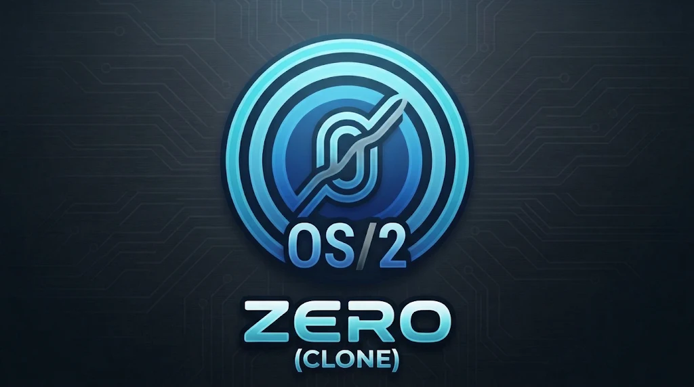

<h1 align="center">OS2-0 (OS/2 Zero)</h1>

<b>Un clone d'OS/2 Warp 3 écrit entièrement en Pascal : du secteur d'amorce au Workplace Shell.</b>

OS2-0 est un système d'exploitation 32 bits qui reproduit OS/2 Warp 3 : un noyau multitâche protégé, les bibliothèques de l'API d'OS/2 (DOSCALLS, VIOCALLS, KBDCALLS, MOUCALLS, PMWIN, PMGPI, PMMERGE et une trentaine d'autres DLL, IFS compris), Presentation Manager et un bureau Workplace Shell avec ses dossiers d'objets, son LaunchPad et ses carnets de paramètres. Tout est écrit en Pascal, plus de 240 000 lignes, et compilé par **OS2PC**, le compilateur du projet, qui produit le secteur d'amorce, le chargeur, le noyau, les DLL et les programmes. OS2PC se compile aussi lui-même : OS2-0 peut donc reconstruire ses propres programmes avec Pascal Developer, son environnement de développement.

OS2-0 démarre d'un CD-ROM ou d'un disque dur, dans QEMU, VirtualBox (y compris au-dessus de Hyper-V) ou VMware.

<table>
	<tr>
		<td align="center">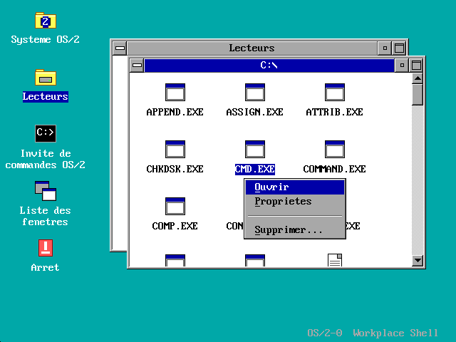 <i>Le bureau (Workplace Shell) et ses dossiers d'objets</i></td>
		<td align="center"> <i>Explorateur OS2-Zero, un explorateur à deux volets</i></td>
	</tr>
	<tr>
		<td align="center"> <i>Navigateur Web : HTML, CSS, JavaScript, HTTPS (TLS 1.3)</i></td>
		<td align="center">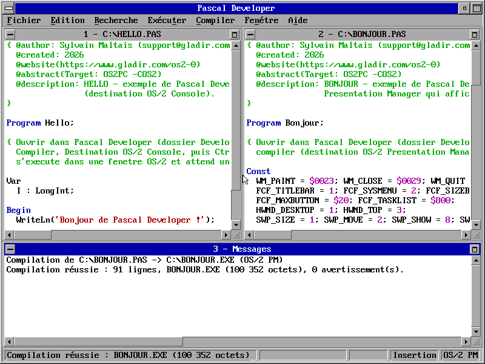 <i>Pascal Developer : compiler et exécuter dans OS/2-0</i></td>
	</tr>
</table>

<h2>Ce qu'OS2-0 sait faire</h2>

<ul>
	<li><b>Noyau 32 bits</b> (OS2KRNL) : mode protégé, pagination, tâches préemptives, sessions plein écran et fenêtrées, chargeur de programmes et de DLL 32 bits (PE et LX), programmes 16 bits d'OS/2 1.x (NE) et machine virtuelle DOS en mode V86 (Turbo Pascal 7, BGI, DPMI).</li>
	<li><b>Systèmes de fichiers</b> : HPFS par défaut, NTFS en lecture, écriture et formatage pour partager ses fichiers avec Windows et Linux, FAT12 sur disquette, ISO 9660 sur CD-ROM, disque virtuel en mémoire ; pilotes IFS chargés par <code>IFS=</code> de CONFIG.SYS.</li>
	<li><b>Presentation Manager et Workplace Shell</b> : fenêtres, menus, contrôles, GPI, presse-papiers, glisser-déposer, raccourcis, modèles, LaunchPad, carnets Système, Souris, Pays et Langue ; de 640 × 480 en 16 couleurs (VGA) à 1024 × 768 en 16 millions de couleurs (VESA).</li>
	<li><b>Applications</b> : Explorateur OS2-Zero, Calculatrice, Paint (dessin bitmap), WorDium (traitement de texte : DOCX, PDF, GAT du MonsterBook, correcteur d'orthographe), Excelsior (tableur : XLC, XLS, XLSX, formules, graphiques), Outlink (courrier IMAP, POP3 et SMTP), Navigateur Web, Gestionnaire des tâches, Gestionnaire de périphériques, Audio numérique, Lecteur MP3, Notator for OS2-Zero, Essai OpenGL (OPENGL.DLL, OpenGL 1.1), Client FTP (FTP et SFTP) et Client SSH (terminal xterm, SFTP, macros) du dossier Outils réseau, Pascal Developer, Astromancie (interprétation de l'astrologie) et Onirologie (interprétation des rêves) du dossier Loisirs, Astronomie, Simulateur de planète, Anatomie 3D du système circulatoire, Table des éléments et Dessin de chimie du dossier Science, Maximilien CRM, Sample Accounting, Acrodoc (PDF), News Master, PresentPoint et Bloc-notes du dossier Productivité, OS2-Zero Debugger (débogueur graphique dans l'esprit de Turbo Debugger) du dossier Developer Kit, jeux (Solitaire Klondike, Échecs, Mahjongg, Sudoku, Othello, TileMan, Hex 2048, Backgammon, Poker, Billard, Checkers, Yahtzee, Bataille navale, Puissance 4, Soko-Ban, Baccarat, Tours de Hanoï, Baby, 421, Mille-pattes, Astéroïde, Badugi, Tic-Tac-Toe, Baseball, Excavateur, Pinball, Barbu, Casse-Brique, Bataille, Invasion de l'espace, FreeCell, Commandement des missiles, L25), fenêtres OS/2 et DOS, les commandes d'OS/2 (CMD.EXE, CHKDSK, FORMAT, XCOPY, MODE, TREE…).</li>
	<li><b>Matériel</b> : disques IDE et ATAPI, lecteur de disquettes, cartes son (Sound Blaster, AC'97, AudioPCI), réseau (Intel PRO/1000, AMD PCnet) avec pile TCP/IP, DHCP, DNS et TLS ; outils invités de VirtualBox et de VMware (souris absolue, écran redimensionnable).</li>
	<li><b>Installation</b> graphique dans le style de Warp 3, sur une partition HPFS ou NTFS, en six langues.</li>
</ul>

<h2>Essayer OS2-0</h2>

Construire les images (Free Pascal) puis démarrer le CD-ROM dans QEMU :

<pre>KERNEL/BUILD.sh
qemu-system-i386 -m 64 -cdrom IMAGE/OS2CD.ISO -boot d</pre>

Installer sur un disque dur, puis démarrer depuis le disque :

<pre>qemu-img create -f raw disque.img 300M
qemu-system-i386 -m 64 -cdrom IMAGE/OS2INST.ISO -hda disque.img -boot d
qemu-system-i386 -m 64 -hda disque.img</pre>

Sous Windows, <code>KERNEL\BUILD.BAT</code> fait la même construction. La documentation complète d'OS2-0 est dans <a href="IMAGE/LISEZMOI.TXT">IMAGE/LISEZMOI.TXT</a>, également copiée sur le CD-ROM.

<h2>Liste des fichiers</h2>

Voici la liste des différents fichiers proposés dans OS2-0 :

<table>
		<tr>
			<th>Nom</th>
			<th>Description</th>	
		</tr>
		<tr>
		 	<td><b>APPEND.PAS</b></td>
			<td>Cette commande permet d'ouvrir des fichiers quelconque se trouvant dans les répertoires spécifiés comme s'il s'agissait du répertoire courant.</td>
		</tr>
		<tr>
			<td><b>ASSIGN.PAS</b></td>
			<td>Cette commande permet de créer un disque virtuel à partir d'un autre disque.</td>
		</tr>
		<tr>
			<td><b>ATTRIB.PAS</b></td>
			<td>Cette commande permet de demander ou de changer les attributs d'un fichier.</td>
		</tr>
		<tr>
			<td><b>BROWSER.PAS</b></td>
			<td>Navigateur Web de Presentation Manager avec l'apparence d'OS/2 Warp 3 (adapté du BROWSER.PAS de DEV-COOLS) : HTML, CSS, JavaScript, images GIF, PNG, JPEG et BMP, code source, codes QR, menu contextuel et outils de développement F12 (Inspecteur, Débogueur, Éditeur de style, Console, Réseau).</td>
		</tr>
		<tr>
			<td><b>CALC.PAS</b></td>
			<td>Calculatrice de Presentation Manager (bureau → Productivité), portée de celle de Pasdows 95 vers l'API d'OS/2 (PMWIN, PMGPI) et l'apparence de Warp 3 : mode Standard, mémoire, presse-papiers de PM.</td>
		</tr>
		<tr>
			<td><b>CHKDSK.PAS</b></td>
			<td>Cette commande permet de vérifier le disque. Cette commande est inspiré du DOS.</td>
		</tr>		
		<tr>
			<td><b>CMD.PAS</b></td>
			<td>Cette commande permet de lancer l'interpréteur de commande OS/2. Il s'agit d'un équivalent du CMD de OS/2.</td>
		</tr>  
		<tr>
			<td><b>COMMAND.PAS</b></td>
			<td>Logiciel clone d'un <i>COMMAND.COM</i> du système d'exploitation <a href="https://www.gladir.com/OS/DOS/intro.htm"><i>DOS</i></a>.</td>
		</tr>
		<tr>
			<td><b>COMP.PAS</b></td>
			<td>Cette commande permet de comparer deux fichiers. Cette commande est un equivalent du <a href="https://www.gladir.com/OS/PCDOS/intro.htm">PC-DOS</a> ou <a href="https://www.gladir.com/OS/MSDOS/intro.htm">MS-DOS</a>.</td>
		</tr>
		<tr>
			 <td><b>DEBUG.PAS</b></td>
			 <td>Cette commande permet de deboguer un programme.</td>
		</tr>
		<tr>
			<td><b>DISKCOMP.PAS</b></td>
			<td>Cette commande permet de comparer des disquettes ou des images.</td>
		</tr>		
		<tr>
		    	<td><b>DISKCOPY.PAS</b></td>
		    	<td>Cette commande permet de copier des disquettes ou des images.</td>
		</tr>	
		<tr>
			<td><b>DOSKEY.PAS</b></td>
			<td>Cette commande permet de charger le programme DOSKEY.</td>
		</tr>
		<tr>
			<td><b>EDLIN.PAS</b></td>
			<td>Cette commande permet de lancer l'éditeur en ligne de commande.</td>
		</tr>
		<tr>
			<td><b>EXE2BIN.PAS</b></td>
			<td>Cette commande permet de convertir un fichier EXE en binaire (COM).</td>
		</tr>
		<tr>
			<td><b>EXPLORER.PAS</b></td>
			<td>Explorateur OS2-Zero : explorateur de fichiers à deux volets dans le style de Windows 95 (arbre des dossiers, Grandes icônes ou Détails, barre d'état, Connecter un lecteur réseau), porté de l'Explorateur Pasdows ; application de Presentation Manager indépendante (bureau → Productivité, menu contextuel du bureau).</td>
		</tr>
		<tr>
			<td><b>FIND.PAS</b></td>
			<td>Cette commande permet de rechercher une chaine de caractères dans des fichiers. Cette commande est un équivalent du DOS.</td>
		</tr>
		<tr>
			<td><b>FORMAT.PAS</b></td>
			<td>Cette commande permet de formater un unite de disquette.</td>
		</tr>
		<tr>
			<td><b>GRAFTABL.PAS</b></td>
			<td>Cette commande permet d'effectuer le chargement en mémoire conventionnelle d'une table de police de caractères pour les modes graphiques.</td>
		</tr>
		<tr>
			<td><b>LABEL.PAS</b></td>
			<td>Cette commande permet de changer le nom d'un volume.</td>
		</tr>
		<tr>
			<td><b>MEM.PAS</b></td>
			<td>Cette commande permet d'afficher les informations sur la mémoire. Cette commande est un clone de la commande MS-DOS ou PC-DOS.</td>
		</tr>
		<tr>
			<td><b>MODE.PAS</b></td>
			<td>Cette commande permet d'effectuer la gestion des paramètres d'un périphérique.</td>
		</tr>
		<tr>
			<td><b>MORE.PAS</b></td>
			<td>Cette commande permet de recevoir l'entrée puis l'affichage sur un périphérique un écran à la fois.</td>
    		</tr>	
    		<tr>
			<td><b>MOVE.PAS</td>
			<td>Cette commande permet de déplacer un fichier.</td>
		</tr>
		<tr>
			<td><b>OUTLINK.PAS</b></td>
			<td>Outlink : client de messagerie dans l'esprit d'Outlook, porté de <code>OUTLOOK.PAS</code> du dépôt OFFICE-0 vers Presentation Manager (bureau → Productivité) ; réception IMAP et POP3, envoi SMTP, TLS et STARTTLS, par les sockets de TCPIP32.DLL et TLS32.DLL.</td>
		</tr>
		<tr>
			<td><b>WORDIUM.PAS</b></td>
			<td>WorDium : traitement de texte porté de <code>WORD.PAS</code> du dépôt OFFICE-0 vers Presentation Manager (bureau → Productivité) ; formats WPD, DOCX, DOC, PDF et GAT du MonsterBook, correcteur d'orthographe en cinq langues, impression par le tampon d'impression d'OS/2.</td>
		</tr>
		<tr>
			<td><b>EXCELSIO.PAS</b></td>
			<td>Excelsior : tableur porté de <code>EXCEL.PAS</code> du dépôt OFFICE-0 vers Presentation Manager (bureau → Productivité) ; 16 feuilles de 4096 lignes sur 256 colonnes, formules, graphiques, formats XLC, XLS (BIFF8) et XLSX.</td>
		</tr>
		<tr>
			<td><b>APPS/PAINT.PAS</b></td>
			<td>Paint : programme de dessin bitmap dans l'esprit de Paint, porté de Pasdows 95 (CloneDRAW) vers Presentation Manager (bureau → Productivité).</td>
		</tr>
		<tr>
			<td><b>PASDEV.PAS</b></td>
			<td>Pascal Developer : environnement de développement intégré Pascal de Presentation Manager (dossier Developer Kit du bureau), dans l'esprit de Borland Pascal mais avec l'apparence d'OS/2 : fenêtres d'édition MDI à coloration syntaxique, compilation par OS2PC.EXE, exécution, boîte Information.</td>
		</tr>
		<tr>
			<td><b>GETSRC.PAS</b></td>
			<td>Télécharger le code source d'OS2-Zero (dossier Developer Kit du bureau) : copie le code source actuel d'OS/2-0 depuis GitHub dans C:\SOURCE\OS2-0\ (sans les données de Git), avec barre de progression ; Mettre à jour ne copie que les fichiers modifiés.</td>
		</tr>
		<tr>
			<td><b>APPS/OS2DBG.PAS</b></td>
			<td>OS2-Zero Debugger (dossier Developer Kit du bureau) : débogueur des programmes d'OS/2-0 dans l'esprit de Turbo Debugger, avec l'apparence de Presentation Manager : désassembleur x86 32 bits coloré, registres, mémoire, pile, points d'arrêt, pas à pas, exceptions.</td>
		</tr>
		<tr>
			<td><b>APPS/NOTEPAD.PAS</b></td>
			<td>Bloc-notes (dossier Productivité du bureau) : le Bloc-notes de Pasdows 95 porté de l'API Win32 vers celle d'OS/2 (PMWIN, DOSCALLS).</td>
		</tr>
		<tr>
			<td><b>REPLACE.PAS</b></td>
			<td>Cette commande permet de remplacer un fichier. Cette commande est un équivalent du DOS.</td>
		</tr>
		<tr>
			<td><b>SORT.PAS</b></td>
			<td>Cette commande permet de trier une fichier texte ASCII et de retourner le résultat. Cette commande est un équivalent de la commande du DOS.</td>
		</tr>
		<tr>
			<td><b>TASKMGR.PAS</b></td>
			<td>Gestionnaire des tâches de Presentation Manager : applications, processus, performances (processeur et mémoire), réseau et utilisateurs, dans le style du Gestionnaire des tâches de Windows XP avec l'apparence d'OS/2 Warp 3.</td>
		</tr>
		<tr>
			<td><b>TREE.PAS</b></td>
			<td>Cette commande permet d'afficher un arbre de répertoire.</td>
		</tr>
		<tr>
			<td><b>XCOPY.PAS</b></td>
			<td>Cette commande permet d'effectuer la copie étendue avec sous-répertoire de fichier(s) vers un nouvel emplacement.</td>
		</tr>
	</table>

<h2>Documentation détaillée</h2>

La description complète de chaque partie d'OS2-0 (API, bibliothèques, programmes, captures d'écran) est dans le dossier <b>DOC</b> :

<table>
	<tr><th>Document</th><th>Contenu</th></tr>
	<tr><td><a href="DOC/NOYAU.md"><b>Noyau OS/2 32 bits et bibliothèques de base</b></a></td><td>Le noyau, le CD-ROM amorçable, le multitâche et les sessions, DOSCALLS, FKA, HPFS.IFS, NTFS.IFS, VIOCALLS, MOUCALLS, NLS, KBDCALLS, MONCALLS, MSG, NAMPIPES, SESMGR, QUECALLS, SPOOLCP, RMINFO, OS2SM, HELPMGR et LIBUNI.</td></tr>
	<tr><td><a href="DOC/PM.md"><b>Presentation Manager</b></a></td><td>PMDRAG, PMWIN, PMGPI, PMMERGE, PMPIC, PMSHAPI, PMSPL, PMVIOP et les fenêtres OS/2.</td></tr>
	<tr><td><a href="DOC/BUREAU.md"><b>Bureau (Workplace Shell), installation et démarrage</b></a></td><td>Le bureau PMSHELL.EXE, les carnets Système, Souris et Pays, le menu Nouveau, Couper, Copier, Coller, Renommer, le LaunchPad, l'installation sur disque dur et l'écran de démarrage.</td></tr>
	<tr><td><a href="DOC/APPLICATIONS.md"><b>Applications</b></a></td><td>Loisirs, Science, Productivité (Maximilien CRM, Sample Accounting, Acrodoc, News Master, PresentPoint), Bloc-notes, Calculatrice, Paint, WorDium, Excelsior, Outlink et le Gestionnaire des tâches.</td></tr>
	<tr><td><a href="DOC/RESEAU.md"><b>Explorateur, réseau et Web</b></a></td><td>L'Explorateur OS2-Zero, les lecteurs réseau (SMB), le Client FTP, le Client SSH et le Navigateur Web.</td></tr>
	<tr><td><a href="DOC/MULTIMEDIA.md"><b>Multimédia</b></a></td><td>Audio numérique, MDM.DLL et les pilotes des cartes son, le Lecteur MP3, OpenGL et Notator for OS2-Zero.</td></tr>
	<tr><td><a href="DOC/VIRTUALISATION.md"><b>Machines virtuelles, sessions DOS et anciens programmes</b></a></td><td>VirtualBox, VMware Workstation, les sessions DOS (Turbo Pascal), les programmes d'OS/2 2.x et 1.x et IBM Works.</td></tr>
	<tr><td><a href="DOC/DEVELOPPEMENT.md"><b>Développement</b></a></td><td>Pascal Developer et le dossier Developer Kit, le téléchargement du code source et OS2-Zero Debugger.</td></tr>
</table>

<h2>Jeux (KLONDIKE.PAS, ECHECS.PAS, MAHJONGG.PAS, SUDOKU.PAS, OTHELLO.PAS, TILEMAN.PAS, HEX2048.PAS, BACKGAM.PAS, POKER.PAS, BILLARD.PAS, CHECKERS.PAS, YATHZEE.PAS, BATTLE.PAS, POWER4.PAS, SOKOBAN.PAS, BACCARAT.PAS, HANOIS.PAS, BABY.PAS, 421.PAS, CENTIPED.PAS, ASTEROID.PAS, BADUGI.PAS, TTT.PAS, BASEBALL.PAS, EXCAVAT.PAS, PINBALL.PAS, BARBU.PAS, BREAKOUT.PAS, BATAILLE.PAS, INVADERS.PAS, FREECELL.PAS, MISSILE.PAS, L25.PAS)</h2>

Comme OS/2 Warp 3, le bureau a un dossier <b>Jeux</b> avec trente-trois jeux de Presentation Manager, écrits en Pascal et compilés par OS2PC. Ce sont des réalisations originales des jeux traditionnels (dessins vectoriels faits par les programmes, aucune image d'IBM). Ils s'exécutent dans la session de Presentation Manager, en même temps que le bureau ; le programme d'installation les copie si le composant « Jeux » est choisi (le dossier n'affiche que les jeux présents).

<table>
	<tr><th>Jeu</th><th>Description</th></tr>
	<tr><td><b>Solitaire - Klondike</b> (KLONDIKE.EXE)</td><td>La patience Klondike : pioche, défausse, quatre fondations (de l'as au roi par couleur), sept colonnes (rouge et noir en alternance, un roi seul dans une colonne vide). Glisser une carte (et celles qui la recouvrent) ou cliquer la carte puis sa destination ; double clic : vers sa fondation ; une carte cachée se retourne d'un clic. Menus Partie (Nouvelle partie F2, Annuler Ctrl+Z, Terminer automatiquement), Options (tirer 1 ou 3 cartes), Aide. Score : fondation +10, défausse vers une colonne +5, carte retournée +5, fondation vers une colonne −15, pioche recyclée −100 (tirage de 1). Paramètre <code>/SEED:n</code> : donne reproductible.</td></tr>
	<tr><td><b>Échecs</b> (ECHECS.EXE)</td><td>Toutes les règles : roque (petit et grand), prise en passant, promotion, échec, mat, pat, règle des 50 coups, matériel insuffisant. L'ordinateur joue les noirs (ou les blancs, ou personne : Deux joueurs) : recherche alpha-bêta à 1, 2 ou 3 demi-coups selon le niveau (facile, moyen, difficile), puis recherche des prises ; évaluation par le matériel et la position des pièces. Cliquer une pièce marque ses cases d'arrivée ; dernier coup encadré ; liste des coups en notation française (R, D, T, F, C ; <code>O-O</code>, <code>+</code>, <code>#</code>) ; Ctrl+Z annule le coup du joueur et la réponse.</td></tr>
	<tr><td><b>Mahjongg Solitaire</b> (MAHJONGG.EXE)</td><td>144 tuiles en cinq étages selon la disposition de la tortue : cercles, bambous et caractères de 1 à 9, vents (E, S, O, N), dragons rouge, vert et blanc (4 de chaque), 4 fleurs et 4 saisons (deux fleurs ou deux saisons forment une paire). On retire les paires de tuiles libres (rien dessus, côté gauche ou droit dégagé). Chaque donne est faisable : elle est construite en vidant un plateau plein par paires de tuiles libres. Indice (I), Annuler (Ctrl+Z), Recommencer la partie, nombre de tuiles et de paires jouables, fin de partie détectée ; <code>/SEED:n</code>.</td></tr>
	<tr><td><b>Sudoku</b> (SUDOKU.EXE)</td><td>Porté du prototype <code>SODOKU.PAS</code> du dépôt 7iles (Turbo Pascal et BGI, clavier seulement) vers Presentation Manager. Remplir la grille de 9 × 9 pour que chaque ligne, colonne et carré de 3 × 3 contienne une fois les chiffres de 1 à 9. Chaque grille est construite au hasard (solution complète par retour arrière, puis cases retirées par paires symétriques tant que la solution reste unique ; le prototype ne vérifiait pas les carrés) ; niveaux Facile, Moyen et Difficile (38, 30 et 25 chiffres donnés environ). Cliquer une case puis un chiffre du pavé, ou taper 1 à 9 ; bouton 2, Suppr ou Espace : effacer. Chiffres donnés sur fond gris, les vôtres en bleu, ceux en conflit en rouge, le même chiffre éclairé dans toute la grille. Menu Partie : nouvelle partie (F2), recommencer, annuler (Ctrl+Z), indice (I), vérifier (V : chiffres faux sur fond rouge), solution, niveau ; chronomètre dans la barre d'état ; <code>/SEED:n</code>.</td></tr>
	<tr><td><b>Othello</b> (OTHELLO.EXE)</td><td>Porté du prototype <code>OTHELLO.PAS</code> du dépôt 7iles (Turbo Pascal et BGI, clavier seulement, écran de titre) vers Presentation Manager. Avoir le plus de pions de sa couleur à la fin : chaque coup doit encadrer en ligne droite au moins un pion adverse, et tous les pions encadrés sont retournés ; qui ne peut pas jouer passe son tour (automatiquement), la partie finit quand personne ne peut jouer. Contre l'ordinateur (vous jouez les noirs) ou à deux joueurs ; niveaux Facile (coup glouton avec du hasard, comme le prototype), Moyen (poids des cases et mobilité) et Difficile (recherche alpha-bêta sur quatre demi-coups). Cliquer une case, ou flèches et Entrée ; coups possibles marqués d'un point, dernier coup d'un carré rouge ; H : indices (nombre de pions retournés par chaque coup) ; Ctrl+Z annule jusqu'au dernier coup du joueur ; panneau des scores, menus Partie et Aide, barre d'état ; résultat en fin de partie. <code>/SEED:n</code> ; <code>/AUTO</code> : l'ordinateur joue les deux couleurs (démonstration).</td></tr>
	<tr><td><b>TileMan</b> (TILEMAN.EXE)</td><td>Porté du prototype <code>TILEMAN.PAS</code> du dépôt 7iles (Turbo Pascal et BGI, clavier seulement, écrans de titre et de fin) vers Presentation Manager. Conquête de terrain sur 35 × 25 cases : le disque jaune part de son territoire (tuiles bleues) et laisse une trace (cyan) en dehors ; en y revenant, la trace et toutes les zones fermées sans ennemi deviennent territoire (le prototype ne gardait que les zones entourées, sans toucher les murs). Les ennemis rouges rebondissent en diagonale sur les murs et le territoire ; s'ils touchent le joueur ou sa trace, ou si le joueur recoupe sa trace, une vie de moins (trois vies) et retour au point de sortie. Niveau terminé à 75 % du terrain (bonus) ; chaque niveau ajoute un ennemi et les accélère. Flèches, Espace (s'arrêter dans son territoire), P ou Pause ; vitesse lente, normale ou rapide ; panneau (pointage, niveau, vies, trace, barre de progression avec l'objectif) ; bandeaux de niveau, de pause et de fin. Dessin seulement de ce qui change (pas de scintillement) ; le jeu s'arrête de lui-même pendant les menus et les boîtes de message. <code>/SEED:n</code> ; <code>/AUTO</code> : pilote automatique (démonstration).</td></tr>
	<tr><td><b>Hex 2048</b> (HEX2048.EXE)</td><td>Porté du prototype <code>HEX2048.PAS</code> du dépôt 7iles vers Presentation Manager. Le 2048 sur une grille hexagonale de 19 cases (3-4-5-4-3) : glisser toutes les tuiles dans une des six directions ; deux tuiles égales qui se rencontrent fusionnent une fois par glissement, le pointage gagne leur somme, une tuile (2, ou 4 une fois sur dix) apparaît ; atteindre 2048 (continuer ensuite), fin quand plus rien ne glisse. Le prototype ne déplaçait chaque tuile que d'une case et ajoutait quatre tuiles par coup. Touches Q W E A S D (comme le prototype), 7 8 9 1 2 3 du pavé numérique, Début, Pg préc, Fin, Pg suiv, flèches haut et bas ; clic sur le plateau du côté où glisser, ou sur la rose des directions ; Ctrl+Z annule le dernier glissement ; tuiles en relief avec une couleur par valeur, nouvelle tuile qui apparaît en grandissant ; meilleur pointage de la séance. <code>/SEED:n</code> ; <code>/AUTO</code> : l'ordinateur joue seul.</td></tr>
	<tr><td><b>Backgammon</b> (BACKGAM.EXE)</td><td>Porté du prototype <code>BACKGAM.PAS</code> du dépôt 7iles (coups tapés par lettres de cases) vers Presentation Manager, avec les règles complètes que le prototype n'avait pas : barre et entrée, pions frappés, sortie des pions (avec un dé plus fort si aucun pion plus loin), obligation de jouer le plus de dés possible (ou le plus fort), doubles joués quatre fois, lancer d'ouverture, gammon et backgammon (2 et 3 points). Plateau en bois avec les numéros des cases, pions blancs (vous) et noirs (l'ordinateur), plateau de sortie, dés dessinés (grisés une fois joués). Lancer les dés (bouton, Espace ou clic sur le plateau), cliquer un pion blanc : ses cases d'arrivée sont marquées d'un point jaune ; Ctrl+Z remet les pions du tour ; les coups de l'ordinateur sont joués un à un, ses cases d'arrivée marquées en cyan. L'ordinateur Normal évalue toutes ses suites de coups (course, pions exposés aux coups directs et indirects, cases faites, barrages, pions sur la barre) ; Facile joue au hasard. Panneau : course (pips) et pions sortis de chacun, parties gagnées. <code>/SEED:n</code> ; <code>/AUTO</code> : l'ordinateur joue les deux couleurs.</td></tr>
	<tr><td><b>Poker</b> (POKER.EXE)</td><td>Porté du prototype <code>POKER.PAS</code> du dépôt 7iles (Turbo Pascal et BGI) vers Presentation Manager. Poker à cinq cartes (draw) contre l'ordinateur : chacun mise (10, 25, 50 ou 100 $ ; 50 $ comme le prototype) et reçoit cinq cartes ; on choisit les cartes à échanger (clic ou 1 à 5), puis Abattre, Relancer (doubler la mise : l'ordinateur suit ou se couche selon sa main) ou Se coucher. Mains nommées en français (« Paire de rois », « Full aux dames par les 3 »…) ; à combinaison égale, les hauteurs départagent (le prototype ne comparait que les combinaisons). L'ordinateur échange comme un joueur (garde ses paires, tire à la couleur ou à la quinte ouverte, sinon garde sa figure). Cartes dessinées comme celles du Solitaire, tapis vert, argent (1000 $ au départ), donnes gagnées ; menu Aide : règles et liste des combinaisons. <code>/SEED:n</code>.</td></tr>
	<tr><td><b>Billard</b> (BILLARD.EXE)</td><td>Porté du prototype <code>BILLARD.PAS</code> du dépôt 7iles (visée aux flèches, écran de titre) vers Presentation Manager. Billard américain à 8 boules : après la casse, le premier qui empoche prend les pleines (1 à 7) ou les rayées (9 à 15) ; on rejoue tant qu'on empoche une de ses boules sans faute ; la 8 en dernier (trop tôt ou avec une faute : partie perdue) ; fautes : blanche empochée (remise sur son point), aucune boule touchée, première boule touchée qui n'est pas des siennes. Physique en virgule fixe : frottement du tapis, chocs élastiques entre boules, rebonds amortis sur les bandes, six poches. Visée à la souris (la queue suit le pointeur ; ligne de visée et boule fantôme sur la première boule touchée) ; maintenir le bouton dose la puissance (jauge), le relâcher tire ; ou flèches, Espace (puissance) et Entrée comme le prototype. Contre l'ordinateur (il vise la boule la mieux placée vers une poche par la méthode de la boule fantôme ; Facile ou Normal) ou à deux joueurs. La table est dessinée dans une image en mémoire de 256 couleurs, affichée par GpiDrawBits seulement là où les boules bougent : pas de scintillement. <code>/SEED:n</code> ; <code>/AUTO</code>.</td></tr>
	<tr><td><b>Checkers</b> (CHECKERS.EXE)</td><td>Porté du prototype <code>CHECKERS.PAS</code> du dépôt 7iles (deux curseurs au clavier, historique des coups) vers Presentation Manager. Dames anglaises sur les cases foncées : un pion avance d'une case en diagonale et prend en sautant (vers l'avant), en rafle tant qu'il peut ; prise obligatoire ; un pion qui atteint la dernière rangée devient dame (couronne) et va dans les quatre directions ; plus de pion ou de coup : partie perdue ; 40 coups chacun sans prise ni pion avancé : nulle (le prototype n'avait ni prise obligatoire, ni rafle, ni prise par les dames). Contre l'ordinateur (recherche alpha-bêta qui poursuit les prises au-delà de l'horizon ; Facile, Moyen, Difficile) ou à deux ; on choisit qui commence, comme le prototype. Clic sur un pion puis sur une case marquée d'un point (une rafle se joue sur sa case d'arrivée), ou flèches et Entrée ; dernier coup encadré ; liste des coups en notation du prototype (colonne et rangée, <code>x</code> pour une prise) ; Ctrl+Z. <code>/SEED:n</code> ; <code>/AUTO</code>.</td></tr>
	<tr><td><b>Yahtzee</b> (YATHZEE.EXE)</td><td>Porté du prototype <code>YATHZEE.PAS</code> du dépôt 7iles (mode texte, feuille de pointage en caractères semi-graphiques) vers Presentation Manager. Treize tours d'au plus trois lancers de cinq dés ; on garde des dés d'un clic (ou 1 à 5) entre les lancers, puis on clique une case libre de sa colonne, où les points possibles sont affichés en gris sur fond jaune. Section supérieure (as à six, prime de 35 à partir de 63 points), brelan, carré, full (25), petite suite (30), grande suite (40), Yahtzee (50, puis prime de 100 par Yahtzee de plus), chance. Seul (comme le prototype), contre l'ordinateur (il garde ses dés selon les cases libres et choisit la case qui rapporte le plus) ou à deux joueurs ; dés qui roulent ; meilleur pointage de la séance. <code>/SEED:n</code> ; <code>/AUTO</code>.</td></tr>
	<tr><td><b>Bataille navale</b> (BATTLE.EXE)</td><td>Jeu écrit pour OS/2-0 (sans prototype), le jeu classique de la bataille navale : chaque joueur place en secret sa flotte sur une grille de 10 × 10 (porte-avions 5 cases, cuirassé 4, croiseur 3, sous-marin 3, torpilleur 2), puis on tire chacun son tour sur une case de la grille adverse : dans l'eau (point blanc), touché (feu), touché-coulé ; le premier qui coule toute la flotte adverse gagne. Option tir en salve : autant de tirs par tour que de navires encore à flot. Chaque type de navire a sa silhouette : vue de dessus sur la grille (pont d'envol et îlot du porte-avions, trois tourelles du cuirassé, kiosque du sous-marin…) et de profil sur l'eau dans le panneau de placement et la liste de la flotte. Placement à la souris (le navire suit le pointeur, vert s'il tient, rouge sinon ; bouton 2 ou R : pivoter ; un clic sur un navire placé le reprend) ou au clavier, ou au hasard (A). Modes : humain contre l'ordinateur (par défaut), deux joueurs (un rideau cache la flotte de l'autre entre les tours) et ordinateur contre ordinateur. L'ordinateur Normal tire selon la densité des positions encore possibles des navires restants et achève les navires touchés ; Facile tire au hasard autour de ses coups au but. En cinq langues : français, anglais, espagnol, italien et allemand (menu Langue, qui refait les menus ; au départ la langue du système, <code>SET LANGUAGE=</code> de CONFIG.SYS, ou <code>/LANG:FR</code>, <code>EN</code>, <code>ES</code>, <code>IT</code>, <code>DE</code>). <code>/SEED:n</code> ; <code>/AUTO</code>.</td></tr>
	<tr><td><b>Puissance 4</b> (POWER4.EXE)</td><td>Porté du prototype <code>POWER4.PAS</code> du dépôt 7iles (Turbo Pascal et BGI) vers Presentation Manager. Aligner quatre jetons de sa couleur (horizontale, verticale ou diagonale) sur la grille de 7 colonnes et 6 rangées ; chaque jeton tombe au plus bas de la colonne choisie (chute animée) ; grille pleine : nulle ; l'alignement gagnant est marqué. Contre l'ordinateur (vous avez les rouges, comme le prototype ; l'ordinateur peut commencer) ou à deux joueurs. L'ordinateur cherche par alpha-bêta (Facile 2 demi-coups avec du hasard, Moyen 5, Difficile 7) en comptant les alignements encore possibles ; le prototype ne voyait que le coup gagnant immédiat. Clic sur une colonne (le jeton suit la souris au-dessus de la grille), flèches et Entrée, 1 à 7 ; Ctrl+Z annule jusqu'au dernier coup du joueur ; victoires et parties nulles comptées. <code>/SEED:n</code> ; <code>/AUTO</code>.</td></tr>
	<tr><td><b>Soko-Ban</b> (SOKOBAN.EXE)</td><td>Porté du prototype <code>SOKOBAN.PAS</code> du dépôt 7iles (1992, Turbo Pascal en mode texte) vers Presentation Manager, avec ses 85 étages repris tels quels. Pousser toutes les caisses sur les cibles : le magasinier pousse une caisse à la fois en marchant contre elle, il ne peut ni tirer ni pousser deux caisses. Murs de briques roses en relief, caisses en bois (vertes une fois rangées), cibles en losange, magasinier dessiné. Flèches pour marcher et pousser ; clic sur une case libre : le magasinier y va par le plus court chemin (sans pousser) ; clic sur une caisse voisine : la pousser. Annulation illimitée (Ctrl+Z ou Retour arrière), F10 ou Échap (recommencer), F8 et F9 (étage précédent et suivant, comme le prototype), choix de l'étage parmi les 85 (F2 ; étages réussis en vert), démonstration de l'étage 1 (F3, la solution du prototype) ; pas, poussées, caisses rangées, record de la séance. <code>/LEVEL:n</code> ; <code>/DEMO</code>.</td></tr>
	<tr><td><b>Baccarat</b> (BACCARAT.EXE)</td><td>Porté du prototype <code>BACCARAT.PAS</code> du dépôt 7iles (Turbo Pascal et BGI) vers Presentation Manager : tapis vert, mains du Joueur et du Banquier, cartes dessinées (comme le Poker) montrées une à une, trois cases de mise cliquables (Joueur 1 pour 1, Banquier 0,95 pour 1, Égalité 8 pour 1) avec le jeton de la mise, sabot de six jeux, panneau de l'argent (1000 $ au départ, comme le prototype) et historique des 18 derniers coups. Règle classique du tirage (naturel 8 ou 9, troisième carte du Joueur avec 0 à 5, tableau du Banquier) ; contrairement au prototype, le naturel est appliqué et un gain rend aussi la mise. 1, 2, 3 (case), + et - (mise), Espace (distribuer), donne rapide (menu). <code>/SEED:n</code>.</td></tr>
	<tr><td><b>Tours de Hanoï</b> (HANOIS.EXE)</td><td>Porté du prototype <code>HANOIS.PAS</code> du dépôt 7iles (2011, mode texte) : socle et tiges de bois, disques de couleur en relief. Comme le prototype, la pile est sur la tige 2 et doit aller sur la tige 1 ou 3, sans poser un disque sur un plus petit (127 coups au moins pour 7 disques). Souris (cliquer une tige pour prendre son disque, puis une autre pour le poser) ou clavier (1, 2, 3 comme le « De : » et « à : » du prototype, flèches et Espace), annulation (Ctrl+Z), 3 à 8 disques (menu Disques), solution animée depuis la position courante (F3), record par nombre de disques. <code>/DISKS:n</code> ; <code>/SOLVE</code>.</td></tr>
	<tr><td><b>Baby</b> (BABY.EXE)</td><td>Porté du prototype <code>BABY.PAS</code> du dépôt 7iles (2024, Turbo Pascal et BGI) avec ses images (immeuble en feu, 26 positions du bébé, pompiers, ambulance) : des bébés sautent de l'immeuble en feu et les deux pompiers doivent les faire rebondir trois fois sur leur toile jusqu'à l'ambulance. Image en mémoire (GpiDrawBits, seuls les rectangles changés sont recopiés), ciel de nuit étoilé, flammes animées, chaussée ; 25 points par bébé sauvé, vagues de 26 bébés de plus en plus rapides, trois vies. Flèches (comme le prototype), A B C ou 1 2 3, souris, pause (P). <code>/SEED:n</code> ; <code>/AUTO</code> (pompiers automatiques).</td></tr>
	<tr><td><b>421</b> (421.EXE)</td><td>Porté du prototype <code>421.PAS</code> du dépôt 7iles (Turbo Pascal et BGI) : piste de bois et de feutre, dés en relief qui roulent (le 1 rouge), 21 jetons par joueur, 11 manches. Trois lancers par manche en gardant des dés (clic ou 1 2 3, fond jaune) ; 421 (10 points), brelans (8), suites (6), sinon les as ; sur un 421 chaque autre joueur paie 2 jetons au gagnant, 1 sur un brelan ou une suite. Contre 1, 2 ou 3 ordinateurs (menu Options), qui s'arrêtent sur une combinaison. <code>/SEED:n</code> ; <code>/AUTO</code> ; <code>/OPP:n</code>.</td></tr>
	<tr><td><b>Mille-pattes</b> (CENTIPED.EXE)</td><td>Porté du prototype <code>CENTIPED.PAS</code> du dépôt 7iles (2024, mode texte de 40 × 23 caractères) vers Presentation Manager, en graphique : chaque caractère du prototype devient un carreau dessiné (jardin de nuit, bordure de pierres, champignons, mille-pattes avec tête et pattes, araignée, canon), dans une image en mémoire dont seuls les carreaux changés sont recopiés (GpiDrawBits). Les règles et les déplacements du prototype sont repris : un mille-pattes touché au milieu se coupe en deux et accélère, chaque anneau touché devient un champignon (violet), un champignon tient deux tirs, l'araignée invincible sème des champignons et détruit le canon ; pointage du prototype (50 au départ, −2 par tir, +10, +100). Un mille-pattes qui atteint la terre coûte une vie (le prototype terminait la partie). Flèches (ou 1 3, 4 6, 7 9 comme le prototype), Espace, souris (le canon suit la souris, clic pour tirer), trois vitesses (menu Options), pause. Bruitages joués par MDM.DLL (tir, champignon et anneau touchés, canon perdu, nouvelle vague ; menu Options, Son). <code>/SEED:n</code> ; <code>/AUTO</code> (canon automatique) ; <code>/NOSOUND</code>.</td></tr>
	<tr><td><b>Astéroïde</b> (ASTEROID.EXE)</td><td>Porté du prototype <code>ASTEROID.PAS</code> du dépôt 7iles (mode texte, vaisseau fixe au centre qui tourne et tire sur les astéroïdes venus des bords) vers Presentation Manager, en graphique : ciel étoilé avec nébuleuse et planète à anneaux, vaisseau dessiné qui pivote en douceur, astéroïdes de pierre ombrés et cratérisés aux contours irréguliers, tirs lumineux, explosions en particules, dans une image en mémoire dont seuls les rectangles changés sont recopiés (GpiDrawBits). Comme le prototype, le vaisseau reste au centre ; en plus, les astéroïdes arrivent par vagues de plus en plus rapides (une vague tous les 15 astéroïdes détruits), trois vies et un record. Flèches gauche et droite (tourner), Espace (tirer, tir continu en gardant la touche), souris (le vaisseau vise le pointeur, clic pour tirer), pause (P). Bruitages joués par MDM.DLL (tir, explosion des astéroïdes et du vaisseau, nouvelle vague ; menu Options, Son). <code>/SEED:n</code> ; <code>/AUTO</code> (visée automatique) ; <code>/NOSOUND</code>.</td></tr>
	<tr><td><b>Badugi</b> (BADUGI.EXE)</td><td>Porté du prototype <code>BADUGI.PAS</code> du dépôt 7iles (poker coréen à quatre cartes) : tapis vert, quatre joueurs (vous au sud contre trois ordinateurs), cartes dessinées comme au Poker, jetons et pot. Le prototype ne faisait qu'une donne et un échange ; le jeu suit maintenant la vraie règle : petite et grosse blinde (10 et 20 sur 1000 jetons), quatre tours de mise (parole, relance, se coucher, au plus quatre relances) entre trois échanges, et la vraie valeur des mains (un badugi a quatre cartes de quatre couleurs et de quatre rangs différents ; moins de cartes valables perd, puis la plus basse gagne, l'as est bas). L'ordinateur mise et échange selon sa main. Clic sur les cartes ou 1 2 3 4 pour choisir celles à échanger, C (parole ou suivre), R (relancer), P (se coucher), D (échanger), S (servi), Entrée (donne suivante). <code>/SEED:n</code> ; <code>/AUTO</code>.</td></tr>
	<tr><td><b>Tic-Tac-Toe</b> (TTT.EXE)</td><td>Porté du prototype <code>TTT.PAS</code> du dépôt 7iles (mode texte, contre l'ordinateur) : grille de 3 × 3 en relief, X verts en traits épais, O rouges en anneaux, ligne gagnante barrée, panneau des victoires, défaites et nulles. Trois niveaux (menu Options) : Facile, Moyen (la stratégie du prototype : gagner, bloquer, centre, coins) et Difficile (minimax, imbattable). L'ordinateur commence comme dans le prototype, ou vous (menu « Vous commencez »). Souris, touches 1 à 9 (comme le pavé numérique), flèches et Entrée, annulation (Ctrl+Z), N (nouvelle partie). <code>/SEED:n</code>.</td></tr>
	<tr><td><b>Baseball</b> (BASEBALL.EXE)</td><td>Porté du prototype <code>BASEBALL.PAS</code> du dépôt 7iles (simulation en mode texte) en graphique : terrain vu d'en haut (pelouse rayée, losange de terre, buts, monticule, clôture, estrades et foule), joueurs dessinés, lancer et vol de la balle animés, coureurs qui avancent de but en but, tableau des points par manche, voyants des balles, prises et retraits. Les règles du prototype sont gardées (frappes selon la moyenne du frappeur et la qualité du lancer, simple, double, triple ou circuit, roulant souvent retiré) ; vous jouez maintenant une des deux équipes contre l'ordinateur : au bâton, le moment du coup d'élan compte (Espace ou clic au passage de la balle), au monticule, choix de la force du lancer (+ et -). Neuf manches, pas de fin de neuvième si les Locaux mènent, victoire sur le dernier point. Bruitages joués par MDM.DLL (lancer, élan, frappe du bâton, balle dans le gant, retrait, point marqué, la foule au coup de circuit, fin de partie ; menu Options, Son). <code>/SEED:n</code> ; <code>/AUTO</code> ; <code>/NOSOUND</code>.</td></tr>
	<tr><td><b>Excavateur</b> (EXCAVAT.EXE)</td><td>Jeu du genre des creuseurs de galeries, écrit à partir des règles d'un clone en Turbo Pascal fourni (<i>DigMan In the Rock</i>, de l'équipe dark-cloud, mode 320 × 200) : les dessins, les huit niveaux, les créatures et l'apparence sont propres à OS/2-0. Image en mémoire (GpiDrawBits, seules les parties qui changent sont recopiées) : ciel avec le chevalement de la mine, terre en quatre couches avec cailloux et racines, galeries creusées au pixel près, excavatrice jaune à foret (tournée dans les quatre directions), taupes, foreuses casquées, pierres précieuses taillées (émeraudes, rubis, saphirs, améthystes, topazes selon le niveau), sacs d'or, tas d'or, lanterne. L'excavatrice creuse où elle va et ramasse les pierres (25 points ; huit à la suite : 250 de plus). Un sac que plus rien ne soutient se balance puis tombe (pas tant que l'excavatrice est juste dessous) ; tombé de deux étages ou plus, il s'ouvre (or : 500 points) ; il écrase ce qui est dessous ; il se pousse à gauche ou à droite. Les taupes sortent du repaire et suivent les galeries ; certaines deviennent des foreuses qui creusent et mangent les pierres. Le tir part dans la galerie et se recharge. La lanterne, au repaire quand la moitié des créatures sont vaincues, les effraie : on les attrape (200 à 1600 points). Trois vies, une de plus tous les 20000 points. Flèches (une case par appui, la répétition de la touche fait continuer : Presentation Manager ne signale pas le relâchement), Espace, P, trois vitesses (menu Options). <code>/SEED:n</code> ; <code>/AUTO</code> (démonstration) ; <code>/LEVEL:n</code>.</td></tr>
	<tr><td><b>Pinball</b> (PINBALL.EXE)</td><td>Porté du flipper fourni (Turbo Pascal, mode X 320 × 400, Sound Blaster ; jeu d'origine de Ansgar Scherp et Joachim Gelhaus, dont les sources, les tables et les sons sont réutilisables en citant les auteurs) avec ses deux tables, <b>Glace</b> et <b>Rat de l'espace</b>, leurs masques de collision, les bras des batteurs, la balle, le ressort, les polices de l'afficheur et ses quatorze sons. Tout est dans le programme (constantes Pascal, compressées en LZSS) : un seul fichier, PINBALL.EXE. La physique d'origine est reprise (la balle suit le masque au pixel près, gravité réduite sur la table du rat), ainsi que les événements des deux tables : bumpers, lumières, P-C-S et SPECIAL, trou de ver, boucles, température et feux pour la glace ; R-A-T, P-H-A-S-E-R, porte et balle verrouillée, rampe, trous de sortie, relance pour le rat ; bonus comptés en fin de balle. Fenêtre de Presentation Manager : la table défile pour suivre la balle, afficheur à points rouges au-dessus (messages traduits, tapés puis défilant comme l'original), panneau des pointages de 1 à 4 joueurs avec la table en miniature, menus Partie, Options (table, joueurs, son) et Aide. Sons joués à leur fréquence d'origine par MDM.DLL. Batteurs : Maj gauche et Maj droite tenues (état du clavier lu à chaque image, comme l'original ; flèches : un coup) ; ressort : Espace puis Espace (ou Ctrl tenu puis relâché) ; K secoue la table (cinq fois : TILT, la balle est perdue). Le lancement de la table du rat est plus fort que l'original, qui ne franchissait pas la courbe du haut. <code>/TABLE:1</code> ou <code>2</code> ; <code>/AUTO</code> (démonstration) ; <code>/NOSOUND</code> ; <code>/SEED:n</code>.</td></tr>
	<tr><td><b>Barbu</b> (BARBU.EXE)</td><td>Porté du prototype <code>BARBU.PAS</code> du dépôt 7iles (Turbo Pascal et BGI, cartes en rectangles) : tapis vert dans un cadre de bois, vous au sud contre Ouest, Nord et Est (l'ordinateur), cartes dessinées comme au Poker, mains adverses en éventail, levée au centre, cartes jouables surlignées, panneau de la donne, du contrat et des points. Le donneur choisit le contrat : <b>Pas de levées</b> (2 par levée), <b>Pas de cœurs</b> (2 par cœur), <b>Pas de dames</b> (6 par dame), <b>Le Barbu</b> (le roi de cœur, 16), <b>Pas la dernière levée</b> (16) ou <b>La salade</b> (tout à la fois) ; le moins de points gagne. Ajouts au prototype : la salade, le choix du contrat par le donneur, partie courte (6 donnes) ou complète (24 donnes, chaque donneur joue chaque contrat), l'as le plus fort, pas d'entame à cœur tant qu'on a autre chose, le roi de cœur à défausser au Barbu, la donne qui s'arrête quand toutes les pénalités sont tombées, un ordinateur qui passe sous la carte maîtresse et se défait de ses cartes dangereuses. Souris, ou flèches et Entrée ; 1 à 6 pour le contrat. Menus Partie, Options et Aide. <code>/AUTO</code> ; <code>/SEED:n</code>.</td></tr>
	<tr><td><b>Casse-Brique</b> (BREAKOUT.EXE)</td><td>Porté du prototype <code>BREAKOUT.PAS</code> du dépôt 7iles (mode texte de 40 colonnes) en graphique : image en mémoire recopiée par morceaux, mur métallique riveté, six rangées de 19 briques en relief (deux rouges à 7 points, une orange et deux vertes à 4 points, une bleue à 1 point), raquette chromée, balle lumineuse, éclats des briques, panneau du pointage, des balles et du niveau, bruitages synthétisés joués par MDM.DLL. Comme le prototype : 5 balles, une balle de plus et un nouveau mur à chaque mur abattu. Ajouts : la balle rebondit selon l'endroit où elle touche la raquette et accélère au fil des coups, chaque nouveau mur commence plus bas, la souris guide la raquette, record de la séance. Options : balles illimitées, briques restantes, son. <code>/FULLBALLS</code> ; <code>/SHOWBRICKS</code> ; <code>/NOSOUND</code> ; <code>/AUTO</code> ; <code>/SEED:n</code>.</td></tr>
	<tr><td><b>Bataille</b> (BATAILLE.EXE)</td><td>Porté du prototype <code>BATAILLE.PAS</code> du dépôt 7iles (Turbo Pascal et BGI) : tapis vert, paquets en relief, cartes dessinées retournées une à une, batailles montrées carte par carte (trois cartes cachées, une visible, et ainsi de suite), panneau du compte des cartes avec jauges, plis, batailles et parties gagnées. Celui qui ne peut pas finir une bataille perd la partie ; les cartes gagnées vont sous le paquet dans un ordre mélangé. Espace ou clic pour jouer, jeu automatique en trois vitesses. <code>/AUTO</code> ; <code>/BATAILLE</code> (le premier pli est une bataille) ; <code>/SEED:n</code>.</td></tr>
	<tr><td><b>Invasion de l'espace</b> (INVADERS.EXE)</td><td>Porté du prototype <code>INVADERS.PAS</code> du dépôt 7iles (Turbo Pascal et BGI en noir et blanc, titre en caractères) en couleur : image en mémoire recopiée par morceaux, ciel étoilé avec planète et nébuleuse, envahisseurs dessinés d'après les dessins de 24 × 16 points du prototype (en couleur, avec relief et ombre, deux poses qui alternent), quatre abris qui s'effritent au point près, canon, vaisseau mère, explosions, écran titre avec la table des pointages, panneau du pointage, des canons et des envahisseurs restants. Comme le prototype : cinq rangées de douze envahisseurs qui descendent à chaque bord et tirent, 40, 30, 20 et 10 points selon la rangée, 100 points pour le vaisseau mère, trois canons, un canon de plus par tableau terminé. Ajouts : la marche des envahisseurs s'accélère quand il en reste peu, chaque tableau commence plus bas, un tir peut détruire une bombe, la souris, le record de la séance, une démonstration (menu Options). Bruitages joués par MDM.DLL (tirs, explosions, vaisseau mère, marche des envahisseurs). <code>/AUTO</code> ; <code>/LEVEL:n</code> ; <code>/NOSOUND</code> ; <code>/SEED:n</code>.</td></tr>
	<tr><td><b>FreeCell</b> (FREECELL.EXE)</td><td>Porté du prototype <code>FREECELL.PAS</code> du dépôt 7iles (Turbo Pascal et BGI, cartes en rectangles de 50 × 70) : tapis vert, cartes dessinées comme au Poker (cartes recouvertes dessinées en allégé pour un affichage rapide), quatre cellules libres et quatre fondations marquées de leur couleur, cartes choisies surlignées, colonnes resserrées quand elles s'allongent. Comme le prototype : 52 cartes visibles en huit colonnes, une carte se pose sur la suivante de l'autre couleur, toute carte va sur une colonne vide, fondations de l'as au roi ; clic pour choisir puis clic pour déposer. Ajouts : les donnes numérotées (les mêmes que celles du FreeCell de Windows, la donne 1 commence par le valet de carreau), le déplacement d'une suite d'un coup selon les cellules et colonnes libres, les cartes qui montent seules aux fondations quand elles ne servent plus, le double clic, l'annulation (Ctrl+Z), donne suivante et rejouer la donne, clavier (1 à 8, A à D, H). <code>/DEAL:n</code> ; <code>/AUTO</code> (coups évidents) ; <code>/SEED:n</code>.</td></tr>
	<tr><td><b>Commandement des missiles</b> (MISSILE.EXE)</td><td>Porté du prototype <code>MISSILE.PAS</code> du dépôt 7iles (Turbo Pascal, mode 13h de 320 × 200, souris obligatoire) : image en mémoire recopiée par morceaux, ciel de nuit étoilé avec lune, collines, six villes aux fenêtres éclairées, batterie au centre dont le canon suit le viseur, traînées des missiles, boules de feu, panneau du pointage, bruitages joués par MDM.DLL. Comme le prototype : les missiles tombent sur six villes, une ville touchée est détruite pour de bon, la partie est perdue quand il n'en reste plus ; chaque niveau envoie plus de missiles, plus vite ; 100 points par missile, 75 par ville restante en fin de niveau. Ce qui change : le clic envoie un antimissile qui explose au point visé, et sa boule de feu détruit les missiles qui la traversent (chacun explose à son tour : réactions en chaîne) ; 30 antimissiles par niveau, batterie touchée muette jusqu'au niveau suivant, missiles qui se divisent à partir du niveau 3, une ville de plus tous les 10 000 points. Souris, ou flèches et Espace. <code>/AUTO</code> ; <code>/LEVEL:n</code> ; <code>/NOSOUND</code> ; <code>/SEED:n</code>.</td></tr>
	<tr><td><b>L25</b> (L25.EXE)</td><td>Porté du prototype <code>L25.PAS</code> du dépôt 7iles (menu en mode texte, damier BGI de 16 points, flèches et Entrée) : échiquier de 5 × 5 dans un cadre de bois avec ses coordonnées, cavalier dessiné, cases parcourues numérotées et reliées par le chemin du cavalier, sauts possibles marqués d'un point jaune. Comme le prototype : le cavalier part du coin en haut à gauche et doit passer par les 25 cases sans jamais repasser par la même ; sans saut possible avant la 25e, la partie est perdue. Ajouts : la souris, l'annulation, le départ au choix, une solution montrée coup par coup depuis la position atteinte (recherche avec retour arrière, cases les plus contraintes d'abord), le meilleur parcours. <code>/AUTO</code> (la solution se joue en boucle).</td></tr>
</table>

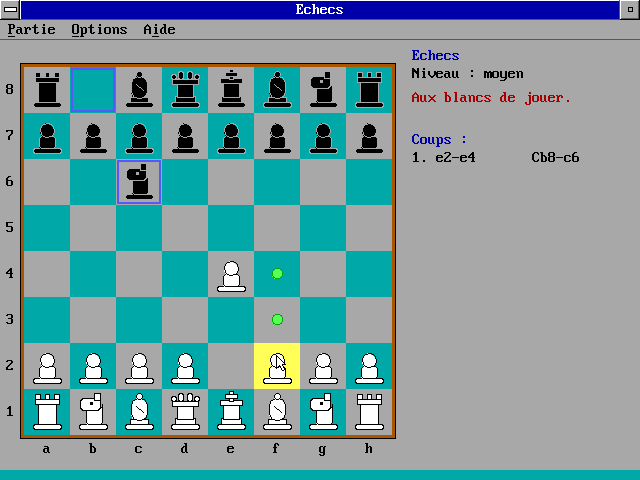

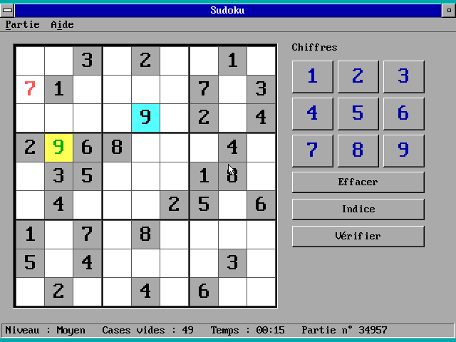
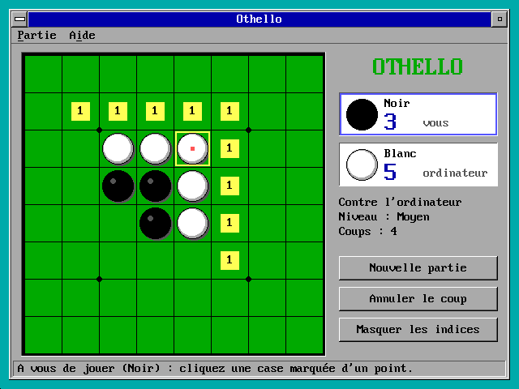
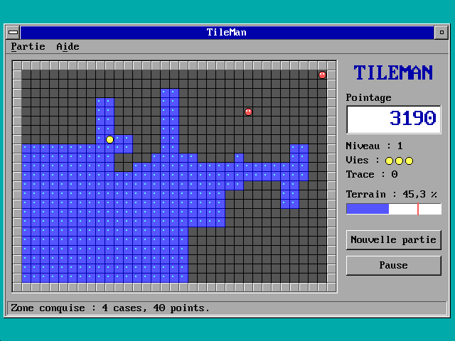
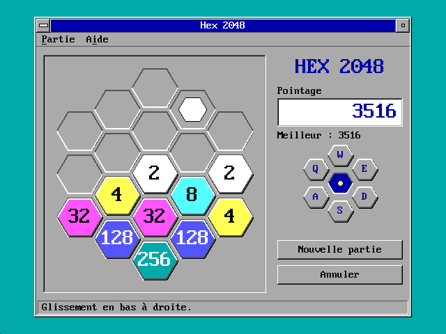
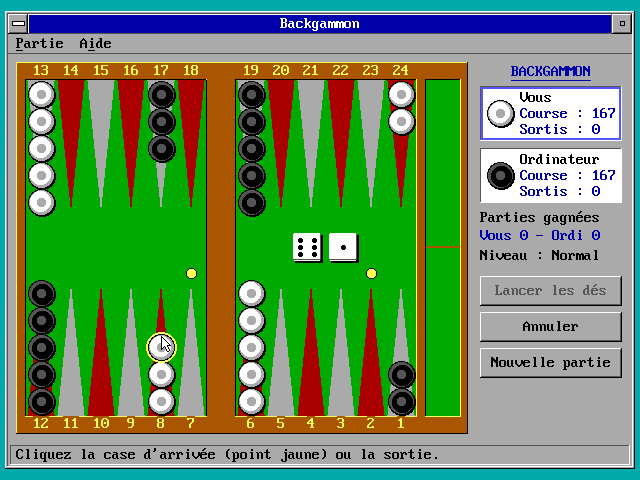
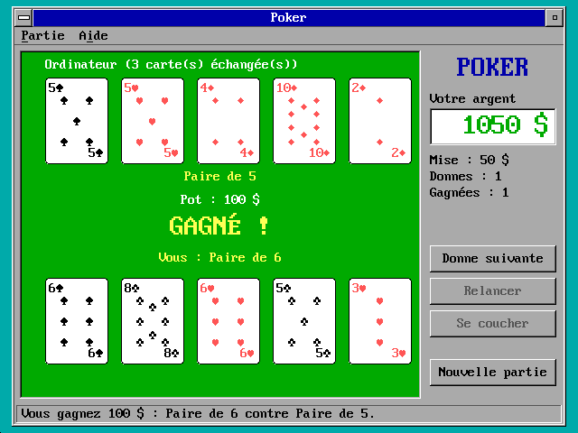

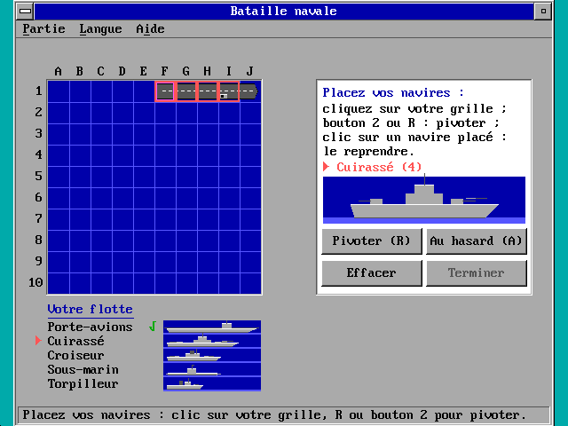

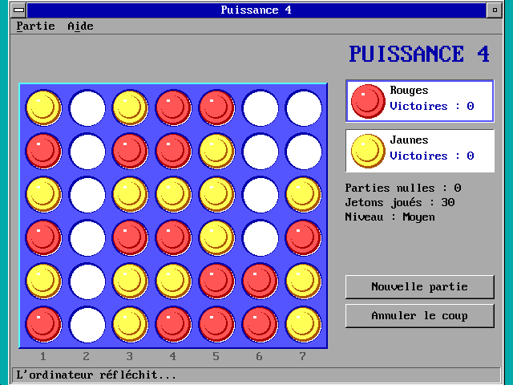
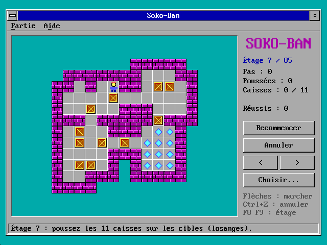

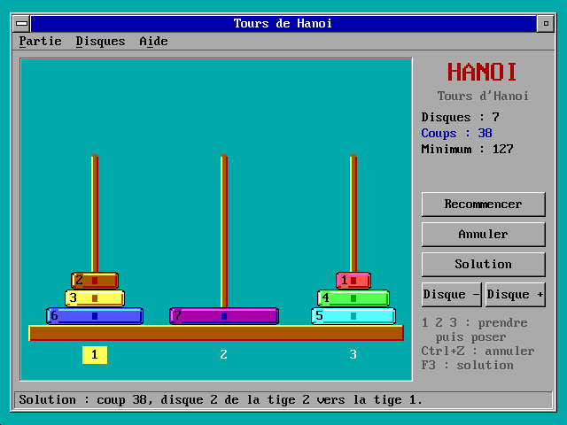

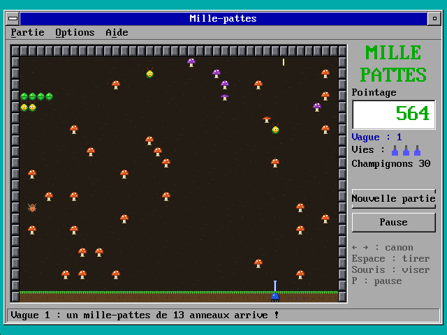
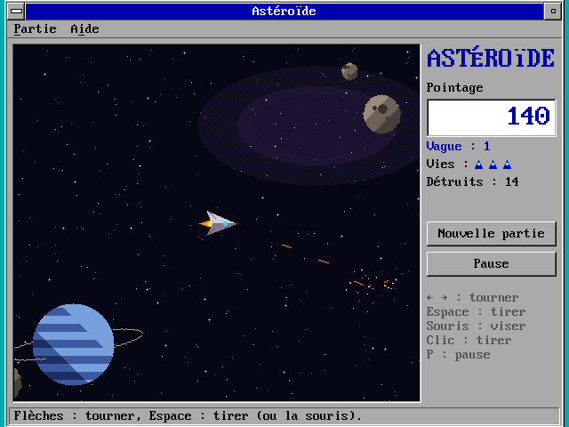
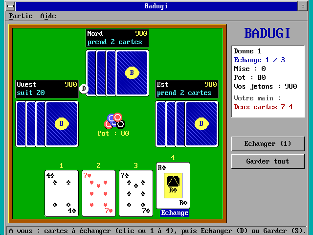

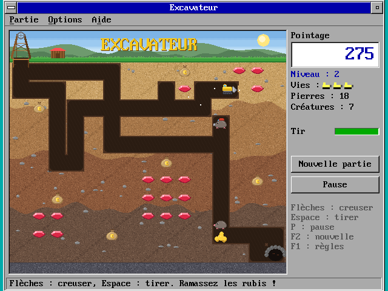
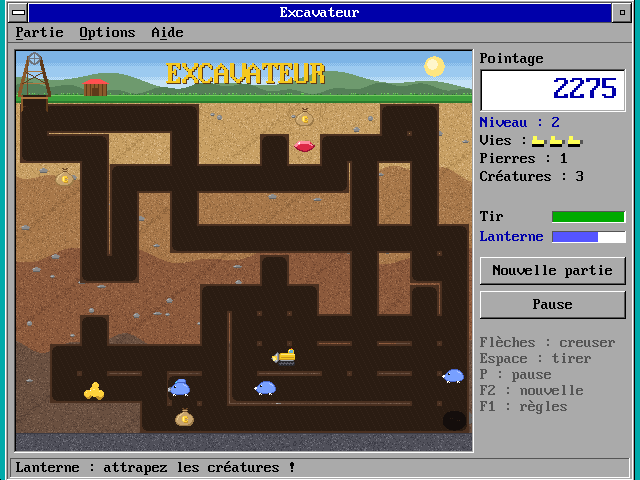
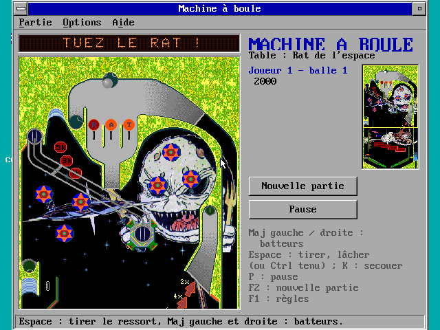
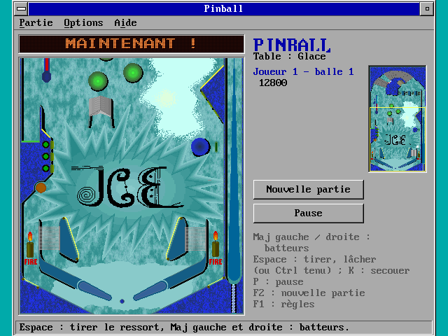

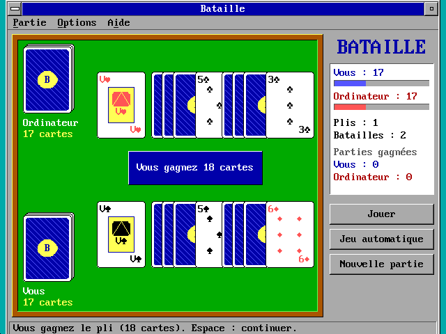
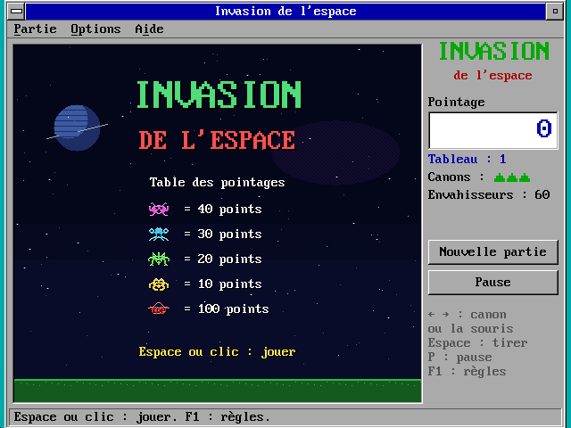
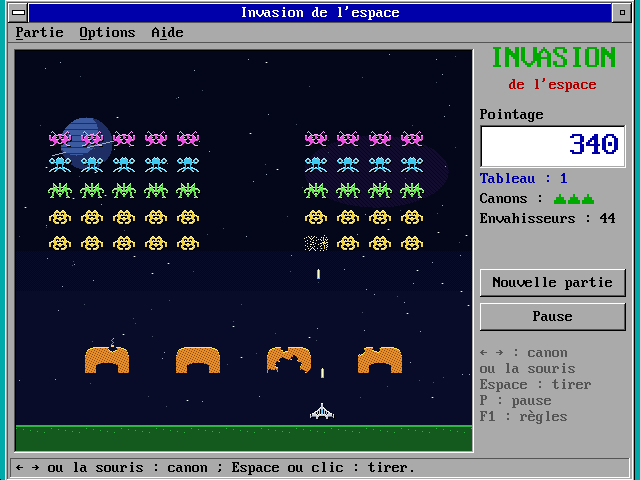

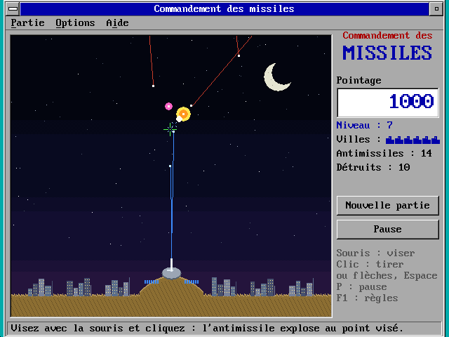
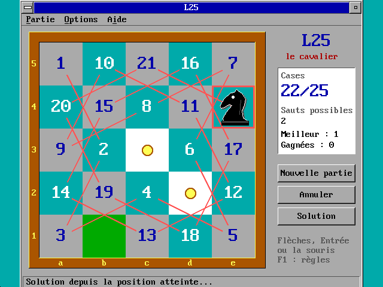

Les chaînes d'OS2PC font au plus 255 caractères : les règles des jeux et plusieurs aides (Othello, Sudoku, Klondike, Navigateur Web, Audio numérique, Pascal Developer, Gestionnaire des tâches…) étaient coupées en plein mot ; le texte est maintenant cumulé dans un tampon (<code>LClr</code>, <code>LAdd</code>) puis affiché par <code>LMsgBox</code>. Un nom de procédure identique à une procédure du Graph intégré d'OS2PC appelle celle d'OS2PC sans message : la fonction <code>Sector</code> d'Hex 2048 démarrait le Graph de Win32 au premier clic sur le plateau et le jeu se fermait (SYS1804 CreateSolidBrush) ; elle s'appelle maintenant <code>DirSector</code>, et les noms des procédures de tous les jeux ont été vérifiés contre la liste des fonctions intégrées d'OS2PC. Écrire ces jeux a fait apparaître des limites d'OS2PC. La borne d'une boucle <code>For</code> était gardée dans une variable statique : dans une fonction récursive (la recherche alpha-bêta des Échecs), un appel intérieur écrasait la borne de la boucle de l'appelant, qui ne se terminait plus. OS2PC la range maintenant dans le cadre de pile de la procédure (une case par <code>For</code> du corps, sous les variables locales) ; seul le programme principal garde une variable statique. Les tableaux à deux dimensions dans un enregistrement et la copie d'enregistrements entiers ne sont pas encore fiables (les jeux utilisent des tableaux globaux à une dimension).

<h2>Compilation</h2>
	
Les fichiers Pascal n'ont aucune dépendances, il suffit de télécharger le fichier désiré et de le compiler avec Free Pascal avec la syntaxe de commande  :

<pre><b>fpc</b> <i>LEFICHIER.PAS</i></pre>
	
Sinon, vous pouvez également le compiler avec le Turbo Pascal à l'aide de la syntaxe de commande suivante :	

<pre><b>tpc</b> <i>LEFICHIER.PAS</i></pre>
	
Par exemple, si vous voulez compiler CMD.PAS, vous devrez tapez la commande suivante :

<pre><b>fpc</b> CMD.PAS</pre>

<h2>Licence</h2>
<ul>
 <li>Le code source est publié sous la licence <a href="https://github.com/gladir/OS2-0/blob/main/LICENSE">MIT</a>.</li>
 <li>Le paquet original est publié sous la licence <a href="https://github.com/gladir/OS2-0/blob/main/LICENSE">MIT</a>.</li>
</ul>
